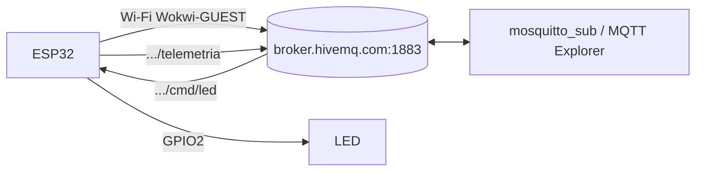

## Checklist — Wi-Fi e MQTT no ESP32 {/* #checklist */}

- [ ] Projeto PlatformIO com plataforma e PubSubClient em **versões fixas**, `diagram.json` com o LED no GPIO2 e `wokwi.toml` (T1)
- [ ] Varredura das redes Wi-Fi no monitor serial (T2)
- [ ] Conexão Wi-Fi em modo estação, com IP e RSSI no serial (T3)
- [ ] Conexão ao broker público com _client ID_ único (T4)
- [ ] Conexão ao broker privado com usuário e senha (T5)
- [ ] Telemetria em JSON a cada 2 s, sem `delay()` (T6)
- [ ] Comando `.../cmd/led` ligando e desligando o LED, com reconexão de Wi-Fi e MQTT no `loop()` (T7)
- [ ] Workflow de CI compilando o firmware a cada `push` (T8)
- [ ] Nenhum `push --force`; cada tarefa num commit `Tn:`
- [ ] Logout do Git e do `gh` no computador do laboratório

:::info[Pontuação]
**T1…T8 = 100 pts** (esta aula não tem desafios): T1 10 · T2 10 · T3 15 · T4 15 · T5 10 ·
T6 15 · T7 15 · T8 10. O autograder normaliza para 0–10. Vale o commit `Tn:` mais recente de
cada tarefa.
:::

<LabSetup />

### Configuração do ambiente de desenvolvimento {/* #setup */}

<DevTools />

---

Até o Lab 03 o ESP32 só falava com o monitor serial. Nesta aula ele entra na rede: conecta ao
**Wi-Fi**, fala com um **broker MQTT**, **publica** telemetria e **recebe** um comando para ligar e
desligar um LED. É a base de todos os labs seguintes: do Lab 05 em diante, o mesmo padrão ganha um
sensor, um temporizador, o Node-RED e um banco de dados.



## Objetivos

- Conectar o ESP32 a uma rede **Wi-Fi** (modo estação) e obter o IP.
- Conectar-se a um **broker MQTT** por host e porta, com e sem usuário e senha.
- **Publicar** dados de telemetria periodicamente em um tópico.
- **Assinar** um tópico e reagir a comandos recebidos (ligar/desligar um LED).
- Tornar a conexão **robusta**, com reconexão de Wi-Fi e MQTT no `loop()`.
- Rodar o mesmo código no **simulador Wokwi** e no **ESP32 físico**, entendendo a diferença entre
  broker **público** e **local**.

## Material

- 1 × ESP32 (ex.: DevKit v1) **ou** o simulador **Wokwi**.
- 1 × LED + resistor de 220 Ω (para o comando remoto).
- Uma rede **Wi-Fi** (real, para o ESP32 físico; no Wokwi, a `Wokwi-GUEST`).
- Um **broker MQTT**:
  - **Público** (para o Wokwi): `broker.hivemq.com:1883`.
  - **Privado** (para o Wokwi): `mqtt.adrianoruseler.com:1883`, com usuário e senha fornecidos
    pelo professor.
  - **Local** (para o ESP32 físico): o **Mosquitto** do stack Docker do curso, no IP da sua
    máquina na rede (ex.: `192.168.0.10:1883`). O Wokwi não alcança um broker local.

## Clonar o repositório do grupo {/* #clonar */}

<LabTeamMembers labName="lab04" />

## Envie o link do repositório do seu grupo no Moodle: {/* #moodle-link */}

<LabSubmit labName="lab04" />

<details>
<summary><strong>Mapa de tarefas</strong> — 8 tarefas · 100 pts</summary>

- [T1 — Projeto PlatformIO e Wokwi](#t1) · 10 pts
- [T2 — Varredura das redes Wi-Fi](#t2) · 10 pts
- [T3 — Conexao Wi-Fi](#t3) · 15 pts
- [T4 — Conexao ao broker MQTT](#t4) · 15 pts
- [T5 — Broker MQTT com usuario e senha](#t5) · 10 pts
- [T6 — Telemetria periodica](#t6) · 15 pts
- [T7 — Comando remoto do LED](#t7) · 15 pts
- [T8 — CI no GitHub Actions](#t8) · 10 pts

</details>

<FileTree
  details={true}
  defaultOpen={false}
  title="Estrutura de Arquivos do Projeto (no fim da aula)"
  root="lab04-grupo-x"
  files={[
    "platformio.ini c",
    "src/main.cpp c",
    "diagram.json c",
    "wokwi.toml c",
    ".github/workflows/ci.yml c",
    "README.md u",
  ]}
/>

:::info[Tópicos do Lab 04]
Tudo fica sob `elt73a/lab04/grupo-x/`. Troque o `x` (e o `#define GRUPO`) pela letra do seu grupo.

| Tópico           | Sentido        | Payload                     |
| ---------------- | -------------- | --------------------------- |
| `.../telemetria` | ESP32 → broker | `{"n":7,"temp":32.00}` (T6) |
| `.../cmd/led`    | broker → ESP32 | `on`/`off` ou `1`/`0` (T7)  |

:::

---

## Parte 1 — Projeto PlatformIO e Wokwi {/* #parte-1 */}

:::info[Suba o stack do LAB04!]
Execute os comandos para subir o [stack do LAB04](/infra/setup/gen_iot_aluno#lab-04)!
:::

### 1.1 Criar o projeto

Na raiz do repositório, como no Lab 02:

```shell title="Terminal do VS Code (cmd)"
pio project init -b esp32dev -O "framework=arduino" -O "monitor_speed=115200" --sample-code
```

O `--sample-code` cria um `src/main.cpp` de exemplo: o projeto já compila no commit da T1, e na T2
você o substitui.

A biblioteca `WiFi.h` já vem no core do ESP32. Fixe a plataforma (como no Lab 02) e acrescente o
cliente MQTT (**PubSubClient**), também com versão fixa:

<FileTree root="lab04-grupo-x" files={["platformio.ini c"]} />

```ini title="platformio.ini"
[env:esp32dev]
platform = espressif32@6.9.0       ; versão fixa (Lab 02)
board = esp32dev
framework = arduino
monitor_speed = 115200
#highlight-start
lib_deps =
    knolleary/PubSubClient@2.8
#highlight-end
```

### 1.2 Circuito no Wokwi (LED do comando)

O circuito é o do Lab 02: LED no GPIO2 com um resistor de 220 Ω. Ele só será usado na T7.

<FileTree root="lab04-grupo-x" files={["diagram.json c", "wokwi.toml c"]} />

<Tabs>
<TabItem value="diagram" label="diagram.json" default>

```json title="diagram.json"
{
  "version": 1,
  "author": "elt73a - Lab 04",
  "editor": "wokwi",
  "parts": [
    {
      "type": "board-esp32-devkit-c-v4",
      "id": "esp",
      "top": 0,
      "left": 0,
      "attrs": {}
    },
    {
      "type": "wokwi-resistor",
      "id": "r1",
      "top": 130,
      "left": 120,
      "attrs": { "value": "220" }
    },
    {
      "type": "wokwi-led",
      "id": "led1",
      "top": 80,
      "left": 220,
      "attrs": { "color": "red", "label": "GPIO2" }
    }
  ],
  "connections": [
    ["esp:TX", "$serialMonitor:RX", "", []],
    ["esp:RX", "$serialMonitor:TX", "", []],
    ["esp:2", "r1:1", "green", []],
    ["r1:2", "led1:A", "green", []],
    ["led1:C", "esp:GND.2", "black", []]
  ],
  "dependencies": {}
}
```

</TabItem>
<TabItem value="wokwi" label="wokwi.toml">

```toml title="wokwi.toml"
[wokwi]
version = 1
firmware = '.pio/build/esp32dev/firmware.bin'
elf = '.pio/build/esp32dev/firmware.elf'
gdbServerPort = 3333
```

</TabItem>
</Tabs>

### 1.3 Validar o diagrama

O `wokwi-cli` não fica instalado no Windows: ele roda na imagem Docker que você montou no Lab 02.
Na raiz do repositório:

```shell title="Terminal do VS Code (cmd)"
docker run --rm -v "%cd%:/projeto" -w /projeto elt73a/esp32-dev:lab02 wokwi-cli lint .
```

Se o Docker responder que a imagem não existe, rode `docker compose build` na pasta do repositório
do Lab 02 e tente de novo.

<CommitPoint
  id="t1"
  task="Projeto PlatformIO e Wokwi"
  pontos={10}
  files="platformio.ini src/main.cpp diagram.json wokwi.toml"
/>

---

## Parte 2 — Varredura das redes Wi-Fi {/* #parte-2 */}

- [ESP32 WiFi simulation](https://docs.wokwi.com/guides/esp32-wifi)
- [ESP32 WiFi Scanning example](https://wokwi.com/projects/305569599398609473)

<FileTree root="lab04-grupo-x" files={["src/main.cpp c"]} />

```cpp title="src/main.cpp (T2)"
/* ESP32 WiFi Scanning example */
// highlight-next-line
#include <Arduino.h>
#include "WiFi.h"

void setup() {
  Serial.begin(115200);
  Serial.println("Initializing WiFi...");
  WiFi.mode(WIFI_STA);
  Serial.println("Setup done!");
}

void loop() {
  Serial.println("Scanning...");

  // WiFi.scanNetworks will return the number of networks found
  int n = WiFi.scanNetworks();
  Serial.println("Scan done!");
  if (n == 0) {
    Serial.println("No networks found.");
  } else {
    Serial.println();
    Serial.print(n);
    Serial.println(" networks found");
    for (int i = 0; i < n; ++i) {
      // Print SSID and RSSI for each network found
      Serial.print(i + 1);
      Serial.print(": ");
      Serial.print(WiFi.SSID(i));
      Serial.print(" (");
      Serial.print(WiFi.RSSI(i));
      Serial.print(")");
      Serial.println((WiFi.encryptionType(i) == WIFI_AUTH_OPEN) ? " " : "*");
      delay(10);
    }
  }
  Serial.println("");

  // Wait a bit before scanning again
  delay(5000);
}
```

Compile (`pio run`) e rode **Wokwi: Start Simulator**: a `Wokwi-GUEST` aparece na lista.

<CommitPoint
  id="t2"
  task="Varredura das redes Wi-Fi"
  pontos={10}
  files="src/main.cpp"
/>

---

## Parte 3 — Conectar ao Wi-Fi {/* #parte-3 */}

Modo estação (`WIFI_STA`), `WiFi.begin()` e espera até `WL_CONNECTED`.

<FileTree root="lab04-grupo-x" files={["src/main.cpp u"]} />

```cpp title="src/main.cpp (T3)"
// highlight-next-line
#include <Arduino.h>
#include <WiFi.h>

const char *WIFI_SSID = "Wokwi-GUEST";
const char *WIFI_SENHA = "";
// placa física: troque pela rede real
// const char *WIFI_SSID = "IoT-Broker";
// const char *WIFI_SENHA = "ESP32IoTLab";

void conectaWiFi() {
  Serial.print("Conectando a "); Serial.println(WIFI_SSID);
  WiFi.mode(WIFI_STA);
  WiFi.begin(WIFI_SSID, WIFI_SENHA);
  while (WiFi.status() != WL_CONNECTED) {
    delay(300);
    Serial.print(".");
  }
  Serial.println();
  Serial.print("Conectado! IP: "); Serial.println(WiFi.localIP());
  Serial.print("RSSI: ");           Serial.println(WiFi.RSSI());
}

void setup() {
  Serial.begin(115200);
  delay(1000);
  conectaWiFi();
}

void loop() {}
```

Saída esperada (o IP e o RSSI variam):

```text title="Monitor serial"
Conectando a Wokwi-GUEST
....
Conectado! IP: 10.13.37.2
RSSI: -30
```

<CommitPoint id="t3" task="Conexao Wi-Fi" pontos={15} files="src/main.cpp" />

---

## Parte 4 — Conectar ao broker MQTT {/* #parte-4 */}

O `PubSubClient` usa um `WiFiClient` por baixo. Definimos o servidor e tentamos conectar com um
**client id único**: dois clientes com o mesmo ID no mesmo broker se derrubam mutuamente.

<FileTree root="lab04-grupo-x" files={["src/main.cpp u"]} />

```cpp title="src/main.cpp (T4)"
#include <Arduino.h>
#include <WiFi.h>
#include <PubSubClient.h>

const char *WIFI_SSID = "Wokwi-GUEST";
const char *WIFI_SENHA = "";
const char *MQTT_HOST = "broker.hivemq.com";
const uint16_t MQTT_PORTA = 1883;

WiFiClient   wifiClient;
PubSubClient mqtt(wifiClient);

void conectaWiFi() {
  WiFi.mode(WIFI_STA);
  WiFi.begin(WIFI_SSID, WIFI_SENHA);
  while (WiFi.status() != WL_CONNECTED) { delay(300); Serial.print("."); }
  Serial.print("\nWiFi OK, IP: "); Serial.println(WiFi.localIP());
}

void conectaMQTT() {
  while (!mqtt.connected()) {
    String clientId = "esp32-" + String(random(0xffff), HEX);
    Serial.print("Conectando ao broker MQTT... ");
    if (mqtt.connect(clientId.c_str())) {
      Serial.println("conectado!");
    } else {
      Serial.print("falhou (rc="); Serial.print(mqtt.state());
      Serial.println("), nova tentativa em 2s");
      delay(2000);
    }
  }
}

void setup() {
  Serial.begin(115200);
  delay(1000);
  conectaWiFi();
  mqtt.setServer(MQTT_HOST, MQTT_PORTA);
  conectaMQTT();
}

void loop() {
  mqtt.loop();
}
```

Saída esperada:

```text title="Monitor serial"
....
WiFi OK, IP: 10.13.37.2
Conectando ao broker MQTT... conectado!
```

:::note[Código de retorno (rc)]
Se falhar, `mqtt.state()` dá a pista: `-2` = não alcançou o servidor (host/porta errados ou sem
rede), `-4` = timeout, `5` = não autorizado. Muito útil para depurar.
:::

:::tip[Placa física com broker local]
Na placa física, troque o SSID e a senha pela rede real e o `MQTT_HOST` pelo **IP da máquina** onde
o stack do curso roda (o Mosquitto escuta na porta `1883`). O computador e o ESP32 precisam estar
na mesma rede.
:::

<CommitPoint
  id="t4"
  task="Conexao ao broker MQTT"
  pontos={15}
  files="src/main.cpp"
/>

---

## Parte 5 — Broker MQTT com usuário e senha {/* #parte-5 */}

O broker privado do curso pede usuário e senha. Muda só o `connect()`, que passa a receber as
credenciais. Use o usuário e a senha fornecidos pelo professor (nunca a senha de uma conta sua).

<FileTree root="lab04-grupo-x" files={["src/main.cpp u"]} />

```cpp title="src/main.cpp (T5: o que muda em relação à T4)"
const char *MQTT_HOST = "mqtt.adrianoruseler.com";
const uint16_t MQTT_PORTA = 1883;

// credenciais do broker (fornecidas pelo professor)
const char *MQTT_USER = "seu_usuario";
const char *MQTT_PASS = "sua_senha";

// em conectaMQTT():
    if (mqtt.connect(clientId.c_str(), MQTT_USER, MQTT_PASS)) {
```

Saída esperada: a mesma da T4. Com a senha errada, o `rc` é `5` (não autorizado).

<CommitPoint
  id="t5"
  task="Broker MQTT com usuario e senha"
  pontos={10}
  files="src/main.cpp"
/>

---

## Parte 6 — Publicar telemetria {/* #parte-6 */}

Publique uma mensagem a cada 2 s, sem `delay()` bloqueante (usando `millis()`, como no Lab 02).
Use o código da T4 (broker público) e acrescente o tópico, trocando o grupo pelo **seu**:

```cpp
const char *TOPICO_TELEMETRIA = "elt73a/lab04/grupo-a/telemetria";  // troque 'grupo-a'!
```

E use este `loop()`:

```cpp title="src/main.cpp (T6: loop)"
void loop() {
  if (!mqtt.connected()) conectaMQTT();
  mqtt.loop();

  static unsigned long ultimo = 0;
  if (millis() - ultimo >= 2000) {
    ultimo = millis();

    static int n = 0;
    n++;
    float temp = 25.0 + (n % 10);   // leitura simulada

    char payload[64];
    snprintf(payload, sizeof(payload), "{\"n\":%d,\"temp\":%.2f}", n, temp);
    mqtt.publish(TOPICO_TELEMETRIA, payload);
    Serial.print("Publicado: "); Serial.println(payload);
  }
}
```

Saída esperada (a cada 2 s):

```text title="Monitor serial"
Publicado: {"n":1,"temp":26.00}
Publicado: {"n":2,"temp":27.00}
Publicado: {"n":3,"temp":28.00}
```

Veja as mensagens chegando no **MQTT Explorer** do stack (`http://localhost:3000`, conectado a
`broker.hivemq.com:1883`) ou pelo terminal:

<GroupCommands
  commands={[
    {
      codeTitle: "Terminal — assinar via Docker",
      command: `docker run --rm eclipse-mosquitto:2 mosquitto_sub -h broker.hivemq.com -t "{course}/lab04/grupo-{group}/#" -v`,
    },
  ]}
/>

<CommitPoint
  id="t6"
  task="Telemetria periodica"
  pontos={15}
  files="src/main.cpp"
/>

---

## Parte 7 — Comando remoto do LED {/* #parte-7 */}

Agora o ESP32 também **assina** um tópico. Quando chega uma mensagem, o PubSubClient chama uma
função sua (o _callback_) dentro do `mqtt.loop()`. Dois cuidados:

- o payload **não** termina com `'\0'`: copie para um buffer e termine a string antes de comparar;
- **assine dentro de `conectaMQTT()`**: a sessão é limpa, então depois de uma reconexão o broker não
  lembra das assinaturas antigas.

E a conexão fica robusta: o `loop()` confere o Wi-Fi e o MQTT a cada volta e reconecta o que caiu.

<FileTree root="lab04-grupo-x" files={["src/main.cpp u"]} />

```cpp title="src/main.cpp (T7: código completo)"
#include <Arduino.h>
#include <WiFi.h>
#include <PubSubClient.h>

#define GRUPO   "a"                      // troque pela letra do seu grupo
#define LED_PIN 2

const char *WIFI_SSID = "Wokwi-GUEST";
const char *WIFI_SENHA = "";
const char *MQTT_HOST = "broker.hivemq.com";
const uint16_t MQTT_PORTA = 1883;

const char *TOPICO_TELEMETRIA = "elt73a/lab04/grupo-" GRUPO "/telemetria";
const char *TOPICO_CMD_LED    = "elt73a/lab04/grupo-" GRUPO "/cmd/led";

WiFiClient   wifiClient;
PubSubClient mqtt(wifiClient);

// chamada pelo PubSubClient, dentro de mqtt.loop(), a cada mensagem num tópico assinado
void aoReceberMensagem(char *topico, byte *payload, unsigned int tam) {
  char txt[8];
  size_t n = tam < sizeof(txt) - 1 ? tam : sizeof(txt) - 1;
  memcpy(txt, payload, n);
  txt[n] = '\0';                         // o payload não termina em '\0'
  Serial.printf("[CMD] %s <- '%s'\r\n", topico, txt);

  if (strcmp(txt, "on") == 0 || strcmp(txt, "1") == 0) {
    digitalWrite(LED_PIN, HIGH);
  } else if (strcmp(txt, "off") == 0 || strcmp(txt, "0") == 0) {
    digitalWrite(LED_PIN, LOW);
  } else {
    Serial.println("[CMD] use on/off ou 1/0");
  }
}

void conectaWiFi() {
  Serial.print("Conectando a "); Serial.println(WIFI_SSID);
  WiFi.mode(WIFI_STA);
  WiFi.begin(WIFI_SSID, WIFI_SENHA);
  while (WiFi.status() != WL_CONNECTED) { delay(300); Serial.print("."); }
  Serial.print("\nWiFi OK, IP: "); Serial.println(WiFi.localIP());
}

void conectaMQTT() {
  while (!mqtt.connected()) {
    String clientId = "esp32-" + String(random(0xffff), HEX);
    Serial.print("Conectando ao broker MQTT... ");
    if (mqtt.connect(clientId.c_str())) {
      Serial.println("conectado!");
      mqtt.subscribe(TOPICO_CMD_LED);    // (re)assina a cada conexão
    } else {
      Serial.print("falhou (rc="); Serial.print(mqtt.state());
      Serial.println("), nova tentativa em 2s");
      delay(2000);
    }
  }
}

void setup() {
  Serial.begin(115200);
  delay(1000);
  pinMode(LED_PIN, OUTPUT);
  conectaWiFi();
  mqtt.setServer(MQTT_HOST, MQTT_PORTA);
  mqtt.setCallback(aoReceberMensagem);
  conectaMQTT();
}

void loop() {
  if (WiFi.status() != WL_CONNECTED) conectaWiFi();   // reconexão do Wi-Fi
  if (!mqtt.connected()) conectaMQTT();               // reconexão do MQTT
  mqtt.loop();

  static unsigned long ultimo = 0;
  if (millis() - ultimo >= 2000) {
    ultimo = millis();
    static int n = 0;
    n++;
    float temp = 25.0 + (n % 10);        // leitura simulada
    char payload[64];
    snprintf(payload, sizeof(payload), "{\"n\":%d,\"temp\":%.2f}", n, temp);
    mqtt.publish(TOPICO_TELEMETRIA, payload);
    Serial.print("Publicado: "); Serial.println(payload);
  }
}
```

Com a simulação rodando, mande os comandos pelo terminal e veja o LED no Wokwi:

<GroupCommands
  commands={[
    {
      codeTitle: "Terminal — ligar e desligar o LED via Docker",
      command: `docker run --rm eclipse-mosquitto:2 mosquitto_pub -h broker.hivemq.com -t "{course}/lab04/grupo-{group}/cmd/led" -m on
docker run --rm eclipse-mosquitto:2 mosquitto_pub -h broker.hivemq.com -t "{course}/lab04/grupo-{group}/cmd/led" -m off
docker run --rm eclipse-mosquitto:2 mosquitto_pub -h broker.hivemq.com -t "{course}/lab04/grupo-{group}/cmd/led" -m talvez`,
    },
  ]}
/>

```text title="Monitor serial (trecho)"
Publicado: {"n":7,"temp":32.00}
[CMD] elt73a/lab04/grupo-a/cmd/led <- 'on'
Publicado: {"n":8,"temp":33.00}
[CMD] elt73a/lab04/grupo-a/cmd/led <- 'off'
[CMD] elt73a/lab04/grupo-a/cmd/led <- 'talvez'
[CMD] use on/off ou 1/0
```

<CommitPoint
  id="t7"
  task="Comando remoto do LED"
  pontos={15}
  files="src/main.cpp"
/>

---

## Parte 8 — CI no GitHub Actions {/* #parte-8 */}

Um workflow que compila o firmware a cada `push`. Se o código parar de compilar, a execução fica
vermelha na aba **Actions**. O Lab 10 completa este pipeline com testes, simulação e _release_.

<FileTree
  root="lab04-grupo-x"
  files={[".github/workflows/ci.yml c", "...", "src/main.cpp"]}
/>

```yaml title=".github/workflows/ci.yml"
name: CI

on: [push, pull_request]

env:
  PLATFORMIO_VERSAO: "6.2.0" # versão fixa, como a plataforma no platformio.ini

jobs:
  build:
    runs-on: ubuntu-latest
    steps:
      - uses: actions/checkout@v7

      - uses: actions/setup-python@v7
        with:
          python-version: "3.12"

      - name: Cache do PlatformIO
        uses: actions/cache@v6
        with:
          path: |
            ~/.platformio
            ~/.cache/pip
          key: pio-${{ runner.os }}-${{ env.PLATFORMIO_VERSAO }}-${{ hashFiles('platformio.ini') }}

      - name: Instala o PlatformIO
        run: pip install "platformio==${PLATFORMIO_VERSAO}"

      - name: Compila o firmware
        run: pio run
```

:::note[Por que `ci.yml`?]
O nome `ci.yml` é o mesmo do Lab 10 e não se confunde com o workflow do autograder que vem no
template do repositório. Não apague nem renomeie os arquivos que já estão em `.github/`.
:::

<CommitPoint
  id="t8"
  task="CI no GitHub Actions"
  pontos={10}
  files=".github/workflows/ci.yml"
/>

---

## Logout do seu ambiente dev, git e gh {/* #logout */}

<LabLogout />
