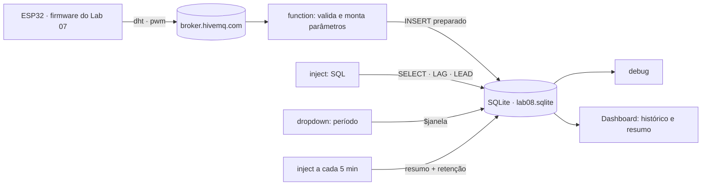
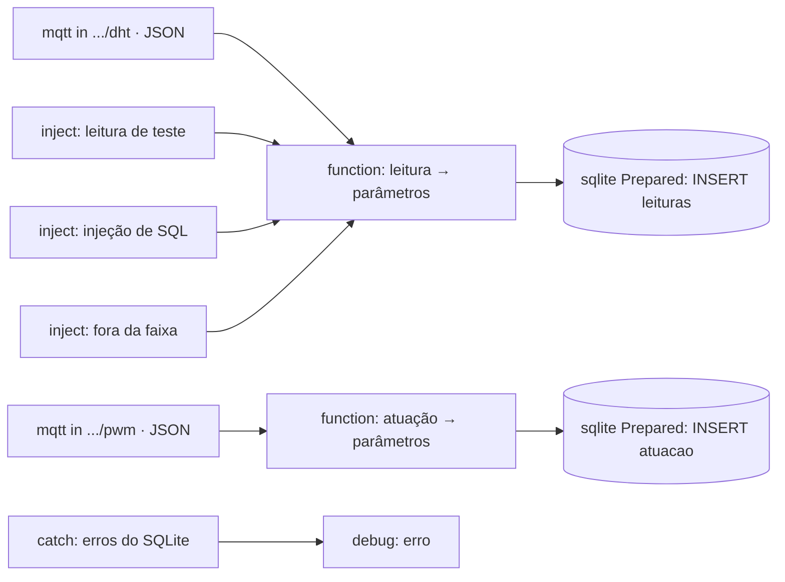
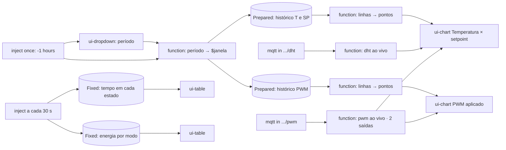

## Checklist — Node-RED e SQLite: gravar, consultar e manter {/* #checklist */}

- [ ] Firmware do Lab 07 publicando em `elt73a/lab08/...`; banco `lab08.sqlite` com as tabelas `leituras` e `atuacao` criadas em modo _Batch_ (T1)
- [ ] Gravação com INSERT preparado, validação na function e `CHECK` no banco; ataque de injeção de SQL gravado como texto (T2)
- [ ] Consultas das leituras: resumo por minuto (`GROUP BY`), falhas na sequência e intervalo real (`LAG()`) (T3)
- [ ] Consultas da atuação: tempo em cada estado, energia por modo e trocas do aquecedor (`LEAD()`, `LAG()`) (T4)
- [ ] Dashboard com histórico vindo do banco, período escolhido por _dropdown_ (`$janela`) e tabelas de resumo (T5)
- [ ] Manutenção: índice e plano de consulta, resumo por minuto, retenção em transação e `VACUUM` (T6)
- [ ] Previsões P1–P5 respondidas no `README.md`
- [ ] Nenhum `push --force`; cada tarefa num commit `Tn:`

:::info[Pontuação]
**T1…T6 = 100 pts** (esta aula não tem desafios): T1 10 · T2 20 · T3 15 · T4 15 · T5 20 ·
T6 20. O autograder normaliza para 0–10. Vale o commit `Tn:` mais recente de cada tarefa.
:::

<LabSetup />

### Configuração do ambiente de desenvolvimento {/* #setup */}

<DevTools />

---

Nos Labs 06 e 07 o Node-RED só **mostrava** o presente: a tela do OLED, o estado dos atuadores, os
sliders. Bastava fechar o dashboard para tudo sumir. Nesta aula o firmware **não muda** (é o do
Lab 07, só com os tópicos em `lab08`). Quem trabalha é o **Node-RED**, que passa a **guardar**
tudo num banco **SQLite** e a responder perguntas sobre o passado:

- alguma leitura se perdeu? o ESP32 reiniciou?
- quanto tempo o controle ficou aquecendo, e quanta **energia** o aquecedor gastou?
- como era a temperatura **na última hora**, mesmo com o dashboard fechado?
- e o banco: ele cresce para sempre? quanto ocupa? as consultas continuam rápidas?



## Objetivos

- Criar um **esquema** com tipos, valores padrão e restrições `CHECK`, e saber quando usar cada
  modo do nó **sqlite** (_Via msg.topic_, _Fixed_, _Prepared_, _Batch_).
- Gravar dados vindos do MQTT com **INSERT preparado**, validando no Node-RED **e** no banco, e
  ver na prática por que concatenar SQL é perigoso.
- Responder perguntas com **SQL**: `GROUP BY`, funções de janela `LAG()` e `LEAD()`,
  `UNION ALL` e médias ponderadas pelo tempo.
- Montar um **dashboard** que carrega o histórico do banco, com consulta **parametrizada**.
- **Manter** o banco: índice e `EXPLAIN QUERY PLAN`, tabela de resumo, retenção dentro de uma
  **transação** e `VACUUM`.

## Material

- VS Code + PlatformIO + extensão **Wokwi** (ESP32 **simulado**), com o circuito do Lab 07.
- Stack Docker do curso: **Node-RED** com `node-red-node-sqlite` e o **Dashboard 2.0**, já
  instalados na imagem.
- O `mosquitto_pub` via Docker (`eclipse-mosquitto:2`), como nos labs anteriores.
- **Nenhuma biblioteca nova** no firmware.

:::info[Onde o banco fica]
O SQLite é **um arquivo**. O banco desta aula é `/data/sqlite/lab08.sqlite` **dentro** do
container do Node-RED. Como `/data` é uma pasta montada do seu computador, o arquivo sobrevive a
um restart e você pode copiá-lo. Se o Node-RED reclamar `failed to open /data/sqlite/...`, a pasta
`sqlite` não existe: crie-a (`docker exec <container-do-node-red> mkdir -p /data/sqlite`) e faça
o _Deploy_ de novo.
:::

## Clonar o repositório do grupo {/* #clonar */}

<LabTeamMembers labName="lab08" />

## Envie o link do repositório do seu grupo no Moodle: {/* #moodle-link */}

<LabSubmit labName="lab08" />

<details>
<summary><strong>Mapa de tarefas</strong> — 6 tarefas · 100 pts</summary>

- [T1 — Banco e esquema](#t1) · 10 pts
- [T2 — Gravacao segura](#t2) · 20 pts
- [T3 — Consultas das leituras](#t3) · 15 pts
- [T4 — Tempo e energia com LEAD](#t4) · 15 pts
- [T5 — Dashboard com historico do banco](#t5) · 20 pts
- [T6 — Manutencao do banco](#t6) · 20 pts

</details>

O repositório do grupo nasce do `lab08-template`, que já traz o **firmware final do Lab 07**
(ADC + PWM + modos `pot`/`remoto`/`auto`) e o circuito:

<FileTree
  details={true}
  defaultOpen={false}
  title="Estrutura de Arquivos do Projeto"
  root="lab08-grupo-X"
  files={[
    "platformio.ini r",
    "src/main.cpp u",
    "diagram.json r",
    "wokwi.toml r",
    ".gitignore r",
    ".vscode/extensions.json r",
    "nodered/flows-lab08.json c",
    "evidencias/t1-esquema.txt c",
    "evidencias/t2-sqlite.txt c",
    "evidencias/t3-consultas.txt c",
    "evidencias/t4-energia.txt c",
    "evidencias/t5-dashboard.png c",
    "evidencias/t6-plano.txt c",
    "evidencias/t6-manutencao.txt c",
    "README.md u",
  ]}
/>

:::info[Tópicos do Lab 08]
Os mesmos do Lab 07, sob `elt73a/lab08/grupo-X/`. Nesta aula o Node-RED **assina** dois deles e
grava cada mensagem:

| Tópico    | Vira uma linha em | Quando chega                                    |
| --------- | ----------------- | ----------------------------------------------- |
| `.../dht` | `leituras`        | a cada leitura do DHT22 (5 s, ou o `intervalo`) |
| `.../pwm` | `atuacao`         | a cada **mudança** dos atuadores (evento)       |

Para comandar o ESP32 (modo, intervalo) use o `mosquitto_pub`, como na T4 do Lab 07.
:::

### Copiando a evidência do debug

Quase todas as evidências desta aula são **resultados de consultas**. No painel **debug** do
Node-RED, passe o mouse sobre a mensagem e clique em **Copy value** (o ícone de copiar). Cole no
arquivo `.txt` da tarefa, com uma linha de título antes de cada consulta:

```text title="Formato das evidências (exemplo)"
## Últimas 10 leituras
[{"id":42,"recebido_em":"2026-10-20 15:53:10.193","grupo":"a","seq":30, ... }]
```

---

## Parte 1 — Banco e esquema {/* #parte-1 */}

### 1.1 Firmware no Lab 08

O firmware é o do Lab 07, sem nenhuma mudança de lógica. Só os tópicos e os textos passam para
`lab08`. No VS Code, em `src/main.cpp`, use **Ctrl+H** com **Match Case** ligado (Alt+C) e troque
`lab07` → `lab08` (`BASE` e `clientId`) e `LAB07` → `LAB08` (a tela e o espelho em texto).
Aproveite e troque também o `Lab 07` do banner do serial.

```cpp title="src/main.cpp (linhas que mudam)"
#define BASE "elt73a/lab08/grupo-" GRUPO
// ...
  oled.print("LAB08 grupo " GRUPO);
// ...
  snprintf(clientId, sizeof(clientId), "lab08-%s-%04X", GRUPO, (uint16_t)(mac >> 32));
```

Rode no Wokwi e confira no serial `[PUB] ok elt73a/lab08/grupo-a/dht -> {...}`.

### 1.2 Os quatro modos do nó sqlite

Todos os nós **sqlite** desta aula usam o mesmo nó de configuração **sqlitedb**: _Database_
**`/data/sqlite/lab08.sqlite`**, _Mode_ **Read-Write-Create**. O que muda é o **SQL Query**:

| Modo                       | De onde vem o SQL | Parâmetros             | Executa                                      | Use para                                     |
| -------------------------- | ----------------- | ---------------------- | -------------------------------------------- | -------------------------------------------- |
| **Via msg.topic**          | `msg.topic`       | não                    | **só o primeiro** comando; devolve as linhas | consultas disparadas por `inject`            |
| **Fixed Statement**        | escrito no nó     | não                    | um comando; devolve as linhas                | a mesma consulta, sempre                     |
| **Prepared Statement**     | escrito no nó     | `msg.params` (`$nome`) | um comando; devolve as linhas                | **tudo o que vem de fora** (MQTT, dashboard) |
| **Batch without response** | `msg.topic`       | não                    | **todos** os comandos, separados por `;`     | criar o esquema, manutenção                  |

:::warning[A armadilha do Via msg.topic]
Mande dois `CREATE TABLE` num só `msg.topic` com o modo _Via msg.topic_ e **só a primeira tabela
é criada**, sem erro nenhum. Para vários comandos, use **Batch**.
:::

### 1.3 Esquema

Crie um **inject** "Criar tabelas" (_Inject once after_ 0,5 s) com o SQL abaixo em `msg.topic`,
ligado a um **sqlite** em modo **Batch without response**:

```sql title="msg.topic do inject 'Criar tabelas' (modo Batch)"
CREATE TABLE IF NOT EXISTS leituras (
    id          INTEGER PRIMARY KEY AUTOINCREMENT,
    recebido_em TEXT NOT NULL DEFAULT (strftime('%Y-%m-%d %H:%M:%f', 'now', 'localtime')),
    grupo       TEXT NOT NULL,
    seq         INTEGER,
    t           REAL NOT NULL CHECK (t BETWEEN -40 AND 80),
    h           REAL NOT NULL CHECK (h BETWEEN 0 AND 100),
    uptime_ms   INTEGER,
    intervalo_s REAL,
    origem      TEXT NOT NULL DEFAULT 'esp32' CHECK (origem IN ('esp32', 'manual'))
);

CREATE TABLE IF NOT EXISTS atuacao (
    id          INTEGER PRIMARY KEY AUTOINCREMENT,
    recebido_em TEXT NOT NULL DEFAULT (strftime('%Y-%m-%d %H:%M:%f', 'now', 'localtime')),
    modo        TEXT NOT NULL CHECK (modo IN ('pot', 'remoto', 'auto')),
    estado      TEXT,
    aq          REAL NOT NULL CHECK (aq BETWEEN 0 AND 100),
    ve          REAL NOT NULL CHECK (ve BETWEEN 0 AND 100),
    aq_duty     INTEGER,
    ve_duty     INTEGER,
    sp          REAL,
    t           REAL
);
```

Repare no que mudou em relação a uma tabela "solta":

- `NOT NULL` e `CHECK`: o **banco** recusa uma temperatura de 999 °C ou um modo `turbo`, mesmo
  que a validação do Node-RED falhe. É a segunda linha de defesa.
- `DEFAULT (strftime(...))`: a hora de chegada é preenchida pelo banco, com milissegundos.
  `'localtime'` usa o fuso do **container** (variável `TZ`).
- `IF NOT EXISTS`: rodar o inject de novo não apaga nada.

Crie agora o sqlite **"consultas"** (_Via msg.topic_) → **debug** "resultado". Todas as consultas
da aula são **injects** com o SQL em `msg.topic`, ligados a ele. A primeira:

```sql title="inject 'Ver esquema'"
SELECT type, name, sql FROM sqlite_master WHERE name NOT LIKE 'sqlite_%' ORDER BY type DESC, name;
```

:::tip[Preveja antes de rodar]
**P1:** o inject "Criar tabelas" roda **a cada Deploy** (_once after 0,5 s_). Isso é um
problema? E se você **mudar** a definição de uma coluna no texto do `CREATE TABLE` e fizer o
Deploy: a tabela que já existe muda? Por quê? Confira com "Ver esquema".
:::

**Evidência:** a saída de "Ver esquema" em `evidencias/t1-esquema.txt`.

<FileTree
  root="lab08-grupo-X"
  files={["src/main.cpp u", "evidencias/t1-esquema.txt c"]}
/>

<CommitPoint
  id="t1"
  task="Banco e esquema"
  pontos={10}
  files="src/main.cpp evidencias/t1-esquema.txt"
/>

---

## Parte 2 — Gravação segura {/* #parte-2 */}



### 2.1 Leituras do DHT22

**mqtt in** `elt73a/lab08/grupo-x/dht` (_a parsed JSON object_) → **function** →
**sqlite** "INSERT leituras" (_Prepared Statement_):

```js title="function: leitura -> parâmetros"
// .../dht (ou leitura injetada à mão) -> parâmetros do INSERT preparado.
// Broker público: QUALQUER um pode publicar no seu tópico -> valide antes de gravar.
const p = msg.payload;
const num = (v) => typeof v === "number" && isFinite(v);
if (!p || typeof p !== "object" || !num(p.t) || !num(p.h)) {
  node.warn("descartado (formato): " + JSON.stringify(p));
  return null;
}
msg.params = {
  $grupo: String(p.grupo ?? "?"),
  $seq: num(p.seq) ? p.seq : null,
  $t: p.t,
  $h: p.h,
  $uptime: num(p.uptime_ms) ? p.uptime_ms : null,
  $intervalo: num(p.intervalo_s) ? p.intervalo_s : null,
  $origem: msg.origem || "esp32",
};
node.status({
  fill: "green",
  shape: "dot",
  text: `seq ${p.seq}: ${p.t} °C ${p.h} %`,
});
return msg;
```

```sql title="sqlite: INSERT leituras (Prepared Statement)"
INSERT INTO leituras (grupo, seq, t, h, uptime_ms, intervalo_s, origem)
VALUES ($grupo, $seq, $t, $h, $uptime, $intervalo, $origem);
```

A function só confere o **formato** (são números?). A **faixa** (−40 a 80 °C, 0 a 100 %) fica com
o `CHECK` do banco. Assim a regra vive num lugar só.

### 2.2 Mudanças dos atuadores

**mqtt in** `elt73a/lab08/grupo-x/pwm` (_a parsed JSON object_) → **function** →
**sqlite** "INSERT atuacao" (_Prepared Statement_):

```js title="function: atuação -> parâmetros"
// .../pwm -> parâmetros do INSERT preparado (o CHECK do banco confere as faixas)
const p = msg.payload;
if (
  !p ||
  typeof p !== "object" ||
  typeof p.aq !== "number" ||
  typeof p.ve !== "number"
) {
  node.warn("descartado (formato): " + JSON.stringify(p));
  return null;
}
const num = (v) => (typeof v === "number" && isFinite(v) ? v : null);
msg.params = {
  $modo: String(p.modo),
  $estado: String(p.estado ?? ""),
  $aq: p.aq,
  $ve: p.ve,
  $aq_duty: num(p.aq_duty),
  $ve_duty: num(p.ve_duty),
  $sp: num(p.sp),
  $t: num(p.t),
};
node.status({
  fill: "green",
  shape: "dot",
  text: `${p.modo} ${p.estado} AQ ${p.aq}% VE ${p.ve}%`,
});
return msg;
```

```sql title="sqlite: INSERT atuacao (Prepared Statement)"
INSERT INTO atuacao (modo, estado, aq, ve, aq_duty, ve_duty, sp, t)
VALUES ($modo, $estado, $aq, $ve, $aq_duty, $ve_duty, $sp, $t);
```

Por fim, um nó **catch** com escopo nos nós sqlite → **debug** "erro" (_Output_
`msg.error.message`). Sem ele, um `CHECK` violado aparece só no log do container.

### 2.3 Testando a defesa

Crie três **inject** ligados à function **da leitura**, cada um com `msg.payload` (JSON) e
`msg.origem` = `manual` (string):

| inject                      | `msg.payload`                                                            |
| --------------------------- | ------------------------------------------------------------------------ |
| Injetar leitura de teste    | `{"grupo":"a","seq":0,"t":-12.3,"h":99.0,"uptime_ms":0,"intervalo_s":0}` |
| Tentativa de injeção de SQL | `{"grupo":"x'); DROP TABLE leituras; --","seq":0,"t":20,"h":50}`         |
| Leitura fora da faixa       | `{"grupo":"a","seq":0,"t":999,"h":50}`                                   |

E mais estas consultas no sqlite "consultas":

| inject                          | SQL                                                                                                             |
| ------------------------------- | --------------------------------------------------------------------------------------------------------------- |
| Últimas 10 leituras             | `SELECT id, recebido_em, grupo, seq, t, h, intervalo_s, origem FROM leituras ORDER BY id DESC LIMIT 10;`        |
| Últimas 10 mudanças             | `SELECT id, recebido_em, modo, estado, aq, ve, aq_duty, ve_duty, sp, t FROM atuacao ORDER BY id DESC LIMIT 10;` |
| INSERT inválido direto no banco | `INSERT INTO leituras (grupo, t, h) VALUES ('teste', 999, 50);`                                                 |
| Apagar leituras manuais         | `DELETE FROM leituras WHERE origem = 'manual';`                                                                 |

```sql title="inject 'Contagem por tabela'"
SELECT 'leituras' AS tabela, COUNT(*) AS linhas, MIN(recebido_em) AS primeira, MAX(recebido_em) AS ultima FROM leituras
UNION ALL
SELECT 'atuacao', COUNT(*), MIN(recebido_em), MAX(recebido_em) FROM atuacao;
```

Dispare os três injects de teste, depois "INSERT inválido", e por fim publique lixo no tópico
pelo terminal:

<GroupCommands
  commands={[
    {
      codeTitle: "Terminal — mensagens inválidas via Docker",
      command: `docker run --rm eclipse-mosquitto:2 mosquitto_pub -h broker.hivemq.com -t '{course}/lab08/grupo-{group}/dht' -m 'lixo'
docker run --rm eclipse-mosquitto:2 mosquitto_pub -h broker.hivemq.com -t '{course}/lab08/grupo-{group}/dht' -m '{"t":"quente"}'
docker run --rm eclipse-mosquitto:2 mosquitto_pub -h broker.hivemq.com -t '{course}/lab08/grupo-{group}/pwm' -m '{"modo":"turbo","estado":"X","aq":10,"ve":0}'`,
    },
  ]}
/>

**Saída esperada** (trechos do painel debug):

```text title="Painel debug do Node-RED"
[erro]      Error: SQLITE_CONSTRAINT: CHECK constraint failed: t BETWEEN -40 AND 80
[erro]      Error: SQLITE_CONSTRAINT: CHECK constraint failed: modo IN ('pot', 'remoto', 'auto')
[resultado] [{"id":33,"recebido_em":"2026-10-20 15:53:10.201","grupo":"x'); DROP TABLE leituras; --",
              "seq":0,"t":20,"h":50,"intervalo_s":null,"origem":"manual"}, ...]
```

A tentativa de injeção virou **uma linha comum**, com o texto do ataque no campo `grupo`. A
tabela continua lá.

:::tip[Preveja antes de rodar]
**P2:** para cada mensagem ruim (`lixo`, `{"t":"quente"}`, `t = 999`, modo `turbo`, a injeção de
SQL), diga **antes** em que nó ela vai parar: no **mqtt in**, na **function**, no **CHECK** do
banco, ou em nenhum (é gravada). Depois confira. Se a function montasse o SQL concatenando
strings (`` `INSERT ... VALUES ('${p.grupo}', ...)` ``), o que a "tentativa de injeção" faria?
:::

**Evidência:** em `evidencias/t2-sqlite.txt`, a saída de "Últimas 10 leituras" (com as linhas
`manual`, inclusive a do ataque), "Últimas 10 mudanças", "Contagem por tabela" e as duas
mensagens de `CHECK` do debug "erro". Depois rode "Apagar leituras manuais".

<FileTree
  root="lab08-grupo-X"
  files={["nodered/flows-lab08.json c", "evidencias/t2-sqlite.txt c"]}
/>

<CommitPoint
  id="t2"
  task="Gravacao segura"
  pontos={20}
  files="nodered/flows-lab08.json evidencias/t2-sqlite.txt"
/>

---

## Parte 3 — Consultas das leituras {/* #parte-3 */}

Com o Wokwi rodando há alguns minutos, a tabela `leituras` já conta uma história. Crie estes
injects no sqlite "consultas":

```sql title="Resumo por minuto (GROUP BY)"
SELECT substr(recebido_em, 1, 16) AS minuto, COUNT(*) AS n,
       ROUND(AVG(t), 1) AS t_media, ROUND(MIN(t), 1) AS t_min, ROUND(MAX(t), 1) AS t_max, ROUND(AVG(h), 1) AS h_media
FROM leituras WHERE origem = 'esp32'
GROUP BY minuto ORDER BY minuto DESC LIMIT 10;
```

```sql title="Falhas na sequência (LAG)"
SELECT recebido_em, anterior, seq,
       CASE WHEN seq < anterior THEN 'ESP32 reiniciou'
            ELSE (seq - anterior - 1) || ' perdida(s)' END AS diagnostico
FROM (SELECT recebido_em, seq, LAG(seq) OVER (ORDER BY id) AS anterior
      FROM leituras WHERE origem = 'esp32')
WHERE seq <> anterior + 1;
```

```sql title="Intervalo real entre leituras (LAG)"
SELECT seq, intervalo_s,
       ROUND((julianday(recebido_em) - julianday(LAG(recebido_em) OVER (ORDER BY id))) * 86400, 1) AS dt_s
FROM leituras WHERE origem = 'esp32' ORDER BY id DESC LIMIT 10;
```

`LAG()` é uma **função de janela**: devolve o valor da linha **anterior** na ordem pedida. É
assim que o `seq` do Lab 05 vira diagnóstico: um salto indica mensagens perdidas, e um `seq`
menor que o anterior indica que o ESP32 reiniciou.

### 3.1 Provocando falhas

1. **Node-RED fora do ar:** com o ESP32 rodando, pare o container do Node-RED por ~30 s
   (`docker stop <container>`) e ligue de novo (`docker start <container>`).
2. **ESP32 reiniciado:** reinicie a simulação no Wokwi.
3. **Intervalo novo:** mude o intervalo para 10 s:

<GroupCommands
  commands={[
    {
      codeTitle: "Terminal — intervalo de 10 s via Docker",
      command: `docker run --rm eclipse-mosquitto:2 mosquitto_pub -h broker.hivemq.com -t '{course}/lab08/grupo-{group}/cmd/intervalo' -m 10`,
    },
  ]}
/>

**Saída esperada** de "Falhas na sequência", depois dos passos 1 e 2:

```text title="Painel debug do Node-RED"
▼ array[2]
  ▶ 0: { recebido_em: "2026-10-20 18:46:28.138", anterior: 106, seq: 113, diagnostico: "6 perdida(s)" }
  ▶ 1: { recebido_em: "2026-10-20 18:51:02.410", anterior: 131, seq: 1, diagnostico: "ESP32 reiniciou" }
```

:::tip[Preveja antes de rodar]
**P3:** no passo 1, o ESP32 continuou publicando, mas as leituras se perderam. Por que o broker
não as guardou para entregar quando o Node-RED voltou? Pense em **QoS 0** e em **sessão limpa**.
O que mudaria com QoS 1 e `cleansession = false` no **mqtt in**? No passo 3, que valor de
`dt_s` você espera ver em "Intervalo real", e a partir de qual `seq`?
:::

**Evidência:** a saída das três consultas em `evidencias/t3-consultas.txt`, depois dos passos
1–3.

<FileTree root="lab08-grupo-X" files={["evidencias/t3-consultas.txt c"]} />

<CommitPoint
  id="t3"
  task="Consultas das leituras"
  pontos={15}
  files="nodered/flows-lab08.json evidencias/t3-consultas.txt"
/>

---

## Parte 4 — Tempo e energia com LEAD {/* #parte-4 */}

A tabela `atuacao` é diferente: cada linha é um **evento de mudança**, que vale **até a
próxima**. A duração de um estado é o tempo até a linha **seguinte**, e é isso que a função de
janela **`LEAD()`** devolve. A última linha ainda está "em andamento", então o `LEAD()` usa o
**agora** como valor padrão:

```sql title="Tempo em cada estado (LEAD)"
SELECT estado, COUNT(*) AS trocas, ROUND(SUM(dt_s), 1) AS segundos
FROM (SELECT estado, (julianday(LEAD(recebido_em, 1, strftime('%Y-%m-%d %H:%M:%f', 'now', 'localtime'))
                  OVER (ORDER BY id)) - julianday(recebido_em)) * 86400 AS dt_s FROM atuacao)
GROUP BY estado ORDER BY segundos DESC;
```

```sql title="Energia do aquecedor por modo (25 W)"
SELECT modo, ROUND(SUM(25.0 * aq / 100.0 * dt_s) / 3600.0, 4) AS energia_wh,
       ROUND(SUM(dt_s) / 60.0, 1) AS minutos,
       ROUND(SUM(aq * dt_s) / SUM(dt_s), 1) AS duty_pct
FROM (SELECT modo, aq, (julianday(LEAD(recebido_em, 1, strftime('%Y-%m-%d %H:%M:%f', 'now', 'localtime'))
                  OVER (ORDER BY id)) - julianday(recebido_em)) * 86400 AS dt_s FROM atuacao)
GROUP BY modo;
```

```sql title="Trocas do aquecedor no modo auto (LAG)"
SELECT COUNT(*) AS trocas_do_aquecedor
FROM (SELECT aq, LAG(aq) OVER (ORDER BY id) AS aq_antes FROM atuacao WHERE modo = 'auto')
WHERE aq <> aq_antes;
```

`energia_wh` soma potência × tempo: 25 W × (duty em %) × duração. `duty_pct` é a média
**ponderada pelo tempo**, diferente da média simples das linhas: um estado que durou 10 minutos
pesa mais que um que durou 2 segundos.

### 4.1 Experimento: 5 min em `pot` × 5 min em `auto`

1. Modo `pot` com o knob em **50 %** por 5 minutos.
2. Modo `auto` com SP ≈ 37,5 °C por 5 minutos, levando a temperatura do DHT22 pela sequência do
   Lab 07: **24,5 → 37,4 → 38,2 → 41,0 → 37,8 → 36,8 °C** (uma leitura em cada valor) e depois
   oscilando entre 36,8 e 38,2 °C até completar os 5 minutos.

<GroupCommands
  commands={[
    {
      codeTitle: "Terminal — trocar o modo via Docker",
      command: `docker run --rm eclipse-mosquitto:2 mosquitto_pub -h broker.hivemq.com -t '{course}/lab08/grupo-{group}/cmd/modo' -m pot
docker run --rm eclipse-mosquitto:2 mosquitto_pub -h broker.hivemq.com -t '{course}/lab08/grupo-{group}/cmd/modo' -m auto`,
    },
  ]}
/>

**Saída esperada** de "Energia do aquecedor por modo" (valores ilustrativos):

```text title="Painel debug do Node-RED"
▼ array[2]
  ▶ 0: { modo: "auto", energia_wh: 0.8333, minutos: 5.0, duty_pct: 40.0 }
  ▶ 1: { modo: "pot",  energia_wh: 1.0417, minutos: 5.0, duty_pct: 50.0 }
```

:::tip[Preveja antes de rodar]
**P4:** antes do experimento, estime a `energia_wh` de 5 minutos em `pot` a 50 % (faça a conta)
e diga se o `auto` vai gastar mais ou menos. Depois compare: a diferença veio do **duty médio**
ou do **tempo**? O que a consulta "Trocas do aquecedor" diz sobre a histerese do Lab 07? Por que
a última linha de `atuacao` precisa do `LEAD(..., 'now')` e o que aconteceria com a energia sem
ele?
:::

**Evidência:** as saídas de "Tempo em cada estado", "Energia do aquecedor por modo" e "Trocas do
aquecedor" depois do experimento, em `evidencias/t4-energia.txt`.

<FileTree root="lab08-grupo-X" files={["evidencias/t4-energia.txt c"]} />

<CommitPoint
  id="t4"
  task="Tempo e energia com LEAD"
  pontos={15}
  files="nodered/flows-lab08.json evidencias/t4-energia.txt"
/>

---

## Parte 5 — Dashboard com histórico do banco {/* #parte-5 */}

Um gráfico do Dashboard 2.0 só tem os pontos que chegaram **com ele aberto**: recarregue a
página e ele começa vazio. Aqui o gráfico nasce com o **histórico do banco**, num período
escolhido, e continua recebendo os pontos **ao vivo**.

Na página **Lab 08** (caminho `/lab08`) do `My Dashboard`, crie os grupos _Histórico (SQLite)_
(largura 7) e _Resumo (SQLite)_ (largura 5).



### 5.1 Período e consulta parametrizada

**ui-dropdown** "Período" (grupo _Histórico_, pass-through desligado) com três opções:

| Rótulo         | Valor         |
| -------------- | ------------- |
| últimos 10 min | `-10 minutes` |
| última hora    | `-1 hours`    |
| últimas 24 h   | `-24 hours`   |

O valor é um **modificador** do `strftime()` do SQLite: `strftime(..., 'now', 'localtime',
'-1 hours')` é "agora menos uma hora". Um **inject** (_once_, 2 s, payload `-1 hours`) liga no
dropdown, para ele já aparecer selecionado, e na function:

```js title="function: período -> $janela"
// período escolhido -> parâmetro $janela das duas consultas (modificador do strftime)
const ok = ["-10 minutes", "-1 hours", "-24 hours"];
const janela = ok.includes(msg.payload) ? msg.payload : "-1 hours";
flow.set("janela", janela);
return { params: { $janela: janela } };
```

A function liga em **dois** sqlite _Prepared Statement_:

```sql title="sqlite: histórico T e SP (Prepared)"
SELECT recebido_em AS ts, 'T (°C)' AS serie, t AS valor
FROM leituras
WHERE origem = 'esp32' AND recebido_em >= strftime('%Y-%m-%d %H:%M:%f', 'now', 'localtime', $janela)
UNION ALL
SELECT recebido_em, 'SP (°C)', sp
FROM atuacao
WHERE sp IS NOT NULL AND recebido_em >= strftime('%Y-%m-%d %H:%M:%f', 'now', 'localtime', $janela)
ORDER BY ts;
```

```sql title="sqlite: histórico PWM (Prepared)"
SELECT recebido_em AS ts, 'Aquecedor (%)' AS serie, aq AS valor
FROM atuacao WHERE recebido_em >= strftime('%Y-%m-%d %H:%M:%f', 'now', 'localtime', $janela)
UNION ALL
SELECT recebido_em, 'Ventilador (%)', ve
FROM atuacao WHERE recebido_em >= strftime('%Y-%m-%d %H:%M:%f', 'now', 'localtime', $janela)
ORDER BY ts;
```

As duas consultas já devolvem as linhas no formato do gráfico (`ts`, `serie`, `valor`), juntando
duas séries com **`UNION ALL`**. Cada uma vai a uma function igual e depois ao seu gráfico:

```js title="function: linhas -> pontos"
// linhas {ts, serie, valor} do SQLite -> pontos do gráfico (substitui o que havia)
const pontos = msg.payload.map((r) => ({
  ts: new Date(r.ts.replace(" ", "T")).getTime(),
  serie: r.serie,
  valor: r.valor,
}));
node.status({ text: `${pontos.length} pontos (${flow.get("janela")})` });
return { payload: pontos, action: "replace" };
```

### 5.2 Pontos ao vivo e resumo

| Nó                                                        | Configuração                                                                                                                                     |
| --------------------------------------------------------- | ------------------------------------------------------------------------------------------------------------------------------------------------ |
| **ui-chart** "Temperatura × setpoint"                     | grupo _Histórico_, _Line_, **Series** = key `serie`, **X** = key `ts` (_timescale_), **Y** = key `valor`, interpolação linear                    |
| **ui-chart** "PWM aplicado"                               | igual, com interpolação **step**                                                                                                                 |
| **mqtt in** `.../dht` → function "dht ao vivo"            | → gráfico de temperatura                                                                                                                         |
| **mqtt in** `.../pwm` → function "pwm ao vivo" (2 saídas) | → gráfico de temperatura (SP) e gráfico de PWM                                                                                                   |
| **inject** a cada 30 s                                    | → sqlite _Fixed_ "tempo em cada estado" → **ui-table**; → sqlite _Fixed_ "energia por modo" → **ui-table** (grupo _Resumo_, colunas automáticas) |

```js title="function: dht ao vivo"
// .../dht -> ponto ao vivo da temperatura
const p = msg.payload;
if (typeof p?.t !== "number") return null;
return { payload: [{ ts: Date.now(), serie: "T (°C)", valor: p.t }] };
```

```js title="function: pwm ao vivo (2 saídas)"
// .../pwm -> ponto ao vivo do setpoint e do PWM
const p = msg.payload;
if (typeof p?.aq !== "number") return null;
const ts = Date.now();
return [
  typeof p.sp === "number"
    ? { payload: [{ ts, serie: "SP (°C)", valor: p.sp }] }
    : null,
  {
    payload: [
      { ts, serie: "Aquecedor (%)", valor: p.aq },
      { ts, serie: "Ventilador (%)", valor: p.ve },
    ],
  },
];
```

Abra `http://localhost:1880/dashboard/lab08`, troque o período e recarregue a página: o histórico
volta inteiro, porque vem do banco.

:::tip[Preveja antes de rodar]
**P5 (parte 1):** por que o período vai em `msg.params` (`$janela`) e não concatenado no texto do
SQL, se o valor vem do **seu** dropdown? O que impediria alguém de mandar `$janela =
"-100 years"` direto pelo WebSocket do dashboard? (Releia a lista `ok` da function.)
:::

**Evidências:** captura do dashboard em `evidencias/t5-dashboard.png`, com o período "última
hora" e os dois gráficos mostrando o experimento da T4, e o fluxo exportado em
`nodered/flows-lab08.json`.

<FileTree
  root="lab08-grupo-X"
  files={["nodered/flows-lab08.json u", "evidencias/t5-dashboard.png c"]}
/>

<CommitPoint
  id="t5"
  task="Dashboard com historico do banco"
  pontos={20}
  files="nodered/flows-lab08.json evidencias/t5-dashboard.png"
/>

---

## Projeto integrador — manutenção do banco {/* #integrador */}

Uma leitura a cada 5 s são **17 280 linhas por dia** por grupo. O SQLite aguenta isso com folga,
mas um sistema que **só cresce** um dia fica lento e enche o disco. Um banco de telemetria
precisa de três cuidados: **índice** para as consultas por período, **resumo** do que é antigo e
**retenção** (apagar o detalhe que já foi resumido).

### Requisitos

1. **Plano de consulta e índice.** O dashboard da T5 filtra por `recebido_em`. Veja como o
   SQLite executa essa consulta **antes** e **depois** do índice:

   ```sql title="inject 'Plano da consulta por período' (sqlite consultas)"
   EXPLAIN QUERY PLAN SELECT COUNT(*) AS n, ROUND(AVG(t), 2) AS t_media FROM leituras
   WHERE recebido_em >= strftime('%Y-%m-%d %H:%M:%f', 'now', 'localtime', '-5 minutes');
   ```

   ```sql title="inject 'Criar índices e leituras_min' (sqlite Batch, once)"
   CREATE INDEX IF NOT EXISTS idx_leituras_recebido ON leituras (recebido_em);
   CREATE INDEX IF NOT EXISTS idx_atuacao_recebido ON atuacao (recebido_em);

   CREATE TABLE IF NOT EXISTS leituras_min (
       minuto  TEXT PRIMARY KEY,      -- 'AAAA-MM-DD HH:MM'
       n       INTEGER NOT NULL,
       t_media REAL, t_min REAL, t_max REAL,
       h_media REAL
   );
   ```

   Antes: `SCAN leituras` (lê a tabela inteira). Depois: `SEARCH leituras USING INDEX
idx_leituras_recebido (recebido_em>?)`.

2. **Resumo e retenção numa transação.** Um **inject** "Manutenção" que repete **a cada 5
   minutos**, ligado ao sqlite **Batch**:

   ```sql title="msg.topic do inject 'Manutenção' (sqlite Batch)"
   BEGIN;
   INSERT OR REPLACE INTO leituras_min (minuto, n, t_media, t_min, t_max, h_media)
   SELECT substr(recebido_em, 1, 16), COUNT(*), ROUND(AVG(t), 2), ROUND(MIN(t), 1), ROUND(MAX(t), 1), ROUND(AVG(h), 2)
   FROM leituras
   WHERE origem = 'esp32'
     AND recebido_em < strftime('%Y-%m-%d %H:%M', 'now', 'localtime', '-10 minutes')
   GROUP BY 1;
   DELETE FROM leituras
   WHERE origem = 'esp32'
     AND recebido_em < strftime('%Y-%m-%d %H:%M', 'now', 'localtime', '-10 minutes');
   COMMIT;
   ```

   As leituras com mais de 10 minutos viram **uma linha por minuto** em `leituras_min` e são
   apagadas de `leituras`. Num sistema real a janela seria de dias (`'-7 days'`); aqui são
   10 minutos para você ver o efeito na aula.

3. **Tamanho e histórico longo.**

   ```sql title="inject 'Tamanho do banco'"
   SELECT p.page_count * s.page_size AS bytes, f.freelist_count AS paginas_livres,
          (SELECT COUNT(*) FROM leituras) AS leituras,
          (SELECT COUNT(*) FROM leituras_min) AS minutos_resumidos
   FROM pragma_page_count() AS p, pragma_page_size() AS s, pragma_freelist_count() AS f;
   ```

   ```sql title="inject 'Histórico longo (resumo + recente)'"
   SELECT minuto, n, t_media, t_min, t_max FROM leituras_min
   UNION ALL
   SELECT substr(recebido_em, 1, 16), COUNT(*), ROUND(AVG(t), 2), ROUND(MIN(t), 1), ROUND(MAX(t), 1)
   FROM leituras WHERE origem = 'esp32' AND substr(recebido_em, 1, 16) NOT IN (SELECT minuto FROM leituras_min)
   GROUP BY 1
   ORDER BY minuto DESC LIMIT 30;
   ```

   O "histórico longo" junta o resumo (minutos antigos) com o detalhe recente agregado na hora:
   quem consulta não precisa saber onde cada minuto está guardado.

4. **VACUUM.** Um inject com `VACUUM;` no sqlite "consultas". Rode "Tamanho do banco" antes e
   depois.

5. **Evidências**
   - `evidencias/t6-plano.txt`: o plano **antes** e **depois** do índice.
   - `evidencias/t6-manutencao.txt`: "Tamanho do banco" antes da primeira manutenção, depois
     dela e depois do `VACUUM`, e as 10 primeiras linhas do "Histórico longo".
   - O fluxo exportado de novo em `nodered/flows-lab08.json`.

**Saída esperada** de "Tamanho do banco" (valores ilustrativos):

```text title="Painel debug do Node-RED"
antes:        [{ bytes: 69632, paginas_livres: 0, leituras: 361, minutos_resumidos: 0 }]
manutenção:   [{ bytes: 69632, paginas_livres: 4, leituras: 122, minutos_resumidos: 20 }]
VACUUM:       [{ bytes: 40960, paginas_livres: 0, leituras: 122, minutos_resumidos: 20 }]
```

:::tip[Preveja antes de rodar]
**P5 (parte 2):** (a) depois da manutenção, o arquivo **não diminui** (`bytes` igual) e aparecem
`paginas_livres`. Por quê? O que o `VACUUM` faz de diferente, e por que ele não roda junto com a
manutenção a cada 5 minutos? (b) Por que o `INSERT` do resumo e o `DELETE` precisam estar na
**mesma transação**? Imagine o Node-RED reiniciando entre os dois. (c) O índice deixa a
consulta por período mais rápida. O que ele custa a **cada INSERT** que chega do MQTT?
:::

### Dicas

- O corte usa `strftime('%Y-%m-%d %H:%M', ...)`, **sem segundos**: só minutos **completos** são
  resumidos, então um minuto nunca fica metade em `leituras_min` e metade em `leituras`.
- `INSERT OR REPLACE` com `minuto` como `PRIMARY KEY` torna a manutenção **idempotente**: rodar
  duas vezes não duplica nada.
- `EXPLAIN QUERY PLAN` não executa a consulta: só mostra o plano. Use-o sempre que uma consulta
  ficar lenta.
- Depois da manutenção, o período "última hora" do dashboard só mostra a temperatura dos últimos
  10 minutos: o detalhe mais antigo foi apagado. Num sistema real, a retenção do detalhe é
  **maior** que o maior período do dashboard (ou o dashboard passa a ler `leituras_min` para os
  períodos longos).

<FileTree
  root="lab08-grupo-X"
  files={[
    "nodered/flows-lab08.json u",
    "evidencias/t6-plano.txt c",
    "evidencias/t6-manutencao.txt c",
  ]}
/>

<CommitPoint
  id="t6"
  task="Manutencao do banco"
  pontos={20}
  files="nodered/flows-lab08.json evidencias/t6-plano.txt evidencias/t6-manutencao.txt"
/>

---

<LabLogout />
