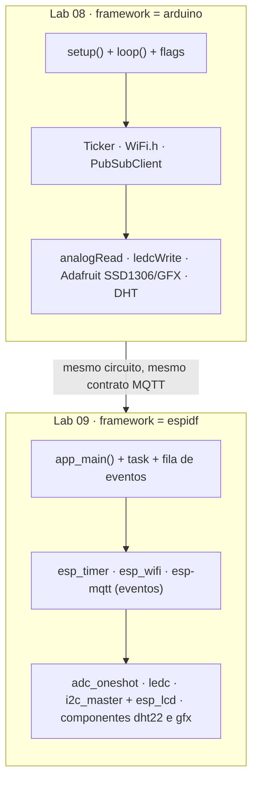
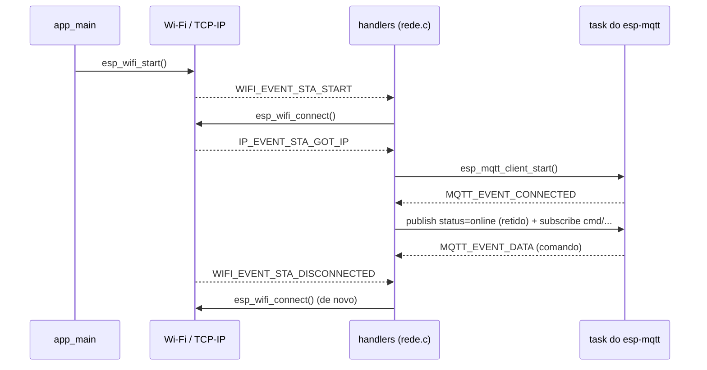
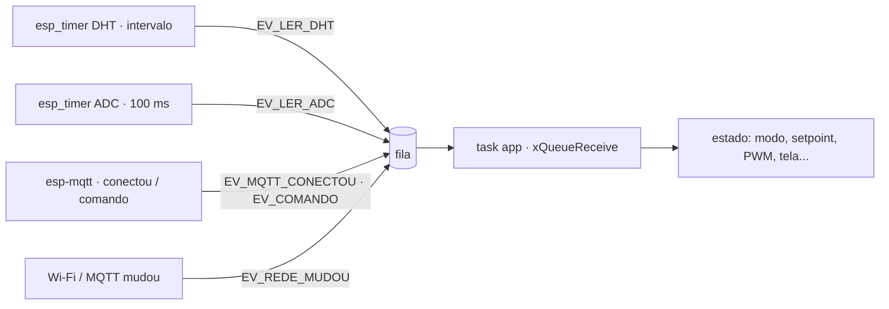

## Checklist — do Arduino para o ESP-IDF {/* #checklist */}

- [ ] Projeto `framework = espidf` (CMake, `sdkconfig.defaults`, imagem completa para o Wokwi) rodando um `app_main()` com uma task (T1)
- [ ] Wi-Fi e MQTT orientados a eventos (`esp_wifi` + `espressif/mqtt`), com LWT `online`/`offline` e comandos chegando (T2)
- [ ] Fila de eventos no lugar do `loop()`: `esp_timer` + ADC oneshot calibrado + DHT22 publicando `.../dht` e `.../adc` (T3)
- [ ] LEDC com dois timers (5 Hz e 25 kHz medidos no analisador lógico) e os modos `pot`, `remoto` e `auto` (T4)
- [ ] SSD1306 com `i2c_master` + `esp_lcd`, a mesma tela do Lab 08, e o Node-RED do Lab 08 gravando o Lab 09 sem mudar nada além do tópico (T5)
- [ ] NVS guardando modo e intervalo, diagnóstico em `.../diag` e comparação Arduino × ESP-IDF (T6)
- [ ] Previsões P1–P5 respondidas no `README.md`
- [ ] Nenhum `push --force`; cada tarefa num commit `Tn:`

:::info[Pontuação]
**T1…T6 = 100 pts** (esta aula não tem desafios): T1 10 · T2 20 · T3 20 · T4 15 · T5 15 ·
T6 20. O autograder normaliza para 0–10. Vale o commit `Tn:` mais recente de cada tarefa.
:::

<LabSetup />

### Configuração do ambiente de desenvolvimento {/* #setup */}

<DevTools />

---

Até o Lab 08, o firmware usou `framework = arduino`: `setup()`, `loop()`, `Serial`, `Ticker`,
`WiFi.h`, `PubSubClient` e as bibliotecas da Adafruit. Por baixo de tudo isso sempre esteve o
**ESP-IDF**, o framework oficial da Espressif, com o **FreeRTOS**. O Arduino é uma camada de
conveniência em cima dele.

Nesta aula você tira essa camada. O **mesmo firmware do Lab 08** (DHT22, potenciômetro, PWM, OLED,
MQTT, modos `pot`/`remoto`/`auto`) é reescrito em `framework = espidf`, em C, usando as APIs do
ESP-IDF 6.1. O circuito não muda, e o **contrato MQTT** (tópicos e JSON) também não. A prova de
que a migração deu certo é o Node-RED do Lab 08 continuar gravando e mostrando tudo sem perceber
a troca.



## Objetivos

- Montar um projeto **ESP-IDF** no PlatformIO: `CMakeLists.txt`, componentes, `sdkconfig` e
  dependências pelo **IDF Component Manager**.
- Trocar o `loop()` que pergunta "tem algo?" por uma **task do FreeRTOS que dorme numa fila** e
  só acorda com eventos.
- Usar **Wi-Fi e MQTT orientados a eventos**: quem reconecta e quem avisa.
- Usar os drivers do ESP-IDF com **handles**: ADC oneshot com calibração, LEDC com timers e
  canais explícitos, I2C master e `esp_lcd`.
- Guardar configuração na **NVS** e medir o que a troca custou ou economizou (flash, RAM, pilha).

## Material

- VS Code + PlatformIO + extensão **Wokwi**, com o circuito do Lab 07/08 (nenhuma mudança).
- O primeiro build com `framework = espidf` baixa o ESP-IDF 6.1 e o toolchain (**~1,5 GB**,
  10 a 20 minutos). Faça-o **antes** da aula, com o T1.
- O Node-RED com o fluxo do **Lab 08** (para a T5) e o `mosquitto_sub`/`mosquitto_pub` via Docker.
- O **analisador lógico** do Wokwi e o Surfer ou o PulseView (como na T3 do Lab 07).

:::info[Arduino × ESP-IDF: o mapa da migração]
| No Lab 08 (Arduino) | No Lab 09 (ESP-IDF) | Tarefa |
| --- | --- | --- |
| `setup()` / `loop()` | `app_main()` + uma task bloqueada numa **fila** | T1, T3 |
| `Serial.printf()` | `ESP_LOGI()` / `ESP_LOGW()` / `ESP_LOGE()` | T1 |
| `delay(ms)` | `vTaskDelay(pdMS_TO_TICKS(ms))` | T1 |
| `lib_deps` no `platformio.ini` | `idf_component.yml` e a pasta `components/` | T1, T2 |
| `WiFi.begin()` + `WiFi.status()` | `esp_wifi` + eventos `WIFI_EVENT` / `IP_EVENT` | T2 |
| `PubSubClient` + `mqtt.loop()` | `esp-mqtt` (`espressif/mqtt`) com task e eventos próprios | T2 |
| `Ticker` | `esp_timer` | T3 |
| `millis()` | `esp_timer_get_time() / 1000` | T3 |
| `analogRead()` / `analogReadMilliVolts()` | `adc_oneshot_read()` + `adc_cali_raw_to_voltage()` | T3 |
| `DHT sensor library` | componente `dht22` (fornecido) | T3 |
| `ledcSetup()` / `ledcWrite()` | `ledc_timer_config()` + `ledc_channel_config()` + `ledc_set_duty()` | T4 |
| `Wire` + `Adafruit_SSD1306` | `i2c_master` + `esp_lcd_panel_ssd1306` | T5 |
| `Adafruit_GFX` | componente `gfx` (fornecido, mesma fonte e algoritmos) | T5 |
| `Preferences` | **NVS** (`nvs_open`, `nvs_set_*`, `nvs_commit`) | T6 |
:::

## Clonar o repositório do grupo {/* #clonar */}

<LabTeamMembers labName="lab09" />

## Envie o link do repositório do seu grupo no Moodle: {/* #moodle-link */}

<LabSubmit labName="lab09" />

<details>
<summary><strong>Mapa de tarefas</strong> — 6 tarefas · 100 pts</summary>

- [T1 — Projeto ESP-IDF](#t1) · 10 pts
- [T2 — Wi-Fi e MQTT por eventos](#t2) · 20 pts
- [T3 — Fila, timers e sensores](#t3) · 20 pts
- [T4 — PWM com LEDC e os modos de operacao](#t4) · 15 pts
- [T5 — Tela e o Node-RED do Lab 08](#t5) · 15 pts
- [T6 — NVS, diagnostico e comparacao](#t6) · 20 pts

</details>

O repositório nasce do `lab09-template`. Ele traz o circuito, o firmware do Lab 08 em
`referencia/main_lab08.cpp` (para consulta: é ele que você vai migrar) e **dois componentes
prontos**, que substituem bibliotecas do Arduino que não existem no ESP-IDF:

- `components/dht22/`: leitura do DHT22 por um fio (o protocolo está comentado no `.c`);
- `components/gfx/`: texto, retângulos e círculo num framebuffer de 1024 bytes, com a **mesma
  fonte e os mesmos algoritmos da Adafruit GFX**. A tela sai idêntica, pixel a pixel.

<FileTree
  details={true}
  defaultOpen={false}
  title="Estrutura de Arquivos do Projeto"
  root="lab09-grupo-X"
  files={[
    "platformio.ini u",
    "CMakeLists.txt c",
    "sdkconfig.defaults c",
    "merge_firmware.py c",
    "wokwi.toml u",
    "diagram.json r",
    ".gitignore r",
    "src/CMakeLists.txt c",
    "src/idf_component.yml c",
    "src/config.h c",
    "src/main.c c",
    "src/rede.h c",
    "src/rede.c c",
    "src/sensores.h c",
    "src/sensores.c c",
    "src/atuadores.h c",
    "src/atuadores.c c",
    "src/tela.h c",
    "src/tela.c c",
    "components/dht22/ r",
    "components/gfx/ r",
    "referencia/main_lab08.cpp r",
    "evidencias/t1-build.txt c",
    "evidencias/t1-serial.txt c",
    "evidencias/t2-serial.txt c",
    "evidencias/t2-mqtt.txt c",
    "evidencias/t3-mqtt.txt c",
    "evidencias/t4-mqtt.txt c",
    "evidencias/t4-pwm.png c",
    "evidencias/t5-oled.png c",
    "evidencias/t5-nodered.png c",
    "evidencias/t6-serial.txt c",
    "evidencias/t6-comparacao.md c",
    "README.md u",
  ]}
/>

:::info[Tópicos do Lab 09]
Os mesmos do Lab 08, sob `elt85b/lab09/grupo-X/`: `dht`, `adc`, `pwm`, `status`, `oled`,
`oled/fb` e os comandos `cmd/intervalo`, `cmd/modo`, `cmd/aquecedor` e `cmd/ventilador`, com o
**mesmo JSON**. Novo só o `.../diag` (T6). Troque o `X` (e o `#define GRUPO`) pela letra do grupo.
:::

---

## Parte 1 — Projeto ESP-IDF {/* #parte-1 */}

### 1.1 O que muda na estrutura

Um projeto ESP-IDF é um projeto **CMake** feito de **componentes**. O seu código (`src/`) é o
componente principal; `components/` guarda os componentes do projeto; e o que vem da internet
(como o MQTT) fica em `managed_components/`, baixado pelo **IDF Component Manager** a partir do
`idf_component.yml`. A configuração do sistema (tick do FreeRTOS, partições, log, Wi-Fi…) fica no
**`sdkconfig`**, gerado a partir do `sdkconfig.defaults`.

```text title="O que cada arquivo faz"
platformio.ini          framework = espidf, versão fixa da plataforma
CMakeLists.txt          o projeto ESP-IDF (3 linhas)
sdkconfig.defaults      o que muda em relação ao padrão (gera sdkconfig.esp32dev)
src/CMakeLists.txt      o componente principal: fontes e de quais componentes ele depende
src/idf_component.yml   dependências baixadas (espressif/mqtt) — T2
components/dht22, gfx   componentes do projeto (fornecidos)
merge_firmware.py       junta bootloader + partições + app para o Wokwi
```

### 1.2 Arquivos do projeto

```ini title="platformio.ini"
[env:esp32dev]
; versão fixa: 7.1.0 traz o ESP-IDF 6.1 (sem a versão, cada aluno pode receber uma diferente)
platform = espressif32@7.1.0
board = esp32dev
framework = espidf
monitor_speed = 115200
monitor_filters = esp32_exception_decoder
; o Wokwi precisa da imagem completa (bootloader + partições + app) num arquivo só
extra_scripts = post:merge_firmware.py
```

```cmake title="CMakeLists.txt"
# Projeto ESP-IDF (o PlatformIO usa este arquivo quando framework = espidf)
cmake_minimum_required(VERSION 3.22)
include($ENV{IDF_PATH}/tools/cmake/project.cmake)
project(lab09)
```

```ini title="sdkconfig.defaults"
# sdkconfig.defaults — o que este projeto muda em relação ao padrão do ESP-IDF.
# O PlatformIO gera sdkconfig.esp32dev a partir daqui (apague-o para regenerar).

# flash de 4 MB e partição "grande" (1,5 MB de app): Wi-Fi + MQTT + TLS não cabem em 1 MB
CONFIG_ESPTOOLPY_FLASHSIZE_4MB=y
CONFIG_PARTITION_TABLE_SINGLE_APP_LARGE=y

# tick do FreeRTOS em 1 ms (o padrão é 10 ms; o core Arduino usa 1000 Hz)
CONFIG_FREERTOS_HZ=1000

# log no monitor serial
CONFIG_LOG_DEFAULT_LEVEL_INFO=y
CONFIG_ESP_CONSOLE_UART_BAUDRATE=115200
```

Na T1, o componente principal tem só o `main.c`:

```cmake title="src/CMakeLists.txt (T1)"
idf_component_register(SRCS "main.c"
                       INCLUDE_DIRS ".")
```

### 1.3 O Wokwi precisa da imagem completa

Com `framework = arduino`, o Wokwi carregava só o `firmware.bin` (o app). Com `espidf` ele
precisa da **imagem completa da flash**: bootloader em `0x1000`, tabela de partições em `0x8000`
e o app em `0x10000`. O script abaixo roda depois de cada build e gera o `firmware.merged.bin`:

```python title="merge_firmware.py"
# merge_firmware.py — depois do build, junta bootloader + tabela de partições + app num único
# firmware.merged.bin (o que o Wokwi carrega com framework = espidf).
Import("env")  # noqa: F821  (PlatformIO injeta 'env')


def juntar(source, target, env):
    imagens = []
    for offset, caminho in env.get("FLASH_EXTRA_IMAGES", []):   # bootloader e partições
        imagens += [offset, '"%s"' % env.subst(caminho)]
    imagens += ["$ESP32_APP_OFFSET", '"$BUILD_DIR/${PROGNAME}.bin"']
    env.Execute(" ".join([
        '"$PYTHONEXE"', '"$OBJCOPY"',                            # $OBJCOPY = esptool.py
        "--chip", env.BoardConfig().get("build.mcu", "esp32"),
        "merge_bin", "-o", '"$BUILD_DIR/firmware.merged.bin"',
        "--flash_mode", "dio", "--flash_size", "4MB",
    ] + imagens))


env.AddPostAction("$BUILD_DIR/${PROGNAME}.bin", juntar)  # noqa: F821
```

```toml title="wokwi.toml"
[wokwi]
version = 1
# framework = espidf: a imagem completa (gerada pelo merge_firmware.py), não só o app
firmware = '.pio/build/esp32dev/firmware.merged.bin'
elf = '.pio/build/esp32dev/firmware.elf'
```

### 1.4 O primeiro programa

```c title="src/main.c (T1)"
// ELT85B - Lab 09 (T1): o primeiro programa ESP-IDF
#include "esp_log.h"
#include "esp_system.h"
#include "freertos/FreeRTOS.h"
#include "freertos/task.h"

static const char *TAG = "app";

// Uma task do FreeRTOS: no Arduino, o loop() era uma task escondida chamada "loopTask"
static void task_pisca(void *arg)
{
    int n = 0;
    for (;;) {
        ESP_LOGI(TAG, "volta %d · heap livre %lu bytes", n++, (unsigned long)esp_get_free_heap_size());
        vTaskDelay(pdMS_TO_TICKS(1000));      // dorme 1 s sem ocupar a CPU (o delay() do Arduino)
    }
}

void app_main(void)                           // o setup() do ESP-IDF
{
    ESP_LOGI(TAG, "=== Lab 09 - ola, ESP-IDF ===");
    ESP_LOGW(TAG, "isto é um aviso");         // amarelo no monitor
    ESP_LOGE(TAG, "isto é um erro");          // vermelho
    xTaskCreate(task_pisca, "pisca", 3072, NULL, 5, NULL);
    // app_main pode terminar: a task "pisca" continua rodando
}
```

Compile (`PlatformIO: Build`, ou `pio run` no terminal). A primeira vez demora: o PlatformIO baixa
o ESP-IDF 6.1 e o toolchain. Depois, inicie o Wokwi.

```text title="Monitor serial (trecho; os tempos e o heap variam um pouco)"
I (288) cpu_start: Multicore app
I (321) app_init: ESP-IDF:          v6.1
I (360) main_task: Calling app_main()
I (360) app: === Lab 09 - ola, ESP-IDF ===
W (360) app: isto é um aviso
E (361) app: isto é um erro
I (361) app: volta 0 · heap livre 300144 bytes
I (1362) app: volta 1 · heap livre 304352 bytes
I (2362) app: volta 2 · heap livre 304352 bytes
```

Cada linha de log diz o **nível** (`I`, `W`, `E`), o **tempo** em ms desde o boot e a
**etiqueta** (`TAG`). Antes do `app_main()`, o próprio ESP-IDF já escreveu dezenas de linhas: o
bootloader, as partições, o FreeRTOS subindo as duas CPUs. No Arduino isso também acontecia, mas
ficava escondido.

:::tip[Preveja antes de rodar]
**P1:** (a) o firmware **completo** do Lab 08 (Arduino) tem quantos KB? Anote o que o `pio run`
mostra no fim (`Flash: [===  ] xx.x% (used ... bytes ...)`). E este "olá" em ESP-IDF, que só tem
uma task? Ele vai ser maior ou menor que o Lab 08? E que um "olá" em Arduino? (b) No Arduino, o
`loop()` nunca termina. Aqui o `app_main()` **termina** logo depois do `xTaskCreate()`. Por que o
programa não para? Quem chamava o `loop()` no Arduino?
:::

**Evidências:** em `evidencias/t1-build.txt`, as últimas linhas do `pio run` (RAM e Flash) do
**Lab 08** e deste T1; em `evidencias/t1-serial.txt`, o monitor serial com pelo menos 3 voltas.

<FileTree
  root="lab09-grupo-X"
  files={[
    "platformio.ini u",
    "CMakeLists.txt c",
    "sdkconfig.defaults c",
    "merge_firmware.py c",
    "wokwi.toml u",
    "src/CMakeLists.txt c",
    "src/main.c c",
    "evidencias/t1-build.txt c",
    "evidencias/t1-serial.txt c",
  ]}
/>

<CommitPoint
  id="t1"
  task="Projeto ESP-IDF"
  pontos={10}
  files="platformio.ini CMakeLists.txt sdkconfig.defaults merge_firmware.py wokwi.toml src/CMakeLists.txt src/main.c evidencias/t1-build.txt evidencias/t1-serial.txt"
/>

---

## Parte 2 — Wi-Fi e MQTT por eventos {/* #parte-2 */}

### 2.1 Quem pergunta e quem avisa

No Lab 08, o `loop()` **perguntava** a cada volta: `WiFi.status()`? `mqtt.connected()`? E chamava
`mqtt.loop()` para o PubSubClient processar a rede. Se o broker caísse, `conectarMQTT()` ficava
num `while` com `delay(2000)`, e nada mais rodava.

No ESP-IDF, quem sabe que algo aconteceu **avisa**. O Wi-Fi e o TCP/IP publicam **eventos** no
_event loop_ do sistema, e você registra uma função (_handler_) para os que interessam. O
**esp-mqtt** tem a **própria task**: conecta, responde aos PINGs, reconecta sozinho e chama o seu
handler a cada evento.



### 2.2 MQTT é um componente gerenciado

No ESP-IDF 6, o cliente MQTT **saiu de dentro do IDF**: virou o componente `espressif/mqtt` do
[registro de componentes](https://components.espressif.com/components/espressif/mqtt). Declare-o
e o Component Manager baixa no próximo build (pasta `managed_components/`). O arquivo
`dependencies.lock` que aparece na raiz **vai para o repositório**: ele fixa as versões usadas.

```yaml title="src/idf_component.yml"
# IDF Component Manager: no ESP-IDF 6 o cliente MQTT saiu do IDF e virou componente gerenciado.
# É baixado de components.espressif.com no primeiro build (pasta managed_components/).
dependencies:
  espressif/mqtt: "^1.1.0"
```

```cmake title="src/CMakeLists.txt (T2)"
idf_component_register(SRCS "main.c" "rede.c"
                       INCLUDE_DIRS "."
                       PRIV_REQUIRES esp_wifi esp_netif esp_event nvs_flash mqtt)
```

### 2.3 Código

Os pinos, as constantes e os tópicos ficam num `config.h`, usado por todos os arquivos:

```c title="src/config.h"
// config.h — pinos, constantes e tópicos (os mesmos do Lab 08, agora em lab09)
#pragma once

#define GRUPO "a"                        // troque pela letra do seu grupo
#define LAB   "lab09"

// ---- Wi-Fi e broker
#define WIFI_SSID   "Wokwi-GUEST"
#define WIFI_SENHA  ""
#define WIFI_CANAL  6                    // canal fixo: conecta mais rápido no Wokwi
#define MQTT_URI    "mqtt://broker.hivemq.com:1883"

// ---- pinos (o circuito é o do Lab 07/08)
#define DHT_PIN   GPIO_NUM_15
#define OLED_SDA  GPIO_NUM_21
#define OLED_SCL  GPIO_NUM_22
#define OLED_ADDR 0x3C
#define POT_CANAL ADC_CHANNEL_6          // GPIO34 = ADC1_CH6 (o ADC1 funciona junto com o Wi-Fi)
#define AQ_PIN    GPIO_NUM_25            // "aquecedor": resistência -> PWM lento
#define VE_PIN    GPIO_NUM_26            // "ventilador": ventoinha 4 fios -> 25 kHz

// ---- ADC
#define ADC_AMOSTRAS 16                  // média de 16 leituras
#define ADC_BANDA    40                  // publica só se mudar mais que ~1 % (40/4095)...
#define ADC_REPUB_US (10 * 1000 * 1000)  // ...ou a cada 10 s
#define SP_MIN       20.0f               // faixa do setpoint (°C)
#define SP_MAX       55.0f

// ---- PWM (LEDC)
#define AQ_FREQ_HZ 5
#define VE_FREQ_HZ 25000
#define PWM_BITS   8                     // duty de 0 a 255
#define PWM_MAX    ((1 << PWM_BITS) - 1)

#define HISTERESE  0.5f                  // controle ON/OFF: ±0,5 °C

// ---- tópicos
#define BASE "elt85b/" LAB "/grupo-" GRUPO
#define TOPICO_DADOS     BASE "/dht"
#define TOPICO_STATUS    BASE "/status"
#define TOPICO_OLED      BASE "/oled"
#define TOPICO_OLED_FB   BASE "/oled/fb"
#define TOPICO_ADC       BASE "/adc"
#define TOPICO_PWM       BASE "/pwm"
#define TOPICO_DIAG      BASE "/diag"              // T6
#define TOPICO_INTERVALO BASE "/cmd/intervalo"
#define TOPICO_CMD_MODO  BASE "/cmd/modo"
#define TOPICO_CMD_AQ    BASE "/cmd/aquecedor"
#define TOPICO_CMD_VE    BASE "/cmd/ventilador"
```

```c title="src/rede.h"
// rede.h — Wi-Fi (esp_wifi) e MQTT (esp-mqtt). Substitui WiFi.h e PubSubClient.
#pragma once

#include <stdbool.h>

// Os callbacks rodam na task do esp-mqtt / do event loop, NÃO na task da aplicação:
// eles só devem copiar os dados e avisar a aplicação (fila), nunca mexer no estado direto.
typedef struct {
    void (*ao_conectar)(void);                                   // MQTT conectado (ou reconectado)
    void (*ao_mudar)(void);                                      // Wi-Fi/MQTT mudou (indicadores W/M)
    void (*ao_receber)(const char *topico, const char *texto);   // mensagem num tópico assinado
} rede_callbacks_t;

void rede_iniciar(const char *client_id, const rede_callbacks_t *cb);
bool rede_wifi_ok(void);
bool rede_mqtt_ok(void);
int  rede_rssi(void);                                            // dBm (0 se desconectado)

// Publica (QoS 0, sem retain). len < 0: usa strlen(dados). Devolve false se falhou.
bool rede_publicar(const char *topico, const char *dados, int len);
```

```c title="src/rede.c"
// rede.c — Wi-Fi e MQTT orientados a EVENTOS.
// No Arduino, o loop() perguntava "WiFi.status()?" e "mqtt.connected()?" a cada volta e chamava
// mqtt.loop(). Aqui ninguém pergunta: o ESP-IDF avisa (handlers) quando algo acontece, e o
// esp-mqtt tem a própria task que mantém a conexão, responde aos PINGs e reconecta sozinha.
#include "rede.h"

#include <string.h>

#include "config.h"
#include "esp_event.h"
#include "esp_log.h"
#include "esp_netif.h"
#include "esp_wifi.h"
#include "mqtt_client.h"

static const char *TAG = "rede";

static esp_mqtt_client_handle_t mqtt;
static rede_callbacks_t cbs;
static volatile bool wifi_ok, mqtt_ok;
static bool mqtt_iniciado;

bool rede_wifi_ok(void) { return wifi_ok; }
bool rede_mqtt_ok(void) { return mqtt_ok; }

int rede_rssi(void)
{
    wifi_ap_record_t ap;
    return (wifi_ok && esp_wifi_sta_get_ap_info(&ap) == ESP_OK) ? ap.rssi : 0;
}

bool rede_publicar(const char *topico, const char *dados, int len)
{
    if (!mqtt_ok) return false;
    return esp_mqtt_client_publish(mqtt, topico, dados, len < 0 ? 0 : len, 0, 0) >= 0;
}

// ------------------------------------------------------------------ MQTT
static void ao_evento_mqtt(void *arg, esp_event_base_t base, int32_t id, void *dados)
{
    esp_mqtt_event_handle_t ev = dados;
    switch ((esp_mqtt_event_id_t)id) {
    case MQTT_EVENT_CONNECTED:
        ESP_LOGI(TAG, "MQTT conectado");
        mqtt_ok = true;
        esp_mqtt_client_publish(mqtt, TOPICO_STATUS, "online", 0, 1, 1);   // retido (LWT)
        // sessão limpa: a cada (re)conexão o broker esqueceu as assinaturas
        esp_mqtt_client_subscribe(mqtt, TOPICO_INTERVALO, 0);
        esp_mqtt_client_subscribe(mqtt, TOPICO_CMD_MODO, 0);
        esp_mqtt_client_subscribe(mqtt, TOPICO_CMD_AQ, 0);
        esp_mqtt_client_subscribe(mqtt, TOPICO_CMD_VE, 0);
        cbs.ao_conectar();
        cbs.ao_mudar();
        break;
    case MQTT_EVENT_DISCONNECTED:
        ESP_LOGW(TAG, "MQTT desconectado (o esp-mqtt reconecta sozinho)");
        mqtt_ok = false;
        cbs.ao_mudar();
        break;
    case MQTT_EVENT_DATA: {
        // tópico e dados NÃO terminam em '\0': copie e termine antes de usar como string
        char topico[96], texto[16];
        int nt = ev->topic_len < (int)sizeof(topico) - 1 ? ev->topic_len : (int)sizeof(topico) - 1;
        int nd = ev->data_len < (int)sizeof(texto) - 1 ? ev->data_len : (int)sizeof(texto) - 1;
        memcpy(topico, ev->topic, nt);
        topico[nt] = '\0';
        memcpy(texto, ev->data, nd);
        texto[nd] = '\0';
        cbs.ao_receber(topico, texto);
        break;
    }
    case MQTT_EVENT_ERROR:
        ESP_LOGW(TAG, "MQTT erro");
        break;
    default:
        break;
    }
}

static void iniciar_mqtt(const char *client_id)
{
    esp_mqtt_client_config_t cfg = {
        .broker.address.uri = MQTT_URI,
        .credentials.client_id = client_id,
        .session = {
            .keepalive = 15,                         // como o PubSubClient
            .last_will = {
                .topic = TOPICO_STATUS,
                .msg = "offline",
                .qos = 1,
                .retain = 1,
            },
        },
        .buffer.size = 2048,                         // o framebuffer em base64 tem 1368 bytes
    };
    mqtt = esp_mqtt_client_init(&cfg);
    esp_mqtt_client_register_event(mqtt, ESP_EVENT_ANY_ID, ao_evento_mqtt, NULL);
}

// ------------------------------------------------------------------ Wi-Fi
static void ao_evento_wifi(void *arg, esp_event_base_t base, int32_t id, void *dados)
{
    if (base == WIFI_EVENT && id == WIFI_EVENT_STA_START) {
        ESP_LOGI(TAG, "conectando a %s", WIFI_SSID);
        esp_wifi_connect();
    } else if (base == WIFI_EVENT && id == WIFI_EVENT_STA_DISCONNECTED) {
        if (wifi_ok) cbs.ao_mudar();
        wifi_ok = false;
        ESP_LOGW(TAG, "Wi-Fi caiu, tentando de novo");
        esp_wifi_connect();                          // reconexão: aqui, e não no loop()
    } else if (base == IP_EVENT && id == IP_EVENT_STA_GOT_IP) {
        ip_event_got_ip_t *ev = dados;
        ESP_LOGI(TAG, "Wi-Fi conectado, IP " IPSTR, IP2STR(&ev->ip_info.ip));
        wifi_ok = true;
        cbs.ao_mudar();
        if (!mqtt_iniciado) {                        // só na primeira vez: depois o esp-mqtt
            mqtt_iniciado = true;                    // se reconecta sozinho
            esp_mqtt_client_start(mqtt);
        }
    }
}

void rede_iniciar(const char *client_id, const rede_callbacks_t *cb)
{
    cbs = *cb;
    ESP_ERROR_CHECK(esp_netif_init());
    esp_netif_create_default_wifi_sta();
    wifi_init_config_t wcfg = WIFI_INIT_CONFIG_DEFAULT();
    ESP_ERROR_CHECK(esp_wifi_init(&wcfg));
    ESP_ERROR_CHECK(esp_event_handler_register(WIFI_EVENT, ESP_EVENT_ANY_ID, ao_evento_wifi, NULL));
    ESP_ERROR_CHECK(esp_event_handler_register(IP_EVENT, IP_EVENT_STA_GOT_IP, ao_evento_wifi, NULL));

    wifi_config_t sta = {
        .sta = {
            .ssid = WIFI_SSID,
            .password = WIFI_SENHA,
            .channel = WIFI_CANAL,
            .threshold.authmode = WIFI_AUTH_OPEN,
        },
    };
    iniciar_mqtt(client_id);
    ESP_ERROR_CHECK(esp_wifi_set_mode(WIFI_MODE_STA));
    ESP_ERROR_CHECK(esp_wifi_set_config(WIFI_IF_STA, &sta));
    ESP_ERROR_CHECK(esp_wifi_start());
}
```

E o `main.c` da T2, que só liga a rede e registra no log o que acontece:

```c title="src/main.c (T2)"
// ELT85B - Lab 09 (T2): Wi-Fi e MQTT orientados a eventos
#include <stdio.h>

#include "config.h"
#include "esp_event.h"
#include "esp_log.h"
#include "esp_mac.h"
#include "nvs_flash.h"
#include "rede.h"

static const char *TAG = "app";

// Por enquanto os callbacks só registram no log. Na T3 eles passam a pôr eventos numa fila.
static void ao_conectar(void) { ESP_LOGI(TAG, "conectado ao broker"); }
static void ao_mudar(void) { ESP_LOGI(TAG, "Wi-Fi %s · MQTT %s", rede_wifi_ok() ? "ok" : "--", rede_mqtt_ok() ? "ok" : "--"); }
static void ao_receber(const char *topico, const char *texto) { ESP_LOGI(TAG, "[CMD] %s <- '%s'", topico, texto); }

void app_main(void)
{
    ESP_LOGI(TAG, "=== Lab 09 - T2: Wi-Fi + MQTT ===");

    // o Wi-Fi guarda a calibração do rádio na NVS: ela precisa estar pronta antes
    esp_err_t err = nvs_flash_init();
    if (err == ESP_ERR_NVS_NO_FREE_PAGES || err == ESP_ERR_NVS_NEW_VERSION_FOUND) {
        ESP_ERROR_CHECK(nvs_flash_erase());
        err = nvs_flash_init();
    }
    ESP_ERROR_CHECK(err);
    ESP_ERROR_CHECK(esp_event_loop_create_default());   // o "correio" dos eventos do sistema

    uint8_t mac[6];
    esp_read_mac(mac, ESP_MAC_WIFI_STA);
    static char client_id[32];                           // static: o esp-mqtt guarda o ponteiro
    snprintf(client_id, sizeof(client_id), "lab09-%s-%02X%02X", GRUPO, mac[4], mac[5]);

    rede_callbacks_t cb = {.ao_conectar = ao_conectar, .ao_mudar = ao_mudar, .ao_receber = ao_receber};
    rede_iniciar(client_id, &cb);
}
```

### 2.4 Testando

<GroupCommands
  commands={[
    {
      codeTitle: "Terminal 1 — assinar via Docker",
      command: `docker run --rm eclipse-mosquitto:2 mosquitto_sub -h broker.hivemq.com -t '{course}/lab09/grupo-{group}/#' -v | tee evidencias/t2-mqtt.txt`,
    },
    {
      codeTitle: "Terminal 2 — comandar via Docker",
      command: `docker run --rm eclipse-mosquitto:2 mosquitto_pub -h broker.hivemq.com -t '{course}/lab09/grupo-{group}/cmd/modo' -m auto`,
    },
  ]}
/>

1. Rode no Wokwi com o terminal 1 aberto: aparece `status online`.
2. Mande o comando do terminal 2: aparece `[CMD] ... <- 'auto'` no serial.
3. **Pare** a simulação: depois de ~20 s (1,5 × o _keepalive_ de 15 s), o broker publica o LWT
   `status offline`.

```text title="Monitor serial (trecho; o IP pode variar)"
I (360) app: === Lab 09 - T2: Wi-Fi + MQTT ===
I (980) rede: conectando a Wokwi-GUEST
I (2410) rede: Wi-Fi conectado, IP 10.10.0.2
I (2410) app: Wi-Fi ok · MQTT --
I (3120) rede: MQTT conectado
I (3120) app: conectado ao broker
I (3130) app: Wi-Fi ok · MQTT ok
I (9540) app: [CMD] elt85b/lab09/grupo-a/cmd/modo <- 'auto'
```

:::tip[Preveja antes de rodar]
**P2:** (a) no Lab 08, com o broker fora do ar, o que acontecia com a leitura do potenciômetro e
com a tela enquanto `conectarMQTT()` esperava? E aqui, com o esp-mqtt reconectando na task dele?
(b) Os handlers rodam na task do esp-mqtt e na do event loop, e **não** na sua. Por que o
`rede.c` copia o tópico e o texto para buffers próprios antes de chamar `ao_receber()`, em vez de
passar os ponteiros do evento? (c) Por que o `client_id` do `main.c` é `static`?
:::

**Evidências:** o serial em `evidencias/t2-serial.txt` e a saída do terminal 1 (com `online`, o
comando e o `offline` depois de parar a simulação) em `evidencias/t2-mqtt.txt`.

<FileTree
  root="lab09-grupo-X"
  files={[
    "src/CMakeLists.txt u",
    "src/idf_component.yml c",
    "src/config.h c",
    "src/rede.h c",
    "src/rede.c c",
    "src/main.c u",
    "evidencias/t2-serial.txt c",
    "evidencias/t2-mqtt.txt c",
  ]}
/>

<CommitPoint
  id="t2"
  task="Wi-Fi e MQTT por eventos"
  pontos={20}
  files="dependencies.lock src/CMakeLists.txt src/idf_component.yml src/config.h src/rede.h src/rede.c src/main.c evidencias/t2-serial.txt evidencias/t2-mqtt.txt"
/>

---

## Parte 3 — Fila, timers e sensores {/* #parte-3 */}

### 3.1 O `loop()` vira uma fila

No Lab 08, os `Ticker` só ligavam **flags** (`leituraPendente`, `adcPendente`), e o `loop()`
girava o tempo todo conferindo essas flags. Agora há várias tasks (a do esp-mqtt, a do event loop,
a dos timers), e flags soltas entre tasks são uma fonte de erro. A solução do FreeRTOS é uma
**fila**: quem detecta algo põe um **evento** na fila, e **uma única task** (`app`) tira os
eventos e mexe no estado. Enquanto a fila está vazia, a task **dorme**, sem gastar CPU.



Os tipos de evento e o que vai na fila:

```c title="src/main.c (eventos)"
// ------------------------------------------------------------------ eventos da fila
typedef enum {
    EV_LER_DHT,          // esp_timer do DHT22 (a cada intervalo)
    EV_LER_ADC,          // esp_timer do potenciômetro (10 Hz)
    EV_MQTT_CONECTOU,    // rede.c: (re)conectou ao broker
    EV_REDE_MUDOU,       // rede.c: Wi-Fi ou MQTT caiu/voltou (indicadores W/M)
    EV_COMANDO,          // rede.c: mensagem num tópico de comando
} tipo_evento_t;

typedef struct {
    tipo_evento_t tipo;
    char topico[64];
    char texto[16];
} evento_t;

static QueueHandle_t fila;
static esp_timer_handle_t timer_dht, timer_adc;
```

Os callbacks dos timers e da rede **só enfileiram**:

```c title="src/main.c (callbacks -> fila)"
// ------------------------------------------------------------------ callbacks -> fila
// Rodam em outras tasks (esp_timer, esp-mqtt, event loop): só põem um evento na fila.
static void enfileirar(tipo_evento_t tipo)
{
    evento_t ev = {.tipo = tipo};
    if (xQueueSend(fila, &ev, 0) != pdTRUE) ESP_LOGW(TAG, "fila cheia: evento %d perdido", tipo);
}

static void ao_timer(void *arg) { enfileirar((tipo_evento_t)(intptr_t)arg); }
static void ao_conectar(void) { enfileirar(EV_MQTT_CONECTOU); }
static void ao_mudar(void) { enfileirar(EV_REDE_MUDOU); }

static void ao_receber(const char *topico, const char *texto)
{
    evento_t ev = {.tipo = EV_COMANDO};
    strlcpy(ev.topico, topico, sizeof(ev.topico));
    strlcpy(ev.texto, texto, sizeof(ev.texto));
    if (xQueueSend(fila, &ev, 0) != pdTRUE) ESP_LOGW(TAG, "fila cheia: comando perdido");
}


static void ler_adc(void)
{
    sensores_ler_pot(&adc_raw, &adc_mv);
    float sp = SP_MIN + adc_raw * (SP_MAX - SP_MIN) / 4095.0f;
    setpoint = roundf(sp * 2) / 2;                                 // passos de 0,5 °C
}

// ------------------------------------------------------------------ tela
static void indicador(int x, const char *letra, bool ok)
{
    if (ok) {
        gfx_retangulo_cheio(x, 0, 13, 9, GFX_BRANCO);
        gfx_cor_texto(GFX_PRETO);
    } else {
        gfx_retangulo(x, 0, 13, 9, GFX_BRANCO);
        gfx_cor_texto(GFX_BRANCO);
    }
    gfx_cursor(x + 4, 1);
    gfx_texto(letra);
    gfx_cor_texto(GFX_BRANCO);
}

static void barra(int y, const char *rotulo, float pct)
{
    gfx_cursor(0, y);
    gfx_texto(rotulo);
    gfx_retangulo(16, y, 80, 8, GFX_BRANCO);
    gfx_retangulo_cheio(18, y + 2, (int)(76 * pct / 100.0f), 4, GFX_BRANCO);
    gfx_cursor(100, y);
    gfx_printf("%3.0f%%", pct);
}

static void desenhar_tela(void)
{
    gfx_limpar();
    gfx_cor_texto(GFX_BRANCO);

    gfx_tamanho_texto(1);                                          // cabeçalho
    gfx_cursor(0, 1);
    gfx_texto("LAB09 grupo " GRUPO);
    indicador(98, "W", rede_wifi_ok());
    indicador(114, "M", rede_mqtt_ok());
    gfx_linha_h(0, 11, GFX_W, GFX_BRANCO);

    gfx_tamanho_texto(2);                                          // temperatura medida
    gfx_cursor(0, 15);
    if (isnan(ultima_t)) gfx_texto("--.-");
    else gfx_printf("%4.1f", ultima_t);
    gfx_circulo(53, 17, 2, GFX_BRANCO);
    gfx_cursor(58, 15);
    gfx_texto("C");

    gfx_tamanho_texto(1);                                          // setpoint e ADC
    gfx_cursor(76, 15);
    gfx_printf("SP %4.1f", setpoint);
    gfx_cursor(76, 24);
    gfx_printf("%4d mV", adc_mv);

    barra(35, "AQ", aq_pct < 0 ? 0 : aq_pct);                      // atuadores
    barra(45, "VE", ve_pct < 0 ? 0 : ve_pct);

    gfx_cursor(0, 56);                                             // modo e estado
    gfx_printf("%s: %s", NOME_MODO[modo], estado);
    tela_enviar();
}

static void publicar_tela_texto(void)
{
    char t[8] = "--.-";
    if (!isnan(ultima_t)) snprintf(t, sizeof(t), "%.1f", ultima_t);
    char payload[220];
    snprintf(payload, sizeof(payload),
             "{\"linhas\":[\"LAB09 grupo %s\",\"T: %s C  SP: %.1f C\",\"AQ: %.0f %%  VE: %.0f %%\","
             "\"modo %s | %s\",\"WiFi %s | MQTT %s\"]}",
             GRUPO, t, setpoint, aq_pct < 0 ? 0 : aq_pct, ve_pct < 0 ? 0 : ve_pct,
             NOME_MODO[modo], estado, rede_wifi_ok() ? "ok" : "--", rede_mqtt_ok() ? "ok" : "--");
    rede_publicar(TOPICO_OLED, payload, -1);
}

static void publicar_framebuffer(void)
{
    static char b64[1400];                                         // static: fora da pilha
    size_t n = tela_base64(b64, sizeof(b64));
    if (n == 0 || !rede_publicar(TOPICO_OLED_FB, b64, (int)n))
        ESP_LOGD(TAG, "framebuffer não publicado");
}
```

O `Ticker` vira um `esp_timer`. O callback recebe o tipo do evento no argumento:

```c title="src/main.c (timers)"
static esp_timer_handle_t criar_timer(const char *nome, tipo_evento_t tipo)
{
    esp_timer_handle_t t;
    esp_timer_create_args_t args = {
        .callback = ao_timer,
        .arg = (void *)(intptr_t)tipo,
        .name = nome,
    };
    ESP_ERROR_CHECK(esp_timer_create(&args, &t));
    return t;
}
```

### 3.2 Sensores

O ADC do ESP-IDF é um **driver com handle**: cria a unidade, configura o canal (atenuação e
resolução) e, à parte, cria a **calibração**, que converte o valor cru em mV. É o que o
`analogReadMilliVolts()` fazia escondido. O DHT22 usa o componente `dht22` do template.

```c title="src/sensores.h"
// sensores.h — potenciômetro (ADC oneshot + calibração) e DHT22.
#pragma once

#include <stdbool.h>

void sensores_iniciar(void);

// Média de ADC_AMOSTRAS leituras: valor cru (0..4095) e tensão calibrada (mV).
void sensores_ler_pot(int *raw, int *mv);

// DHT22: true se a leitura é válida.
bool sensores_ler_dht(float *t, float *h);
```

```c title="src/sensores.c"
// sensores.c — no Arduino: analogRead(), analogReadMilliVolts() e dht.readTemperature().
// No ESP-IDF, o ADC é um "driver com handle": cria a unidade, configura o canal e, à parte,
// cria o esquema de calibração que converte o valor cru em milivolts.
#include "sensores.h"

#include "config.h"
#include "dht22.h"
#include "esp_adc/adc_cali.h"
#include "esp_adc/adc_cali_scheme.h"
#include "esp_adc/adc_oneshot.h"
#include "esp_log.h"

static const char *TAG = "sensores";

static adc_oneshot_unit_handle_t adc;
static adc_cali_handle_t cali;          // NULL se o chip não tiver calibração gravada

void sensores_iniciar(void)
{
    adc_oneshot_unit_init_cfg_t ucfg = {.unit_id = ADC_UNIT_1};
    ESP_ERROR_CHECK(adc_oneshot_new_unit(&ucfg, &adc));

    adc_oneshot_chan_cfg_t ccfg = {
        .atten = ADC_ATTEN_DB_12,        // ~0 a 3,1 V (o "ADC_11db" do Arduino)
        .bitwidth = ADC_BITWIDTH_12,     // 0..4095
    };
    ESP_ERROR_CHECK(adc_oneshot_config_channel(adc, POT_CANAL, &ccfg));

    adc_cali_line_fitting_config_t kcfg = {
        .unit_id = ADC_UNIT_1,
        .atten = ADC_ATTEN_DB_12,
        .bitwidth = ADC_BITWIDTH_12,
        .default_vref = 1100,            // usado se o eFuse não tiver a referência gravada
    };
    if (adc_cali_create_scheme_line_fitting(&kcfg, &cali) != ESP_OK) {
        ESP_LOGW(TAG, "sem calibração do ADC: mV será estimado");
        cali = NULL;
    }

    dht22_iniciar(DHT_PIN);
}

void sensores_ler_pot(int *raw, int *mv)
{
    int soma = 0;
    for (int i = 0; i < ADC_AMOSTRAS; i++) {
        int v = 0;
        adc_oneshot_read(adc, POT_CANAL, &v);
        soma += v;
    }
    *raw = soma / ADC_AMOSTRAS;
    if (cali == NULL || adc_cali_raw_to_voltage(cali, *raw, mv) != ESP_OK) {
        *mv = *raw * 3100 / 4095;        // estimativa linear, sem calibração
    }
}

bool sensores_ler_dht(float *t, float *h)
{
    esp_err_t err = dht22_ler(DHT_PIN, t, h);
    if (err != ESP_OK) ESP_LOGW(TAG, "DHT22: %s", esp_err_to_name(err));
    return err == ESP_OK;
}
```

Atualize o `src/CMakeLists.txt` com os fontes e componentes novos. A partir daqui ele fica igual
ao final:

```cmake title="src/CMakeLists.txt (a partir da T3)"
# "src" é o componente principal. Os outros componentes ficam em components/ (dht22, gfx)
# ou vêm do IDF Component Manager (mqtt, declarado em idf_component.yml).
idf_component_register(
    SRCS "main.c" "rede.c" "sensores.c" "atuadores.c" "tela.c"
    INCLUDE_DIRS "."
    PRIV_REQUIRES esp_wifi esp_netif esp_event nvs_flash esp_timer esp_adc
                  esp_driver_ledc esp_driver_i2c esp_driver_gpio esp_lcd mbedtls
                  mqtt dht22 gfx)
```

### 3.3 A task da aplicação

As funções do Lab 08 voltam quase iguais. Mudam só as chamadas: `millis()` vira
`esp_timer_get_time() / 1000`, `Serial.printf` vira `ESP_LOGI`, `mqtt.publish` vira
`rede_publicar`.

```c title="src/main.c (ADC e DHT22)"
static void ler_adc(void)
{
    sensores_ler_pot(&adc_raw, &adc_mv);
    float sp = SP_MIN + adc_raw * (SP_MAX - SP_MIN) / 4095.0f;
    setpoint = roundf(sp * 2) / 2;                                 // passos de 0,5 °C
}

static void publicar_adc(void)
{
    char payload[96];
    snprintf(payload, sizeof(payload), "{\"raw\":%d,\"mv\":%d,\"sp\":%.1f}", adc_raw, adc_mv, setpoint);
    rede_publicar(TOPICO_ADC, payload, -1);
    raw_publicado = adc_raw;
    t_adc_publicado = esp_timer_get_time();
}

static void ler_e_publicar(void)
{
    float t, h;
    if (!sensores_ler_dht(&t, &h)) return;                          // falha: descartada
    seq++;
    ultima_t = t;
    ultima_h = h;
    char payload[160];
    snprintf(payload, sizeof(payload),
             "{\"grupo\":\"%s\",\"seq\":%lu,\"t\":%.1f,\"h\":%.1f,\"uptime_ms\":%lu,\"intervalo_s\":%.1f}",
             GRUPO, (unsigned long)seq, t, h, (unsigned long)(esp_timer_get_time() / 1000), intervalo_s);
    bool ok = rede_publicar(TOPICO_DADOS, payload, -1);
    ESP_LOGI(TAG, "[PUB] %s %s -> %s", ok ? "ok" : "ERRO", TOPICO_DADOS, payload);
    controlar();                                                   // no modo auto a temperatura decide
    tela_suja = true;
}
```

A task `app`: na T3, trate `EV_LER_ADC`, `EV_LER_DHT`, `EV_MQTT_CONECTOU` e `EV_REDE_MUDOU` (os
outros casos entram na T4 e na T5). O código completo está no bloco recolhível no fim da Parte 5.

```c title="src/main.c (task app e app_main, como ficam na T5)"
// É o antigo loop(): mas em vez de girar o tempo todo perguntando "tem algo?", ela DORME na fila
// e só acorda quando chega um evento. Todo o estado é mexido só aqui: sem disputa entre tasks.
static void task_app(void *arg)
{
    evento_t ev;
    for (;;) {
        if (xQueueReceive(fila, &ev, portMAX_DELAY) != pdTRUE) continue;
        switch (ev.tipo) {
        case EV_LER_ADC:
            ler_adc();
            if (abs(adc_raw - raw_publicado) > ADC_BANDA) {            // banda morta
                ESP_LOGI(TAG, "[ADC] raw=%4d  %4d mV  SP=%.1f C", adc_raw, adc_mv, setpoint);
                publicar_adc();
                controlar();
                tela_suja = true;
            } else if (esp_timer_get_time() - t_adc_publicado >= ADC_REPUB_US) {
                publicar_adc();                                        // "ainda estou aqui"
            }
            break;
        case EV_LER_DHT:
            ler_e_publicar();
            break;
        case EV_MQTT_CONECTOU:
            publicar_adc();                                            // estado atual para quem
            publicar_pwm();                                            // acabou de chegar
            tela_suja = true;
            break;
        case EV_REDE_MUDOU:
            tela_suja = true;
            break;
        case EV_COMANDO:
            tratar_comando(ev.topico, ev.texto);
            break;
        }
        if (tela_suja) {
            tela_suja = false;
            desenhar_tela();
            publicar_tela_texto();
            publicar_framebuffer();
        }
    }
}

void app_main(void)
{
    ESP_LOGI(TAG, "=== Lab 09 - ESP-IDF: ADC + PWM + MQTT ===");

    // NVS: o Wi-Fi guarda a calibração do rádio nela
    esp_err_t err = nvs_flash_init();
    if (err == ESP_ERR_NVS_NO_FREE_PAGES || err == ESP_ERR_NVS_NEW_VERSION_FOUND) {
        ESP_ERROR_CHECK(nvs_flash_erase());
        err = nvs_flash_init();
    }
    ESP_ERROR_CHECK(err);
    ESP_ERROR_CHECK(esp_event_loop_create_default());

    sensores_iniciar();
    atuadores_iniciar();
    ler_adc();
    controlar();
    tela_iniciar();
    desenhar_tela();

    fila = xQueueCreate(16, sizeof(evento_t));
    timer_dht = criar_timer("dht", EV_LER_DHT);
    timer_adc = criar_timer("adc", EV_LER_ADC);

    // a task da aplicação na CPU 1; o Wi-Fi fica na CPU 0 (o DHT22 desliga interrupções ~5 ms)
    xTaskCreatePinnedToCore(task_app, "app", 6144, NULL, 5, NULL, 1);

    uint8_t mac[6];
    esp_read_mac(mac, ESP_MAC_WIFI_STA);
    static char client_id[32];
    snprintf(client_id, sizeof(client_id), "lab09-%s-%02X%02X", GRUPO, mac[4], mac[5]);
    rede_callbacks_t cb = {.ao_conectar = ao_conectar, .ao_mudar = ao_mudar, .ao_receber = ao_receber};
    rede_iniciar(client_id, &cb);

    esp_timer_start_periodic(timer_dht, (uint64_t)(intervalo_s * 1e6f));
    esp_timer_start_periodic(timer_adc, 100 * 1000);               // 10 Hz
    // app_main pode terminar: a task "app", os timers e o Wi-Fi continuam rodando
}
```

:::tip[Preveja antes de rodar]
**P3:** (a) por que o callback do `esp_timer` **não** pode chamar `sensores_ler_dht()` direto?
Pense nos ~5 ms com as interrupções desligadas, e em quem mais depende da task do `esp_timer`.
(b) O que acontece com um evento quando a fila (16 posições) está cheia? Em que situação isso
poderia ocorrer? (c) A task `app` foi criada **na CPU 1**. Por que não na CPU 0, onde roda o Wi-Fi?
:::

**Evidências:** em `evidencias/t3-mqtt.txt`, a saída do `mosquitto_sub` com `.../dht` e `.../adc`
(gire o potenciômetro de um extremo ao outro).

```text title="evidencias/t3-mqtt.txt (trecho)"
elt85b/lab09/grupo-a/status online
elt85b/lab09/grupo-a/adc {"raw":2047,"mv":1650,"sp":37.5}
elt85b/lab09/grupo-a/dht {"grupo":"a","seq":1,"t":24.5,"h":55.0,"uptime_ms":8123,"intervalo_s":5.0}
elt85b/lab09/grupo-a/adc {"raw":3001,"mv":2420,"sp":45.5}
```

<FileTree
  root="lab09-grupo-X"
  files={[
    "src/CMakeLists.txt u",
    "src/sensores.h c",
    "src/sensores.c c",
    "src/main.c u",
    "evidencias/t3-mqtt.txt c",
  ]}
/>

<CommitPoint
  id="t3"
  task="Fila, timers e sensores"
  pontos={20}
  files="src/CMakeLists.txt src/sensores.h src/sensores.c src/main.c evidencias/t3-mqtt.txt"
/>

---

## Parte 4 — PWM com LEDC e os modos de operação {/* #parte-4 */}

### 4.1 Timer e canal: o que o Arduino escondia

O LEDC tem **timers** (geram frequência e resolução) e **canais** (cada um usa um timer e
controla um pino). No ESP-IDF você escolhe os dois. No core Arduino 2.x, `ledcSetup(canal, ...)`
escolhe o timer **pelo número do canal**: `timer = (canal / 2) % 4`. Os canais 0 e 1 **dividem o
timer 0**.

O outro detalhe é o **relógio**. 5 Hz com 8 bits pedem um divisor de 80 MHz ÷ (5 × 256) = 62 500,
e o divisor do LEDC vai só até ~1023. Com `LEDC_AUTO_CLK`, o driver procura um relógio que sirva:
o **REF_TICK** de 1 MHz dá 1 MHz ÷ (5 × 256) ≈ 781. Para 25 kHz, o APB de 80 MHz serve
(divisor 12,5).

```c title="src/atuadores.h"
// atuadores.h — PWM do aquecedor e do ventilador (LEDC).
#pragma once

#include <stdint.h>

void atuadores_iniciar(void);
uint32_t atuadores_duty(float pct);             // 0..100 % -> 0..255
void atuadores_aplicar(float aq_pct, float ve_pct);
```

```c title="src/atuadores.c"
// atuadores.c — no Arduino 2.x: ledcSetup(canal, freq, bits) + ledcAttachPin + ledcWrite.
// No ESP-IDF a estrutura do periférico aparece: um TIMER gera a frequência e a resolução, e cada
// CANAL usa um timer e controla um pino. Aqui são dois timers, porque as frequências são diferentes.
#include "atuadores.h"

#include <math.h>

#include "config.h"
#include "driver/gpio.h"   // no IDF 6, o ledc.h não inclui mais o gpio.h
#include "driver/ledc.h"
#include "esp_log.h"

static const char *TAG = "atuadores";

#define AQ_TIMER LEDC_TIMER_0
#define VE_TIMER LEDC_TIMER_1
#define AQ_CANAL LEDC_CHANNEL_0
#define VE_CANAL LEDC_CHANNEL_1

static void iniciar_timer(ledc_timer_t timer, uint32_t freq)
{
    ledc_timer_config_t t = {
        .speed_mode = LEDC_LOW_SPEED_MODE,
        .timer_num = timer,
        .duty_resolution = LEDC_TIMER_8_BIT,
        .freq_hz = freq,
        .clk_cfg = LEDC_AUTO_CLK,        // 5 Hz em 8 bits não cabe no relógio de 80 MHz:
    };                                   // o driver escolhe o REF_TICK (1 MHz) sozinho
    ESP_ERROR_CHECK(ledc_timer_config(&t));
    ESP_LOGI(TAG, "timer %d: %lu Hz pedidos, %lu Hz obtidos", timer, (unsigned long)freq,
             (unsigned long)ledc_get_freq(LEDC_LOW_SPEED_MODE, timer));
}

static void iniciar_canal(ledc_channel_t canal, ledc_timer_t timer, gpio_num_t pino)
{
    ledc_channel_config_t c = {
        .speed_mode = LEDC_LOW_SPEED_MODE,
        .channel = canal,
        .timer_sel = timer,
        .gpio_num = pino,
        .duty = 0,
        .hpoint = 0,
    };
    ESP_ERROR_CHECK(ledc_channel_config(&c));
}

void atuadores_iniciar(void)
{
    iniciar_timer(AQ_TIMER, AQ_FREQ_HZ);
    iniciar_timer(VE_TIMER, VE_FREQ_HZ);
    iniciar_canal(AQ_CANAL, AQ_TIMER, AQ_PIN);
    iniciar_canal(VE_CANAL, VE_TIMER, VE_PIN);
}

uint32_t atuadores_duty(float pct) { return (uint32_t)lroundf(pct * PWM_MAX / 100.0f); }

static void escrever(ledc_channel_t canal, float pct)
{
    ledc_set_duty(LEDC_LOW_SPEED_MODE, canal, atuadores_duty(pct));   // 1. prepara
    ledc_update_duty(LEDC_LOW_SPEED_MODE, canal);                     // 2. aplica
}

void atuadores_aplicar(float aq_pct, float ve_pct)
{
    escrever(AQ_CANAL, aq_pct);
    escrever(VE_CANAL, ve_pct);
}
```

:::warning[ESP-IDF 6: inclua o que você usa]
No ESP-IDF 6, o `driver/ledc.h` **não inclui mais** o `driver/gpio.h`. Sem o `#include` explícito,
`gpio_num_t` e `GPIO_NUM_25` dão `error: unknown type name`. Vários headers "emagreceram" assim
na versão 6.
:::

### 4.2 Controle e comandos

`controlar()` e o tratamento dos comandos são os do Lab 08, com duas mudanças: o comando de
intervalo usa `strtof()` (como os outros) e reinicia o `esp_timer` em vez do `Ticker`.

```c title="src/main.c (PWM, controle e comandos)"
static void publicar_pwm(void)
{
    char t[8] = "null";
    if (!isnan(ultima_t)) snprintf(t, sizeof(t), "%.1f", ultima_t);
    char payload[200];
    snprintf(payload, sizeof(payload),
             "{\"modo\":\"%s\",\"estado\":\"%s\",\"aq\":%.0f,\"ve\":%.0f,"
             "\"aq_duty\":%lu,\"ve_duty\":%lu,\"sp\":%.1f,\"t\":%s}",
             NOME_MODO[modo], estado, aq_pct, ve_pct,
             (unsigned long)atuadores_duty(aq_pct), (unsigned long)atuadores_duty(ve_pct), setpoint, t);
    rede_publicar(TOPICO_PWM, payload, -1);
    ESP_LOGI(TAG, "[PWM] %s", payload);
}

static void controlar(void)
{
    float aq = 0, ve = 0;
    const char *novo_estado;
    switch (modo) {
    case MODO_POT:                                                 // potenciômetro = dimmer
        aq = ve = adc_raw * 100.0f / 4095.0f;
        novo_estado = "MANUAL";
        break;
    case MODO_REMOTO:                                              // valores vindos do MQTT
        aq = aq_remoto;
        ve = ve_remoto;
        novo_estado = "REMOTO";
        break;
    default:                                                       // ON/OFF com histerese
        if (isnan(ultima_t)) {
            novo_estado = "SEM DHT";
            break;
        }
        if (ultima_t < setpoint - HISTERESE) aquecendo = true;
        else if (ultima_t > setpoint + HISTERESE) aquecendo = false;
        aq = aquecendo ? 100 : 0;
        ve = fminf(fmaxf((ultima_t - setpoint - 1.0f) * 25.0f, 0.0f), 100.0f);
        novo_estado = aquecendo ? "AQUECENDO" : (ultima_t > setpoint + 1.0f ? "RESFRIANDO" : "ESTAVEL");
        break;
    }
    aq = roundf(aq);
    ve = roundf(ve);
    if (aq == aq_pct && ve == ve_pct && strcmp(novo_estado, estado) == 0) return;   // nada mudou
    aq_pct = aq;
    ve_pct = ve;
    estado = novo_estado;
    atuadores_aplicar(aq_pct, ve_pct);
    publicar_pwm();
    tela_suja = true;
}

static void tratar_comando(const char *topico, const char *txt)
{
    ESP_LOGI(TAG, "[CMD] %s <- '%s'", topico, txt);
    if (strcmp(topico, TOPICO_INTERVALO) == 0) {
        char *fim;
        float v = strtof(txt, &fim);
        if (fim == txt || v < 2.0f || v > 60.0f) {
            ESP_LOGW(TAG, "[CMD] intervalo fora de 2..60 s - ignorado");
            return;
        }
        intervalo_s = v;
        esp_timer_stop(timer_dht);                                 // o "detach() + attach()"
        esp_timer_start_periodic(timer_dht, (uint64_t)(intervalo_s * 1e6f));
        tela_suja = true;
    } else if (strcmp(topico, TOPICO_CMD_MODO) == 0) {
        int novo = -1;
        for (int i = 0; i < 3; i++)
            if (strcasecmp(txt, NOME_MODO[i]) == 0) novo = i;
        if (novo < 0) {
            ESP_LOGW(TAG, "[CMD] modo invalido (use pot, remoto ou auto)");
            return;
        }
        modo = (modo_t)novo;
        aquecendo = false;
        controlar();
        tela_suja = true;
    } else if (strcmp(topico, TOPICO_CMD_AQ) == 0 || strcmp(topico, TOPICO_CMD_VE) == 0) {
        char *fim;
        float v = strtof(txt, &fim);
        if (fim == txt || v < 0 || v > 100) {
            ESP_LOGW(TAG, "[CMD] use 0..100 (%%)");
            return;
        }
        if (strcmp(topico, TOPICO_CMD_AQ) == 0) aq_remoto = v;
        else ve_remoto = v;
        if (modo == MODO_REMOTO) controlar();
        else ESP_LOGI(TAG, "[CMD] guardado; vale no modo remoto");
    }
}
```

Na task `app`, trate `EV_COMANDO` chamando `tratar_comando(ev.topico, ev.texto)`.

### 4.3 Medindo

Repita os comandos da T4 do Lab 07 (`cmd/modo remoto`, `cmd/aquecedor 30`, `cmd/ventilador 80`,
`cmd/aquecedor 150`, `cmd/modo turbo`, `cmd/modo pot`) e a sequência de temperaturas da T6
(modo `auto`, SP ≈ 37,5 °C: 24,5 → 37,4 → 38,2 → 41,0 → 37,8 → 36,8 °C). Depois, com o knob em
~25 % no modo `pot`, grave o analisador lógico e meça D0 e D1 no Surfer ou no PulseView.

```text title="Monitor serial (início)"
I (420) atuadores: timer 0: 5 Hz pedidos, 5 Hz obtidos
I (425) atuadores: timer 1: 25000 Hz pedidos, 25000 Hz obtidos
I (431) app: [PWM] {"modo":"pot","estado":"MANUAL","aq":50,"ve":50,"aq_duty":128,"ve_duty":128,"sp":37.5,"t":null}
```

:::tip[Preveja antes de rodar]
**P4:** (a) no Lab 07/08 (Arduino), o aquecedor usava o **canal 0** a 5 Hz e o ventilador o
**canal 1** a 25 kHz, e o `ledcSetup()` do ventilador vinha **depois**. Com a regra
`timer = canal / 2`, que frequência o D0 (aquecedor) realmente tinha? Se você ainda tem o Wokwi
do Lab 08, grave o analisador e confira. Como corrigir no Arduino, sem mudar os pinos? (b) Por
que o ESP-IDF precisou de **dois** `ledc_timer_config()`? (c) O que o `ledc_update_duty()` faz que
o `ledc_set_duty()` sozinho não faz?
:::

**Evidências:** a saída do `mosquitto_sub` com os comandos e as mensagens `.../pwm` em
`evidencias/t4-mqtt.txt`, e a captura do analisador com as duas medições em
`evidencias/t4-pwm.png`.

<FileTree
  root="lab09-grupo-X"
  files={[
    "src/atuadores.h c",
    "src/atuadores.c c",
    "src/main.c u",
    "evidencias/t4-mqtt.txt c",
    "evidencias/t4-pwm.png c",
  ]}
/>

<CommitPoint
  id="t4"
  task="PWM com LEDC e os modos de operacao"
  pontos={15}
  files="src/atuadores.h src/atuadores.c src/main.c evidencias/t4-mqtt.txt evidencias/t4-pwm.png"
/>

---

## Parte 5 — Tela e o Node-RED do Lab 08 {/* #parte-5 */}

### 5.1 Três camadas, três handles

`Wire.begin()` + `oled.begin()` viram três objetos: o **barramento I2C** (`i2c_master`), o **IO
do painel** (como os bytes de comando e de dado vão pelo I2C) e o **painel SSD1306** (`esp_lcd`).
O desenho continua num framebuffer na RAM, agora do componente `gfx`. `tela_enviar()` faz o papel
do `oled.display()`: manda os 1024 bytes.

```c title="src/tela.h"
// tela.h — SSD1306 por I2C (driver i2c_master + esp_lcd). O desenho é feito com o gfx.
#pragma once

#include <stdbool.h>
#include <stddef.h>

bool tela_iniciar(void);                       // false se o display não respondeu
void tela_enviar(void);                        // framebuffer do gfx -> display (1024 bytes)
// framebuffer em base64 (1368 caracteres + '\0'); devolve o tamanho ou 0 se não coube
size_t tela_base64(char *saida, size_t capacidade);
```

```c title="src/tela.c"
// tela.c — no Arduino: Wire.begin(21, 22) + oled.begin(SSD1306_SWITCHCAPVCC, 0x3C) + oled.display().
// No ESP-IDF são três camadas, cada uma com o seu handle:
//   barramento I2C (i2c_master)  ->  "painel IO" I2C (esp_lcd)  ->  painel SSD1306 (esp_lcd)
// O desenho continua num framebuffer na RAM (gfx); tela_enviar() faz o papel do display().
#include "tela.h"

#include "config.h"
#include "driver/i2c_master.h"
#include "esp_lcd_io_i2c.h"
#include "esp_lcd_panel_ops.h"
#include "esp_lcd_panel_ssd1306.h"
#include "esp_log.h"
#include "gfx.h"
#include "mbedtls/base64.h"

static const char *TAG = "tela";
static esp_lcd_panel_handle_t painel;

bool tela_iniciar(void)
{
    i2c_master_bus_handle_t barramento;
    i2c_master_bus_config_t bcfg = {
        .i2c_port = I2C_NUM_0,
        .sda_io_num = OLED_SDA,
        .scl_io_num = OLED_SCL,
        .clk_source = I2C_CLK_SRC_DEFAULT,
        .glitch_ignore_cnt = 7,
        .flags.enable_internal_pullup = true,
    };
    ESP_ERROR_CHECK(i2c_new_master_bus(&bcfg, &barramento));

    if (i2c_master_probe(barramento, OLED_ADDR, 50) != ESP_OK) {
        ESP_LOGE(TAG, "SSD1306 nao encontrado em 0x%02X - confira SDA/SCL/endereco", OLED_ADDR);
        return false;
    }

    esp_lcd_panel_io_handle_t io;
    esp_lcd_panel_io_i2c_config_t iocfg = {
        .dev_addr = OLED_ADDR,
        .scl_speed_hz = 400 * 1000,
        .control_phase_bytes = 1,        // byte de controle antes de cada comando/dado
        .dc_bit_offset = 6,              // bit "D/C" do byte de controle (datasheet do SSD1306)
        .lcd_cmd_bits = 8,
        .lcd_param_bits = 8,
    };
    ESP_ERROR_CHECK(esp_lcd_new_panel_io_i2c(barramento, &iocfg, &io));

    esp_lcd_panel_ssd1306_config_t scfg = {.height = 64};
    esp_lcd_panel_dev_config_t pcfg = {
        .bits_per_pixel = 1,
        .reset_gpio_num = -1,            // sem pino de reset (como o -1 da Adafruit)
        .vendor_config = &scfg,
    };
    ESP_ERROR_CHECK(esp_lcd_new_panel_ssd1306(io, &pcfg, &painel));
    ESP_ERROR_CHECK(esp_lcd_panel_reset(painel));
    ESP_ERROR_CHECK(esp_lcd_panel_init(painel));
    // a Adafruit inicia o SSD1306 espelhado nos dois eixos (0xA1, 0xC8); o esp_lcd, não
    ESP_ERROR_CHECK(esp_lcd_panel_mirror(painel, true, true));
    ESP_ERROR_CHECK(esp_lcd_panel_disp_on_off(painel, true));
    return true;
}

void tela_enviar(void)
{
    if (painel) esp_lcd_panel_draw_bitmap(painel, 0, 0, GFX_W, GFX_H, gfx_buffer());
}

size_t tela_base64(char *saida, size_t capacidade)
{
    size_t n = 0;
    if (mbedtls_base64_encode((unsigned char *)saida, capacidade, &n, gfx_buffer(), GFX_FB_BYTES) != 0)
        return 0;
    return n;
}
```

### 5.2 Desenho e publicação

A tela do Lab 08 com as funções do `gfx` (`oled.fillRect` → `gfx_retangulo_cheio`,
`oled.printf` → `gfx_printf`…). Os espelhos em `.../oled` e `.../oled/fb` são os mesmos.

```c title="src/main.c (tela)"
static void indicador(int x, const char *letra, bool ok)
{
    if (ok) {
        gfx_retangulo_cheio(x, 0, 13, 9, GFX_BRANCO);
        gfx_cor_texto(GFX_PRETO);
    } else {
        gfx_retangulo(x, 0, 13, 9, GFX_BRANCO);
        gfx_cor_texto(GFX_BRANCO);
    }
    gfx_cursor(x + 4, 1);
    gfx_texto(letra);
    gfx_cor_texto(GFX_BRANCO);
}

static void barra(int y, const char *rotulo, float pct)
{
    gfx_cursor(0, y);
    gfx_texto(rotulo);
    gfx_retangulo(16, y, 80, 8, GFX_BRANCO);
    gfx_retangulo_cheio(18, y + 2, (int)(76 * pct / 100.0f), 4, GFX_BRANCO);
    gfx_cursor(100, y);
    gfx_printf("%3.0f%%", pct);
}

static void desenhar_tela(void)
{
    gfx_limpar();
    gfx_cor_texto(GFX_BRANCO);

    gfx_tamanho_texto(1);                                          // cabeçalho
    gfx_cursor(0, 1);
    gfx_texto("LAB09 grupo " GRUPO);
    indicador(98, "W", rede_wifi_ok());
    indicador(114, "M", rede_mqtt_ok());
    gfx_linha_h(0, 11, GFX_W, GFX_BRANCO);

    gfx_tamanho_texto(2);                                          // temperatura medida
    gfx_cursor(0, 15);
    if (isnan(ultima_t)) gfx_texto("--.-");
    else gfx_printf("%4.1f", ultima_t);
    gfx_circulo(53, 17, 2, GFX_BRANCO);
    gfx_cursor(58, 15);
    gfx_texto("C");

    gfx_tamanho_texto(1);                                          // setpoint e ADC
    gfx_cursor(76, 15);
    gfx_printf("SP %4.1f", setpoint);
    gfx_cursor(76, 24);
    gfx_printf("%4d mV", adc_mv);

    barra(35, "AQ", aq_pct < 0 ? 0 : aq_pct);                      // atuadores
    barra(45, "VE", ve_pct < 0 ? 0 : ve_pct);

    gfx_cursor(0, 56);                                             // modo e estado
    gfx_printf("%s: %s", NOME_MODO[modo], estado);
    tela_enviar();
}

static void publicar_tela_texto(void)
{
    char t[8] = "--.-";
    if (!isnan(ultima_t)) snprintf(t, sizeof(t), "%.1f", ultima_t);
    char payload[220];
    snprintf(payload, sizeof(payload),
             "{\"linhas\":[\"LAB09 grupo %s\",\"T: %s C  SP: %.1f C\",\"AQ: %.0f %%  VE: %.0f %%\","
             "\"modo %s | %s\",\"WiFi %s | MQTT %s\"]}",
             GRUPO, t, setpoint, aq_pct < 0 ? 0 : aq_pct, ve_pct < 0 ? 0 : ve_pct,
             NOME_MODO[modo], estado, rede_wifi_ok() ? "ok" : "--", rede_mqtt_ok() ? "ok" : "--");
    rede_publicar(TOPICO_OLED, payload, -1);
}

static void publicar_framebuffer(void)
{
    static char b64[1400];                                         // static: fora da pilha
    size_t n = tela_base64(b64, sizeof(b64));
    if (n == 0 || !rede_publicar(TOPICO_OLED_FB, b64, (int)n))
        ESP_LOGD(TAG, "framebuffer não publicado");
}
```

No fim da task `app`, depois do `switch`, redesenhe quando `tela_suja` (como no fim do `loop()`).

<details>
<summary><strong>Código completo do <code>main.c</code> até a T5</strong> (clique para abrir)</summary>

```c title="src/main.c (T5)"
// ELT85B - Lab 09 (T5): o firmware do Lab 08 migrado de framework = arduino para espidf.
// Mesmo circuito, mesmo contrato MQTT (tópicos e JSON), mesma tela. O que muda é a estrutura:
//   setup()               -> app_main(): inicia periféricos e cria a task da aplicação
//   loop() + flags        -> task "app" bloqueada numa FILA de eventos (xQueueReceive)
//   Ticker                -> esp_timer (o callback só põe um evento na fila)
//   WiFi.h / PubSubClient -> esp_wifi + esp-mqtt, orientados a eventos (rede.c)
//   Serial.printf         -> ESP_LOGI / ESP_LOGW (com nível e etiqueta)
#include <math.h>
#include <stdio.h>
#include <stdlib.h>
#include <string.h>
#include <strings.h>

#include "atuadores.h"
#include "config.h"
#include "esp_event.h"
#include "esp_log.h"
#include "esp_mac.h"
#include "esp_system.h"
#include "esp_timer.h"
#include "freertos/FreeRTOS.h"
#include "freertos/queue.h"
#include "freertos/task.h"
#include "gfx.h"
#include "nvs_flash.h"
#include "rede.h"
#include "sensores.h"
#include "tela.h"

static const char *TAG = "app";

// ------------------------------------------------------------------ eventos da fila
typedef enum {
    EV_LER_DHT,          // esp_timer do DHT22 (a cada intervalo)
    EV_LER_ADC,          // esp_timer do potenciômetro (10 Hz)
    EV_MQTT_CONECTOU,    // rede.c: (re)conectou ao broker
    EV_REDE_MUDOU,       // rede.c: Wi-Fi ou MQTT caiu/voltou (indicadores W/M)
    EV_COMANDO,          // rede.c: mensagem num tópico de comando
} tipo_evento_t;

typedef struct {
    tipo_evento_t tipo;
    char topico[64];
    char texto[16];
} evento_t;

static QueueHandle_t fila;
static esp_timer_handle_t timer_dht, timer_adc;

// ------------------------------------------------------------------ estado (o mesmo do Lab 08)
typedef enum { MODO_POT, MODO_REMOTO, MODO_AUTO } modo_t;
static const char *NOME_MODO[] = {"pot", "remoto", "auto"};

static modo_t modo = MODO_POT;
static float intervalo_s = 5.0f;
static uint32_t seq;
static float ultima_t = NAN, ultima_h = NAN;
static bool tela_suja = true;

static int adc_raw, adc_mv;
static float setpoint = SP_MIN;
static int raw_publicado = -10000;
static int64_t t_adc_publicado;
static float aq_pct = -1, ve_pct = -1;
static float aq_remoto, ve_remoto;
static bool aquecendo;
static const char *estado = "---";

// ------------------------------------------------------------------ callbacks -> fila
// Rodam em outras tasks (esp_timer, esp-mqtt, event loop): só põem um evento na fila.
static void enfileirar(tipo_evento_t tipo)
{
    evento_t ev = {.tipo = tipo};
    if (xQueueSend(fila, &ev, 0) != pdTRUE) ESP_LOGW(TAG, "fila cheia: evento %d perdido", tipo);
}

static void ao_timer(void *arg) { enfileirar((tipo_evento_t)(intptr_t)arg); }
static void ao_conectar(void) { enfileirar(EV_MQTT_CONECTOU); }
static void ao_mudar(void) { enfileirar(EV_REDE_MUDOU); }

static void ao_receber(const char *topico, const char *texto)
{
    evento_t ev = {.tipo = EV_COMANDO};
    strlcpy(ev.topico, topico, sizeof(ev.topico));
    strlcpy(ev.texto, texto, sizeof(ev.texto));
    if (xQueueSend(fila, &ev, 0) != pdTRUE) ESP_LOGW(TAG, "fila cheia: comando perdido");
}


static void ler_adc(void)
{
    sensores_ler_pot(&adc_raw, &adc_mv);
    float sp = SP_MIN + adc_raw * (SP_MAX - SP_MIN) / 4095.0f;
    setpoint = roundf(sp * 2) / 2;                                 // passos de 0,5 °C
}

// ------------------------------------------------------------------ tela
static void indicador(int x, const char *letra, bool ok)
{
    if (ok) {
        gfx_retangulo_cheio(x, 0, 13, 9, GFX_BRANCO);
        gfx_cor_texto(GFX_PRETO);
    } else {
        gfx_retangulo(x, 0, 13, 9, GFX_BRANCO);
        gfx_cor_texto(GFX_BRANCO);
    }
    gfx_cursor(x + 4, 1);
    gfx_texto(letra);
    gfx_cor_texto(GFX_BRANCO);
}

static void barra(int y, const char *rotulo, float pct)
{
    gfx_cursor(0, y);
    gfx_texto(rotulo);
    gfx_retangulo(16, y, 80, 8, GFX_BRANCO);
    gfx_retangulo_cheio(18, y + 2, (int)(76 * pct / 100.0f), 4, GFX_BRANCO);
    gfx_cursor(100, y);
    gfx_printf("%3.0f%%", pct);
}

static void desenhar_tela(void)
{
    gfx_limpar();
    gfx_cor_texto(GFX_BRANCO);

    gfx_tamanho_texto(1);                                          // cabeçalho
    gfx_cursor(0, 1);
    gfx_texto("LAB09 grupo " GRUPO);
    indicador(98, "W", rede_wifi_ok());
    indicador(114, "M", rede_mqtt_ok());
    gfx_linha_h(0, 11, GFX_W, GFX_BRANCO);

    gfx_tamanho_texto(2);                                          // temperatura medida
    gfx_cursor(0, 15);
    if (isnan(ultima_t)) gfx_texto("--.-");
    else gfx_printf("%4.1f", ultima_t);
    gfx_circulo(53, 17, 2, GFX_BRANCO);
    gfx_cursor(58, 15);
    gfx_texto("C");

    gfx_tamanho_texto(1);                                          // setpoint e ADC
    gfx_cursor(76, 15);
    gfx_printf("SP %4.1f", setpoint);
    gfx_cursor(76, 24);
    gfx_printf("%4d mV", adc_mv);

    barra(35, "AQ", aq_pct < 0 ? 0 : aq_pct);                      // atuadores
    barra(45, "VE", ve_pct < 0 ? 0 : ve_pct);

    gfx_cursor(0, 56);                                             // modo e estado
    gfx_printf("%s: %s", NOME_MODO[modo], estado);
    tela_enviar();
}

static void publicar_tela_texto(void)
{
    char t[8] = "--.-";
    if (!isnan(ultima_t)) snprintf(t, sizeof(t), "%.1f", ultima_t);
    char payload[220];
    snprintf(payload, sizeof(payload),
             "{\"linhas\":[\"LAB09 grupo %s\",\"T: %s C  SP: %.1f C\",\"AQ: %.0f %%  VE: %.0f %%\","
             "\"modo %s | %s\",\"WiFi %s | MQTT %s\"]}",
             GRUPO, t, setpoint, aq_pct < 0 ? 0 : aq_pct, ve_pct < 0 ? 0 : ve_pct,
             NOME_MODO[modo], estado, rede_wifi_ok() ? "ok" : "--", rede_mqtt_ok() ? "ok" : "--");
    rede_publicar(TOPICO_OLED, payload, -1);
}

static void publicar_framebuffer(void)
{
    static char b64[1400];                                         // static: fora da pilha
    size_t n = tela_base64(b64, sizeof(b64));
    if (n == 0 || !rede_publicar(TOPICO_OLED_FB, b64, (int)n))
        ESP_LOGD(TAG, "framebuffer não publicado");
}

// ------------------------------------------------------------------ ADC e PWM no MQTT
static void publicar_adc(void)
{
    char payload[96];
    snprintf(payload, sizeof(payload), "{\"raw\":%d,\"mv\":%d,\"sp\":%.1f}", adc_raw, adc_mv, setpoint);
    rede_publicar(TOPICO_ADC, payload, -1);
    raw_publicado = adc_raw;
    t_adc_publicado = esp_timer_get_time();
}

static void publicar_pwm(void)
{
    char t[8] = "null";
    if (!isnan(ultima_t)) snprintf(t, sizeof(t), "%.1f", ultima_t);
    char payload[200];
    snprintf(payload, sizeof(payload),
             "{\"modo\":\"%s\",\"estado\":\"%s\",\"aq\":%.0f,\"ve\":%.0f,"
             "\"aq_duty\":%lu,\"ve_duty\":%lu,\"sp\":%.1f,\"t\":%s}",
             NOME_MODO[modo], estado, aq_pct, ve_pct,
             (unsigned long)atuadores_duty(aq_pct), (unsigned long)atuadores_duty(ve_pct), setpoint, t);
    rede_publicar(TOPICO_PWM, payload, -1);
    ESP_LOGI(TAG, "[PWM] %s", payload);
}

// ------------------------------------------------------------------ decisão dos atuadores
static void controlar(void)
{
    float aq = 0, ve = 0;
    const char *novo_estado;
    switch (modo) {
    case MODO_POT:                                                 // potenciômetro = dimmer
        aq = ve = adc_raw * 100.0f / 4095.0f;
        novo_estado = "MANUAL";
        break;
    case MODO_REMOTO:                                              // valores vindos do MQTT
        aq = aq_remoto;
        ve = ve_remoto;
        novo_estado = "REMOTO";
        break;
    default:                                                       // ON/OFF com histerese
        if (isnan(ultima_t)) {
            novo_estado = "SEM DHT";
            break;
        }
        if (ultima_t < setpoint - HISTERESE) aquecendo = true;
        else if (ultima_t > setpoint + HISTERESE) aquecendo = false;
        aq = aquecendo ? 100 : 0;
        ve = fminf(fmaxf((ultima_t - setpoint - 1.0f) * 25.0f, 0.0f), 100.0f);
        novo_estado = aquecendo ? "AQUECENDO" : (ultima_t > setpoint + 1.0f ? "RESFRIANDO" : "ESTAVEL");
        break;
    }
    aq = roundf(aq);
    ve = roundf(ve);
    if (aq == aq_pct && ve == ve_pct && strcmp(novo_estado, estado) == 0) return;   // nada mudou
    aq_pct = aq;
    ve_pct = ve;
    estado = novo_estado;
    atuadores_aplicar(aq_pct, ve_pct);
    publicar_pwm();
    tela_suja = true;
}

// ------------------------------------------------------------------ DHT22
static void ler_e_publicar(void)
{
    float t, h;
    if (!sensores_ler_dht(&t, &h)) return;                          // falha: descartada
    seq++;
    ultima_t = t;
    ultima_h = h;
    char payload[160];
    snprintf(payload, sizeof(payload),
             "{\"grupo\":\"%s\",\"seq\":%lu,\"t\":%.1f,\"h\":%.1f,\"uptime_ms\":%lu,\"intervalo_s\":%.1f}",
             GRUPO, (unsigned long)seq, t, h, (unsigned long)(esp_timer_get_time() / 1000), intervalo_s);
    bool ok = rede_publicar(TOPICO_DADOS, payload, -1);
    ESP_LOGI(TAG, "[PUB] %s %s -> %s", ok ? "ok" : "ERRO", TOPICO_DADOS, payload);
    controlar();                                                   // no modo auto a temperatura decide
    tela_suja = true;
}

// ------------------------------------------------------------------ comandos
static void tratar_comando(const char *topico, const char *txt)
{
    ESP_LOGI(TAG, "[CMD] %s <- '%s'", topico, txt);
    if (strcmp(topico, TOPICO_INTERVALO) == 0) {
        char *fim;
        float v = strtof(txt, &fim);
        if (fim == txt || v < 2.0f || v > 60.0f) {
            ESP_LOGW(TAG, "[CMD] intervalo fora de 2..60 s - ignorado");
            return;
        }
        intervalo_s = v;
        esp_timer_stop(timer_dht);                                 // o "detach() + attach()"
        esp_timer_start_periodic(timer_dht, (uint64_t)(intervalo_s * 1e6f));
        tela_suja = true;
    } else if (strcmp(topico, TOPICO_CMD_MODO) == 0) {
        int novo = -1;
        for (int i = 0; i < 3; i++)
            if (strcasecmp(txt, NOME_MODO[i]) == 0) novo = i;
        if (novo < 0) {
            ESP_LOGW(TAG, "[CMD] modo invalido (use pot, remoto ou auto)");
            return;
        }
        modo = (modo_t)novo;
        aquecendo = false;
        controlar();
        tela_suja = true;
    } else if (strcmp(topico, TOPICO_CMD_AQ) == 0 || strcmp(topico, TOPICO_CMD_VE) == 0) {
        char *fim;
        float v = strtof(txt, &fim);
        if (fim == txt || v < 0 || v > 100) {
            ESP_LOGW(TAG, "[CMD] use 0..100 (%%)");
            return;
        }
        if (strcmp(topico, TOPICO_CMD_AQ) == 0) aq_remoto = v;
        else ve_remoto = v;
        if (modo == MODO_REMOTO) controlar();
        else ESP_LOGI(TAG, "[CMD] guardado; vale no modo remoto");
    }
}

// ------------------------------------------------------------------ task da aplicação
// É o antigo loop(): mas em vez de girar o tempo todo perguntando "tem algo?", ela DORME na fila
// e só acorda quando chega um evento. Todo o estado é mexido só aqui: sem disputa entre tasks.
static void task_app(void *arg)
{
    evento_t ev;
    for (;;) {
        if (xQueueReceive(fila, &ev, portMAX_DELAY) != pdTRUE) continue;
        switch (ev.tipo) {
        case EV_LER_ADC:
            ler_adc();
            if (abs(adc_raw - raw_publicado) > ADC_BANDA) {            // banda morta
                ESP_LOGI(TAG, "[ADC] raw=%4d  %4d mV  SP=%.1f C", adc_raw, adc_mv, setpoint);
                publicar_adc();
                controlar();
                tela_suja = true;
            } else if (esp_timer_get_time() - t_adc_publicado >= ADC_REPUB_US) {
                publicar_adc();                                        // "ainda estou aqui"
            }
            break;
        case EV_LER_DHT:
            ler_e_publicar();
            break;
        case EV_MQTT_CONECTOU:
            publicar_adc();                                            // estado atual para quem
            publicar_pwm();                                            // acabou de chegar
            tela_suja = true;
            break;
        case EV_REDE_MUDOU:
            tela_suja = true;
            break;
        case EV_COMANDO:
            tratar_comando(ev.topico, ev.texto);
            break;
        }
        if (tela_suja) {
            tela_suja = false;
            desenhar_tela();
            publicar_tela_texto();
            publicar_framebuffer();
        }
    }
}

static esp_timer_handle_t criar_timer(const char *nome, tipo_evento_t tipo)
{
    esp_timer_handle_t t;
    esp_timer_create_args_t args = {
        .callback = ao_timer,
        .arg = (void *)(intptr_t)tipo,
        .name = nome,
    };
    ESP_ERROR_CHECK(esp_timer_create(&args, &t));
    return t;
}

void app_main(void)
{
    ESP_LOGI(TAG, "=== Lab 09 - ESP-IDF: ADC + PWM + MQTT ===");

    // NVS: o Wi-Fi guarda a calibração do rádio nela
    esp_err_t err = nvs_flash_init();
    if (err == ESP_ERR_NVS_NO_FREE_PAGES || err == ESP_ERR_NVS_NEW_VERSION_FOUND) {
        ESP_ERROR_CHECK(nvs_flash_erase());
        err = nvs_flash_init();
    }
    ESP_ERROR_CHECK(err);
    ESP_ERROR_CHECK(esp_event_loop_create_default());

    sensores_iniciar();
    atuadores_iniciar();
    ler_adc();
    controlar();
    tela_iniciar();
    desenhar_tela();

    fila = xQueueCreate(16, sizeof(evento_t));
    timer_dht = criar_timer("dht", EV_LER_DHT);
    timer_adc = criar_timer("adc", EV_LER_ADC);

    // a task da aplicação na CPU 1; o Wi-Fi fica na CPU 0 (o DHT22 desliga interrupções ~5 ms)
    xTaskCreatePinnedToCore(task_app, "app", 6144, NULL, 5, NULL, 1);

    uint8_t mac[6];
    esp_read_mac(mac, ESP_MAC_WIFI_STA);
    static char client_id[32];
    snprintf(client_id, sizeof(client_id), "lab09-%s-%02X%02X", GRUPO, mac[4], mac[5]);
    rede_callbacks_t cb = {.ao_conectar = ao_conectar, .ao_mudar = ao_mudar, .ao_receber = ao_receber};
    rede_iniciar(client_id, &cb);

    esp_timer_start_periodic(timer_dht, (uint64_t)(intervalo_s * 1e6f));
    esp_timer_start_periodic(timer_adc, 100 * 1000);               // 10 Hz
    // app_main pode terminar: a task "app", os timers e o Wi-Fi continuam rodando
}
```

</details>

### 5.3 O Node-RED não pode perceber a troca

No Node-RED, exporte a aba **Lab 08** (menu → _Export_ → _Current flow_), troque `lab08` por
`lab09` no texto (tópicos, nome da aba, caminho `/lab08` do dashboard e o banco
`lab08.sqlite`) e importe como uma aba nova. Sem mudar mais nada:

- o banco `lab09.sqlite` recebe as leituras e as mudanças de PWM;
- as consultas do Lab 08 (falhas na sequência, tempo em cada estado, energia) funcionam;
- o dashboard `/lab09` mostra o histórico.

:::tip[Preveja antes de rodar]
**P5:** (a) o `esp_lcd` inicia o SSD1306 sem espelhar a imagem, e a Adafruit espelha nos dois
eixos (`0xA1`, `0xC8`). O que você veria no Wokwi sem a linha `esp_lcd_panel_mirror(painel,
true, true)`? Teste. (b) O app desta versão tem ~960 KB. A partição padrão do ESP-IDF para o app
é de 1 MB. Por que o `sdkconfig.defaults` troca para `SINGLE_APP_LARGE` (1,5 MB), e que
mensagem o build daria se você não trocasse e o código crescesse um pouco?
:::

**Evidências:** em `evidencias/t5-oled.png`, o Wokwi e o framebuffer no dashboard (Lab 07) lado a
lado, com a mesma tela; em `evidencias/t5-nodered.png`, o dashboard `/lab09` (cópia do Lab 08)
com o histórico vindo do banco.

<FileTree
  root="lab09-grupo-X"
  files={[
    "src/tela.h c",
    "src/tela.c c",
    "src/main.c u",
    "evidencias/t5-oled.png c",
    "evidencias/t5-nodered.png c",
  ]}
/>

<CommitPoint
  id="t5"
  task="Tela e o Node-RED do Lab 08"
  pontos={15}
  files="src/tela.h src/tela.c src/main.c evidencias/t5-oled.png evidencias/t5-nodered.png"
/>

---

## Projeto integrador — NVS, diagnóstico e comparação {/* #integrador */}

Hoje, se o ESP32 reiniciar no modo `auto` com intervalo de 10 s, ele volta em `pot` com 5 s: o
estado só existe na RAM. E ninguém de fora sabe quanta memória sobra, nem se a task tem pilha
suficiente.

### Requisitos

1. **NVS.** Guardar o `modo` e o `intervalo` na NVS (namespace `lab09`) a cada comando aceito, e
   carregá-los no boot, **antes** de aplicar o primeiro PWM e de iniciar o timer do DHT22.
   - `modo` como `u8`; `intervalo` como `u16` em **décimos de segundo** (10 s → 100);
   - valide o que leu (modo 0..2, intervalo 2..60 s): a flash pode ter lixo de outra versão.
2. **Diagnóstico.** Um terceiro `esp_timer` (30 s) gera o evento `EV_DIAG`, e a task `app`
   publica em `.../diag`:

   ```text title="elt85b/lab09/grupo-X/diag (valores ilustrativos)"
   {"uptime_s":61,"heap_livre":231412,"heap_minimo":219808,"pilha_livre_app":4928,"rssi":-62,"reset":1}
   ```

   | Campo | De onde vem |
   | --- | --- |
   | `heap_livre`, `heap_minimo` | `esp_get_free_heap_size()`, `esp_get_minimum_free_heap_size()` |
   | `pilha_livre_app` | `uxTaskGetStackHighWaterMark(NULL)`: no ESP-IDF, em **bytes** |
   | `rssi` | `esp_wifi_sta_get_ap_info()` (use `rede_rssi()`) |
   | `reset` | `esp_reset_reason()` (1 = ligou, 3 = `esp_restart()`, …) |

3. **Teste de reset.** Mande `cmd/modo auto` e `cmd/intervalo 10`, reinicie a simulação e mostre
   no serial que o ESP32 voltou em `auto` com 10 s.
4. **Comparação.** Em `evidencias/t6-comparacao.md`, uma tabela Lab 08 (Arduino) × Lab 09
   (ESP-IDF) com: tamanho do app (do `pio run`), RAM estática (`RAM:` do `pio run`), heap livre
   depois de conectar (Lab 09: o `.../diag`; Lab 08: acrescente
   `Serial.printf("heap %u\n", ESP.getFreeHeap());` no fim do `setup()`), linhas de código
   (`src/` menos os componentes) e o tempo do boot até `MQTT conectado`. Termine com um parágrafo:
   o que ficou melhor, o que ficou pior e quando você escolheria cada framework.

**Saída esperada** (segundo boot, depois dos comandos):

```text title="evidencias/t6-serial.txt (trecho)"
I (360) app: === Lab 09 - ESP-IDF: ADC + PWM + MQTT ===
I (372) app: NVS: modo auto, intervalo 10.0 s
I (420) atuadores: timer 0: 5 Hz pedidos, 5 Hz obtidos
I (425) atuadores: timer 1: 25000 Hz pedidos, 25000 Hz obtidos
I (431) app: [PWM] {"modo":"auto","estado":"SEM DHT","aq":0,"ve":0,"aq_duty":0,"ve_duty":0,"sp":37.5,"t":null}
```

### Dicas de API

```c title="Trechos úteis (NVS e diagnóstico)"
#include "nvs.h"

nvs_handle_t h;
if (nvs_open("lab09", NVS_READWRITE, &h) == ESP_OK) {
    nvs_set_u8(h, "modo", (uint8_t)modo);
    nvs_set_u16(h, "intervalo", (uint16_t)lroundf(intervalo_s * 10));
    nvs_commit(h);                 // sem o commit, nada vai para a flash
    nvs_close(h);
}
// leitura: nvs_open(..., NVS_READONLY, &h) e nvs_get_u8 / nvs_get_u16;
// na primeira vez o namespace não existe e nvs_open devolve erro: use os valores padrão

// diagnóstico (na task app, no evento EV_DIAG):
//   esp_get_free_heap_size(), esp_get_minimum_free_heap_size(),
//   uxTaskGetStackHighWaterMark(NULL), rede_rssi(), esp_reset_reason()
```

:::tip[Preveja antes de rodar]
**P5 (parte 2):** (a) a task `app` foi criada com 6144 bytes de pilha. Quanto ela usa de verdade
(veja `pilha_livre_app`)? O que aconteceria com 2048? (b) `heap_minimo` é menor que `heap_livre`.
O que ele mede, e por que é ele que importa para saber se a memória vai acabar? (c) A NVS grava na
flash a cada comando. A flash aguenta ~100 mil apagamentos por setor. É um problema gravar a cada
`cmd/intervalo`? E se fosse a cada leitura do DHT22?
:::

<FileTree
  root="lab09-grupo-X"
  files={[
    "src/config.h u",
    "src/main.c u",
    "evidencias/t6-serial.txt c",
    "evidencias/t6-comparacao.md c",
    "README.md u",
  ]}
/>

<CommitPoint
  id="t6"
  task="NVS, diagnostico e comparacao"
  pontos={20}
  files="src/config.h src/main.c evidencias/t6-serial.txt evidencias/t6-comparacao.md README.md"
/>

---

<LabLogout />
