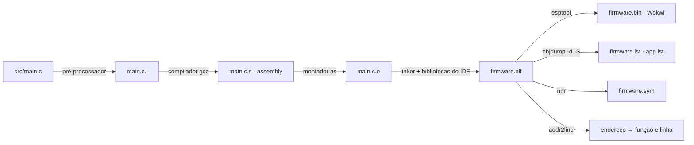
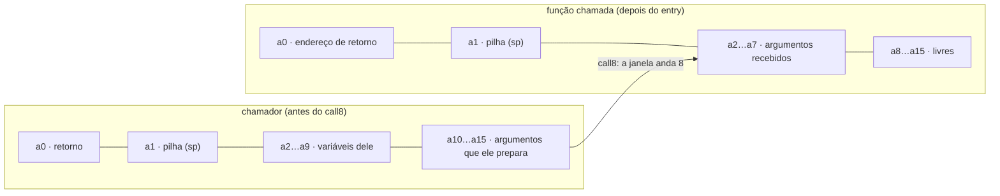

## Checklist — o assembly do ESP32: ver, ler e medir {/* #checklist */}

- [ ] Firmware do Lab 09 em `lab11`, com o `disasm.py` gerando `firmware.lst`, `app.lst`, `firmware.sym` e `firmware.secoes`, e os `.s` do compilador (T1)
- [ ] Anatomia de três funções Xtensa: janela de registradores, `l32r`, FPU e chamadas a `__divsf3` (T2)
- [ ] Mapa da memória: em que região (ROM, IRAM, flash, DRAM) fica cada símbolo, e o efeito do `IRAM_ATTR` (T3)
- [ ] Bancada de ciclos (`cmd/bancada` → `.../bancada`), com cada resultado explicado pelo assembly (T4)
- [ ] Níveis de otimização: `exemplos/otimizacao.c` de `-O0` a `-O2`, `volatile`, e o firmware inteiro em `-Og`, `-Os` e `-O2` (T5)
- [ ] Três falhas (`cmd/falha nulo | div0 | travar`) diagnosticadas pelo PC, pelos registradores e pelo `addr2line` (T6)
- [ ] Previsões P1–P5 respondidas no `README.md`
- [ ] Nenhum `push --force`; cada tarefa num commit `Tn:`

:::info[Pontuação]
**T1…T6 = 100 pts** (esta aula não tem desafios): T1 10 · T2 20 · T3 15 · T4 20 · T5 15 ·
T6 20. O autograder normaliza para 0–10. Vale o commit `Tn:` mais recente de cada tarefa.
:::

<LabSetup />

### Configuração do ambiente de desenvolvimento {/* #setup */}

<DevTools />

---

No Lab 09 você escreveu o firmware em C com as APIs do ESP-IDF, e no Lab 10 passou a verificar o
**comportamento** dele por máquina: testes unitários, `wokwi-cli` e CI. Falta olhar o que fica
entre o código e o teste: o que o compilador **gerou**. Quem executa não é o C, é uma sequência de
**instruções Xtensa** que o compilador escolheu por você, e um teste verde não diz quanto ela
custa nem o que o compilador apagou. Nesta aula o firmware
**não ganha funções novas**. Você abre o binário, lê o que o GCC gerou e mede o que cada escolha
custa:

- por que `setpoint / 2` vira uma multiplicação, mas `adc_raw / 4095.0f` vira uma **chamada de
  função**?
- onde fica cada coisa: `app_main`, `memset`, o `NOME_MODO`, a variável `seq`, a pilha da task?
- quanto custa um `float` × um `double` × um `snprintf("%.1f")`?
- o que muda entre `-Og`, `-Os` e `-O2`, e por que um laço `while (!pronto)` pode virar um laço
  **infinito**?
- e, quando o ESP32 reinicia com um **Guru Meditation**, como sair do endereço `0x400e717b` até a
  linha do C que causou o crash?



:::note[De volta ao ESP-IDF do Lab 09]
O Lab 10 usou o firmware **Arduino** (o do Lab 08), porque o `pio test` no ESP32 é mais direto
nele. Esta aula volta ao firmware **ESP-IDF** do Lab 09: tudo o que ela mede depende dele (o nível
de otimização no `sdkconfig`, o `esp_idf_size`, o `IRAM_ATTR`, o Guru Meditation do IDF). O que
veio do Lab 10 continua valendo: o `diagram.json` do template já passa no `wokwi-cli lint`, e a T5
e a T6 voltam ao pipeline para perguntar o que o CI deixaria passar.
:::

## Objetivos

- Gerar e navegar a **desmontagem** do firmware (`objdump`), a tabela de **símbolos** (`nm`) e o
  **assembly do compilador** (`-save-temps`, `-fverbose-asm`).
- Ler código **Xtensa LX6**: janela de registradores (`entry`, `call8`, `retw`), constantes por
  `l32r`, a FPU de precisão simples e as funções de biblioteca que substituem o que o hardware não
  tem.
- Localizar cada símbolo no **mapa de memória** do ESP32 e entender o que `IRAM_ATTR` e `const`
  mudam.
- **Medir** com o contador de ciclos (`CCOUNT`) e justificar cada número com as instruções.
- Comparar **níveis de otimização** e reconhecer o que o compilador pode apagar (`volatile`,
  comportamento indefinido).
- Diagnosticar um **crash** pelo PC, pelos registradores e pelo backtrace.

## Material

- VS Code + PlatformIO + extensão **Wokwi**, com o circuito de sempre (o `diagram.json` já sem o
  `channelNames` que o `wokwi-cli lint` do Lab 10 acusa).
- O toolchain que o Lab 09 já instalou (`toolchain-xtensa-esp-elf`, GCC 15.2): `objdump`, `nm`,
  `addr2line` e o próprio `gcc`. Nada para baixar.
- `mosquitto_sub`/`mosquitto_pub` via Docker, como nos labs anteriores.
- Python 3 com o pacote `esp-idf-size` (`python -m pip install esp-idf-size`), na T1 e na T3.
- Opcional: o [Compiler Explorer](https://godbolt.org) tem compiladores "Xtensa ESP32" para testar
  trechos isolados.

:::info[Como chamar as ferramentas do toolchain]
O PlatformIO não coloca o toolchain no `PATH` do terminal. Use o `pio pkg exec`, que acha o
executável dentro do pacote (funciona igual no Linux, no macOS e no Windows):

```bash title="Terminal do PlatformIO (na pasta do projeto)"
pio pkg exec -p toolchain-xtensa-esp-elf -- xtensa-esp32-elf-objdump --version
```

Nesta aula, `objdump`, `nm`, `addr2line` e `gcc` são sempre `xtensa-esp32-elf-...` chamados
assim. Para encurtar, o enunciado escreve só `$XT objdump ...`: leia como `pio pkg exec -p
toolchain-xtensa-esp-elf -- xtensa-esp32-elf-objdump ...`.
:::

## Clonar o repositório do grupo {/* #clonar */}

<LabTeamMembers labName="lab11" />

## Envie o link do repositório do seu grupo no Moodle: {/* #moodle-link */}

<LabSubmit labName="lab11" />

<details>
<summary><strong>Mapa de tarefas</strong> — 6 tarefas · 100 pts</summary>

- [T1 — Gerar e navegar o assembly](#t1) · 10 pts
- [T2 — Anatomia de uma funcao Xtensa](#t2) · 20 pts
- [T3 — Onde mora cada coisa](#t3) · 15 pts
- [T4 — Bancada de ciclos](#t4) · 20 pts
- [T5 — Niveis de otimizacao e volatile](#t5) · 15 pts
- [T6 — Diagnostico de falhas pelo assembly](#t6) · 20 pts

</details>

O repositório nasce do `lab11-template`, que traz o **firmware final do Lab 09** (ESP-IDF, com NVS
e diagnóstico, ainda com os textos em `lab09`) e o circuito:

<FileTree
  details={true}
  defaultOpen={false}
  title="Estrutura de Arquivos do Projeto"
  root="lab11-grupo-X"
  files={[
    "platformio.ini u",
    "CMakeLists.txt u",
    "sdkconfig.defaults r",
    "merge_firmware.py r",
    "disasm.py c",
    "wokwi.toml r",
    "diagram.json r",
    ".gitignore r",
    "src/CMakeLists.txt u",
    "src/idf_component.yml r",
    "src/config.h u",
    "src/main.c u",
    "src/rede.c u",
    "src/rede.h r",
    "src/sensores.c r",
    "src/atuadores.c r",
    "src/tela.c r",
    "src/bancada.h c",
    "src/bancada.c c",
    "src/falhas.h c",
    "src/falhas.c c",
    "components/dht22/ r",
    "components/gfx/ r",
    "exemplos/otimizacao.c c",
    "evidencias/t1-tamanhos.txt c",
    "evidencias/t2-anatomia.md c",
    "evidencias/t3-memoria.md c",
    "evidencias/t4-bancada.txt c",
    "evidencias/t4-analise.md c",
    "evidencias/t5-otimizacao.md c",
    "evidencias/t6-falhas.md c",
    "README.md u",
  ]}
/>

:::info[Tópicos do Lab 11]
Os mesmos do Lab 09, sob `elt85b/lab11/grupo-X/`, e mais três:

| Tópico | Direção | Conteúdo | Tarefa |
| --- | --- | --- | --- |
| `.../cmd/bancada` | → ESP32 | qualquer texto: roda a bancada de ciclos | T4 |
| `.../bancada` | ESP32 → | JSON com os ciclos de cada operação | T4 |
| `.../cmd/falha` | → ESP32 | `nulo`, `div0` ou `travar`: provoca uma falha **de propósito** | T6 |
:::

:::warning[Os endereços do seu firmware são outros]
Todas as listagens deste enunciado vêm de um build real do Lab 11 com o ESP-IDF 6.1. Mas basta
uma linha diferente no código (ou outra letra de grupo) para os endereços mudarem. Use os números
daqui como **referência de formato** e trabalhe sempre com os do **seu** `firmware.lst`.
:::

---

## Parte 1 — Gerar e navegar o assembly {/* #parte-1 */}

### 1.1 Firmware no Lab 11

Como no Lab 08, só os textos mudam. Em `src/` use **Ctrl+H** com **Match Case** ligado: `lab09` →
`lab11` (o `LAB` do `config.h`, o namespace da NVS e o `client_id`), `LAB09` → `LAB11` (a tela e o
espelho em texto) e `Lab 09` → `Lab 11` (o banner do serial). No `CMakeLists.txt` da raiz, troque
`project(lab09)` por `project(lab11)`.

### 1.2 Três jeitos de ver o assembly

| O quê | Quem gera | Quando usar |
| --- | --- | --- |
| **`.s` do compilador** | `gcc -S` (aqui: `-save-temps=obj`) | ver o que o GCC escreveu **antes** do linker: nomes das variáveis nos comentários (`-fverbose-asm`), endereços ainda simbólicos |
| **desmontagem do ELF** | `objdump -d -S` | ver o que **vai rodar**: endereços finais, bytes de cada instrução, o C intercalado |
| **símbolos** | `nm -S --size-sort` | saber **onde** e **quanto** ocupa cada função e variável |

O `platformio.ini` ganha duas coisas: os `.s` (só para o `src/`, com `build_src_flags`) e um
segundo script que roda depois de cada build:

```ini title="platformio.ini"
[env:esp32dev]
platform = espressif32@7.1.0
board = esp32dev
framework = espidf
monitor_speed = 115200
monitor_filters = esp32_exception_decoder
; depois do build: a imagem do Wokwi (Lab 09) e a desmontagem (Lab 11)
extra_scripts =
    post:merge_firmware.py
    post:disasm.py
; Lab 11: guarda o .i (pré-processado) e o .s (assembly comentado) de cada arquivo do src/
build_src_flags =
    -save-temps=obj
    -fverbose-asm
```

```python title="disasm.py"
# disasm.py — Lab 11: depois de cada build, gera a desmontagem e os símbolos do firmware.
#
#   firmware.lst     tudo: objdump -d -S -C (assembly intercalado com o C), ~18 MB
#   app.lst          só as funções do src/ (é este que você vai ler)
#   firmware.sym     símbolos do maior para o menor: endereço, tamanho, tipo, nome
#   firmware.secoes  as seções do ELF (objdump -h): onde fica cada região da memória
#
# Tudo em .pio/build/esp32dev/. Também roda fora do PlatformIO, para testar:
#   python disasm.py firmware.elf pasta-com-os-.o-do-src [prefixo-do-toolchain]
import glob
import os
import re
import subprocess
import sys

CABECALHO = re.compile(r"^([0-9a-f]{8}) <(.+)>:$")


def funcoes_do_src(nm, objetos):
    """Nomes das funções (T ou t) definidas nos objetos do src/."""
    nomes = set()
    for obj in objetos:
        saida = subprocess.run([nm, "--defined-only", obj], capture_output=True, text=True).stdout
        for linha in saida.splitlines():
            partes = linha.split()
            if len(partes) == 3 and partes[1] in ("T", "t"):
                nomes.add(partes[2])
    return nomes


def gerar(prefixo, elf, objetos, saida_dir):
    objdump, nm = prefixo + "objdump", prefixo + "nm"
    lst = os.path.join(saida_dir, "firmware.lst")
    with open(lst, "w") as f:
        subprocess.run([objdump, "-d", "-S", "-C", elf], stdout=f, check=True)

    # app.lst: corta o firmware.lst nos cabeçalhos "400dce24 <ler_adc>:" e fica com as do src/
    nomes = funcoes_do_src(nm, objetos)
    blocos, atual, manter = [], [], False
    with open(lst) as f:
        for linha in f:
            m = CABECALHO.match(linha.rstrip("\n"))
            if m:
                if manter:
                    blocos.append("".join(atual))
                atual, manter = [], m.group(2) in nomes
            elif linha.startswith("Disassembly of section"):
                if manter:
                    blocos.append("".join(atual))
                atual, manter = [], False
                continue
            atual.append(linha)
    if manter:
        blocos.append("".join(atual))
    with open(os.path.join(saida_dir, "app.lst"), "w") as f:
        f.write("\n".join(blocos))

    # símbolos com tamanho, do maior para o menor (sem os marcadores do linker, como _rtc_*_length)
    simbolos = subprocess.run([nm, "-C", "-S", "--size-sort", "-r", elf],
                              capture_output=True, text=True, check=True).stdout.splitlines()
    with open(os.path.join(saida_dir, "firmware.sym"), "w") as f:
        f.write("# endereço  tamanho  tipo nome   (t/T = código, d/D = dados com valor, b/B = zerados)\n")
        for linha in simbolos:
            partes = linha.split(maxsplit=3)
            if len(partes) == 4 and int(partes[1], 16) < 0x100000:
                f.write(linha + "\n")
    with open(os.path.join(saida_dir, "firmware.secoes"), "w") as f:
        subprocess.run([objdump, "-h", elf], stdout=f, check=True)
    print("disasm.py: %d funções do src/ em app.lst; firmware.lst, .sym e .secoes em %s"
          % (len(blocos), saida_dir))


try:
    Import("env")  # noqa: F821  (dentro do PlatformIO)
except NameError:
    env = None

if env is None:  # linha de comando
    elf, pasta = sys.argv[1], sys.argv[2]
    prefixo = sys.argv[3] if len(sys.argv) > 3 else "xtensa-esp32-elf-"
    objs = glob.glob(os.path.join(pasta, "**", "*.o*"), recursive=True)
    gerar(prefixo, elf, objs, os.path.dirname(os.path.abspath(elf)))
else:
    def pos_build(source, target, env):
        elf = str(target[0])
        build = env.subst("$BUILD_DIR")
        # $CC = "xtensa-esp32-elf-gcc": o objdump e o nm têm o mesmo prefixo
        prefixo = env.subst("$CC")[: -len("gcc")]
        caminho = env.WhereIs(prefixo + "objdump")
        if caminho:
            prefixo = caminho[: -len("objdump")]
        # objetos do src/: .pio/build/esp32dev/src/*.o
        objs = glob.glob(os.path.join(build, "src", "**", "*.o"), recursive=True)
        gerar(prefixo, elf, objs, build)

    env.AddPostAction("$BUILD_DIR/${PROGNAME}.elf", pos_build)  # noqa: F821
```

:::warning[`$OBJCOPY` não é o objcopy]
No `merge_firmware.py` do Lab 09, `$OBJCOPY` é o **esptool.py**: a plataforma espressif32 usa
esse nome para outra coisa. Por isso o `disasm.py` monta o nome do `objdump` a partir do `$CC`
(`xtensa-esp32-elf-gcc` → `xtensa-esp32-elf-objdump`).
:::

Compile (`pio run`). No fim aparece `disasm.py: 42 funções do src/ em app.lst ...` (66 depois da
T6, com a bancada e as falhas). Os arquivos ficam em `.pio/build/esp32dev/`; os `.s`, ao lado dos objetos, em
`.pio/build/esp32dev/src/` (`main.c.s`, `rede.c.s`, ...).

### 1.3 Navegando

Abra o `app.lst` no VS Code e procure (**Ctrl+F**) por `<ler_adc>:`. Cada linha de assembly tem
três colunas: **endereço**, **bytes da instrução** (2 ou 3 bytes) e **instrução**. As linhas sem
endereço são o seu C, que o `-S` intercalou:

```text title=".pio/build/esp32dev/app.lst (trecho)"
400dcaec <ao_timer>:
static void ao_timer(void *arg) { enfileirar((tipo_evento_t)(intptr_t)arg); }
400dcaec:	004136        	entry	a1, 32
400dcaef:	02ad      	mov.n	a10, a2
400dcaf1:	fffa65        	call8	400dca98 <enfileirar>
400dcaf4:	f01d      	retw.n
```

Agora abra `.pio/build/esp32dev/src/main.c.s` e procure por `ler_adc:`. É o mesmo código **antes**
do linker: em vez de endereços há rótulos (`.LC91`, `call8 __divsf3`), e o `-fverbose-asm` comenta
cada instrução com o nome das variáveis do C:

```text title=".pio/build/esp32dev/src/main.c.s (trecho; o caminho do arquivo aparece completo)"
# .../src/main.c:122:     float sp = SP_MIN + adc_raw * (SP_MAX - SP_MIN) / 4095.0f;
	l32r	a8, .LC91	#, tmp65
	l32i.n	a8, a8, 0	# adc_raw, adc_raw
	float.s	f0, a8, 0	# _2, adc_raw
	l32r	a11, .LC93	#,
	l32r	a8, .LC92	#, tmp67
	wfr	f1, a8	# tmp67, tmp67
	mul.s	f0, f0, f1	# tmp66, _2, tmp67
	rfr	a10, f0	#, tmp66
	call8	__divsf3		#
```

Para uma função só, direto do ELF:

```bash title="Terminal do PlatformIO"
pio pkg exec -p toolchain-xtensa-esp-elf -- xtensa-esp32-elf-objdump -d -S --disassemble=ler_adc .pio/build/esp32dev/firmware.elf
```

### 1.4 O que ocupa o firmware

O `firmware.sym` lista os símbolos do maior para o menor. Os primeiros quase nunca são seus:

```text title=".pio/build/esp32dev/firmware.sym (início)"
400d0020 00002920 T _stext
401034ac 000012d4 t esp_internal_sha1_parallel_engine_process$isra$0
4011c5fc 0000122f T hostap_recv_mgmt
400f3b84 000010ea T mbedtls_ssl_handshake_server_step
3ffb7258 00000f88 B g_cnxMgr
40130074 00000dc4 T ieee80211_sta_new_state
```

Para somar por **biblioteca**, use o `esp-idf-size` sobre o arquivo `.map` que o linker do ESP-IDF
gera (procure-o com `ls .pio/build/esp32dev/*.map`):

```bash title="Terminal"
python -m pip install esp-idf-size
python -m esp_idf_size .pio/build/esp32dev/lab11.map
python -m esp_idf_size --archives .pio/build/esp32dev/lab11.map
```

:::tip[Preveja antes de rodar]
**P1:** (a) o app tem ~965 KB. **Antes** de rodar o `--archives`, estime quantos KB são do seu
`src/` e quais bibliotecas vêm no topo. Depois confira. (b) O `firmware.elf` tem ~9,6 MB e o
`firmware.bin`, ~965 KB. O que está no ELF que não vai para a flash? (Olhe o `firmware.secoes`.)
(c) Compare o `ler_adc` no `main.c.s` e no `app.lst`. O que um mostra que o outro não mostra?
:::

**Evidência:** em `evidencias/t1-tamanhos.txt`: as últimas linhas do `pio run` (RAM e Flash); do
`firmware.secoes`, as linhas de `.iram0.text`, `.dram0.data`, `.dram0.bss`, `.flash.rodata` e
`.flash.text`; as 15 primeiras linhas do `firmware.sym`; e as 10 primeiras bibliotecas do
`--archives`, mais a linha da biblioteca do `src/`.

<FileTree
  root="lab11-grupo-X"
  files={[
    "platformio.ini u",
    "CMakeLists.txt u",
    "disasm.py c",
    "src/config.h u",
    "src/main.c u",
    "evidencias/t1-tamanhos.txt c",
  ]}
/>

<CommitPoint
  id="t1"
  task="Gerar e navegar o assembly"
  pontos={10}
  files="platformio.ini CMakeLists.txt disasm.py src/config.h src/main.c evidencias/t1-tamanhos.txt"
/>

---

## Parte 2 — Anatomia de uma função Xtensa {/* #parte-2 */}

### 2.1 O mínimo para ler Xtensa

O ESP32 tem dois núcleos **Xtensa LX6** de 32 bits. São 64 registradores de uso geral, mas uma
função só enxerga **16** deles, de `a0` a `a15`: é a **janela de registradores**. A cada `call8`, a
janela **anda 8 posições**. O que o chamador escreveu em `a10` aparece para a função chamada como
`a2`:



| Instrução | O que faz |
| --- | --- |
| `entry a1, N` | primeira instrução de toda função: reserva **N bytes** de pilha |
| `retw.n` | volta ao chamador e desfaz a janela. O valor de retorno sai em `a2` e o chamador o recebe em `a10` |
| `call8 X` / `callx8 a8` | chama `X` (direto) ou o endereço que está em `a8` (para longe: IRAM, ROM, outro trecho da flash) |
| `l32r aN, ...` | carrega uma **constante de 32 bits** de uma tabela (_literal pool_). O `objdump` mostra o valor entre parênteses |
| `l32i` / `s32i` / `l8ui` / `s8i` | lê / grava 32 bits ou 8 bits na memória: `l32i a8, a9, 4` lê o endereço `a9 + 4` |
| `memw` | barreira de memória: o compilador a põe antes de **todo** acesso a uma variável `volatile` |
| `mull` / `quos` | multiplicação / divisão inteira com sinal, no hardware |
| `wfr` / `rfr` | copia um registrador inteiro para um registrador da FPU (`f0…f15`) e vice-versa |
| `lsi` / `ssi` | lê / grava um `float` direto na FPU |
| `add.s` / `mul.s` / `madd.s` | soma / multiplicação / multiplica-e-soma em `float` (precisão simples) |
| `float.s` | converte inteiro → `float` |
| `.n` no fim (`mov.n`, `l32i.n`) | a mesma instrução em **2 bytes** em vez de 3: o compilador usa sempre que cabe |

Os tipos têm tamanho fixo no Xtensa: `int`, `long` e ponteiros têm **4 bytes**, e `uint32_t` é
`unsigned long` (é a P2 do Lab 10). Por isso o mesmo `l32i`/`s32i` lê e grava todos eles.

:::info[O que o hardware não tem]
A FPU do ESP32 faz `float` de 32 bits, mas **não tem instrução de divisão** e **não faz `double`**.
O compilador troca essas operações por **chamadas** a funções da `libgcc`: `__divsf3` (divisão
`float`), `__muldf3` e `__divdf3` (`double`), `__extendsfdf2` (`float` → `double`). Na listagem,
uma operação do C que vira `callx8` em vez de uma instrução é um sinal de custo.
:::

### 2.2 Lendo `atuadores_duty()`

A função do Lab 09 que converte 0–100 % em duty de 0–255:

```text title="app.lst — atuadores_duty"
400dde30 <atuadores_duty>:
uint32_t atuadores_duty(float pct) { return (uint32_t)lroundf(pct * PWM_MAX / 100.0f); }
400dde30:	006136        	entry	a1, 48
400dde33:	0129      	s32i.n	a2, a1, 0
400dde35:	cb85b1        	l32r	a11, 400d0c4c <_stext+0xc2c> (42c80000 <_etext+0x2b02a52>)
400dde38:	fa0250        	wfr	f0, a2
400dde3b:	cc1181        	l32r	a8, 400d0e80 <_stext+0xe60> (437f0000 <_etext+0x3672a52>)
400dde3e:	fa1850        	wfr	f1, a8
400dde41:	2a0010        	mul.s	f0, f0, f1
400dde44:	faa040        	rfr	a10, f0
400dde47:	cb7b81        	l32r	a8, 400d0c34 <_stext+0xc14> (40172c84 <__divsf3>)
400dde4a:	0008e0        	callx8	a8
400dde4d:	cb6e81        	l32r	a8, 400d0c08 <_stext+0xbe8> (4016e348 <lroundf>)
400dde50:	0008e0        	callx8	a8
400dde53:	0a2d      	mov.n	a2, a10
400dde55:	f01d      	retw.n
```

Linha a linha:

1. `entry a1, 48`: reserva 48 bytes de pilha. `pct` chegou em **`a2`**: no ESP32, até um `float`
   é passado num registrador **inteiro**.
2. `s32i.n a2, a1, 0`: guarda `pct` na pilha. É o `-Og` (o padrão do ESP-IDF) mantendo a variável
   visível para o depurador. Não muda o resultado.
3. `l32r a11, ... (42c80000)`: já prepara o **segundo argumento** de `__divsf3` em `a11`. O
   `0x42c80000` é o padrão de bits do `float` 100,0.
4. `wfr f0, a2` e `l32r` + `wfr f1, a8`: leva `pct` e `255.0f` (`0x437f0000`) para a FPU.
5. `mul.s f0, f0, f1`: `pct * 255`, **uma** instrução.
6. `rfr a10, f0`: o produto volta para um registrador inteiro, no lugar do **primeiro argumento**
   (`a10` aqui = `a2` em `__divsf3`).
7. `callx8 a8` com `a8 = __divsf3`: a divisão por 100 é uma **chamada de função**.
8. O resultado volta em `a10`, que já é o argumento de `lroundf()`: outra chamada.
9. `mov.n a2, a10` e `retw.n`: o retorno de `lroundf` vira o retorno da função.

Para ver o `float` por trás de um padrão de bits:

```bash title="Terminal"
python -c "import struct; print(struct.unpack('>f', bytes.fromhex('437f0000'))[0])"
```

### 2.3 Sua vez: `ler_adc()` e `enfileirar()`

Procure as duas no **seu** `app.lst` e anote-as linha a linha, como acima:

```c title="src/main.c (Lab 09)"
static void ler_adc(void)
{
    sensores_ler_pot(&adc_raw, &adc_mv);
    float sp = SP_MIN + adc_raw * (SP_MAX - SP_MIN) / 4095.0f;
    setpoint = roundf(sp * 2) / 2;                                 // passos de 0,5 °C
}

static void enfileirar(tipo_evento_t tipo)
{
    evento_t ev = {.tipo = tipo};
    if (xQueueSend(fila, &ev, 0) != pdTRUE) ESP_LOGW(TAG, "fila cheia: evento %d perdido", tipo);
}
```

Em `ler_adc`, encontre: onde fica `adc_raw` (o endereço que o `l32r` carrega), as quatro
constantes `float` (decodifique cada uma), as **duas** chamadas de função e o que aconteceu com o
`* 2` e com o `/ 2`. Em `enfileirar`, encontre o `memset` e explique o `84` que vai em `a12`, e
descubra em que instrução o `xQueueSend` do C virou `xQueueGenericSend`.

:::tip[Preveja antes de rodar]
**P2:** (a) `pct` chega em `a2`, um registrador inteiro, e precisa de um `wfr` para entrar na
FPU. Que custo isso tem em cada chamada? (b) Em `ler_adc`, o `/ 2` virou `mul.s` por `0.5`
(`0x3f000000`), mas o `/ 4095.0f` virou `__divsf3`. Por que o compilador pode trocar o primeiro e
**não pode** trocar o segundo? (Pense em potências de 2 e em arredondamento.) (c) `enfileirar`
só preenche `.tipo`, e mesmo assim zera 84 bytes. Por quê? Essa função roda 10 vezes por segundo:
isso importa?
:::

**Evidência:** `evidencias/t2-anatomia.md` com as três funções (`atuadores_duty`, `ler_adc`,
`enfileirar`) copiadas do **seu** `app.lst` e anotadas linha a linha, e uma tabela "registrador →
o que guarda" para `ler_adc`.

<FileTree root="lab11-grupo-X" files={["evidencias/t2-anatomia.md c"]} />

<CommitPoint
  id="t2"
  task="Anatomia de uma funcao Xtensa"
  pontos={20}
  files="evidencias/t2-anatomia.md"
/>

---

## Parte 3 — Onde mora cada coisa {/* #parte-3 */}

### 3.1 O mapa do ESP32

O endereço já diz **onde** um símbolo está. No ESP32 (ESP-IDF, `soc.h`):

| Faixa | Região | O que fica lá | Seção do ELF |
| --- | --- | --- | --- |
| `0x4000_0000`–`0x4006_FFFF` | **ROM** (gravada na fábrica) | `memset`, `strcmp`, `__muldf3`, ... | — (só endereço) |
| `0x4008_0000`–`0x400A_9FFF` | **IRAM** (RAM de instruções) | interrupções, partes do FreeRTOS, `IRAM_ATTR` | `.iram0.vectors`, `.iram0.text` |
| `0x400D_0000`–`0x403F_FFFF` | **flash, código** (via cache) | quase todo o código | `.flash.text` |
| `0x3F40_0000`–`0x3F7F_FFFF` | **flash, dados** (via cache) | `const`, strings, tabelas | `.flash.rodata` |
| `0x3FFA_E000`–`0x3FFF_FFFF` | **DRAM** (RAM de dados) | variáveis globais, heap, pilhas | `.dram0.data`, `.dram0.bss` |

O código na flash não é lido direto: passa por um **cache**. Se o cache está desligado (durante uma
gravação na flash, por exemplo) e uma interrupção precisa rodar, ela tem que estar na **IRAM**. É
para isso que serve o `IRAM_ATTR`.

### 3.2 Localize

Use o `firmware.sym` (ou `$XT nm -S .pio/build/esp32dev/firmware.elf | grep ...`). As funções
da ROM não estão nele (não têm tamanho): procure o nome entre `<>` no `firmware.lst`, como
`<memset>`.

| Símbolo | De onde vem |
| --- | --- |
| `app_main`, `task_app`, `ler_adc` | `src/main.c` |
| `esp_timer_get_time`, `_xt_lowint1` | ESP-IDF (`esp_timer`, vetores de interrupção) |
| `memset`, `strcmp`, `__muldf3` | chamados pelo seu código (procure no `firmware.lst`) |
| `NOME_MODO`, `estado`, `setpoint`, `seq`, `fila` | variáveis do `src/main.c` |
| `b64$…` | o `static char b64[1400]` **dentro** de `publicar_framebuffer()` |

Para cada um: endereço, região, seção, tamanho e **por que** ele está lá. Repare nas letras do
`nm`: `T`/`t` código, `D`/`d` dado com valor inicial, `B`/`b` dado zerado (`.bss`), maiúscula =
global, minúscula = `static`.

### 3.3 Experimento: `IRAM_ATTR`

Em `src/atuadores.c`, inclua `#include "esp_attr.h"` e marque a função:

```c title="src/atuadores.c (experimento)"
uint32_t IRAM_ATTR atuadores_duty(float pct) { return (uint32_t)lroundf(pct * PWM_MAX / 100.0f); }
```

Recompile e compare com o build anterior: o endereço novo de `atuadores_duty`, a linha de IRAM do
`esp_idf_size` (antes e depois) e o endereço das **duas funções que ela chama**. Depois **desfaça**
a mudança.

```text title="app.lst — atuadores_duty com IRAM_ATTR (trecho)"
4008312c <atuadores_duty>:
4008312c:	006136        	entry	a1, 48
...
40083143:	f5b081        	l32r	a8, 40080804 <_iram_text_start+0x400> (40172c58 <__divsf3>)
40083146:	0008e0        	callx8	a8
40083149:	f5af81        	l32r	a8, 40080808 <_iram_text_start+0x404> (4016e31c <lroundf>)
```

:::tip[Preveja antes de rodar]
**P3:** (a) **Antes** de procurar, diga em que região você espera cada símbolo da tabela 3.2.
Errou algum? (b) `NOME_MODO` é `static const char *NOME_MODO[]`: os ponteiros do array **não** são
`const`, e mesmo assim ele está em `0x3F4…`. Já `estado` (`static const char *estado`) está na
DRAM. O que o compilador percebeu num e não no outro? (c) Com `IRAM_ATTR`, `atuadores_duty` pode
rodar com o cache desligado? Olhe para onde apontam os dois `callx8`. (d) `.dram0.data` ocupa
espaço no `firmware.bin` e `.dram0.bss`, não. Por quê?
:::

**Evidência:** `evidencias/t3-memoria.md` com a tabela da 3.2 preenchida (endereço, região,
seção, tamanho, por quê) e o experimento da 3.3 (endereços e IRAM antes e depois).

<FileTree root="lab11-grupo-X" files={["evidencias/t3-memoria.md c"]} />

<CommitPoint
  id="t3"
  task="Onde mora cada coisa"
  pontos={15}
  files="evidencias/t3-memoria.md"
/>

---

## Parte 4 — Bancada de ciclos {/* #parte-4 */}

### 4.1 O contador de ciclos

Todo núcleo Xtensa tem um registrador **`CCOUNT`**, que soma 1 a cada ciclo de relógio da CPU
(160 MHz no ESP-IDF; o core Arduino usa 240 MHz). `esp_cpu_get_cycle_count()` o lê com **uma**
instrução. Ler antes e depois de um trecho dá o custo dele em ciclos.

Medir uma instrução isolada é difícil: a medida tem um custo próprio, e uma interrupção no meio
estraga a amostra. A bancada abaixo resolve as duas coisas: chama cada operação 64 vezes, repete
8 vezes, fica com a **menor** rodada e desconta o custo de uma chamada "vazia" (`op_base`).

```c title="src/bancada.h"
// bancada.h — Lab 11 (T4): mede o custo (ciclos de CPU) de operações básicas.
#pragma once

#include <stddef.h>

// Roda todas as medidas (~50 ms), escreve a tabela no log e o resultado em JSON.
// Devolve o tamanho do JSON, ou 0 se não coube.
size_t bancada_rodar(char *json, size_t capacidade);
```

```c title="src/bancada.c"
// bancada.c — Lab 11 (T4): quanto custa cada operação no ESP32, em ciclos de CPU.
//
// O contador CCOUNT do Xtensa soma 1 a cada ciclo do relógio da CPU (160 MHz no ESP-IDF).
// Cada medida chama a operação N vezes, repete REPETICOES vezes e fica com a MENOR: assim uma
// interrupção no meio de uma rodada não estraga o resultado. Do total sai o custo da chamada
// "vazia" (op_base), que só lê os operandos e grava o resultado.
//
// Os operandos são volatile: sem isso, o compilador calcularia 123457 * 321 na compilação e a
// "medida" seria de uma constante. Cada operação fica numa função noinline, para aparecer
// separada no firmware.lst (T4: compare os ciclos com as instruções de cada uma).
#include "bancada.h"

#include <math.h>
#include <stdio.h>
#include <stdlib.h>

#include "esp_attr.h"
#include "esp_cpu.h"
#include "esp_log.h"

static const char *TAG = "bancada";

#define N           64              // chamadas por rodada
#define REPETICOES  8               // rodadas (fica a menor)
#define NOINLINE    __attribute__((noinline))

static volatile int32_t ia = 123457, ib = 321;
static volatile float fa = 37.5f, fb = 4095.0f;
static volatile double da = 37.5, db = 4095.0;
static volatile int32_t ri;
static volatile float rf;
static volatile double rd;
static char texto[32];

// ------------------------------------------------------------------ as operações
static NOINLINE void op_base(void) { ri = ia; }                     // referência: lê e grava
static NOINLINE void op_int_soma(void) { ri = ia + ib; }
static NOINLINE void op_int_mul(void) { ri = ia * ib; }
static NOINLINE void op_int_div(void) { ri = ia / ib; }
static NOINLINE void op_int_div16(void) { ri = ia / 16; }           // divisor constante
static NOINLINE void op_float_soma(void) { rf = fa + fb; }
static NOINLINE void op_float_mul(void) { rf = fa * fb; }
static NOINLINE void op_float_div(void) { rf = fa / fb; }
static NOINLINE void op_float_inv(void) { rf = fa * (1.0f / 4095.0f); }   // multiplica pelo inverso
static NOINLINE void op_float_sqrt(void) { rf = sqrtf(fa); }
static NOINLINE void op_double_mul(void) { rd = da * db; }
static NOINLINE void op_double_div(void) { rd = da / db; }
static NOINLINE void op_int_para_float(void) { rf = (float)ia; }
static NOINLINE void op_snprintf_int(void) { snprintf(texto, sizeof(texto), "%ld", (long)ia); }
static NOINLINE void op_snprintf_float(void) { snprintf(texto, sizeof(texto), "%.1f", fa); }

// mesma função, duas casas: uma na flash (via cache), outra na IRAM
static NOINLINE void op_flash(void) { ri = ia * ib + ia; }
static NOINLINE IRAM_ATTR void op_iram(void) { ri = ia * ib + ia; }

typedef struct {
    const char *nome;
    void (*f)(void);
} operacao_t;

static const operacao_t OPS[] = {
    {"int_soma", op_int_soma},
    {"int_mul", op_int_mul},
    {"int_div", op_int_div},
    {"int_div16", op_int_div16},
    {"float_soma", op_float_soma},
    {"float_mul", op_float_mul},
    {"float_div", op_float_div},
    {"float_inv", op_float_inv},
    {"float_sqrt", op_float_sqrt},
    {"double_mul", op_double_mul},
    {"double_div", op_double_div},
    {"int_para_float", op_int_para_float},
    {"snprintf_int", op_snprintf_int},
    {"snprintf_float", op_snprintf_float},
    {"flash", op_flash},
    {"iram", op_iram},
};
#define N_OPS (sizeof(OPS) / sizeof(OPS[0]))

// ------------------------------------------------------------------ medida
static uint32_t medir(void (*f)(void))
{
    uint32_t menor = UINT32_MAX;
    for (int r = 0; r < REPETICOES; r++) {
        uint32_t t0 = esp_cpu_get_cycle_count();
        for (int i = 0; i < N; i++) f();
        uint32_t dt = esp_cpu_get_cycle_count() - t0;   // unsigned: certo mesmo se der a volta
        if (dt < menor) menor = dt;
    }
    return menor;
}

// c10 = ciclos x 10 -> "12.5" (inteiros: sem usar o float que estamos medindo)
static void formatar(char *s, size_t cap, int32_t c10)
{
    snprintf(s, cap, "%s%ld.%ld", c10 < 0 ? "-" : "", labs(c10) / 10, labs(c10) % 10);
}

size_t bancada_rodar(char *json, size_t capacidade)
{
    uint32_t base = medir(op_base);
    size_t n = snprintf(json, capacidade, "{\"n\":%d,\"base\":%lu", N, (unsigned long)(base / N));
    ESP_LOGI(TAG, "%-15s %8s", "operacao", "ciclos");
    for (size_t i = 0; i < N_OPS; i++) {
        uint32_t total = medir(OPS[i].f);
        int32_t c10 = ((int32_t)total - (int32_t)base) * 10 / N;    // por chamada, sem a base
        char c[12];
        formatar(c, sizeof(c), c10);
        ESP_LOGI(TAG, "%-15s %8s", OPS[i].nome, c);
        if (n < capacidade) n += snprintf(json + n, capacidade - n, ",\"%s\":%s", OPS[i].nome, c);
    }
    if (n < capacidade) n += snprintf(json + n, capacidade - n, "}");
    return n < capacidade ? n : 0;
}
```

### 4.2 Ligando ao firmware

No `config.h`, os tópicos novos (o `TOPICO_CMD_FALHA` já fica pronto para a T6):

```c title="src/config.h (acrescente depois de TOPICO_CMD_VE)"
#define TOPICO_BANCADA     BASE "/bancada"           // Lab 11 (T4): resultado da bancada
#define TOPICO_CMD_BANCADA BASE "/cmd/bancada"       // Lab 11 (T4): qualquer texto roda a bancada
#define TOPICO_CMD_FALHA   BASE "/cmd/falha"         // Lab 11 (T6): nulo | div0 | travar
```

No `rede.c`, assine os dois comandos no `MQTT_EVENT_CONNECTED`, junto dos outros:

```c title="src/rede.c (MQTT_EVENT_CONNECTED)"
        esp_mqtt_client_subscribe(mqtt, TOPICO_CMD_BANCADA, 0);   // Lab 11
        esp_mqtt_client_subscribe(mqtt, TOPICO_CMD_FALHA, 0);     // Lab 11
```

No `main.c`, `#include "bancada.h"` e um ramo novo em `tratar_comando()`, antes do de
aquecedor/ventilador. A bancada roda na task `app` (CPU 1), como qualquer comando:

```c title="src/main.c (tratar_comando)"
    } else if (strcmp(topico, TOPICO_CMD_BANCADA) == 0) {          // Lab 11 (T4)
        static char json[512];                                     // static: fora da pilha da app
        if (bancada_rodar(json, sizeof(json)) > 0) rede_publicar(TOPICO_BANCADA, json, -1);
```

E o `bancada.c` entra no componente:

```cmake title="src/CMakeLists.txt"
idf_component_register(
    SRCS "main.c" "rede.c" "sensores.c" "atuadores.c" "tela.c" "bancada.c"
    INCLUDE_DIRS "."
    PRIV_REQUIRES esp_wifi esp_netif esp_event nvs_flash esp_timer esp_adc
                  esp_driver_ledc esp_driver_i2c esp_driver_gpio esp_lcd mbedtls
                  mqtt dht22 gfx)
```

### 4.3 Medindo

<GroupCommands
  commands={[
    {
      codeTitle: "Terminal 1 — assinar o resultado via Docker",
      command: `docker run --rm eclipse-mosquitto:2 mosquitto_sub -h broker.hivemq.com -t '{course}/lab11/grupo-{group}/bancada' -v`,
    },
    {
      codeTitle: "Terminal 2 — rodar a bancada via Docker",
      command: `docker run --rm eclipse-mosquitto:2 mosquitto_pub -h broker.hivemq.com -t '{course}/lab11/grupo-{group}/cmd/bancada' -m 1`,
    },
  ]}
/>

**Saída esperada** (valores **ilustrativos**, medidos no QEMU da Espressif):

```text title="Monitor serial"
I (2020) app: [CMD] elt85b/lab11/grupo-a/cmd/bancada <- '1'
I (2020) bancada: operacao          ciclos
I (2020) bancada: int_soma             5.1
I (2020) bancada: int_mul              5.1
I (2020) bancada: int_div              5.1
I (2020) bancada: int_div16            3.8
I (2020) bancada: float_soma           5.1
I (2020) bancada: float_mul            5.1
I (2020) bancada: float_div           43.5
I (2020) bancada: float_inv            3.8
I (2021) bancada: float_sqrt          51.2
I (2021) bancada: double_mul          84.4
I (2023) bancada: double_div         513.2
I (2023) bancada: int_para_float       1.2
I (2028) bancada: snprintf_int      1317.6
I (2045) bancada: snprintf_float    5347.6
I (2045) bancada: flash                8.9
I (2045) bancada: iram                 8.9
```

:::warning[Simulador não é placa]
O Wokwi e o QEMU executam as instruções, mas **não reproduzem o tempo** de cada uma: o `CCOUNT`
deles anda mais ou menos **por instrução executada**. Num ESP32 de verdade, `quos` leva vários
ciclos, a FPU tem latência e um acesso à flash fora do cache custa dezenas de ciclos. Os seus
números vão ser outros. O que vale aqui é a **ordem de grandeza**, e ela você explica contando
instruções no `app.lst`. É o mesmo motivo de o cenário do Lab 10 medir o PWM no **VCD**, com
tolerância, em vez de confiar no tempo exato de cada instrução.
:::

### 4.4 Explicando cada número

Para cada operação, abra a função `op_...` no `app.lst` e conte as instruções a **mais** que a
`op_base`. Duas delas, para comparar:

```text title="app.lst — op_int_soma e op_float_div"
400de050 <op_int_soma>:
400de053:	cb9b81        	l32r	a8, 400d0ec0 <_stext+0xea0> (3ffb05ac <ia>)
400de056:	0020c0        	memw
400de059:	0888      	l32i.n	a8, a8, 0
400de05b:	cb9b91        	l32r	a9, 400d0ec8 <_stext+0xea8> (3ffb05a8 <ib>)
400de05e:	0020c0        	memw
400de061:	0998      	l32i.n	a9, a9, 0
400de063:	889a      	add.n	a8, a8, a9
...
400de118 <op_float_div>:
...
400de129:	08b8      	l32i.n	a11, a8, 0
400de12b:	cac281        	l32r	a8, 400d0c34 <_stext+0xc14> (40172c84 <__divsf3>)
400de12e:	0008e0        	callx8	a8
```

Quando a operação vira uma chamada, siga o endereço até a função chamada no `firmware.lst` (por
exemplo, procure `<__divsf3>:`) e conte o que tem lá dentro. Se o endereço for de ROM
(`0x4000…`–`0x4006…`), o código não está no seu ELF: ele está gravado no chip.

:::tip[Preveja antes de rodar]
**P4:** (a) **Antes** de rodar, ordene as 16 operações da mais barata para a mais cara. Onde você
errou? (b) No simulador, `int_div` custa o mesmo que `int_soma`. Por quê? Num chip real seria
igual? (c) `float_div` custa ~8 vezes `float_mul`. Abra o `__divsf3` no `firmware.lst`: que
instruções da FPU ele usa no lugar de uma divisão? (d) Em que região está o `__muldf3`? O que isso
diz sobre `double` no ESP32? (e) Cada `snprintf("%.1f")` custa milhares de ciclos, e o `.../pwm`
e o `.../dht` formatam vários `float` a cada mensagem. A 160 MHz, quanto tempo isso dá por
mensagem? É um problema a cada 5 s? E a 1 kHz? (f) Por que `flash` e `iram` deram o mesmo número?
Em que situação, num chip real, eles seriam diferentes?
:::

**Evidências:** em `evidencias/t4-bancada.txt`, a tabela do serial e o JSON do `.../bancada`; em
`evidencias/t4-analise.md`, uma tabela com uma linha por operação: ciclos medidos, instruções a
mais que a `op_base` (ou "chama `__divsf3`", etc.) e uma frase de explicação.

<FileTree
  root="lab11-grupo-X"
  files={[
    "src/bancada.h c",
    "src/bancada.c c",
    "src/config.h u",
    "src/rede.c u",
    "src/main.c u",
    "src/CMakeLists.txt u",
    "evidencias/t4-bancada.txt c",
    "evidencias/t4-analise.md c",
  ]}
/>

<CommitPoint
  id="t4"
  task="Bancada de ciclos"
  pontos={20}
  files="src/bancada.h src/bancada.c src/config.h src/rede.c src/main.c src/CMakeLists.txt evidencias/t4-bancada.txt evidencias/t4-analise.md"
/>

---

## Parte 5 — Níveis de otimização e `volatile` {/* #parte-5 */}

### 5.1 Quatro funções, quatro níveis

O ESP-IDF compila com **`-Og`** por padrão ("Debug": otimiza sem atrapalhar o depurador). O
Arduino usa `-Os`. Para ver o que cada nível faz, sem esperar um build inteiro, compile um arquivo
**fora** do firmware:

```c title="exemplos/otimizacao.c"
// exemplos/otimizacao.c — Lab 11 (T5): o que o compilador faz com o seu C.
// Compile com níveis diferentes e compare o assembly (veja o enunciado):
//   xtensa-esp32-elf-gcc -mlongcalls -O0 -S -o - exemplos/otimizacao.c
#include <stdbool.h>
#include <stdint.h>

// 1. média de 16 amostras (sensores_ler_pot do Lab 09): divisão por constante
int media16(const int *v)
{
    int soma = 0;
    for (int i = 0; i < 16; i++) soma += v[i];
    return soma / 16;                    // int: e se fosse unsigned?
}

unsigned media16_u(const unsigned *v)
{
    unsigned soma = 0;
    for (int i = 0; i < 16; i++) soma += v[i];
    return soma / 16;
}

// 2. ADC -> setpoint (ler_adc do Lab 09): dividir ou multiplicar pelo inverso?
float sp_divide(int raw)  { return 20.0f + raw * 35.0f / 4095.0f; }
float sp_multiplica(int raw) { return 20.0f + raw * (35.0f / 4095.0f); }

// 3. espera "ocupada" por uma flag que OUTRA task muda (wifi_ok, no rede.c do Lab 09)
bool pronto;                             // sem volatile
volatile bool pronto_v;                  // com volatile

void esperar(void)   { while (!pronto) { } }
void esperar_v(void) { while (!pronto_v) { } }

// 4. um "delay" feito com laço
void atraso(void)
{
    for (int i = 0; i < 100000; i++) { }
}

void atraso_v(void)
{
    for (volatile int i = 0; i < 100000; i++) { }
}
```

```bash title="Terminal do PlatformIO (repita com -Og, -Os e -O2)"
pio pkg exec -p toolchain-xtensa-esp-elf -- xtensa-esp32-elf-gcc -mlongcalls -O0 -S -o exemplos/otimizacao-O0.s exemplos/otimizacao.c
pio pkg exec -p toolchain-xtensa-esp-elf -- xtensa-esp32-elf-gcc -mlongcalls -O0 -c -o exemplos/otimizacao-O0.o exemplos/otimizacao.c
pio pkg exec -p toolchain-xtensa-esp-elf -- xtensa-esp32-elf-nm -S --size-sort exemplos/otimizacao-O0.o
```

O `.s` mostra o código; o `nm -S` do `.o`, o tamanho de cada função em bytes. Um exemplo do que
você vai encontrar:

```text title="esperar() em -Og e em -Os"
# -Og                                  # -Os
esperar:                               esperar:
	entry	sp, 32                         	entry	sp, 32
.L10:                                  	l32r	a8, .LC8      # &pronto
	l32r	a8, .LC5      # &pronto        	l8ui	a8, a8, 0     # lê UMA vez
	l8ui	a8, a8, 0     # lê a cada volta	bnez.n	a8, .L11
	beqz.n	a8, .L10                    .L13:
	retw.n                                 	j	.L13          # laço infinito
                                       .L11:
                                       	retw.n
```

Em `-Os`, o compilador lê `pronto` **uma vez**: se for falso, entra num `j` para ele mesmo e nunca
mais olha. Para o C isso está correto, porque nada **dentro** do laço muda `pronto`, e o
compilador não sabe que outra task muda. Em `-Og` o defeito fica **escondido**: o código funciona
no build de depuração e trava no de produção.

### 5.2 O firmware inteiro em três níveis

O nível do firmware vem do `sdkconfig`. Acrescente **uma** linha ao `sdkconfig.defaults`,
**apague** o `sdkconfig.esp32dev` (senão ele não é regenerado) e compile. Atenção: muda o nível
de **todo** o ESP-IDF, então o build é completo (alguns minutos).

```ini title="sdkconfig.defaults (acrescente uma de cada vez)"
# -Os: tamanho
CONFIG_COMPILER_OPTIMIZATION_SIZE=y
# -O2: desempenho
CONFIG_COMPILER_OPTIMIZATION_PERF=y
```

Anote, para `-Og` (o build que você já tem), `-Os` e `-O2`: o tamanho do app, a IRAM e a "Flash
Code" do `esp_idf_size`, a linha da biblioteca do `src/` no `--archives` e o tamanho de
`task_app` e de `tratar_comando` no `firmware.sym`. Rode a bancada da T4 em `-O2` também.

```text title="Referência (build -Og)"
app 964 960 bytes · IRAM 90 063 · Flash Code 710 030 · task_app 0x123 · tratar_comando 0x212
```

No fim, **volte ao padrão**: tire a linha do `sdkconfig.defaults`, apague o `sdkconfig.esp32dev` e
compile de novo. A T6 precisa do `-Og`.

:::tip[Preveja antes de rodar]
**P5 (parte 1):** (a) Na 5.1, em que níveis `atraso()` **sumiu**? Se você precisa de um atraso
curto de verdade, o que usar no ESP-IDF? (b) Por que `media16` (com `int`) precisa de três
instruções para dividir por 16 e `media16_u` (com `unsigned`), de uma? O que é a instrução `loop`
que aparece em `-Os`? (c) No `rede.c` do Lab 09, `wifi_ok` é `volatile`. Abra `rede_wifi_ok` no
`app.lst` e mostre o `memw`. O que poderia acontecer sem o `volatile`, e em que nível? (d) Na 5.2,
qual nível deu o menor app? Em `-Os` e `-O2`, `tratar_comando` some do `firmware.sym` e a
`task_app` cresce. O que aconteceu, e o que isso muda num backtrace? (e) No Lab 10, o `pio test -e
native` compila com o `gcc` do PC (outro compilador, outras opções), e o firmware vai para o ESP32
com o nível do framework. Um `esperar()` sem `volatile` seria pego pelos testes do PC? Em que nível o pipeline precisa compilar o
firmware que ele **testa** no Wokwi, e por quê?
:::

**Evidência:** `evidencias/t5-otimizacao.md` com: uma tabela "função × nível" (bytes do `nm -S`
e o que mudou) para as oito funções de `exemplos/otimizacao.c`; o `esperar` e o `esperar_v` em
`-Os` comentados; e a tabela da 5.2 com os três níveis.

<FileTree
  root="lab11-grupo-X"
  files={["exemplos/otimizacao.c c", "evidencias/t5-otimizacao.md c"]}
/>

<CommitPoint
  id="t5"
  task="Niveis de otimizacao e volatile"
  pontos={15}
  files="exemplos/otimizacao.c evidencias/t5-otimizacao.md"
/>

---

## Projeto integrador — diagnóstico de falhas pelo assembly {/* #integrador */}

Quando o firmware acessa um endereço proibido ou divide por zero, o processador gera uma
**exceção**. O ESP-IDF a captura, imprime um **Guru Meditation** com os registradores e reinicia.
Não há nome de função, nem linha: só **endereços**. Nesta tarefa você provoca três falhas de
propósito e chega à linha do C a partir deles.

### Código

```c title="src/falhas.h"
// falhas.h — Lab 11 (T6): defeitos propositais para analisar o crash pelo assembly.
#pragma once

#include <stdbool.h>

// tipo: "nulo", "div0" ou "travar". Devolve false se o tipo não existe
// (nos outros casos, normalmente não volta).
bool falhas_provocar(const char *tipo);
```

```c title="src/falhas.c"
// falhas.c — Lab 11 (T6): três defeitos de propósito, para diagnosticar pelo assembly.
//
//   cmd/falha nulo   -> grava por um ponteiro NULL                    (StoreProhibited)
//   cmd/falha div0   -> divide um inteiro por zero                    (IntegerDivideByZero)
//   cmd/falha travar -> laço sem fim na task app: o IDLE1 não roda     (task watchdog)
//
// Os dois primeiros derrubam o ESP32 (Guru Meditation + reboot). O terceiro não: o watchdog só
// avisa a cada 5 s e mostra onde a CPU 1 está presa. Nos três, a saída do serial traz endereços
// (PC, EXCVADDR, Backtrace) que você vai achar no firmware.lst.
#include "falhas.h"

#include <string.h>

#include "esp_log.h"

static const char *TAG = "falhas";

#define NOINLINE __attribute__((noinline))

typedef struct {
    int raw;
    int mv;
    float setpoint;
} leitura_t;

static leitura_t *ultima_leitura;        // nunca inicializado: continua NULL
static volatile int divisor;             // volatile: o compilador não sabe que é 0
static volatile uint32_t voltas;

static NOINLINE void guardar_setpoint(leitura_t *l, float sp)
{
    l->setpoint = sp;                    // l == NULL -> grava no endereço 0 + 8
}

static NOINLINE int media(int soma, int n)
{
    return soma / n;                     // n == 0 -> exceção do hardware (instrução quos)
}

static NOINLINE void esperar_para_sempre(void)
{
    for (;;) voltas++;                   // nunca cede a CPU: o IDLE1 não roda
}

bool falhas_provocar(const char *tipo)
{
    if (strcmp(tipo, "nulo") == 0) {
        ESP_LOGW(TAG, "gravando por um ponteiro NULL...");
        guardar_setpoint(ultima_leitura, 37.5f);
    } else if (strcmp(tipo, "div0") == 0) {
        ESP_LOGW(TAG, "dividindo por zero...");
        ESP_LOGI(TAG, "media = %d", media(1234, divisor));
    } else if (strcmp(tipo, "travar") == 0) {
        ESP_LOGW(TAG, "travando a task app (o watchdog avisa a cada 5 s)...");
        esperar_para_sempre();
    } else {
        return false;
    }
    return true;
}
```

No `main.c`, `#include "falhas.h"` e mais um ramo em `tratar_comando()`; no
`src/CMakeLists.txt`, acrescente `"falhas.c"` ao `SRCS`:

```c title="src/main.c (tratar_comando)"
    } else if (strcmp(topico, TOPICO_CMD_FALHA) == 0) {            // Lab 11 (T6)
        if (!falhas_provocar(txt)) ESP_LOGW(TAG, "[CMD] falha desconhecida (use nulo, div0 ou travar)");
```

<GroupCommands
  commands={[
    {
      codeTitle: "Terminal — provocar uma falha via Docker (troque nulo por div0 ou travar)",
      command: `docker run --rm eclipse-mosquitto:2 mosquitto_pub -h broker.hivemq.com -t '{course}/lab11/grupo-{group}/cmd/falha' -m nulo`,
    },
  ]}
/>

### Lendo um Guru Meditation

**Saída esperada** de `cmd/falha nulo` (os endereços do seu firmware são outros):

```text title="Monitor serial"
I (2220) app: [CMD] elt85b/lab11/grupo-a/cmd/falha <- 'nulo'
W (2220) falhas: gravando por um ponteiro NULL...
Guru Meditation Error: Core  1 panic'ed (StoreProhibited). Exception was unhandled.
Core  1 register dump:
PC      : 0x400e717b  PS      : 0x00060230  A0      : 0x800dc090  A1      : 0x3ffbb8b0
A2      : 0x00000000  A3      : 0x42160000  A4      : 0x3f40468c  A5      : 0x000008ac
...
A14     : 0x00000037  A15     : 0x00000000  SAR     : 0x00000004  EXCCAUSE: 0x0000001d
EXCVADDR: 0x00000008  LBEG    : 0x400012e5  LEND    : 0x40001309  LCOUNT  : 0x800dc072
Backtrace: 0x400e7178:0x3ffbb8b0 0x400dc08d:0x3ffbb8d0 0x400db3d5:0x3ffbb8f0 0x400db766:0x3ffbb940 0x400eac5d:0x3ffbb9d0
ELF file SHA256: 5384cd995
Rebooting...
```

| Campo | O que é |
| --- | --- |
| `Core 1 panic'ed (StoreProhibited)` | o núcleo e o **tipo** da exceção |
| `PC` | o endereço da instrução que falhou |
| `EXCCAUSE` | o código da causa: `6` IntegerDivideByZero, `28` (`0x1c`) LoadProhibited, `29` (`0x1d`) StoreProhibited, `0` IllegalInstruction |
| `EXCVADDR` | o endereço de memória que a instrução tentou acessar |
| `A0`…`A15` | os registradores da janela **da função que falhou**: os argumentos dela estão em `A2`, `A3`... |
| `A0` | o endereço de retorno. Os 2 bits de cima guardam o tamanho da janela: `0x800dc090` → troque o `8` por `4` → `0x400dc090` |
| `Backtrace` | pares `PC:SP` de cada função na pilha, da que falhou até a primeira |

Para transformar os endereços em funções e linhas:

```bash title="Terminal do PlatformIO"
pio pkg exec -p toolchain-xtensa-esp-elf -- xtensa-esp32-elf-addr2line -pfiaC -e .pio/build/esp32dev/firmware.elf 0x400e717b 0x400dc08d 0x400db3d5 0x400db766 0x400eac5d
```

```text title="Saída (com os endereços da listagem acima; caminhos encurtados)"
0x400e717b: guardar_setpoint at src/falhas.c:32
0x400dc08d: falhas_provocar at src/falhas.c:49
0x400db3d5: tratar_comando at src/main.c:319
0x400db766: task_app at src/main.c:383
0x400eac5d: vPortTaskWrapper at .../freertos/FreeRTOS-Kernel/portable/xtensa/port.c:147
```

Agora procure o `PC` no `app.lst`:

```text title="app.lst"
400e7178 <guardar_setpoint>:
400e7178:	004136        	entry	a1, 32
    l->setpoint = sp;                    // l == NULL -> grava no endereço 0 + 8
400e717b:	2239      	s32i.n	a3, a2, 8
```

`s32i.n a3, a2, 8` grava `a3` no endereço `a2 + 8`. O dump diz `A2 = 0` (o ponteiro `l`), `A3 =
0x42160000` (o `float` 37,5) e `EXCVADDR = 0x8`, que é `0 + 8`: o deslocamento do campo
`setpoint` dentro de `leitura_t`.

### Requisitos

1. **Os três casos.** Para `nulo`, `div0` e `travar`: copie a saída do serial, decodifique o
   backtrace com o `addr2line`, ache o `PC` (no `travar`, o terceiro endereço do backtrace) no seu
   `app.lst` e explique com os registradores **qual valor** causou a falha.
2. **`div0`.** Qual instrução falhou? Em que registradores estavam o dividendo e o divisor? Por que
   o `divisor` precisa ser `volatile` para a falha acontecer?
3. **`travar`.** O ESP32 **não** reinicia. Explique, pela mensagem do `task_wdt`, quem o watchdog
   está vigiando e por que ele aparece a cada 5 s. Explique também a enxurrada de `fila cheia:
   evento 1 perdido` (qual evento é o 1, e em quanto tempo a fila enche). O `.../status` continua
   `online`? Por quê? Para sair, reinicie a simulação.
4. **O bug que sumiu.** Compile com `CONFIG_COMPILER_OPTIMIZATION_SIZE=y` (como na 5.2), mande
   `cmd/falha nulo` de novo e veja o que acontece. Procure `falhas_provocar` no `app.lst` e explique.
   Depois volte ao `-Og`.
5. **Evidência:** `evidencias/t6-falhas.md` com os itens 1 a 4.

**Saída esperada** do `travar` (trecho):

```text title="Monitor serial"
W (2220) falhas: travando a task app (o watchdog avisa a cada 5 s)...
W (3820) app: fila cheia: evento 1 perdido
W (3920) app: fila cheia: evento 1 perdido
...
E (7219) task_wdt: Task watchdog got triggered. The following tasks/users did not reset the watchdog in time:
E (7219) task_wdt:  - IDLE1 (CPU 1)
E (7219) task_wdt: Tasks currently running:
E (7219) task_wdt: CPU 0: IDLE0
E (7219) task_wdt: CPU 1: app
E (7219) task_wdt: Print CPU 1 backtrace

Backtrace: 0x40083D82:0x3FFB1EC0 0x40083159:0x3FFB1EE0 0x400DC056:0x3FFBB8B0 0x400DC107:0x3FFBB8D0 0x400DB3D5:0x3FFBB8F0 0x400DB766:0x3FFBB940 0x400EAC5D:0x3FFBB9D0
```

:::tip[Preveja antes de rodar]
**P5 (parte 2):** (a) Antes de mandar o `nulo`, diga qual vai ser o `EXCVADDR`. E se o campo fosse
`raw` em vez de `setpoint`? (b) Os dois primeiros endereços do backtrace do `travar` são
`esp_crosscore_isr` e `_xt_lowint1`, que não são seus. De onde eles vêm? (c) No item 4, o compilador
apagou a gravação. Ele errou? O que o padrão C diz sobre gravar por um ponteiro nulo, e por que
isso é pior do que o crash?
:::

### Dicas

- O `PC` do registrador é a instrução que falhou. No `Backtrace`, os endereços das funções de cima
  são **endereços de retorno** (a instrução depois do `call`). Por isso eles caem uma linha depois
  da chamada.
- `addr2line` aceita vários endereços de uma vez. Basta colar a parte antes de cada `:`.
- Para decodificar automaticamente, o Wokwi pode expor a serial por RFC2217: acrescente
  `rfc2217ServerPort = 4000` ao `[wokwi]` do `wokwi.toml` e rode `pio device monitor -p
  rfc2217://localhost:4000`. O filtro `esp32_exception_decoder` do `platformio.ini` traduz o
  backtrace sozinho. Faça a decodificação manual **antes**: é ela que vale a nota.
- No pipeline do Lab 10, um crash vira CI vermelho com uma linha: acrescente
  `--fail-text "Guru Meditation"` à chamada do `wokwi-cli`. Ele encerra com erro assim que o
  texto aparece no serial, mesmo que o teste "esperado" ainda não tenha falhado.

<FileTree
  root="lab11-grupo-X"
  files={[
    "src/falhas.h c",
    "src/falhas.c c",
    "src/main.c u",
    "src/CMakeLists.txt u",
    "evidencias/t6-falhas.md c",
    "README.md u",
  ]}
/>

<CommitPoint
  id="t6"
  task="Diagnostico de falhas pelo assembly"
  pontos={20}
  files="src/falhas.h src/falhas.c src/main.c src/CMakeLists.txt evidencias/t6-falhas.md README.md"
/>

---

<LabLogout />
