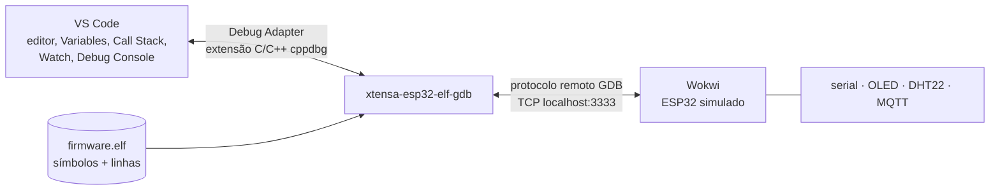

## Checklist — depuração com GDB no Wokwi for VS Code {/* #checklist */}

- [ ] Firmware em `lab12`, `wokwi.toml` com `gdbServerPort`, `.vscode/launch.json` "Wokwi GDB" e a primeira sessão parada em `app_main` (T1)
- [ ] Breakpoints (simples, condicional e de função), passo a passo, variáveis, Watch e uma variável mudada com o firmware parado (T2)
- [ ] Memória e FreeRTOS pelo GDB: `x`, `print/x`, a fila de eventos, a task de cada núcleo e a pilha da `app` (T3)
- [ ] As três falhas do Lab 11 ao vivo: o panic parado antes do reboot, o `div0` evitado e o `travar` destravado sem reiniciar (T4)
- [ ] O mesmo firmware em `-Os`: o que o depurador deixa de mostrar (T5)
- [ ] O defeito da média móvel achado com um **watchpoint**, corrigido e verificado (T6)
- [ ] Previsões P1–P5 respondidas no `README.md`
- [ ] Nenhum `push --force`; cada tarefa num commit `Tn:`

:::info[Pontuação]
**T1…T6 = 100 pts** (esta aula não tem desafios): T1 10 · T2 20 · T3 15 · T4 20 · T5 15 ·
T6 20. O autograder normaliza para 0–10. Vale o commit `Tn:` mais recente de cada tarefa.
:::

<LabSetup />

### Configuração do ambiente de desenvolvimento {/* #setup */}

<DevTools />

---

Até aqui, para saber o que o firmware estava fazendo, você tinha três ferramentas: um
`ESP_LOGI` a mais (e um build a mais), os testes do Lab 10 e, depois de um crash, os endereços do
Guru Meditation decodificados à mão no Lab 11. Todas olham **de fora** e **depois**.

Nesta aula você entra **dentro** do firmware enquanto ele roda. O Wokwi tem um **servidor GDB**:
com ele, o VS Code para o ESP32 simulado numa linha, mostra as variáveis e a pilha de chamadas,
avança uma instrução por vez, muda um valor na memória e deixa o firmware seguir. É o mesmo GDB
que, numa placa real, conversaria com o chip por JTAG.



## Objetivos

- Configurar o **Wokwi for VS Code** como alvo de depuração (`gdbServerPort`, `launch.json`,
  extensão C/C++) e conectar o GDB do toolchain do ESP-IDF.
- Usar breakpoints (de linha, condicionais, de função), passo a passo (`step`, `next`, `finish`,
  `stepi`), a pilha de chamadas, os painéis Variables e Watch e o **Debug Console** (`-exec`).
- Ler a memória e o estado do **FreeRTOS** pelo GDB: a fila de eventos, a task de cada núcleo, a
  pilha.
- Depurar um **crash** antes do reboot e mudar o estado do programa para contorná-lo.
- Entender o que a **otimização** tira do depurador.
- Achar um defeito de **corrupção de memória** com um **watchpoint**.

## Material

- VS Code + PlatformIO + **Wokwi for VS Code** (com a licença que você já usa) + extensão
  **C/C++** da Microsoft (`ms-vscode.cpptools`), que é quem fala com o GDB.
- O **GDB do Xtensa**. Desde o GCC 12, a Espressif distribui o GDB separado do compilador, e a
  plataforma `espressif32@7.1.0` com `framework = espidf` já o instala junto do build, no pacote
  **`tool-xtensa-esp-elf-gdb`** (versão 12.1 no Linux e no macOS, 11.2 no Windows). Nada para
  baixar.
- O circuito de sempre, com o `diagram.json` que já passa no `wokwi-cli lint` (Lab 10).
- `mosquitto_pub`/`mosquitto_sub` via Docker, como nos labs anteriores.

:::warning[O caminho do GDB na documentação do Wokwi é outro]
A documentação do Wokwi para PlatformIO aponta para
`~/.platformio/packages/toolchain-xtensa-esp32/bin/xtensa-esp32-elf-gdb`. Esse é o toolchain
**antigo** (GCC 8, usado pelo Arduino), que trazia o GDB dentro dele. O nosso firmware usa o
toolchain novo (`toolchain-xtensa-esp-elf`, GCC 15), que **não tem GDB**: ele está em
`~/.platformio/packages/tool-xtensa-esp-elf-gdb/`. Confira se a pasta existe:

```bash title="Terminal (Linux/macOS; no Windows: dir %USERPROFILE%\.platformio\packages)"
ls ~/.platformio/packages/ | grep gdb
ls ~/.platformio/packages/tool-xtensa-esp-elf-gdb/bin/
```
:::

## Clonar o repositório do grupo {/* #clonar */}

<LabTeamMembers labName="lab12" />

## Envie o link do repositório do seu grupo no Moodle: {/* #moodle-link */}

<LabSubmit labName="lab12" />

<details>
<summary><strong>Mapa de tarefas</strong> — 6 tarefas · 100 pts</summary>

- [T1 — Conectar o GDB ao Wokwi](#t1) · 10 pts
- [T2 — Breakpoints, passos e variaveis](#t2) · 20 pts
- [T3 — Memoria e FreeRTOS pelo GDB](#t3) · 15 pts
- [T4 — As falhas do Lab 11 ao vivo](#t4) · 20 pts
- [T5 — Depurando codigo otimizado](#t5) · 15 pts
- [T6 — Caca ao defeito com watchpoint](#t6) · 20 pts

</details>

O repositório nasce do `lab12-template`: o **firmware final do Lab 11** (ESP-IDF, com a bancada
e as falhas, ainda com os textos em `lab11`) e duas mudanças pequenas:

- **`src/filtro.c`**: uma **média móvel** das 4 últimas leituras do DHT22, publicada como
  `t_media` no `.../dht`. Ela tem um defeito, que você vai caçar na T6.
- **`src/falhas.c`**: o laço do `cmd/falha travar` agora é `while (!liberar)`. Nenhuma linha do
  firmware muda `liberar`: só o depurador (T4).

<FileTree
  details={true}
  defaultOpen={false}
  title="Estrutura de Arquivos do Projeto"
  root="lab12-grupo-X"
  files={[
    "platformio.ini r",
    "CMakeLists.txt u",
    "sdkconfig.defaults r",
    "merge_firmware.py r",
    "disasm.py r",
    "wokwi.toml u",
    "diagram.json r",
    ".gitignore u",
    ".vscode/launch.json c",
    ".vscode/extensions.json c",
    "src/config.h u",
    "src/main.c u",
    "src/filtro.h r",
    "src/filtro.c u",
    "src/falhas.c r",
    "src/bancada.c r",
    "src/rede.c r",
    "components/dht22/ r",
    "components/gfx/ r",
    "evidencias/t1-conexao.png c",
    "evidencias/t1-console.txt c",
    "evidencias/t2-depuracao.md c",
    "evidencias/t3-memoria.txt c",
    "evidencias/t4-falhas.md c",
    "evidencias/t5-otimizado.md c",
    "evidencias/t6-filtro.md c",
    "evidencias/t6-watchpoint.png c",
    "README.md u",
  ]}
/>

:::info[Tópicos do Lab 12]
Os mesmos do Lab 11, sob `elt85b/lab12/grupo-X/`. O `.../dht` ganha o campo `t_media`:
`{"grupo":"a","seq":7,"t":24.5,"t_media":24.5,"h":55.0,...}`.
:::

:::warning[Os números desta página são de referência]
As sessões de GDB mostradas aqui foram gravadas com o **mesmo firmware** rodando no QEMU da
Espressif (que também tem servidor GDB), com a rede desligada. No Wokwi, os endereços, os tempos
e a lista de threads podem ser outros. O que vale são os **nomes** das funções, as **linhas** e os
**valores** das variáveis.
:::

---

## Parte 1 — Conectar o GDB ao Wokwi {/* #parte-1 */}

### 1.1 Firmware no Lab 12

Como nos labs anteriores: em `src/` use **Ctrl+H** com **Match Case** ligado e troque `lab11` →
`lab12`, `LAB11` → `LAB12` e `Lab 11` → `Lab 12`. No `CMakeLists.txt` da raiz, `project(lab11)` →
`project(lab12)`. Compile (`pio run`) e rode no Wokwi como sempre, para conferir que nada quebrou.

### 1.2 Três arquivos

O simulador abre o servidor GDB numa porta TCP:

```toml title="wokwi.toml"
[wokwi]
version = 1
# framework = espidf: a imagem completa (gerada pelo merge_firmware.py), não só o app
firmware = '.pio/build/esp32dev/firmware.merged.bin'
elf = '.pio/build/esp32dev/firmware.elf'
# Lab 12: o simulador abre um servidor GDB nesta porta (o launch.json conecta nela)
gdbServerPort = 3333
```

O VS Code precisa saber **qual GDB** usar, **qual ELF** carregar (é dele que saem os nomes e as
linhas) e **onde** está o servidor:

```jsonc title=".vscode/launch.json"
{
  // Lab 12: depurar o firmware que roda no Wokwi.
  // 1) pio run   2) F1 > "Wokwi: Start Simulator and Wait for Debugger"   3) F5 com "Wokwi GDB"
  "version": "0.2.0",
  "configurations": [
    {
      "name": "Wokwi GDB",
      "type": "cppdbg",
      "request": "launch",
      "program": "${workspaceFolder}/.pio/build/esp32dev/firmware.elf",
      "cwd": "${workspaceFolder}",
      "MIMode": "gdb",
      "miDebuggerServerAddress": "localhost:3333",
      "linux": {
        "miDebuggerPath": "${userHome}/.platformio/packages/tool-xtensa-esp-elf-gdb/bin/xtensa-esp32-elf-gdb"
      },
      "osx": {
        "miDebuggerPath": "${userHome}/.platformio/packages/tool-xtensa-esp-elf-gdb/bin/xtensa-esp32-elf-gdb"
      },
      "windows": {
        "miDebuggerPath": "${userHome}/.platformio/packages/tool-xtensa-esp-elf-gdb/bin/xtensa-esp32-elf-gdb.exe"
      }
    }
  ]
}
```

```json title=".vscode/extensions.json"
{
  "recommendations": [
    "platformio.platformio-ide",
    "wokwi.wokwi-vscode",
    "ms-vscode.cpptools"
  ]
}
```

Desde o Lab 09, o `.gitignore` ignora a pasta `.vscode/` inteira. Agora a configuração de
depuração precisa ir para o repositório (o colega clona e já depura):

```text title=".gitignore"
.pio/
# .vscode/ fica fora do repositório, menos a configuração de depuração (Lab 12)
.vscode/*
!.vscode/launch.json
!.vscode/extensions.json
managed_components/
sdkconfig.esp32dev
sdkconfig.esp32dev.old
wokwi.vcd
# dependencies.lock VAI para o repositório: fixa as versões dos componentes baixados
```

:::note[E as configurações "PIO Debug"?]
O PlatformIO também escreve configurações no `launch.json` (as "PIO Debug"). Elas são para
depurar uma **placa real** por JTAG (um ESP-Prog, por exemplo) e não funcionam com o Wokwi.
Deixe-as no arquivo e escolha **"Wokwi GDB"** no seletor da aba **Run and Debug**. Se a sua
configuração sumir depois de mexer no `platformio.ini`, cole-a de novo.
:::

### 1.3 A primeira sessão

A ordem importa: o **simulador** abre o servidor, e só então o **GDB** pode conectar.

1. `pio run` (o ELF precisa estar atualizado: o GDB lê as linhas dele, não do seu `.c`).
2. **F1** → **Wokwi: Start Simulator and Wait for Debugger**. O simulador abre, mas fica parado.
3. Abra `src/main.c` e clique à esquerda do número da linha de `void app_main(void)`: aparece um
   ponto vermelho (**breakpoint**).
4. **F5** (com "Wokwi GDB" selecionado). O VS Code conecta, o firmware dá boot e **para** em
   `app_main`.

Repare no painel **Call Stack**: `app_main` foi chamada por `main_task`, que foi chamada por
`vPortTaskWrapper`. É o mecanismo que o Lab 09 descreveu ("quem chama o `app_main`?"), agora
visível. A barra de controle tem **Continue** (F5), **Step Over** (F10), **Step Into** (F11),
**Step Out** (Shift+F11), **Pause** (F6), **Restart** e **Stop**.

O **Debug Console** (aba ao lado do Terminal) aceita comandos do GDB, com o prefixo `-exec`:

```text title="Debug Console"
-exec info threads
-exec bt
-exec info registers pc
-exec info breakpoints
```

```text title="Saída de referência (QEMU)"
Thread 1 hit Breakpoint 1, app_main () at src/main.c:413
#0  app_main () at src/main.c:413
#1  0x400d5298 in main_task (args=0x0) at $IDF_PATH/components/freertos/app_startup.c:206
#2  0x400eaafc in vPortTaskWrapper (pxCode=0x400d5234 <main_task>, pvParameters=0x0) at $IDF_PATH/components/freertos/FreeRTOS-Kernel/portable/xtensa/port.c:147
  Id   Target Id                    Frame
* 1    Thread 1.1 (CPU#0 [running]) app_main () at src/main.c:413
  2    Thread 1.2 (CPU#1 [halted ]) 0x4008565e in esp_cpu_wait_for_intr () at $IDF_PATH/components/esp_hw_support/cpu.c:64
```

Por fim, acrescente temporariamente `"stopAtConnect": true` à configuração, reinicie (passos 2 e
4) e veja **onde** o processador está antes de qualquer código seu: anote o `pc`. Depois, tire a
linha.

:::tip[Preveja antes de rodar]
**P1:** (a) com `stopAtConnect`, em que endereço o processador está quando o GDB conecta? Em que
região do mapa do Lab 11 fica esse endereço, e quem escreveu o código que está lá? (b) Por que o
simulador precisa ser iniciado **antes** do F5? E por que um ELF desatualizado faz o depurador
parar "na linha errada"? (c) Quantas **threads** o `info threads` mostra? Elas são as tasks do
FreeRTOS ou outra coisa? Anote o que o **Wokwi** mostra (pode ser diferente do QEMU).
:::

**Evidências:** `evidencias/t1-conexao.png` (o VS Code parado em `app_main`, com o Call Stack
visível) e `evidencias/t1-console.txt` (a saída dos quatro comandos do Debug Console e o `pc` do
`stopAtConnect`).

<FileTree
  root="lab12-grupo-X"
  files={[
    "wokwi.toml u",
    ".vscode/launch.json c",
    ".vscode/extensions.json c",
    ".gitignore u",
    "CMakeLists.txt u",
    "src/config.h u",
    "src/main.c u",
    "evidencias/t1-conexao.png c",
    "evidencias/t1-console.txt c",
  ]}
/>

<CommitPoint
  id="t1"
  task="Conectar o GDB ao Wokwi"
  pontos={10}
  files="wokwi.toml .vscode/launch.json .vscode/extensions.json .gitignore CMakeLists.txt src/config.h src/main.c evidencias/t1-conexao.png evidencias/t1-console.txt"
/>

---

## Parte 2 — Breakpoints, passos e variáveis {/* #parte-2 */}

### 2.1 O mapa: painel, botão ou comando

Tudo o que a interface faz é um comando do GDB por baixo. Quando a interface não oferecer algo,
use o Debug Console.

| Quero... | No VS Code | No Debug Console |
| --- | --- | --- |
| parar numa linha | clique na margem da linha | `-exec break main.c:278` |
| parar numa função (sem abrir o arquivo) | Breakpoints ▸ **+** (Add Function Breakpoint) | `-exec break esp_panic_handler` |
| parar só às vezes | botão direito no ponto ▸ **Edit Breakpoint** ▸ Expression | `-exec condition 2 ev.tipo == EV_COMANDO` |
| executar a linha sem entrar na função | Step Over (F10) | `-exec next` |
| entrar na função | Step Into (F11) | `-exec step` |
| terminar a função e voltar | Step Out (Shift+F11) | `-exec finish` |
| uma **instrução** de máquina | Disassembly View ▸ F11 | `-exec stepi` |
| ver uma expressão sempre | painel **Watch** ▸ **+** | `-exec display setpoint` |
| mudar uma variável | Variables ▸ duplo clique no valor | `-exec set var modo = MODO_AUTO` |
| ver a memória crua | — | `-exec x/7xw &filtro_dht` |

### 2.2 Dois caminhos até `ler_adc`

Ponha um breakpoint na primeira linha de `ler_adc()` e dê **Continue** (F5) até ele parar **duas
vezes**. Em cada parada, olhe o **Call Stack** e a thread selecionada.

```text title="Saída de referência (QEMU): bt nas duas paradas"
Thread 1 hit Breakpoint 1, ler_adc () at src/main.c:122
#0  ler_adc () at src/main.c:122
#1  0x400db8a8 in app_main () at src/main.c:429
[Switching to Thread 1.2]
Thread 2 hit Breakpoint 1, ler_adc () at src/main.c:122
#0  ler_adc () at src/main.c:122
#1  0x400db6c3 in task_app (arg=0x0) at src/main.c:363
#2  0x400eaafc in vPortTaskWrapper (pxCode=0x400db684 <task_app>, pvParameters=0x0) at .../port.c:147
```

Na segunda parada: **Step Over** até a linha do `float sp = ...`, abra o painel **Variables** e
procure `sp`; passe o mouse sobre `adc_raw` e `adc_mv`; dê **Step Out** e veja `setpoint`. No
painel **Watch**, acrescente:

```text title="Painel Watch"
setpoint
NOME_MODO[modo]
adc_raw * 100 / 4095
filtro_dht
```

### 2.3 Mudar o firmware sem recompilar

Com o firmware parado, mude `modo` para `MODO_AUTO` (duplo clique em Variables, ou
`-exec set var modo = MODO_AUTO`) e dê Continue. Quando o DHT22 for lido, o `controlar()` vai
decidir pelo modo **auto**, sem nenhum `cmd/modo`. Confira no serial (`[PWM] {"modo":"auto",...}`)
e na tela.

### 2.4 Breakpoint condicional e de função

1. Em `task_app()`, ponha um breakpoint na linha do `switch (ev.tipo)` com a condição
   `ev.tipo == EV_COMANDO`. Ele ignora os 10 eventos de ADC por segundo e só para num comando.
   Mande um `cmd/modo pot` e, parado, olhe `ev.topico` e `ev.texto` no Variables.
2. Acrescente um **breakpoint de função** em `controlar` (Breakpoints ▸ **+**). Gire o
   potenciômetro no Wokwi **com o firmware rodando** e veja quem chamou (`Call Stack`).

<GroupCommands
  commands={[
    {
      codeTitle: "Terminal — um comando via Docker",
      command: `docker run --rm eclipse-mosquitto:2 mosquitto_pub -h broker.hivemq.com -t '{course}/lab12/grupo-{group}/cmd/modo' -m pot`,
    },
  ]}
/>

### 2.5 Uma instrução por vez

Pare em `atuadores_duty()` (o potenciômetro, no modo `pot`, chega lá) e abra a **Disassembly
View** (botão direito no editor ▸ **Open Disassembly View**). Avance com **F11** uma instrução por
vez até o `callx8` do `__divsf3`, e compare com a listagem que você anotou na T2 do Lab 11. No
Debug Console:

```text title="Debug Console"
-exec x/6i $pc
-exec info registers a2 a10 a11
-exec info registers f0 f1
```

:::tip[Preveja antes de rodar]
**P2:** (a) Por que a primeira parada em `ler_adc` vem do `app_main`, na CPU 0, e as seguintes da
`task_app`, na CPU 1? (b) Em `-Og` (o padrão do ESP-IDF), `sp` aparece como `<optimized out>`.
Onde o valor dela está de verdade? (Volte ao `ler_adc` do `app.lst`.) (c) Deixe o firmware
**parado** num breakpoint por um minuto, com o `mosquitto_sub` aberto em `.../status`. O que o
broker publica, e depois de quantos segundos? O que acontece quando você dá Continue? (d) Numa
placa real, um breakpoint **dentro** de `dht22_ler()` estragaria a leitura do sensor. Por quê? E no
Wokwi?
:::

**Evidência:** `evidencias/t2-depuracao.md` com o `bt` das duas paradas em `ler_adc`, o valor de
`sp`, `adc_raw`, `adc_mv` e `setpoint`, a linha do `[PWM]` depois do `set var modo`, o
`ev.topico` e o `ev.texto` do breakpoint condicional, o Call Stack do breakpoint em `controlar` e
o `x/6i $pc` com os registradores da 2.5.

<FileTree root="lab12-grupo-X" files={["evidencias/t2-depuracao.md c"]} />

<CommitPoint
  id="t2"
  task="Breakpoints, passos e variaveis"
  pontos={20}
  files="evidencias/t2-depuracao.md"
/>

---

## Parte 3 — Memória e FreeRTOS pelo GDB {/* #parte-3 */}

O GDB conhece os **tipos** de tudo o que foi compilado com `-g`, inclusive as estruturas internas
do FreeRTOS. Com um cast, dá para olhar dentro de um `QueueHandle_t`, que para o seu código é só um
ponteiro opaco. Pare em `ler_e_publicar()` (na segunda leitura do DHT22) e rode no Debug Console:

```text title="Debug Console"
-exec print *(Queue_t *) fila
-exec print pxCurrentTCBs[0]->pcTaskName
-exec print pxCurrentTCBs[1]->pcTaskName
-exec print/x pxCurrentTCBs[1]->pxStack
-exec print/x pxCurrentTCBs[1]->pxEndOfStack
-exec print/x $sp
-exec x/7xw &filtro_dht
-exec print filtro_dht
-exec x/s NOME_MODO[2]
-exec x/4i 0x4000c44c
-exec info registers lbeg lend lcount
```

```text title="Saída de referência (QEMU, trechos)"
$1 = {pcHead = 0x3ffb9ca4 "\001", ..., uxMessagesWaiting = 0, uxLength = 16, uxItemSize = 84, ...}
$2 = "IDLE0\000\000\000\000\000\000\000\000\000\000"
$3 = "app", '\000' <repeats 12 times>
$4 = 0x3ffba288
$5 = 0x3ffbba80
$6 = 0x3ffbb960
0x3ffb427c <filtro_dht>:	0x41c40000	0x00000000	0x00000000	0x00000000
0x3ffb428c <filtro_dht+16>:	0x41c40000	0x00000001	0x00000001
$7 = {amostras = {24.5, 0, 0, 0}, soma = 24.5, pos = 1, n = 1}
0x3f404314:	"auto"
   0x4000c44c:	entry	a1, 16
   0x4000c44f:	extui	a3, a3, 0, 8
```

- `pxCurrentTCBs[n]` é a task que está rodando na CPU `n` (o TCB, _task control block_, guarda o
  nome, a pilha, a prioridade...).
- A pilha da `app` vai de `pxStack` a `pxEndOfStack` e cresce **para baixo**: `pxEndOfStack −
  $sp` é o quanto está em uso **agora**, nessa linha.
- `x/7xw` mostra 7 palavras de 32 bits em hexadecimal. `0x41c40000` é o `float` 24,5 (confira
  com o `struct.unpack` do Lab 11).

:::tip[Preveja antes de rodar]
**P3:** (a) Explique o `uxLength = 16` e o `uxItemSize = 84` da fila (Labs 09 e 11). Quanto vale
o `uxMessagesWaiting` durante um `cmd/falha travar`? (b) Calcule o tamanho da pilha da `app`
(`pxEndOfStack − pxStack`) e o uso naquele instante (`pxEndOfStack − $sp`). Bate com o
`xTaskCreatePinnedToCore` e com o `pilha_livre_app` do `.../diag` (Lab 09)? (c) O `x/4i
0x4000c44c` mostra o código do `memset`, que **não está** no seu ELF (é ROM, Lab 11). De onde o GDB
o leu? (d) `LBEG`, `LEND` e `LCOUNT` são os registradores da instrução `loop` (Lab 11, T5). Por
que eles apontam para a ROM?
:::

**Evidência:** `evidencias/t3-memoria.txt` com a saída dos onze comandos e as contas da P3(b).

<FileTree root="lab12-grupo-X" files={["evidencias/t3-memoria.txt c"]} />

<CommitPoint
  id="t3"
  task="Memoria e FreeRTOS pelo GDB"
  pontos={15}
  files="evidencias/t3-memoria.txt"
/>

---

## Parte 4 — As falhas do Lab 11 ao vivo {/* #parte-4 */}

No Lab 11, você só via o crash **depois**: o Guru Meditation, o reboot e os endereços para
decodificar. Com o depurador conectado, dá para parar **antes** do reboot, e até evitar o crash.

<GroupCommands
  commands={[
    {
      codeTitle: "Terminal — provocar uma falha via Docker (nulo, div0 ou travar)",
      command: `docker run --rm eclipse-mosquitto:2 mosquitto_pub -h broker.hivemq.com -t '{course}/lab12/grupo-{group}/cmd/falha' -m nulo`,
    },
  ]}
/>

### 4.1 `nulo`: parar dentro do panic

O panic handler do ESP-IDF só entrega o controle ao depurador sozinho se detectar um depurador
**JTAG** no chip. Com o servidor GDB de um simulador, não conte com isso: ponha você mesmo um
**breakpoint de função** em `esp_panic_handler` e mande o `cmd/falha nulo`.

```text title="Saída de referência (QEMU): bt dentro do panic"
Thread 2 hit Breakpoint 2, esp_panic_handler (info=0x3ffbb810) at .../esp_system/panic.c:324
#0  esp_panic_handler (info=0x3ffbb810) at .../esp_system/panic.c:324
#1  0x400d32e6 in panic_handler (frame=0x3ffbb810, pseudo_excause=false) at .../port/panic_handler.c:264
#2  0x40081967 in xt_unhandled_exception (frame=0x3ffbb810) at .../port/panic_handler.c:307
#3  0x40082ebb in _xt_handle_exc () at .../xtensa/xtensa_vectors.S:830
#4  0x400e70a7 in guardar_setpoint (l=0x0, sp=0) at src/falhas.c:33
#5  0x400dc0d0 in falhas_provocar (tipo=0x3ffbb9b4 "nulo") at src/falhas.c:52
#6  0x400db404 in tratar_comando (topico=0x3ffbb974 "elt85b/lab12/grupo-a/cmd/falha", txt=0x3ffbb9b4 "nulo") at src/main.c:324
#7  0x400db795 in task_app (arg=0x0) at src/main.c:388
```

O GDB atravessa a exceção e mostra a pilha inteira, inclusive os argumentos de `tratar_comando`
(o tópico e o texto do comando). Mas não confie nos argumentos de `guardar_setpoint` no quadro
#4: `sp=0` está **errado** (o programa gravava 37,5), e numa outra execução o `l` também saiu com
lixo. Naquele ponto a janela de registradores foi salva pela exceção, e o GDB não sabe onde. Os valores verdadeiros estão na **`XtExcFrame`**, a estrutura que o vetor de
exceção preencheu. Clique no quadro `panic_handler` do Call Stack e:

```text title="Debug Console (no quadro de panic_handler)"
-exec print/x *(XtExcFrame *) frame
-exec x/i ((XtExcFrame *) frame)->pc
```

```text title="Saída de referência (QEMU)"
$3 = {exit = 0x3ffbb8d0, pc = 0x400e70a7, ps = 0x60230, a0 = 0x800dc0d0, a1 = 0x3ffbb8d0, a2 = 0x0, a3 = 0x42160000, ..., exccause = 0x1d, excvaddr = 0x8, lbeg = 0x400012e5, lend = 0x40001309, lcount = 0x800dc0b2, ...}
   0x400e70a7 <guardar_setpoint+3>:	s32i.n	a3, a2, 8
```

É o **mesmo** conteúdo que o Guru Meditation vai imprimir quando você der Continue. Confira.

### 4.2 `div0`: evitar o crash

Ponha um breakpoint em `media()` e mande `cmd/falha div0`. Olhe os argumentos.

```text title="Saída de referência (QEMU)"
Thread 2 hit Breakpoint 1, media (soma=1061176952, n=1061175468) at src/falhas.c:38
```

Lixo de novo, e não é a exceção: o breakpoint caiu **na própria instrução `entry`**, antes de a
janela de registradores girar (Lab 11, T2). Os argumentos ainda estão em `a10`/`a11` do chamador. Dê
**um** `stepi` e olhe de novo: agora `soma = 1234` e `n = 0`. Então:

```text title="Debug Console"
-exec stepi
-exec info args
-exec set var n = 2
-exec info args
```

Remova o breakpoint e dê Continue. No serial aparece `I (...) falhas: media = 617`, e o ESP32
**não** reinicia.

:::warning[Mude o valor no lugar certo]
Se você fizer o `set var n = 2` **antes** do `stepi`, o GDB escreve no registrador errado, a
divisão acontece com `n = 0` e o crash vem do mesmo jeito. No Xtensa, só confie nos argumentos
depois do `entry`.
:::

### 4.3 `travar`: destravar sem reiniciar

Mande `cmd/falha travar` e espere aparecer o `task_wdt` e a enxurrada de `fila cheia`. Agora:

1. **Pause** (F6). A CPU pode parar dentro de um **vetor de interrupção** (o tick do FreeRTOS
   roda 1000 vezes por segundo), e aí o Call Stack fica curto. Não se preocupe.
2. Ponha um breakpoint na linha `while (!liberar) voltas++;` e dê Continue: ele para na hora,
   porque a CPU 1 não sai dali.
3. Olhe `voltas` e a fila (`-exec print ((Queue_t *) fila)->uxMessagesWaiting`).
4. `-exec set var liberar = 1`, remova o breakpoint e dê Continue.

A task `app` sai do laço, processa os 16 eventos que estavam na fila e volta a publicar. O
`task_wdt` para de reclamar. Nada reiniciou.

:::tip[Preveja antes de rodar]
**P4:** (a) Por que o GDB mostra `sp=0` em `guardar_setpoint`, mas a `XtExcFrame` mostra
`a3 = 0x42160000`? Qual dos dois é o valor que o programa usou, e quanto ele vale em `float`? (b) Por que o `set var n = 2` só funciona
depois do `stepi`? (c) O GDB tem um comando `return` que tira uma função da pilha. Por que este lab
usa uma variável `liberar` em vez de `return`? (Dica: lembre o que a janela de registradores
precisa desfazer.) (d) Com o firmware parado no breakpoint do `travar`, o watchdog **não**
reclama. Por quê?
:::

**Evidência:** `evidencias/t4-falhas.md` com, para cada falha: os comandos que você usou, o `bt` e
o que mudou no serial. Para o `nulo`, inclua a `XtExcFrame` e o Guru Meditation que veio depois.

<FileTree root="lab12-grupo-X" files={["evidencias/t4-falhas.md c"]} />

<CommitPoint
  id="t4"
  task="As falhas do Lab 11 ao vivo"
  pontos={20}
  files="evidencias/t4-falhas.md"
/>

---

## Parte 5 — Depurando código otimizado {/* #parte-5 */}

O ESP-IDF compila com `-Og` justamente para o depurador funcionar. Para ver por quê, compile o
mesmo firmware com `-Os`, como na T5 do Lab 11: acrescente ao `sdkconfig.defaults`, apague o
`sdkconfig.esp32dev` e compile.

```ini title="sdkconfig.defaults (só nesta parte)"
CONFIG_COMPILER_OPTIMIZATION_SIZE=y
```

Repita, em `-Os`, quatro coisas que você fez em `-Og`:

1. o breakpoint em `ler_adc` e o Step Over linha a linha (a seta pula? volta?);
2. o breakpoint de função em `tratar_comando` (essa função ainda existe no `firmware.sym`?);
3. um breakpoint na linha `f->pos++;` do `filtro.c`;
4. o painel Variables em `ler_e_publicar` (quantas variáveis aparecem `<optimized out>`?).

O próprio GDB conta o que aconteceu com cada linha e cada variável:

```text title="Debug Console"
-exec info line filtro.c:17
-exec info scope ler_e_publicar
-exec info breakpoints
```

```text title="Saída de referência: info line filtro.c:17"
# -Og
Line 17 of "src/filtro.c" starts at address 0x400de4da <filtro_adicionar+58> and ends at 0x400de4de <filtro_adicionar+62>.
# -Os
Line 17 of "src/filtro.c" is at address 0x400dc876 <filtro_adicionar+46> but contains no code.
```

No fim, **volte ao `-Og`**: tire a linha do `sdkconfig.defaults`, apague o `sdkconfig.esp32dev`
e compile. A T6 precisa do `-Og`.

:::tip[Preveja antes de rodar]
**P5 (parte 1):** (a) Em `-Os`, a função `tratar_comando` não existe mais no `firmware.sym`
(Lab 11), e mesmo assim o breakpoint de função funciona. Como? (b) O que significa "contains no
code" para a linha 17, e onde foi parar o `f->pos++`? (c) Você depura em `-Og` e entrega em
`-Os`. Que tipo de defeito pode aparecer **só** na versão entregue? (Lembre o `esperar()` e o
`nulo` do Lab 11.)
:::

**Evidência:** `evidencias/t5-otimizado.md` com uma tabela "o que eu fiz × o que vi em `-Og` × o
que vi em `-Os`" para os quatro itens, e a saída dos três comandos nos dois níveis.

<FileTree root="lab12-grupo-X" files={["evidencias/t5-otimizado.md c"]} />

<CommitPoint
  id="t5"
  task="Depurando codigo otimizado"
  pontos={15}
  files="evidencias/t5-otimizado.md"
/>

---

## Projeto integrador — caça ao defeito com watchpoint {/* #integrador */}

O `filtro.c` do template tem um defeito. Com o DHT22 parado em **24,5 °C** (o valor inicial do
diagrama), o `.../dht` mostra:

```text title="mosquitto_sub .../dht (trecho)"
{"grupo":"a","seq":1,"t":24.5,"t_media":24.5,...}
{"grupo":"a","seq":2,"t":24.5,"t_media":24.5,...}
{"grupo":"a","seq":3,"t":24.5,"t_media":24.5,...}
{"grupo":"a","seq":4,"t":24.5,"t_media":24.5,...}
{"grupo":"a","seq":5,"t":24.5,"t_media":12.2,...}
{"grupo":"a","seq":6,"t":24.5,"t_media":12.2,...}
```

A média de quatro leituras iguais a 24,5 não pode ser 12,2. E nenhuma linha de código faz
`soma = ...` com metade de nada. Alguém está escrevendo onde não devia.

### A ferramenta: watchpoint

Um **watchpoint** para o programa quando um **endereço de memória muda**, seja qual for a linha
que escreveu. O ESP32 tem **dois** comparadores de endereço no hardware para isso, e o GDB os usa
(_hardware watchpoint_). Um breakpoint pergunta "quando esta linha roda?"; um watchpoint pergunta
"**quem** mexeu nesta variável?".

```text title="Debug Console"
-exec watch filtro_dht.soma
```

(No VS Code também dá para clicar com o botão direito numa variável do painel Variables e escolher
**Break When Value Changes**.)

### Requisitos

1. **Reproduza** o sintoma no Wokwi (deixe 6 leituras passarem) e anote o `seq` em que `t_media`
   errou.
2. **Prenda o defeito:** reinicie a sessão, pare em `app_main`, crie o watchpoint em
   `filtro_dht.soma` e dê Continue a cada parada. Em cada uma, anote o valor antigo, o novo, a
   linha e `f->pos`. Ache a parada em que `soma` muda numa linha que **não deveria** escrever nela.
3. **Prove o mecanismo** com o GDB:

   ```text title="Debug Console (parado no filtro_adicionar)"
   -exec print *f
   -exec print &f->amostras[4]
   -exec print &f->soma
   -exec ptype filtro_t
   ```

4. **Corrija** o `filtro.c` (uma linha) e **verifique** com o mesmo watchpoint: agora `soma` só
   muda nas linhas certas, e o `t_media` do `.../dht` fica certo também com temperaturas
   diferentes (mexa no DHT22 do Wokwi).
5. **Evidências:** `evidencias/t6-filtro.md` com a tabela das paradas (antes e depois da
   correção), a saída dos comandos do item 3 e a explicação em três frases; `evidencias/t6-watchpoint.png`
   com o VS Code parado no watchpoint que entrega o defeito.

```text title="Saída de referência (QEMU, DHT22 falso com a sequência do Lab 07: 24,5 → 37,4 → 38,2 → 41,0 → 37,8)"
Hardware watchpoint 2: filtro_dht.soma
Old value = 0
New value = 24.5
filtro_adicionar (f=0x3ffb427c <filtro_dht>, x=24.5) at src/filtro.c:17
...
Old value = 100.100006
New value = 141.100006
filtro_adicionar (f=0x3ffb427c <filtro_dht>, x=41) at src/filtro.c:17
```

O watchpoint para na linha **seguinte** à que escreveu: o hardware avisa depois da gravação.

:::warning[Se o watchpoint não funcionar no Wokwi]
O watchpoint de hardware depende do servidor GDB do simulador. Se o Wokwi recusar o `watch` (ou o
GDB disser que usou um _software watchpoint_, que avança instrução por instrução e fica lento
demais), use um **breakpoint condicional** na linha `f->amostras[f->pos] = x;` com a condição
`f->pos >= FILTRO_N`, e registre no `t6-filtro.md` qual dos dois caminhos você usou.
:::

:::tip[Preveja antes de rodar]
**P5 (parte 2):** (a) **Antes** do watchpoint: em que leitura (`seq`) e em que linha você aposta
que `soma` é estragada? (b) O defeito escreve fora do vetor e o ESP32 **não** trava. Por quê? Que
outro membro da struct seria estragado se `soma` estivesse declarada depois de `pos`? (c) Que
teste unitário, no estilo do Lab 10, teria pegado esse defeito antes de ele chegar ao firmware?
:::

<FileTree
  root="lab12-grupo-X"
  files={[
    "src/filtro.c u",
    "evidencias/t6-filtro.md c",
    "evidencias/t6-watchpoint.png c",
    "README.md u",
  ]}
/>

<CommitPoint
  id="t6"
  task="Caca ao defeito com watchpoint"
  pontos={20}
  files="src/filtro.c evidencias/t6-filtro.md evidencias/t6-watchpoint.png README.md"
/>

---

<LabLogout />
