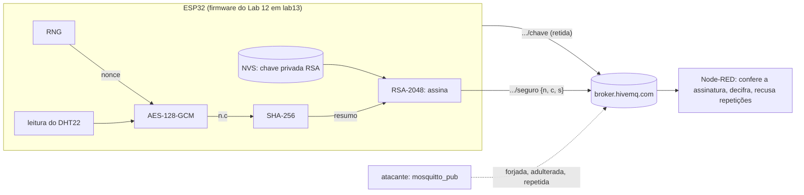
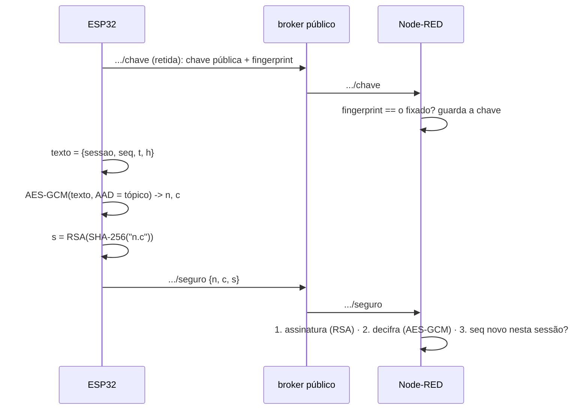

## Checklist — criptografia no ESP32: RNG, SHA, AES e RSA {/* #checklist */}

- [ ] Firmware em `lab13` com o `cripto.c`, a fonte de entropia ligada no boot e o teste estatístico do **RNG** (T1)
- [ ] **SHA-256** no acelerador: autoteste com o vetor do FIPS 180 e `cmd/cripto sha` conferido no PC (T2)
- [ ] **AES-128-GCM** no acelerador: cada leitura em `.../cifrado`, decifrada no PC, e a adulteração detectada (T3)
- [ ] **RSA-2048** no acelerador: par de chaves persistente na NVS, chave pública em `.../chave` e cada leitura assinada em `.../assinado` (T4)
- [ ] Bancada de ciclos com os aceleradores ligados e desligados (`CONFIG_MBEDTLS_HARDWARE_*`) (T5)
- [ ] Node-RED aceitando só leituras assinadas, decifráveis e novas, e recusando os quatro ataques (T6)
- [ ] Previsões P1–P6 respondidas no `README.md`
- [ ] Nenhum `push --force`; cada tarefa num commit `Tn:`
- [ ] Logout do Git e do `gh` no computador do laboratório

:::info[Pontuação]
**T1…T6 = 100 pts** (esta aula não tem desafios): T1 10 · T2 15 · T3 20 · T4 20 · T5 15 ·
T6 20. O autograder normaliza para 0–10. Vale o commit `Tn:` mais recente de cada tarefa.
:::

<LabSetup />

### Configuração do ambiente de desenvolvimento {/* #setup */}

<DevTools />

---

Desde o Lab 05, o ESP32 publica num broker **público** (`broker.hivemq.com`): qualquer pessoa
**lê** as leituras da câmara e qualquer pessoa **publica** nos tópicos de comando. O Lab 08 mostrou
uma "leitura" forjada sendo gravada no banco só porque tinha o formato certo. Nesta aula o firmware
passa a proteger o que envia, com os quatro periféricos de criptografia que o ESP32 tem no chip:

| Periférico          | O que faz no hardware                                            | Para que serve aqui                           | Tarefa |
| ------------------- | ---------------------------------------------------------------- | --------------------------------------------- | ------ |
| **RNG**             | números aleatórios a partir de ruído físico                      | chaves, _nonces_, identificador de sessão     | T1     |
| **SHA Accelerator** | resumo (_hash_) SHA-1/SHA-256/SHA-384/SHA-512                    | resumo de cada mensagem antes de assinar      | T2     |
| **AES Accelerator** | cifra e decifra blocos de 16 bytes, com chaves de 128 a 256 bits | **sigilo** e **integridade** da leitura       | T3     |
| **RSA Accelerator** | exponenciação modular de números de até 4096 bits                | **assinatura**: prova de que veio deste ESP32 | T4     |



## Objetivos

- Usar o **RNG** do ESP32 e entender **quando** ele é aleatório de verdade (fonte de entropia, Wi-Fi,
  ADC).
- Calcular **SHA-256** e conferir o resultado com um vetor de teste e com o PC.
- Cifrar com **AES-128-GCM**: chave, _nonce_ único, dado associado (AAD) e _tag_ de autenticação.
- Gerar um par **RSA-2048** que fica na flash do ESP32, publicar a chave pública e **assinar** cada
  leitura.
- Usar a API **PSA Crypto** do ESP-IDF 6 e **medir** o ganho dos aceleradores contra o software.
- Montar no Node-RED um receptor que confere **autenticidade**, **integridade**, **sigilo** e
  **frescor**, e testá-lo com ataques.

## Material

- VS Code + PlatformIO + **Wokwi for VS Code**, com o circuito de sempre.
- O firmware **ESP-IDF** do Lab 12 (a média móvel já corrigida). Nenhuma biblioteca nova: a PSA
  Crypto vem com o componente `mbedtls` do ESP-IDF 6.
- Python 3 com o pacote **`cryptography`** (`py -m pip install cryptography`), para conferir no PC o
  que o ESP32 fez.
- O stack do curso: **Node-RED** com o **Dashboard 2.0** e o `mosquitto_pub`/`mosquitto_sub` via
  Docker.

:::info[O que o Wokwi simula]
O guia de ESP32 do Wokwi lista o **RNG** e os aceleradores **AES**, **SHA** e **RSA** do ESP32 como
simulados: a aula roda inteira no Wokwi. Dois cuidados:

- O simulador não reproduz o **tempo** de cada operação (é o aviso da T4 do Lab 11). Na T5, compare
  a **ordem de grandeza**, não os números exatos.
- O RNG simulado é sempre "bom". A diferença entre ter e não ter fonte de entropia (T1) só aparece
  num chip real, e mesmo lá **nenhum teste estatístico a revela**. É a P1.
  :::

:::warning[Segurança de laboratório]
Esta aula ensina os blocos de construção, não um sistema pronto para produção. A chave AES fica no
`config.h` (e portanto no Git e no `firmware.bin`), a chave privada RSA fica na NVS **sem**
criptografia da flash, e o broker continua público. O fim da página aponta o caminho de verdade:
TLS, _flash encryption_, NVS criptografada e o periférico **DS** (_Digital Signature_).
:::

## Clonar o repositório do grupo {/* #clonar */}

<LabTeamMembers labName="lab13" />

## Envie o link do repositório do seu grupo no Moodle: {/* #moodle-link */}

<LabSubmit labName="lab13" />

<details>
<summary><strong>Mapa de tarefas</strong> — 6 tarefas · 100 pts</summary>

- [T1 — Projeto e RNG](#t1) · 10 pts
- [T2 — SHA-256 no acelerador](#t2) · 15 pts
- [T3 — AES-128-GCM no acelerador](#t3) · 20 pts
- [T4 — Assinatura RSA no acelerador](#t4) · 20 pts
- [T5 — Bancada: hardware x software](#t5) · 15 pts
- [T6 — Node-RED: so leituras autenticas](#t6) · 20 pts

</details>

O repositório nasce do `lab13-template`: o **firmware final do Lab 12** (ESP-IDF, com a bancada, as
falhas e o filtro corrigido, ainda com os textos em `lab12`) e as duas ferramentas do PC em
`ferramentas/`.

<FileTree
  details={true}
  defaultOpen={false}
  title="Estrutura de Arquivos do Projeto"
  root="lab13-grupo-x"
  files={[
    "platformio.ini r",
    "CMakeLists.txt u",
    "sdkconfig.defaults r",
    "merge_firmware.py r",
    "disasm.py r",
    "wokwi.toml r",
    "diagram.json r",
    ".gitignore r",
    ".vscode/launch.json r",
    "src/CMakeLists.txt u",
    "src/config.h u",
    "src/main.c u",
    "src/rede.h u",
    "src/rede.c u",
    "src/cripto.h c",
    "src/cripto.c c",
    "src/filtro.c r",
    "src/bancada.c r",
    "src/falhas.c r",
    "components/dht22/ r",
    "components/gfx/ r",
    "ferramentas/decifrar.py r",
    "ferramentas/verificar.py r",
    "nodered/flows-lab13.json c",
    "evidencias/t1-serial.txt c",
    "evidencias/t1-rng.txt c",
    "evidencias/t2-sha.txt c",
    "evidencias/t3-cifrado.json c",
    "evidencias/t3-aes.txt c",
    "evidencias/t4-chave.json c",
    "evidencias/t4-assinado.json c",
    "evidencias/t4-rsa.txt c",
    "evidencias/t5-bancada.md c",
    "evidencias/t6-ataques.md c",
    "evidencias/t6-dashboard.png c",
    "README.md u",
  ]}
/>

:::info[Tópicos do Lab 13]
Os mesmos do Lab 12, sob `elt73a/lab13/grupo-x/`, e mais seis:

| Tópico           | Sentido        | Conteúdo                                                     | Tarefa |
| ---------------- | -------------- | ------------------------------------------------------------ | ------ |
| `.../cmd/cripto` | broker → ESP32 | `rng`, `sha <texto>`, `autoteste` ou `bancada`               | T1–T5  |
| `.../cripto`     | ESP32 → broker | JSON com o resultado do comando                              | T1–T5  |
| `.../cifrado`    | ESP32 → broker | `{"n":"<nonce>","c":"<cifrado + tag>"}` (base64)             | T3     |
| `.../chave`      | ESP32 → broker | `{"rsa":"<chave pública>","fp":"<fingerprint>"}`, **retida** | T4     |
| `.../assinado`   | ESP32 → broker | `{"m":"<leitura>","s":"<assinatura>"}` (base64)              | T4     |
| `.../seguro`     | ESP32 → broker | `{"n":...,"c":...,"s":...}`: cifrado **e** assinado          | T6     |

O `.../dht` continua em texto claro, como antes, para o Node-RED do Lab 08 não perceber a mudança.
:::

---

## Parte 1 — Projeto e RNG {/* #parte-1 */}

:::info[Suba o stack do LAB13!]
Execute os comandos para subir o [stack do LAB13](/infra/setup/gen_iot_aluno#lab-13)!
:::

### 1.1 Firmware no Lab 13

Como nos labs anteriores: em `src/` use **Ctrl+H** com **Match Case** ligado e troque `lab12` →
`lab13` (o `LAB` do `config.h`, o namespace da NVS e o `client_id`), `LAB12` → `LAB13` e
`Lab 12` → `Lab 13`. No `CMakeLists.txt` da raiz, `project(lab12)` → `project(lab13)`.

### 1.2 A biblioteca `cripto`

No ESP-IDF 6, o **mbedTLS 4** expõe a criptografia só pela API **PSA Crypto** (`psa/crypto.h`): as
funções antigas `mbedtls_aes_*`, `mbedtls_sha256_*` e `mbedtls_rsa_*` saíram da API pública. Com
as opções `CONFIG_MBEDTLS_HARDWARE_AES`, `CONFIG_MBEDTLS_HARDWARE_SHA` e
`CONFIG_MBEDTLS_HARDWARE_MPI` (ligadas por padrão), os _drivers_ PSA do ESP-IDF mandam o trabalho
para os aceleradores. O seu código chama a mesma função com ou sem acelerador: é o que a T5 mede.

O `cripto.c` completo entra agora; cada parte seguinte liga uma função dele ao firmware e explica o
periférico por trás.

<FileTree root="lab13-grupo-x" files={["src/cripto.h c", "src/cripto.c c"]} />

```c title="src/cripto.h"
// cripto.h — Lab 13: RNG, SHA, AES e RSA do ESP32 pela API PSA Crypto (ESP-IDF 6).
#pragma once

#include <stdbool.h>
#include <stddef.h>

// Chaves e autoteste. Chame depois do nvs_flash_init() (a chave RSA fica na NVS) e com a fonte
// de entropia ligada (bootloader_random_enable() ou Wi-Fi). Devolve false se algo falhou.
bool cripto_iniciar(void);

// RNG: estatística de 4096 bytes do esp_fill_random() (T1). Escreve no log e devolve o JSON.
size_t cripto_teste_rng(const char *rotulo, char *json, size_t capacidade);

// Comandos de .../cmd/cripto: "rng", "sha <texto>", "autoteste", "bancada".
// Devolve o tamanho do JSON de resposta, ou 0 se o comando não existe ou falhou.
size_t cripto_comando(const char *txt, char *json, size_t capacidade);

// Chave pública RSA (DER em base64) e o fingerprint SHA-256, em JSON (T4).
size_t cripto_chave_publica(char *json, size_t capacidade);

// {"n":"<nonce>","c":"<cifrado+tag>"}: AES-128-GCM com o tópico como dado associado (T3).
size_t cripto_cifrada(const char *topico, const char *texto, char *json, size_t capacidade);

// {"m":"<mensagem>","s":"<assinatura>"}: RSA-2048 PKCS#1 v1.5 sobre o SHA-256 da mensagem (T4).
size_t cripto_assinada(const char *texto, char *json, size_t capacidade);

// {"n":..., "c":..., "s":...}: cifra (T3) e assina o texto "n.c" (T4) (T6).
size_t cripto_segura(const char *topico, const char *texto, char *json, size_t capacidade);
```

<details>
<summary><strong><code>src/cripto.c</code></strong> (clique para abrir)</summary>

```c title="src/cripto.c"
// cripto.c — Lab 13: os quatro periféricos de criptografia do ESP32, pela API PSA Crypto.
//
//   RNG  esp_fill_random()                       nonces, chaves, testes estatísticos (T1)
//   SHA  psa_hash_compute(PSA_ALG_SHA_256)        resumo de mensagens (T2)
//   AES  psa_aead_encrypt(PSA_ALG_GCM)            sigilo e integridade com chave compartilhada (T3)
//   RSA  psa_sign_hash(RSA PKCS#1 v1.5)           assinatura com chave privada que não sai do chip (T4)
//
// No ESP-IDF 6, o mbedTLS 4 só expõe a API PSA. Com CONFIG_MBEDTLS_HARDWARE_SHA, _AES e _MPI
// (ligados por padrão), os drivers PSA do ESP-IDF usam os aceleradores do chip; desligados, as
// mesmas chamadas rodam em software (T5).
#include "cripto.h"

#include <stdint.h>
#include <stdio.h>
#include <string.h>

#include "config.h"
#include "esp_cpu.h"
#include "esp_log.h"
#include "esp_random.h"
#include "esp_timer.h"
#include "mbedtls/base64.h"
#include "psa/crypto.h"
#include "sdkconfig.h"

static const char *TAG = "cripto";

#define ID_CHAVE_RSA   ((psa_key_id_t)0x13)            // chave persistente (PSA ITS, na NVS)
#define RSA_BITS       2048
#define ALG_ASSINATURA PSA_ALG_RSA_PKCS1V15_SIGN(PSA_ALG_SHA_256)
#define NONCE_BYTES    12                               // tamanho recomendado para o GCM
#define TAG_BYTES      16
#define TEXTO_MAX      256                              // maior texto que cifra/assina

static psa_key_id_t chave_aes;                          // volátil: importada a cada boot
static char fingerprint[65];                            // SHA-256 da chave pública, em hex

// ------------------------------------------------------------------ utilidades
static void para_hex(const uint8_t *b, size_t n, char *saida)
{
    for (size_t i = 0; i < n; i++) sprintf(saida + 2 * i, "%02x", b[i]);
    saida[2 * n] = '\0';
}

static bool de_hex(const char *txt, uint8_t *b, size_t n)
{
    if (strlen(txt) != 2 * n) return false;
    for (size_t i = 0; i < n; i++) {
        unsigned v;
        if (sscanf(txt + 2 * i, "%2x", &v) != 1) return false;
        b[i] = (uint8_t)v;
    }
    return true;
}

// base64 com '\0' no fim; devolve o tamanho sem o '\0', ou 0 se não coube
static size_t para_b64(const uint8_t *b, size_t n, char *saida, size_t capacidade)
{
    size_t escritos = 0;
    if (mbedtls_base64_encode((unsigned char *)saida, capacidade, &escritos, b, n) != 0) return 0;
    return escritos;
}

static size_t terminar(int n, size_t capacidade)        // resultado de um snprintf
{
    return (n > 0 && (size_t)n < capacidade) ? (size_t)n : 0;
}

// ------------------------------------------------------------------ RNG (T1)
size_t cripto_teste_rng(const char *rotulo, char *json, size_t capacidade)
{
    static uint8_t amostra[4096];                       // static: fora da pilha
    static uint32_t contagem[256];
    uint32_t t0 = esp_cpu_get_cycle_count();
    esp_fill_random(amostra, sizeof(amostra));
    uint32_t ciclos = (esp_cpu_get_cycle_count() - t0) / (sizeof(amostra) / 4);

    memset(contagem, 0, sizeof(contagem));
    uint32_t uns = 0;
    for (size_t i = 0; i < sizeof(amostra); i++) {
        contagem[amostra[i]]++;
        uns += __builtin_popcount(amostra[i]);
    }
    // monobit: 32768 bits, esperado 16384 uns, desvio padrão ~90,5 -> aceita +-4 desvios
    // qui-quadrado dos 256 valores de byte: 255 graus de liberdade, média 255, desvio ~22,6
    const float esperado = sizeof(amostra) / 256.0f;
    float qui2 = 0;
    for (int v = 0; v < 256; v++) {
        float d = contagem[v] - esperado;
        qui2 += d * d / esperado;
    }
    bool ok = uns > 16384 - 362 && uns < 16384 + 362 && qui2 > 165.0f && qui2 < 345.0f;
    ESP_LOGI(TAG, "RNG (%s): %lu uns em 32768 bits, qui2 = %.1f, %lu ciclos por palavra: %s",
             rotulo, (unsigned long)uns, qui2, (unsigned long)ciclos, ok ? "ok" : "SUSPEITO");
    return terminar(snprintf(json, capacidade,
                             "{\"rng\":\"%s\",\"bits\":32768,\"uns\":%lu,\"qui2\":%.1f,"
                             "\"ciclos_palavra\":%lu,\"ok\":%s}",
                             rotulo, (unsigned long)uns, qui2, (unsigned long)ciclos,
                             ok ? "true" : "false"),
                    capacidade);
}

// ------------------------------------------------------------------ SHA (T2)
static bool sha256(const void *dados, size_t n, uint8_t resumo[32])
{
    size_t tamanho = 0;
    return psa_hash_compute(PSA_ALG_SHA_256, dados, n, resumo, 32, &tamanho) == PSA_SUCCESS &&
           tamanho == 32;
}

// ------------------------------------------------------------------ chaves
static bool iniciar_chave_aes(void)
{
    uint8_t k[16];
    if (!de_hex(CHAVE_AES_HEX, k, sizeof(k))) {
        ESP_LOGE(TAG, "CHAVE_AES_HEX precisa de 32 dígitos hexadecimais");
        return false;
    }
    psa_key_attributes_t a = PSA_KEY_ATTRIBUTES_INIT;
    psa_set_key_usage_flags(&a, PSA_KEY_USAGE_ENCRYPT | PSA_KEY_USAGE_DECRYPT);
    psa_set_key_algorithm(&a, PSA_ALG_GCM);
    psa_set_key_type(&a, PSA_KEY_TYPE_AES);
    psa_set_key_bits(&a, 128);
    psa_status_t st = psa_import_key(&a, k, sizeof(k), &chave_aes);
    memset(k, 0, sizeof(k));                            // a cópia na pilha não é mais necessária
    if (st != PSA_SUCCESS) ESP_LOGE(TAG, "AES: psa_import_key = %d", (int)st);
    return st == PSA_SUCCESS;
}

static bool iniciar_chave_rsa(void)
{
    psa_key_attributes_t a = PSA_KEY_ATTRIBUTES_INIT;
    if (psa_get_key_attributes(ID_CHAVE_RSA, &a) == PSA_SUCCESS) {   // já está na NVS
        psa_reset_key_attributes(&a);
        ESP_LOGI(TAG, "RSA: chave persistente encontrada (id 0x%lx)", (unsigned long)ID_CHAVE_RSA);
        return true;
    }
    ESP_LOGW(TAG, "RSA: gerando um par de %d bits (só no primeiro boot, pode demorar)...", RSA_BITS);
    psa_set_key_id(&a, ID_CHAVE_RSA);                   // id definido -> chave persistente
    psa_set_key_lifetime(&a, PSA_KEY_LIFETIME_PERSISTENT);
    psa_set_key_usage_flags(&a, PSA_KEY_USAGE_SIGN_HASH | PSA_KEY_USAGE_VERIFY_HASH);
    psa_set_key_algorithm(&a, ALG_ASSINATURA);
    psa_set_key_type(&a, PSA_KEY_TYPE_RSA_KEY_PAIR);
    psa_set_key_bits(&a, RSA_BITS);
    int64_t t0 = esp_timer_get_time();
    psa_key_id_t id;
    psa_status_t st = psa_generate_key(&a, &id);
    psa_reset_key_attributes(&a);
    if (st != PSA_SUCCESS) {
        ESP_LOGE(TAG, "RSA: psa_generate_key = %d", (int)st);
        return false;
    }
    ESP_LOGI(TAG, "RSA: par gerado em %lld ms", (long long)((esp_timer_get_time() - t0) / 1000));
    return true;
}

static bool calcular_fingerprint(uint8_t *der, size_t capacidade, size_t *tamanho)
{
    uint8_t resumo[32];
    if (psa_export_public_key(ID_CHAVE_RSA, der, capacidade, tamanho) != PSA_SUCCESS) return false;
    if (!sha256(der, *tamanho, resumo)) return false;
    para_hex(resumo, sizeof(resumo), fingerprint);
    return true;
}

// ------------------------------------------------------------------ autoteste
// Vetores conhecidos: se o acelerador (ou o driver) errar, o resultado não bate.
static bool autoteste(char *json, size_t capacidade)
{
    // SHA-256("abc"), FIPS 180-2
    static const char *SHA_ABC = "ba7816bf8f01cfea414140de5dae2223b00361a396177a9cb410ff61f20015ad";
    uint8_t resumo[32];
    char hex[65];
    bool ok_sha = sha256("abc", 3, resumo);
    para_hex(resumo, sizeof(resumo), hex);
    ok_sha = ok_sha && strcmp(hex, SHA_ABC) == 0;

    // AES-128-GCM, caso de teste 2 do NIST: chave, nonce e texto (16 bytes) zerados, sem AAD
    static const char *GCM_ZERO = "0388dace60b6a392f328c2b971b2fe78ab6e47d42cec13bdf53a67b21257bddf";
    uint8_t zeros[16] = {0}, saida[32];
    size_t n = 0;
    psa_key_id_t k = 0;
    psa_key_attributes_t a = PSA_KEY_ATTRIBUTES_INIT;
    psa_set_key_usage_flags(&a, PSA_KEY_USAGE_ENCRYPT);
    psa_set_key_algorithm(&a, PSA_ALG_GCM);
    psa_set_key_type(&a, PSA_KEY_TYPE_AES);
    psa_set_key_bits(&a, 128);
    bool ok_aes = psa_import_key(&a, zeros, sizeof(zeros), &k) == PSA_SUCCESS &&
                  psa_aead_encrypt(k, PSA_ALG_GCM, zeros, NONCE_BYTES, NULL, 0, zeros, sizeof(zeros),
                                   saida, sizeof(saida), &n) == PSA_SUCCESS &&
                  n == sizeof(saida);
    psa_destroy_key(k);
    char hex_gcm[65];
    para_hex(saida, sizeof(saida), hex_gcm);
    ok_aes = ok_aes && strcmp(hex_gcm, GCM_ZERO) == 0;

    // RSA: assina o resumo de "abc" e confere; com um bit trocado, a conferência TEM de falhar
    uint8_t assinatura[256];
    size_t n_sig = 0;
    sha256("abc", 3, resumo);
    bool ok_rsa = psa_sign_hash(ID_CHAVE_RSA, ALG_ASSINATURA, resumo, sizeof(resumo), assinatura,
                                sizeof(assinatura), &n_sig) == PSA_SUCCESS &&
                  psa_verify_hash(ID_CHAVE_RSA, ALG_ASSINATURA, resumo, sizeof(resumo), assinatura,
                                  n_sig) == PSA_SUCCESS;
    resumo[0] ^= 1;
    ok_rsa = ok_rsa && psa_verify_hash(ID_CHAVE_RSA, ALG_ASSINATURA, resumo, sizeof(resumo),
                                       assinatura, n_sig) == PSA_ERROR_INVALID_SIGNATURE;

    ESP_LOGI(TAG, "autoteste: SHA-256 %s · AES-GCM %s · RSA %s", ok_sha ? "ok" : "FALHOU",
             ok_aes ? "ok" : "FALHOU", ok_rsa ? "ok" : "FALHOU");
    if (json)
        terminar(snprintf(json, capacidade, "{\"autoteste\":{\"sha256\":%s,\"aes_gcm\":%s,\"rsa\":%s}}",
                          ok_sha ? "true" : "false", ok_aes ? "true" : "false",
                          ok_rsa ? "true" : "false"),
                 capacidade);
    return ok_sha && ok_aes && ok_rsa;
}

bool cripto_iniciar(void)
{
    psa_status_t st = psa_crypto_init();                // o ESP-IDF já chama; repetir não faz mal
    if (st != PSA_SUCCESS) {
        ESP_LOGE(TAG, "psa_crypto_init = %d", (int)st);
        return false;
    }
    uint8_t der[300];
    size_t n = 0;
    bool ok = iniciar_chave_aes() && iniciar_chave_rsa() && calcular_fingerprint(der, sizeof(der), &n);
    if (ok) ESP_LOGI(TAG, "RSA: chave pública %u bytes, fingerprint %s", (unsigned)n, fingerprint);
    return ok && autoteste(NULL, 0);
}

// ------------------------------------------------------------------ mensagens (T3, T4, T6)
size_t cripto_chave_publica(char *json, size_t capacidade)
{
    uint8_t der[300];
    char der64[420];
    size_t n = 0;
    if (!calcular_fingerprint(der, sizeof(der), &n) || !para_b64(der, n, der64, sizeof(der64))) return 0;
    return terminar(snprintf(json, capacidade, "{\"rsa\":\"%s\",\"fp\":\"%s\"}", der64, fingerprint),
                    capacidade);
}

// AES-128-GCM: nonce novo do RNG a cada mensagem; o tópico entra como dado associado (AAD)
static bool cifrar(const char *topico, const char *texto, char *n64, size_t cap_n, char *c64,
                   size_t cap_c)
{
    static uint8_t cifrado[TEXTO_MAX + TAG_BYTES];
    uint8_t nonce[NONCE_BYTES];
    size_t n_texto = strlen(texto), n = 0;
    if (n_texto > TEXTO_MAX) return false;
    esp_fill_random(nonce, sizeof(nonce));
    if (psa_aead_encrypt(chave_aes, PSA_ALG_GCM, nonce, sizeof(nonce), (const uint8_t *)topico,
                         strlen(topico), (const uint8_t *)texto, n_texto, cifrado, sizeof(cifrado),
                         &n) != PSA_SUCCESS)
        return false;
    return para_b64(nonce, sizeof(nonce), n64, cap_n) > 0 && para_b64(cifrado, n, c64, cap_c) > 0;
}

// SHA-256 da mensagem (acelerador SHA) e assinatura RSA (acelerador RSA) do resumo
static bool assinar(const void *dados, size_t n, char *s64, size_t cap_s)
{
    uint8_t resumo[32], assinatura[256];
    size_t n_sig = 0;
    if (!sha256(dados, n, resumo)) return false;
    if (psa_sign_hash(ID_CHAVE_RSA, ALG_ASSINATURA, resumo, sizeof(resumo), assinatura,
                      sizeof(assinatura), &n_sig) != PSA_SUCCESS)
        return false;
    return para_b64(assinatura, n_sig, s64, cap_s) > 0;
}

size_t cripto_cifrada(const char *topico, const char *texto, char *json, size_t capacidade)
{
    static char n64[24], c64[(TEXTO_MAX + TAG_BYTES + 2) / 3 * 4 + 1];
    if (!cifrar(topico, texto, n64, sizeof(n64), c64, sizeof(c64))) return 0;
    return terminar(snprintf(json, capacidade, "{\"n\":\"%s\",\"c\":\"%s\"}", n64, c64), capacidade);
}

size_t cripto_assinada(const char *texto, char *json, size_t capacidade)
{
    static char m64[(TEXTO_MAX + 2) / 3 * 4 + 1], s64[345];
    size_t n = strlen(texto);
    if (n > TEXTO_MAX || !para_b64((const uint8_t *)texto, n, m64, sizeof(m64))) return 0;
    if (!assinar(texto, n, s64, sizeof(s64))) return 0;
    return terminar(snprintf(json, capacidade, "{\"m\":\"%s\",\"s\":\"%s\"}", m64, s64), capacidade);
}

size_t cripto_segura(const char *topico, const char *texto, char *json, size_t capacidade)
{
    static char n64[24], c64[(TEXTO_MAX + TAG_BYTES + 2) / 3 * 4 + 1], s64[345];
    static char assinado[sizeof(n64) + sizeof(c64) + 1];
    if (!cifrar(topico, texto, n64, sizeof(n64), c64, sizeof(c64))) return 0;
    int n = snprintf(assinado, sizeof(assinado), "%s.%s", n64, c64);   // assina "n.c"
    if (terminar(n, sizeof(assinado)) == 0 || !assinar(assinado, (size_t)n, s64, sizeof(s64))) return 0;
    return terminar(snprintf(json, capacidade, "{\"n\":\"%s\",\"c\":\"%s\",\"s\":\"%s\"}", n64, c64, s64),
                    capacidade);
}

// ------------------------------------------------------------------ bancada (T5)
// Uma medida = ciclos de CPU (CCOUNT) e microssegundos (esp_timer), por repetição.
#define MEDIR(repeticoes, corpo, ciclos, us)                                     \
    do {                                                                         \
        int64_t t_us_ = esp_timer_get_time();                                    \
        uint32_t t_c_ = esp_cpu_get_cycle_count();                               \
        for (int i_ = 0; i_ < (repeticoes); i_++) { corpo; }                     \
        ciclos = (esp_cpu_get_cycle_count() - t_c_) / (repeticoes);              \
        us = (uint32_t)((esp_timer_get_time() - t_us_) / (repeticoes));          \
    } while (0)

#ifdef CONFIG_MBEDTLS_HARDWARE_AES
#define HW_AES true
#else
#define HW_AES false
#endif
#ifdef CONFIG_MBEDTLS_HARDWARE_SHA
#define HW_SHA true
#else
#define HW_SHA false
#endif
#ifdef CONFIG_MBEDTLS_HARDWARE_MPI
#define HW_MPI true
#else
#define HW_MPI false
#endif

static size_t bancada(char *json, size_t capacidade)
{
    static uint8_t bloco[1024], saida[1024 + TAG_BYTES];
    uint8_t resumo[32], nonce[NONCE_BYTES], assinatura[256];
    size_t n = 0, n_sig = 0;
    volatile uint32_t r = 0;
    uint32_t c_rng, u_rng, c_sha, u_sha, c_aes, u_aes, c_ass, u_ass, c_ver, u_ver;

    esp_fill_random(bloco, sizeof(bloco));
    esp_fill_random(nonce, sizeof(nonce));
    MEDIR(256, r ^= esp_random(), c_rng, u_rng);
    MEDIR(16, sha256(bloco, sizeof(bloco), resumo), c_sha, u_sha);
    MEDIR(16, psa_aead_encrypt(chave_aes, PSA_ALG_GCM, nonce, sizeof(nonce), NULL, 0, bloco,
                               sizeof(bloco), saida, sizeof(saida), &n),
          c_aes, u_aes);
    MEDIR(1, psa_sign_hash(ID_CHAVE_RSA, ALG_ASSINATURA, resumo, sizeof(resumo), assinatura,
                           sizeof(assinatura), &n_sig),
          c_ass, u_ass);
    MEDIR(4, psa_verify_hash(ID_CHAVE_RSA, ALG_ASSINATURA, resumo, sizeof(resumo), assinatura, n_sig),
          c_ver, u_ver);
    (void)r;

    ESP_LOGI(TAG, "bancada (hw: aes %d · sha %d · mpi %d)", HW_AES, HW_SHA, HW_MPI);
    ESP_LOGI(TAG, "%-16s %10s %10s", "operacao", "ciclos", "us");
    ESP_LOGI(TAG, "%-16s %10lu %10lu", "rng_palavra", (unsigned long)c_rng, (unsigned long)u_rng);
    ESP_LOGI(TAG, "%-16s %10lu %10lu", "sha256_1k", (unsigned long)c_sha, (unsigned long)u_sha);
    ESP_LOGI(TAG, "%-16s %10lu %10lu", "aes_gcm_1k", (unsigned long)c_aes, (unsigned long)u_aes);
    ESP_LOGI(TAG, "%-16s %10lu %10lu", "rsa_assinar", (unsigned long)c_ass, (unsigned long)u_ass);
    ESP_LOGI(TAG, "%-16s %10lu %10lu", "rsa_verificar", (unsigned long)c_ver, (unsigned long)u_ver);
    return terminar(snprintf(json, capacidade,
                             "{\"hw\":{\"aes\":%s,\"sha\":%s,\"mpi\":%s},"
                             "\"ciclos\":{\"rng_palavra\":%lu,\"sha256_1k\":%lu,\"aes_gcm_1k\":%lu,"
                             "\"rsa_assinar\":%lu,\"rsa_verificar\":%lu},"
                             "\"us\":{\"rng_palavra\":%lu,\"sha256_1k\":%lu,\"aes_gcm_1k\":%lu,"
                             "\"rsa_assinar\":%lu,\"rsa_verificar\":%lu}}",
                             HW_AES ? "true" : "false", HW_SHA ? "true" : "false",
                             HW_MPI ? "true" : "false", (unsigned long)c_rng, (unsigned long)c_sha,
                             (unsigned long)c_aes, (unsigned long)c_ass, (unsigned long)c_ver,
                             (unsigned long)u_rng, (unsigned long)u_sha, (unsigned long)u_aes,
                             (unsigned long)u_ass, (unsigned long)u_ver),
                    capacidade);
}

// ------------------------------------------------------------------ comandos
size_t cripto_comando(const char *txt, char *json, size_t capacidade)
{
    if (strcmp(txt, "rng") == 0) return cripto_teste_rng("comando", json, capacidade);
    if (strcmp(txt, "autoteste") == 0) {
        autoteste(json, capacidade);
        return strlen(json);
    }
    if (strcmp(txt, "bancada") == 0) return bancada(json, capacidade);
    if (strncmp(txt, "sha ", 4) == 0) {
        const char *texto = txt + 4;
        if (strpbrk(texto, "\"\\")) return 0;           // aspas e barra quebrariam o JSON de resposta
        uint8_t resumo[32];
        char hex[65];
        if (!sha256(texto, strlen(texto), resumo)) return 0;
        para_hex(resumo, sizeof(resumo), hex);
        ESP_LOGI(TAG, "SHA-256(\"%s\") = %s", texto, hex);
        return terminar(snprintf(json, capacidade, "{\"texto\":\"%s\",\"sha256\":\"%s\"}", texto, hex),
                        capacidade);
    }
    return 0;
}
```

</details>

### 1.3 Ligando ao firmware

**`src/config.h`**: os tópicos novos e a chave AES do grupo.

```c title="src/config.h (acrescente depois dos tópicos do Lab 11)"
// ---- Lab 13: criptografia
#define TOPICO_CRIPTO     BASE "/cripto"        // resultados: RNG, SHA, autoteste, bancada
#define TOPICO_CMD_CRIPTO BASE "/cmd/cripto"    // rng | sha <texto> | autoteste | bancada
#define TOPICO_CHAVE      BASE "/chave"         // T4: chave pública RSA (retida)
#define TOPICO_CIFRADO    BASE "/cifrado"       // T3: AES-128-GCM
#define TOPICO_ASSINADO   BASE "/assinado"      // T4: RSA
#define TOPICO_SEGURO     BASE "/seguro"        // T6: AES-128-GCM + RSA

// Chave AES-128 compartilhada com o Node-RED: 32 dígitos hexadecimais. TROQUE pela do seu grupo.
// Só para o laboratório: ela vai para o firmware.bin e para o Git (veja o aviso do início).
#define CHAVE_AES_HEX "00000000000000000000000000000000"
```

Gere a chave do grupo no PC (o `secrets` do Python usa o gerador do sistema operacional) e cole o
resultado no `CHAVE_AES_HEX`:

```shell title="Terminal do VS Code (cmd)"
py -c "import secrets; print(secrets.token_hex(16))"
```

**`src/rede.h` e `src/rede.c`**: uma publicação **retida** (para a chave pública) e a assinatura do
comando novo.

```c title="src/rede.h (acrescente)"
bool rede_publicar_retido(const char *topico, const char *dados);   // QoS 1, retida (Lab 13)
```

```c title="src/rede.c"
bool rede_publicar_retido(const char *topico, const char *dados)
{
    if (!mqtt_ok) return false;
    return esp_mqtt_client_publish(mqtt, topico, dados, 0, 1, 1) >= 0;
}

// no MQTT_EVENT_CONNECTED, junto das outras assinaturas:
        esp_mqtt_client_subscribe(mqtt, TOPICO_CMD_CRIPTO, 0);    // Lab 13
```

**`src/main.c`**: inclua `"cripto.h"`, `"bootloader_random.h"` e `"esp_random.h"`, e mude o
`app_main()` e a `tratar_comando()`:

```c title="src/main.c (app_main, depois do esp_event_loop_create_default)"
    // Lab 13: liga a fonte de entropia interna (SAR ADC) para gerar as chaves.
    // Ela tem de ser DESLIGADA antes do ADC do potenciômetro (sensores_iniciar) e do Wi-Fi.
    bootloader_random_enable();
    static char json[160];
    cripto_teste_rng("boot, fonte ligada", json, sizeof(json));
    if (!cripto_iniciar()) ESP_LOGE(TAG, "cripto: falhou (veja o log acima)");
    sessao = esp_random();                      // T6: identifica este boot
    bootloader_random_disable();
    cripto_teste_rng("boot, fonte desligada", json, sizeof(json));

    sensores_iniciar();                         // (como antes)
```

```c title="src/main.c (tratar_comando)"
    } else if (strcmp(topico, TOPICO_CMD_CRIPTO) == 0) {           // Lab 13
        static char json[640];
        if (cripto_comando(txt, json, sizeof(json)) > 0) rede_publicar(TOPICO_CRIPTO, json, -1);
        else ESP_LOGW(TAG, "[CMD] cripto: use rng, sha <texto>, autoteste ou bancada");
```

Declare `static uint32_t sessao;` junto do estado do `main.c` (ele é usado na T6). Duas mudanças
pequenas a mais:

- a pilha da task `app` passa de **6144** para **8192** bytes no `xTaskCreatePinnedToCore()`: a
  assinatura RSA usa mais pilha que o resto do firmware (confira no `pilha_livre_app` do
  `.../diag`, como no Lab 09);
- o `cripto.c` e o `bootloader_support` entram no componente:

```cmake title="src/CMakeLists.txt"
idf_component_register(
    SRCS "main.c" "rede.c" "sensores.c" "atuadores.c" "tela.c" "bancada.c" "falhas.c" "filtro.c"
         "cripto.c"
    INCLUDE_DIRS "."
    PRIV_REQUIRES esp_wifi esp_netif esp_event nvs_flash esp_timer esp_adc
                  esp_driver_ledc esp_driver_i2c esp_driver_gpio esp_lcd mbedtls
                  mqtt dht22 gfx bootloader_support)
```

Se o seu `SRCS` tiver outros arquivos, mantenha-os: só `"cripto.c"` e `bootloader_support` são novos.

### 1.4 Quando o RNG é aleatório de verdade

O RNG do ESP32 mistura **ruído físico** num registrador interno, e o `esp_random()` lê 32 bits dele
(esperando o suficiente para entrar ruído novo entre uma leitura e outra). Pela documentação do
ESP-IDF, os números são **aleatórios de verdade** só enquanto existir uma fonte de ruído ligada:

- o **rádio** (Wi-Fi ou Bluetooth) ligado, que alimenta o RNG com um ADC de alta velocidade; ou
- a fonte **interna**, o SAR ADC, ligada por `bootloader_random_enable()`.

Sem nenhuma das duas (no começo do `app_main()`, antes do Wi-Fi), a saída é só **pseudoaleatória**.
E a fonte interna usa o mesmo **SAR ADC** do potenciômetro: por isso o `bootloader_random_disable()`
vem antes do `sensores_iniciar()`. As chaves (T4) e a sessão (T6) nascem com a fonte ligada.

O `cripto_teste_rng()` sorteia 4096 bytes e aplica dois testes estatísticos simples: a contagem de
bits `1` (_monobit_, esperado 16 384 de 32 768) e o **qui-quadrado** da frequência de cada valor de
byte (esperado ~255). Ele roda três vezes: no boot com a fonte ligada, logo depois de desligá-la e,
por comando, com o Wi-Fi conectado.

<GroupCommands
  commands={[
    {
      codeTitle: "Terminal 1 — assinar o resultado via Docker",
      command: `docker run --rm eclipse-mosquitto:2 mosquitto_sub -h broker.hivemq.com -t "{course}/lab13/grupo-{group}/cripto" -v`,
    },
    {
      codeTitle: "Terminal 2 — testar o RNG com o Wi-Fi ligado",
      command: `docker run --rm eclipse-mosquitto:2 mosquitto_pub -h broker.hivemq.com -t "{course}/lab13/grupo-{group}/cmd/cripto" -m rng`,
    },
  ]}
/>

```text title="Monitor serial (formato; os números são do seu firmware)"
I (...) cripto: RNG (boot, fonte ligada): 16391 uns em 32768 bits, qui2 = 248.3, ... ciclos por palavra: ok
I (...) cripto: RSA: chave persistente encontrada (id 0x13)
I (...) cripto: RSA: chave pública 270 bytes, fingerprint 3f9c...
I (...) cripto: autoteste: SHA-256 ok · AES-GCM ok · RSA ok
I (...) cripto: RNG (boot, fonte desligada): 16402 uns em 32768 bits, qui2 = 261.0, ... ciclos por palavra: ok
...
I (...) cripto: RNG (comando): 16350 uns em 32768 bits, qui2 = 239.7, ... ciclos por palavra: ok
```

No **primeiro** boot, no lugar de "chave persistente encontrada" aparece a geração do par RSA, que
pode demorar (T4). Enquanto ela roda, o `task_wdt` pode reclamar da `IDLE0`: é esperado, como no
`travar` do Lab 11.

:::tip[Preveja antes de rodar]
**P1:** (a) Os três testes do RNG passam, inclusive o "fonte desligada". Num chip real, sem rádio e
sem fonte interna, eles também passariam? O que um teste estatístico consegue provar sobre um
gerador, e o que ele **não** consegue? (b) Por que gerar a chave RSA **antes** do
`bootloader_random_enable()` seria um defeito de segurança, mesmo com todos os testes verdes? (c)
Por que o `bootloader_random_disable()` tem de vir antes do `sensores_iniciar()`? O que aconteceria
com o setpoint do potenciômetro se ficasse depois? (d) O `ciclos por palavra` mostra a espera do
`esp_random()`. A 160 MHz, quantas palavras de 32 bits por segundo isso dá?
:::

**Evidências:** em `evidencias/t1-serial.txt`, o boot até o autoteste e as três linhas `RNG`; em
`evidencias/t1-rng.txt`, a saída do Terminal 1 com o JSON do `cmd/cripto rng`.

<FileTree
  root="lab13-grupo-x"
  files={[
    "CMakeLists.txt u",
    "src/CMakeLists.txt u",
    "src/config.h u",
    "src/main.c u",
    "src/rede.h u",
    "src/rede.c u",
    "src/cripto.h c",
    "src/cripto.c c",
    "evidencias/t1-serial.txt c",
    "evidencias/t1-rng.txt c",
  ]}
/>

<CommitPoint
  id="t1"
  task="Projeto e RNG"
  pontos={10}
  files="CMakeLists.txt src/CMakeLists.txt src/config.h src/main.c src/rede.h src/rede.c src/cripto.h src/cripto.c evidencias/t1-serial.txt evidencias/t1-rng.txt"
/>

---

## Parte 2 — SHA-256 no acelerador {/* #parte-2 */}

### 2.1 O que o acelerador faz

Uma função de **resumo** (_hash_) transforma qualquer quantidade de bytes em um número de tamanho
fixo: 256 bits no SHA-256. Mudar **um** bit da entrada muda, em média, metade dos bits do resumo, e
não se conhece um jeito de achar duas entradas com o mesmo resumo. O acelerador do ESP32 processa a
mensagem em blocos de 512 bits (64 bytes) com a função de compressão do SHA no hardware; o driver só
entrega os blocos e lê o resultado.

No firmware, o SHA-256 aparece em três lugares: no autoteste, no comando `sha` e, na T4, no resumo
que o RSA assina.

```c title="src/cripto.c (trecho)"
static bool sha256(const void *dados, size_t n, uint8_t resumo[32])
{
    size_t tamanho = 0;
    return psa_hash_compute(PSA_ALG_SHA_256, dados, n, resumo, 32, &tamanho) == PSA_SUCCESS &&
           tamanho == 32;
}
```

### 2.2 Autoteste e comparação com o PC

O autoteste do boot confere o resumo de `abc` com o valor publicado no FIPS 180-2:
`ba7816bf8f01cfea414140de5dae2223b00361a396177a9cb410ff61f20015ad`. Agora peça ao ESP32 o resumo de
dois textos que diferem num caractere, e calcule os mesmos no PC:

<GroupCommands
  commands={[
    {
      codeTitle: "Terminal 2 — dois resumos no ESP32 via Docker",
      command: `docker run --rm eclipse-mosquitto:2 mosquitto_pub -h broker.hivemq.com -t "{course}/lab13/grupo-{group}/cmd/cripto" -m "sha lab13"
docker run --rm eclipse-mosquitto:2 mosquitto_pub -h broker.hivemq.com -t "{course}/lab13/grupo-{group}/cmd/cripto" -m "sha lab14"`,
    },
  ]}
/>

```shell title="Terminal do VS Code (cmd): os mesmos resumos no PC"
py -c "import hashlib; print(hashlib.sha256(b'lab13').hexdigest())"
py -c "import hashlib; print(hashlib.sha256(b'lab14').hexdigest())"
```

```text title="Terminal 1 (formato)"
elt73a/lab13/grupo-a/cripto {"texto":"lab13","sha256":"..."}
elt73a/lab13/grupo-a/cripto {"texto":"lab14","sha256":"..."}
```

O texto do comando cabe em **11** caracteres: o `evento_t` da fila (Lab 09) guarda só 16 bytes, e
`sha ` ocupa 4. Textos com `"` ou `\` são recusados, porque quebrariam o JSON da resposta.

:::tip[Preveja antes de rodar]
**P2:** (a) Quantos dos 64 dígitos hexadecimais mudam entre `lab13` e `lab14`? Conte. (b) Se o
ESP32 publicasse a leitura junto com o SHA-256 dela, isso impediria alguém de forjar uma leitura no
broker público? Por quê? (Pense em quem consegue calcular um SHA-256.) (c) Por que o RSA da T4
assina o **resumo** da mensagem, e não a mensagem inteira?
:::

**Evidência:** `evidencias/t2-sha.txt` com o autoteste do serial, as duas respostas do
`.../cripto`, os dois resumos do PC e a contagem da P2(a).

<FileTree root="lab13-grupo-x" files={["evidencias/t2-sha.txt c"]} />

<CommitPoint
  id="t2"
  task="SHA-256 no acelerador"
  pontos={15}
  files="evidencias/t2-sha.txt"
/>

---

## Parte 3 — AES-128-GCM no acelerador {/* #parte-3 */}

### 3.1 Bloco, modo e _tag_

O acelerador **AES** do ESP32 cifra (ou decifra) **um bloco de 16 bytes** com uma chave de 128, 192
ou 256 bits. Uma mensagem de verdade tem outro tamanho e não pode ser cifrada bloco a bloco
independentemente (blocos iguais sairiam iguais), então o driver monta um **modo de operação** em
volta do bloco. Esta aula usa o **GCM**:

- **sigilo**: um contador cifrado pelo AES gera uma sequência de bytes que é somada (XOR) à
  mensagem;
- **integridade**: uma _tag_ de 16 bytes, calculada sobre o cifrado e sobre um **dado associado**
  (AAD) que não é cifrado. Aqui o AAD é o **tópico**: uma mensagem copiada para outro tópico não
  decifra;
- **nonce** de 12 bytes, que pode ser público mas **nunca** pode se repetir com a mesma chave. Ele
  vem do RNG a cada mensagem.

```c title="src/cripto.c (trecho)"
    esp_fill_random(nonce, sizeof(nonce));
    if (psa_aead_encrypt(chave_aes, PSA_ALG_GCM, nonce, sizeof(nonce), (const uint8_t *)topico,
                         strlen(topico), (const uint8_t *)texto, n_texto, cifrado, sizeof(cifrado),
                         &n) != PSA_SUCCESS)
```

A saída do `psa_aead_encrypt()` é o cifrado (do tamanho do texto) seguido da _tag_. O autoteste do
boot confere o **caso de teste 2 do NIST** para o GCM: chave, nonce e texto zerados dão
`0388dace60b6a392f328c2b971b2fe78` com a _tag_ `ab6e47d42cec13bdf53a67b21257bddf`.

### 3.2 Cada leitura cifrada

No `ler_e_publicar()`, depois de publicar o `.../dht`:

```c title="src/main.c (ler_e_publicar, depois do rede_publicar do .../dht)"
    // Lab 13: a mesma leitura cifrada (T3)
    static char protegido[1024];
    if (cripto_cifrada(TOPICO_CIFRADO, payload, protegido, sizeof(protegido)) > 0)
        rede_publicar(TOPICO_CIFRADO, protegido, -1);
```

### 3.3 Decifrando no PC

Instale o pacote `cryptography` uma vez (`py -m pip install cryptography`). Capture **uma** mensagem
e decifre-a com a chave do `config.h` (troque `SUA_CHAVE_HEX`):

<GroupCommands
  commands={[
    {
      codeTitle: "Terminal — capturar uma mensagem cifrada via Docker",
      command: `docker run --rm eclipse-mosquitto:2 mosquitto_sub -h broker.hivemq.com -t "{course}/lab13/grupo-{group}/cifrado" -C 1 > evidencias\\t3-cifrado.json
type evidencias\\t3-cifrado.json`,
    },
    {
      codeTitle: "Terminal — decifrar no PC (chave e tópico certos)",
      command: `py ferramentas\\decifrar.py SUA_CHAVE_HEX {course}/lab13/grupo-{group}/cifrado evidencias\\t3-cifrado.json > evidencias\\t3-aes.txt
type evidencias\\t3-aes.txt`,
    },
  ]}
/>

```text title="evidencias/t3-aes.txt (formato)"
nonce  29a37b6cfae341040ec5caf3 (12 bytes)
dados  90 bytes cifrados + 16 bytes de tag
ok     {"grupo":"a","seq":7,"t":24.5,"t_media":24.5,"h":55.0,"uptime_ms":35210,"intervalo_s":5.0}
```

Agora tente enganar o GCM e acrescente as duas saídas ao `t3-aes.txt` (com `>>`):

1. **outro tópico**: rode o `decifrar.py` com `grupo-z` no lugar da letra do seu grupo;
2. **mensagem adulterada**: copie o arquivo (`copy evidencias\t3-cifrado.json
evidencias\t3-adulterado.json`), troque **um** caractere do **meio** do campo `"c"` no VS Code
   (uma letra por outra letra) e decifre o arquivo novo. O último caractere antes do `=` pode ter
   bits de enchimento do base64 e não mudar nenhum byte.

Nos dois casos a resposta tem de ser `FALHOU: tag inválida`.

<details>
<summary><strong><code>ferramentas/decifrar.py</code></strong> (já vem no template)</summary>

```python title="ferramentas/decifrar.py"
"""Lab 13 (T3): decifra no PC uma mensagem publicada em .../cifrado (AES-128-GCM).

uso: py ferramentas/decifrar.py <chave_hex> <topico> <arquivo.json>

O arquivo tem o JSON {"n": "<nonce>", "c": "<cifrado + tag>"} recebido pelo mosquitto_sub.
O tópico entra como dado associado (AAD): ele precisa ser exatamente o tópico da publicação.
"""
import base64
import json
import sys

from cryptography.exceptions import InvalidTag
from cryptography.hazmat.primitives.ciphers.aead import AESGCM


def main():
    if len(sys.argv) != 4:
        print(__doc__)
        sys.exit(2)
    chave = bytes.fromhex(sys.argv[1])
    topico = sys.argv[2].encode()
    with open(sys.argv[3], encoding="utf-8") as f:
        msg = json.load(f)
    nonce = base64.b64decode(msg["n"])
    cifrado = base64.b64decode(msg["c"])
    print(f"nonce  {nonce.hex()} ({len(nonce)} bytes)")
    print(f"dados  {len(cifrado) - 16} bytes cifrados + 16 bytes de tag")
    try:
        texto = AESGCM(chave).decrypt(nonce, cifrado, topico)
    except InvalidTag:
        print("FALHOU: tag inválida (mensagem, nonce, tópico ou chave diferentes do que foi cifrado)")
        sys.exit(1)
    print("ok    ", texto.decode())


if __name__ == "__main__":
    main()
```

</details>

:::tip[Preveja antes de rodar]
**P3:** (a) Duas leituras **iguais** (mesmo `seq` não acontece, mas imagine) produzem o mesmo `"c"`?
Por quê? (b) Se o firmware usasse sempre o **mesmo** nonce, o que um atacante que tem duas mensagens
cifradas consegue calcular sem saber a chave? (Pense no XOR.) (c) O `"c"` tem exatamente o tamanho
do texto mais 16 bytes. O que o tamanho de uma mensagem cifrada ainda conta para quem só escuta? (d)
A chave AES está no `config.h`. Procure-a no `firmware.bin` (o `strings` do Lab 11, ou abra o
arquivo num editor hexadecimal): ela aparece em hexadecimal, em binário, ou não aparece?
:::

**Evidências:** `evidencias/t3-cifrado.json` e `evidencias/t3-aes.txt` (a decifração certa e as
duas falhas).

<FileTree
  root="lab13-grupo-x"
  files={[
    "src/main.c u",
    "evidencias/t3-cifrado.json c",
    "evidencias/t3-aes.txt c",
  ]}
/>

<CommitPoint
  id="t3"
  task="AES-128-GCM no acelerador"
  pontos={20}
  files="src/main.c evidencias/t3-cifrado.json evidencias/t3-aes.txt"
/>

---

## Parte 4 — Assinatura RSA no acelerador {/* #parte-4 */}

### 4.1 Chave pública, chave privada e o acelerador

O AES da T3 usa **uma** chave, que o ESP32 e o Node-RED precisam conhecer: quem tem a chave decifra
**e também cifra**, então o Node-RED não tem como provar que uma mensagem veio do ESP32 e não de
outro dono da mesma chave. O **RSA** separa os papéis:

- a **chave privada** fica só no ESP32 e **assina**: `s = resumo^d mod n`;
- a **chave pública** (`n` e `e = 65537`) pode ser publicada e só **confere**: `s^e mod n` tem de dar
  o resumo de novo.

Com 2048 bits, `n`, `d` e `s` são números de 256 bytes. O acelerador **RSA** do ESP32 faz a
**exponenciação modular** (multiplicações de Montgomery) desses números no hardware: é a parte cara
de assinar e de conferir. O resto (preparar o resumo no formato PKCS#1 v1.5) é software.

### 4.2 A chave nasce no chip e fica na NVS

O `iniciar_chave_rsa()` procura a chave de id `0x13`. Se ela não existe, gera um par novo com
`psa_generate_key()` e a marca como **persistente**: o ESP-IDF 6 guarda chaves persistentes da PSA
na **NVS** (o _PSA Internal Trusted Storage_). Nos boots seguintes, a mesma chave é usada. A chave
privada não tem a permissão `PSA_KEY_USAGE_EXPORT`, então a API **se recusa** a entregá-la, mesmo
para o próprio firmware.

A chave pública é publicada **retida** em `.../chave` a cada conexão ao broker, com o
**fingerprint** (o SHA-256 da chave pública), que também aparece no serial do boot:

```c title="src/main.c (task_app, no case EV_MQTT_CONECTOU)"
        case EV_MQTT_CONECTOU: {
            static char chave[512];
            if (cripto_chave_publica(chave, sizeof(chave)) > 0)
                rede_publicar_retido(TOPICO_CHAVE, chave);         // Lab 13 (T4)
            publicar_adc();                                        // (como antes)
            publicar_pwm();
            tela_suja = true;
            break;
        }
```

:::note[A chave muda quando a flash é apagada]
`pio run -t erase` (numa placa real) apaga a NVS, e o próximo boot gera outra chave, com outro
fingerprint. Se no Wokwi o fingerprint mudar a cada vez que você **inicia** a simulação, é porque
ela começou com a flash apagada: anote o fingerprint de **cada** sessão. Se a geração de 2048 bits
ficar lenta demais no simulador, você pode baixar temporariamente o `RSA_BITS` do `cripto.c` para
1024 só para testar. Uma chave de 1024 bits **não** é segura, e o commit tem de ir com 2048.
:::

### 4.3 Cada leitura assinada

O `cripto_assinada()` calcula o SHA-256 da leitura (T2), assina o resumo e publica a leitura e a
assinatura em base64. No `ler_e_publicar()`, logo depois do `.../cifrado`:

```c title="src/main.c (ler_e_publicar)"
    // Lab 13: a mesma leitura assinada (T4)
    if (cripto_assinada(payload, protegido, sizeof(protegido)) > 0)
        rede_publicar(TOPICO_ASSINADO, protegido, -1);
```

### 4.4 Conferindo no PC

<GroupCommands
  commands={[
    {
      codeTitle:
        "Terminal — capturar a chave pública (retida) e uma leitura assinada",
      command: `docker run --rm eclipse-mosquitto:2 mosquitto_sub -h broker.hivemq.com -t "{course}/lab13/grupo-{group}/chave" -C 1 > evidencias\\t4-chave.json
docker run --rm eclipse-mosquitto:2 mosquitto_sub -h broker.hivemq.com -t "{course}/lab13/grupo-{group}/assinado" -C 1 > evidencias\\t4-assinado.json`,
    },
  ]}
/>

```shell title="Terminal do VS Code (cmd)"
py ferramentas\verificar.py evidencias\t4-chave.json evidencias\t4-assinado.json > evidencias\t4-rsa.txt
type evidencias\t4-rsa.txt
```

```text title="evidencias/t4-rsa.txt (formato)"
fingerprint calculado 3f9c...
fingerprint anunciado 3f9c...
ok     assinatura de 256 bytes confere
       mensagem: {"grupo":"a","seq":7,"t":24.5,...}
```

O **fingerprint calculado** tem de ser igual ao do serial do boot. Depois, como na T3, copie o
`t4-assinado.json` para `t4-adulterado.json`, troque um caractere do meio do campo `"m"`, rode o
`verificar.py` de novo e acrescente a saída (`FALHOU: assinatura inválida`) ao `t4-rsa.txt`.

<details>
<summary><strong><code>ferramentas/verificar.py</code></strong> (já vem no template)</summary>

```python title="ferramentas/verificar.py"
"""Lab 13 (T4 e T6): confere no PC uma assinatura RSA do ESP32.

uso: py ferramentas/verificar.py <chave.json> <mensagem.json>

chave.json    o JSON retido em .../chave: {"rsa": "<chave pública DER em base64>", "fp": "..."}
mensagem.json uma mensagem de .../assinado {"m": ..., "s": ...} (assina os bytes de m)
              ou de .../seguro {"n": ..., "c": ..., "s": ...} (assina o texto "n.c")
"""
import base64
import hashlib
import json
import sys
import textwrap

from cryptography.exceptions import InvalidSignature
from cryptography.hazmat.primitives import hashes, serialization
from cryptography.hazmat.primitives.asymmetric import padding


def carregar_chave(arquivo):
    with open(arquivo, encoding="utf-8") as f:
        d = json.load(f)
    der = base64.b64decode(d["rsa"])                 # RSAPublicKey (PKCS#1), como a PSA exporta
    corpo = "\n".join(textwrap.wrap(base64.b64encode(der).decode(), 64))
    pem = f"-----BEGIN RSA PUBLIC KEY-----\n{corpo}\n-----END RSA PUBLIC KEY-----\n"
    return serialization.load_pem_public_key(pem.encode()), hashlib.sha256(der).hexdigest(), d.get("fp")


def main():
    if len(sys.argv) != 3:
        print(__doc__)
        sys.exit(2)
    chave, fp, fp_anunciado = carregar_chave(sys.argv[1])
    print(f"fingerprint calculado {fp}")
    print(f"fingerprint anunciado {fp_anunciado}")
    with open(sys.argv[2], encoding="utf-8") as f:
        msg = json.load(f)
    if "m" in msg:
        dados = base64.b64decode(msg["m"])
    else:
        dados = f'{msg["n"]}.{msg["c"]}'.encode()
    assinatura = base64.b64decode(msg["s"])
    try:
        chave.verify(assinatura, dados, padding.PKCS1v15(), hashes.SHA256())
    except InvalidSignature:
        print(f"FALHOU: assinatura inválida ({len(assinatura)} bytes)")
        sys.exit(1)
    print(f"ok     assinatura de {len(assinatura)} bytes confere")
    if "m" in msg:
        print("       mensagem:", dados.decode())


if __name__ == "__main__":
    main()
```

</details>

:::tip[Preveja antes de rodar]
**P4:** (a) No primeiro boot, quanto tempo levou a geração do par (está no serial)? Por que gerar um
par RSA demora tanto mais que assinar? (Pense em achar dois números primos de 1024 bits.) (b) A
assinatura tem sempre 256 bytes, qualquer que seja o tamanho da leitura. Por quê? (c) Qualquer
pessoa pode publicar uma "chave pública" **retida** em `.../chave`. O que impede o Node-RED (ou o
`verificar.py`) de aceitar a chave de um atacante? (d) A chave privada não sai pela API PSA. Ela
está protegida contra quem tem o ESP32 na mão e um cabo USB? (Pense em `esptool read_flash` e em
onde fica a NVS.)
:::

**Evidências:** `evidencias/t4-chave.json`, `evidencias/t4-assinado.json` e `evidencias/t4-rsa.txt`
(a conferência certa, a falha com a mensagem adulterada e, numa linha, o tempo da geração do par e
o fingerprint do serial).

<FileTree
  root="lab13-grupo-x"
  files={[
    "src/main.c u",
    "evidencias/t4-chave.json c",
    "evidencias/t4-assinado.json c",
    "evidencias/t4-rsa.txt c",
  ]}
/>

<CommitPoint
  id="t4"
  task="Assinatura RSA no acelerador"
  pontos={20}
  files="src/main.c evidencias/t4-chave.json evidencias/t4-assinado.json evidencias/t4-rsa.txt"
/>

---

## Parte 5 — Bancada: hardware × software {/* #parte-5 */}

O `cmd/cripto bancada` mede cinco operações com o contador de ciclos (`CCOUNT`, Lab 11) e com o
`esp_timer`: uma palavra do RNG, o SHA-256 de 1 KB, o AES-128-GCM de 1 KB, uma assinatura RSA e uma
conferência RSA. O JSON da resposta diz também quais aceleradores estavam ligados no build.

<GroupCommands
  commands={[
    {
      codeTitle: "Terminal 2 — rodar a bancada via Docker",
      command: `docker run --rm eclipse-mosquitto:2 mosquitto_pub -h broker.hivemq.com -t "{course}/lab13/grupo-{group}/cmd/cripto" -m bancada`,
    },
  ]}
/>

```text title="Monitor serial (formato)"
I (...) cripto: bancada (hw: aes 1 · sha 1 · mpi 1)
I (...) cripto: operacao             ciclos         us
I (...) cripto: rng_palavra             ...        ...
I (...) cripto: sha256_1k               ...        ...
I (...) cripto: aes_gcm_1k              ...        ...
I (...) cripto: rsa_assinar             ...        ...
I (...) cripto: rsa_verificar           ...        ...
```

Agora compile **sem** os aceleradores. Acrescente ao `sdkconfig.defaults`, **apague** o
`sdkconfig.esp32dev` (senão ele não é regenerado) e compile, como na T5 do Lab 11:

```ini title="sdkconfig.defaults (só nesta parte)"
CONFIG_MBEDTLS_HARDWARE_AES=n
CONFIG_MBEDTLS_HARDWARE_SHA=n
CONFIG_MBEDTLS_HARDWARE_MPI=n
```

Rode a bancada de novo e anote também o tamanho do app (`esp_idf_size`, Lab 11) nos dois builds.
No fim, **volte ao padrão**: tire as três linhas, apague o `sdkconfig.esp32dev` e compile. A T6
precisa dos aceleradores.

:::warning[Simulador não é placa]
No Wokwi, o `CCOUNT` anda mais ou menos por **instrução executada** (Lab 11, T4). Com o acelerador,
a CPU entrega os dados e espera; sem ele, executa o algoritmo inteiro. O que a bancada mostra no
simulador é quanto trabalho **sai da CPU**, não o tempo de um chip real. Compare as razões
(software ÷ hardware), não os números absolutos.
:::

:::tip[Preveja antes de rodar]
**P5:** (a) **Antes** de rodar, ordene as cinco operações da mais barata para a mais cara, com e sem
aceleradores. Qual delas você acha que ganha mais com o hardware? (b) Por que `rsa_verificar` é tão
mais barata que `rsa_assinar`, nos dois builds? (Compare o expoente `e = 65537` com o `d`, que tem
~2048 bits.) (c) O `rng_palavra` muda entre os dois builds? Por quê? (d) Sem o acelerador RSA, a
bancada trava a task `app` por mais tempo. O que acontece com a fila de eventos (16 posições, 10
eventos de ADC por segundo) enquanto isso? Procure no serial. (e) O app ficou maior ou menor sem os
aceleradores? O que entra no firmware no lugar de cada driver?
:::

**Evidência:** `evidencias/t5-bancada.md` com uma tabela "operação × ciclos e µs com hardware ×
ciclos e µs sem hardware × razão", os dois JSON do `.../cripto`, o tamanho do app nos dois builds e
o que o serial mostrou na P5(d).

<FileTree root="lab13-grupo-x" files={["evidencias/t5-bancada.md c"]} />

<CommitPoint
  id="t5"
  task="Bancada: hardware x software"
  pontos={15}
  files="evidencias/t5-bancada.md"
/>

---

## Projeto integrador — Node-RED: só leituras autênticas {/* #integrador */}

Cada técnica sozinha deixa um buraco: o AES da T3 esconde e protege a leitura, mas quem tem a chave
compartilhada também forja; o RSA da T4 prova a origem, mas mostra a leitura a todos; e nenhum dos
dois impede alguém de **gravar** uma mensagem válida e publicá-la de novo depois (_replay_). O
`.../seguro` junta as três proteções:



### Requisitos

1. **Firmware.** No `ler_e_publicar()`, depois do `.../assinado`, monte um texto só com o que o
   receptor precisa, incluindo a `sessao` sorteada no boot (T1), e publique-o protegido:

   ```c title="src/main.c (ler_e_publicar)"
       // Lab 13: cifrado E assinado, com sessão e seq para recusar repetições (T6)
       char texto[96];
       snprintf(texto, sizeof(texto), "{\"sessao\":%lu,\"seq\":%lu,\"t\":%.1f,\"h\":%.1f}",
                (unsigned long)sessao, (unsigned long)seq, t, h);
       if (cripto_segura(TOPICO_SEGURO, texto, protegido, sizeof(protegido)) > 0)
           rede_publicar(TOPICO_SEGURO, protegido, -1);
   ```

2. **Node-RED.** Numa aba nova **Lab 13**, duas _functions_. As duas usam o módulo `crypto` do
   Node.js: na aba **Setup** de cada _function_, em **Modules**, acrescente o módulo `crypto` com a
   variável `crypto`.

   | Nó                                                              | Configuração                                                                                      |
   | --------------------------------------------------------------- | ------------------------------------------------------------------------------------------------- |
   | **mqtt in** "chave pública"                                     | `elt73a/lab13/grupo-x/chave`, _Output_ **a parsed JSON object** → _function_ "fixa a chave"       |
   | **function** "fixa a chave"                                     | código abaixo, com o **fingerprint do seu serial** no `FP_FIXADO`                                 |
   | **mqtt in** "leituras protegidas"                               | `elt73a/lab13/grupo-x/seguro`, _Output_ **a parsed JSON object** → _function_ "confere e decifra" |
   | **function** "confere e decifra"                                | código abaixo, com a **chave AES do `config.h`**, **2 saídas**                                    |
   | saída 1 → **ui-text** "Última leitura verificada"               | página **Lab 13** (`/lab13`), _Value format_ `{{msg.payload.t}} °C · seq {{msg.payload.seq}}`     |
   | saída 2 → **ui-text** "Última recusada" e **debug** "recusadas" | _Value format_ `{{msg.payload.motivo}}`                                                           |

   ```js title="function: fixa a chave (.../chave)"
   // .../chave (retida) -> guarda a chave pública SÓ se o fingerprint for o fixado
   // Setup > Modules: crypto (variável crypto)
   const FP_FIXADO = "COLE_AQUI_O_FINGERPRINT_DO_SERIAL";
   const p = msg.payload;
   if (typeof p?.rsa !== "string") return null;
   const der = Buffer.from(p.rsa, "base64");
   const fp = crypto.createHash("sha256").update(der).digest("hex");
   if (fp !== FP_FIXADO) {
     node.status({
       fill: "red",
       shape: "ring",
       text: `fingerprint ${fp.slice(0, 8)}... RECUSADO`,
     });
     node.warn(`chave pública recusada: fingerprint ${fp}`);
     return null; // mantém a chave que já estava fixada (se houver)
   }
   flow.set(
     "chave_rsa",
     crypto.createPublicKey({ key: der, format: "der", type: "pkcs1" }),
   );
   node.status({
     fill: "green",
     shape: "dot",
     text: `chave fixada ${fp.slice(0, 8)}...`,
   });
   return null;
   ```

   ```js title="function: confere e decifra (.../seguro, 2 saídas)"
   // .../seguro -> confere a assinatura (RSA), decifra (AES-GCM) e recusa repetições
   // Setup > Modules: crypto (variável crypto). Saída 1: leitura aceita; saída 2: mensagem recusada
   const CHAVE_AES = Buffer.from("000102030405060708090a0b0c0d0e0f", "hex"); // a do config.h
   const recusar = (motivo) => {
     node.status({ fill: "red", shape: "ring", text: motivo });
     return [null, { payload: { motivo, recebido: msg.payload } }];
   };
   const chave = flow.get("chave_rsa");
   if (!chave) return recusar("sem chave pública fixada");
   const p = msg.payload;
   if (
     typeof p?.n !== "string" ||
     typeof p.c !== "string" ||
     typeof p.s !== "string"
   )
     return recusar("formato");

   // 1. autenticidade: a assinatura confere com a chave do ESP32?
   const assinatura = Buffer.from(p.s, "base64");
   if (
     !crypto.verify("sha256", Buffer.from(`${p.n}.${p.c}`), chave, assinatura)
   )
     return recusar("assinatura inválida");

   // 2. sigilo e integridade: decifra; o tópico é o dado associado (AAD)
   const nonce = Buffer.from(p.n, "base64");
   const c = Buffer.from(p.c, "base64");
   let texto;
   try {
     const d = crypto.createDecipheriv("aes-128-gcm", CHAVE_AES, nonce);
     d.setAAD(Buffer.from(msg.topic));
     d.setAuthTag(c.subarray(c.length - 16));
     texto = Buffer.concat([
       d.update(c.subarray(0, c.length - 16)),
       d.final(),
     ]).toString();
   } catch (e) {
     return recusar("tag do AES-GCM inválida");
   }
   const leitura = JSON.parse(texto);

   // 3. frescor: em cada sessão (boot) do ESP32, o seq só pode subir
   const sessoes = context.get("sessoes") || {};
   const ultimo = sessoes[leitura.sessao];
   if (ultimo !== undefined && leitura.seq <= ultimo)
     return recusar(
       `repetida (sessão ${leitura.sessao}, seq ${leitura.seq} <= ${ultimo})`,
     );
   sessoes[leitura.sessao] = leitura.seq;
   context.set("sessoes", sessoes);

   node.status({
     fill: "green",
     shape: "dot",
     text: `seq ${leitura.seq}: ${leitura.t} °C`,
   });
   return [{ payload: leitura }, null];
   ```

   :::note[Se o Node-RED não aceitar o módulo `crypto` no Setup]
   Em versões antigas, o módulo pode ser exposto pelo `settings.js` do container:
   `functionGlobalContext: { crypto: require("crypto") }`. Nas duas _functions_, troque o Setup por
   `const crypto = global.get("crypto");` na primeira linha. A chave pública fica no contexto da
   aba (`flow`), que por padrão fica na memória: depois de um _restart_ do Node-RED, ela é recebida
   de novo pela mensagem retida.
   :::

3. **Ataques.** Com o Wokwi e o Node-RED rodando, faça cada ataque e registre o que o Node-RED fez
   (o texto de "Última recusada" e do debug):

<GroupCommands
  commands={[
    {
      codeTitle: "1. Forjada: uma mensagem inventada",
      command: `docker run --rm eclipse-mosquitto:2 mosquitto_pub -h broker.hivemq.com -t "{course}/lab13/grupo-{group}/seguro" -m "{\\"n\\":\\"AAAAAAAAAAAAAAAA\\",\\"c\\":\\"AAAA\\",\\"s\\":\\"AAAA\\"}"`,
    },
    {
      codeTitle:
        "2. Repetida: capture uma mensagem válida e publique-a de novo",
      command: `docker run --rm eclipse-mosquitto:2 mosquitto_sub -h broker.hivemq.com -t "{course}/lab13/grupo-{group}/seguro" -C 1 > evidencias\\t6-capturada.json
docker run --rm -v "%cd%\\evidencias:/ev" eclipse-mosquitto:2 mosquitto_pub -h broker.hivemq.com -t "{course}/lab13/grupo-{group}/seguro" -f /ev/t6-capturada.json`,
    },
    {
      codeTitle:
        '3. Adulterada: a mensagem capturada com um caractere trocado no "c"',
      command: `copy evidencias\\t6-capturada.json evidencias\\t6-adulterada.json
rem troque um caractere do campo "c" no VS Code e salve; depois:
docker run --rm -v "%cd%\\evidencias:/ev" eclipse-mosquitto:2 mosquitto_pub -h broker.hivemq.com -t "{course}/lab13/grupo-{group}/seguro" -f /ev/t6-adulterada.json`,
    },
    {
      codeTitle: "4. Chave falsa: outra chave pública em .../chave (sem -r)",
      command: `docker run --rm eclipse-mosquitto:2 mosquitto_pub -h broker.hivemq.com -t "{course}/lab13/grupo-{group}/chave" -m "{\\"rsa\\":\\"AAAA\\",\\"fp\\":\\"falso\\"}"`,
    },
  ]}
/>

```text title="Resultado esperado (debug e status das functions)"
1. forjada    -> recusada: assinatura inválida
2. repetida   -> recusada: repetida (sessão ..., seq N <= N)
3. adulterada -> recusada: assinatura inválida
4. chave falsa-> "fixa a chave": fingerprint ... RECUSADO (a chave fixada continua valendo)
```

4. **Evidências**
   - `nodered/flows-lab13.json`: a aba **Lab 13** exportada;
   - `evidencias/t6-ataques.md`: uma tabela "ataque × o que o Node-RED fez × qual verificação
     barrou", com a linha do debug de cada um;
   - `evidencias/t6-dashboard.png`: a página `/lab13` com uma leitura verificada e a última
     recusada.

:::tip[Preveja antes de rodar]
**P6:** (a) O Node-RED aceita uma `sessao` que nunca viu. Um atacante que gravou mensagens de uma
sessão inteira **enquanto o Node-RED estava desligado** consegue fazê-las aceitas depois? Como
fechar esse buraco? (Pense num relógio, ou num contador guardado na NVS.) (b) Por que o RSA assina
`n.c` (o cifrado) e não o texto claro? O que o Node-RED economiza conferindo a assinatura **antes**
de decifrar? (c) O ataque 4 foi publicado **sem** `-r`. E se fosse **com** `-r`? Quem perderia, e
até quando? (d) O `.../dht` continua em texto claro. O que ele desfaz do que esta aula construiu?
(e) Com TLS (`mqtts://`, porta 8883), a conexão até o broker fica cifrada. O que o TLS protege que o
`.../seguro` não protege, e o que o `.../seguro` protege que o TLS **não** protege, num broker de
terceiros?
:::

:::info[Para ir além (não vale nota)]
Num produto, os mesmos blocos aparecem com outra embalagem: o **TLS** do `esp-mqtt` (que usa os
mesmos aceleradores por baixo), a **flash encryption** e a **NVS criptografada** (a chave privada
deixa de ser legível com o `esptool`), e o periférico **DS** (_Digital Signature_) do ESP32-S2/S3/C3,
que assina com uma chave que **nem o firmware** consegue ler.
:::

<FileTree
  root="lab13-grupo-x"
  files={[
    "src/main.c u",
    "nodered/flows-lab13.json c",
    "evidencias/t6-ataques.md c",
    "evidencias/t6-dashboard.png c",
    "README.md u",
  ]}
/>

<CommitPoint
  id="t6"
  task="Node-RED: so leituras autenticas"
  pontos={20}
  files="src/main.c nodered/flows-lab13.json evidencias/t6-ataques.md evidencias/t6-dashboard.png README.md"
/>

---

## Referência rápida {/* #referencia */}

| Para…                         | API PSA (`psa/crypto.h`)                                                                 |
| ----------------------------- | ---------------------------------------------------------------------------------------- |
| números aleatórios (RNG)      | `esp_fill_random()` / `esp_random()` · `psa_generate_random()`                           |
| resumo SHA-256                | `psa_hash_compute(PSA_ALG_SHA_256, ...)`                                                 |
| importar uma chave AES        | `psa_import_key()` com `PSA_KEY_TYPE_AES` e `PSA_ALG_GCM`                                |
| cifrar / decifrar com AES-GCM | `psa_aead_encrypt()` / `psa_aead_decrypt()`                                              |
| gerar um par RSA persistente  | `psa_set_key_id()` + `psa_generate_key()` com `PSA_KEY_TYPE_RSA_KEY_PAIR`                |
| assinar / conferir            | `psa_sign_hash()` / `psa_verify_hash()` com `PSA_ALG_RSA_PKCS1V15_SIGN(PSA_ALG_SHA_256)` |
| chave pública                 | `psa_export_public_key()` (DER, PKCS#1)                                                  |
| acelerador ligado ou não      | `CONFIG_MBEDTLS_HARDWARE_AES`, `_SHA`, `_MPI` no `sdkconfig`                             |

| Problema                                           | O que fazer                                                                                                                |
| -------------------------------------------------- | -------------------------------------------------------------------------------------------------------------------------- |
| `bootloader_random.h: No such file`                | falta `bootloader_support` no `PRIV_REQUIRES` do `src/CMakeLists.txt`                                                      |
| `CHAVE_AES_HEX precisa de 32 dígitos hexadecimais` | a chave do `config.h` tem de ter exatamente 32 caracteres `0-9a-f`                                                         |
| `RSA: psa_generate_key = -134`                     | `PSA_ERROR_NOT_SUPPORTED`: a geração de chaves RSA está desligada no mbedTLS (**menuconfig → Component config → mbedTLS**) |
| `autoteste: ... FALHOU`                            | não continue: algum driver está errado. Rode `cmd/cripto autoteste` com e sem os aceleradores (T5)                         |
| _Stack overflow_ na task `app` ao assinar          | a pilha da `app` precisa de 8192 bytes (1.3)                                                                               |
| `decifrar.py`: `tag inválida` com a mensagem certa | a chave do comando não é a do `config.h`, ou o tópico não é **exatamente** o da publicação                                 |
| `verificar.py`: fingerprints diferentes            | a chave capturada é de outra sessão do ESP32 (a flash foi apagada) ou não é do seu ESP32                                   |
| Node-RED: `sem chave pública fixada`               | o `FP_FIXADO` não bate com o fingerprint do serial, ou o `.../chave` ainda não chegou                                      |
| Node-RED: `crypto is not defined`                  | o módulo `crypto` não foi acrescentado no **Setup** da _function_ (veja a nota da T6)                                      |

---

## Logout do seu ambiente dev, git e gh {/* #logout */}

<LabLogout />
