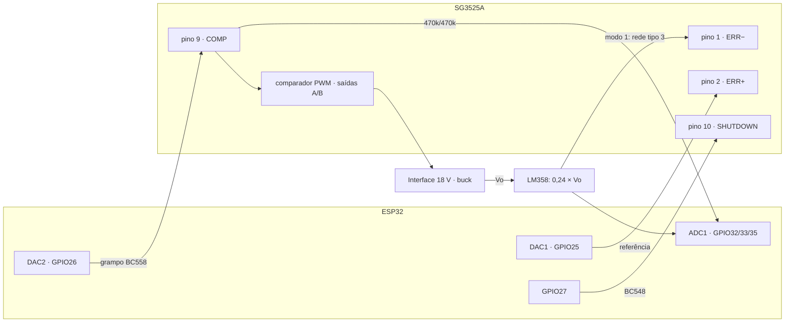
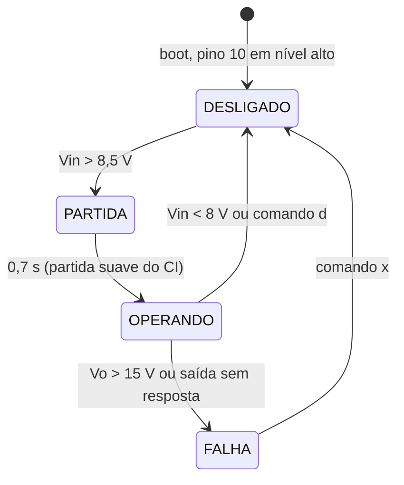

{/* Figuras geradas pelo Kroki. Fontes em diagramas/; depois de editar, rode diagramas/gerar_kroki.py */}

## Checklist — ESP32 nos pinos 1, 2 e 9 do SG3525A {/* #checklist */}

- [ ] SG3525A de volta ao soquete, com pino 10 em _shutdown_ seguro (BC548 e 2,2 kΩ ao pino 16)
- [ ] DAC1 (GPIO25) no pino 2, por 1 kΩ, com 1 µF e 1 MΩ para o GND
- [ ] Grampo com BC558 no pino 9, comandado pelo DAC2 (GPIO26)
- [ ] Amplificador de diferença (LM358) medindo Vo e entregando 0,24 × Vo
- [ ] COMP, Vin e Vo lidos pelo ADC1 (GPIO33, GPIO32 e GPIO35)
- [ ] Modo 1: rede tipo 3 entre os pinos 1 e 9, regulando com referência do ESP32
- [ ] Modo 2: pinos 1 e 9 ligados, malha fechada no ESP32
- [ ] Calibração do VEB conferida no serial e ensaios do roteiro registrados

Nos dois guias anteriores o ESP32 **substituiu** o SG3525A. Aqui os dois trabalham juntos. O CI
continua fazendo o que faz bem, em hardware: oscilador, comparador PWM, flip-flop, tempo morto,
partida suave, bloqueio por subtensão e saídas de 400 mA. O ESP32 entra pelos pinos analógicos
do amplificador de erro: **gera a referência** no pino 2 (ERR+) com o DAC, **lê** o pino 9 (COMP)
com o ADC e **limita** a tensão do pino 9 com um transistor. O pino 1 (ERR−) recebe a realimentação
ou fica ligado ao pino 9, conforme o modo.



:::danger[Antes de ligar]

- Nenhum pino do ESP32 pode receber mais que 3,3 V. O pino 9 chega a **5,8 V** e o pino 16 tem
  **5,1 V**: os dois só entram no ESP32 por divisor ou por transistor, como está nos esquemas.
- O conversor é o buck do [guia de malha fechada](./guia-esp32-buck-malha-fechada.mdx), em
  18 V. Com o conversor ligado ao retificador, o ESP32 não pode ficar no USB do computador sem
  isolação.

:::

## Objetivos

- Entender o amplificador de erro do SG3525A como **amplificador de transcondutância** e o que
  isso muda na compensação.
- Usar o DAC do ESP32 como referência do CI e o ADC para observar o pino 9.
- Limitar a razão cíclica do CI pelo pino 9, com um grampo comandado pelo DAC.
- Comparar duas divisões de trabalho: malha analógica no CI com supervisão digital (modo 1) e
  malha digital no ESP32 com o CI como modulador (modo 2).

## Material

- A placa da experiência com o SG3525A, o estágio BC548/BC558 e o buck do guia anterior.
- ESP32 DevKit **clássico**: só ele (e o ESP32-S2) tem DAC. No S3 e no C3 veja a
  [Parte 5](#parte-5).
- 1 LM358, 1 BC548 e 1 BC558 extras.
- Resistores: 2 × 100 kΩ e 2 × 24 kΩ de **1 %** (ou melhores), 1 MΩ, 2 × 470 kΩ, 100 kΩ (×2),
  27 kΩ, 20 kΩ, 18 kΩ, 10 kΩ (×5), 3,3 kΩ, 2,2 kΩ, 1,1 kΩ, 1 kΩ (×2).
- Capacitores: 1 µF, 100 nF (×3), 82 nF, 68 nF, 10 nF (×2), 820 pF — os da rede tipo 3 de
  filme ou cerâmica C0G/X7R.
- 1 diodo Schottky pequeno (BAT54 ou 1N5817).
- Osciloscópio de dois canais e multímetro.

---

## Parte 1 — O amplificador de erro por dentro {/* #parte-1 */}

A figura 8 do datasheet mostra o amplificador de erro: um par diferencial (pinos 1 e 2) com
corrente de cauda de **200 µA**, um espelho de corrente que **fornece** corrente ao pino 9 e uma
fonte de **100 µA** que **drena** corrente do pino 9. Há ainda um zener de 5,8 V e 30 Ω em série
com o pino.

Isso faz dele um **amplificador de transcondutância (OTA)**: a saída é uma corrente proporcional
à diferença entre os pinos 2 e 1, limitada a cerca de ±100 µA, e não uma tensão de baixa
impedância como a de um amp-op comum. Três consequências guiam todo o guia:

1. **Qualquer circuito externo que drene pouco mais de 100 µA vence o amplificador.** É o que
   o próprio datasheet sugere para desligar as saídas pelo pino 9, e é o que o grampo da
   [Parte 3](#parte-3) usa.
2. **O pino 9 não aguenta carga.** Um divisor de 20 kΩ para medir COMP rouba boa parte dos
   100 µA. Por isso a medida usa 470 kΩ + 470 kΩ.
3. **Capacitor grande entre os pinos 1 e 9 cria um zero no semiplano direito** em
   `gm / (2π × Cf)`. Um integrador de 4,7 µF, que funcionaria com um amp-op, põe esse zero em
   dezenas de hertz e torna a malha instável. A compensação precisa usar capacitores de
   nanofarads.

| Parâmetro (datasheet, VCC = 20 V)     | Valor                                   | O que significa para o ESP32                              |
| ------------------------------------- | --------------------------------------- | --------------------------------------------------------- |
| Faixa de modo comum (teste de CMRR)   | 1,5 V a 5,2 V                           | referência do DAC acima de 1,5 V no ponto de operação     |
| Corrente de polarização das entradas  | 1 µA típico, 10 µA máximo               | resistências baixas (≤ 10 kΩ) nos pinos 1 e 2             |
| Saída do amplificador                 | 0,2 V (baixo) a 5,6 V típico (alto)     | o pino 9 ultrapassa 3,3 V: medir com divisor              |
| Rampa do comparador PWM               | 0,9 V (D = 0) a 3,3 V (D máx.), típicos | a faixa útil do pino 9 cabe no DAC de 3,3 V               |
| Razão cíclica máxima por saída        | 49 % típico                             | 98 % no sinal A OU B                                      |
| Corrente para desligar pelo pino 9    | até 100 µA                              | um BC558 comandado pelo DAC basta                         |
| Ganho em malha aberta (carga ≥ 10 MΩ) | 75 dB típico                            | sugere `gm` da ordem de 0,5 mS ou mais (não especificado) |

O `gm` do amplificador não aparece no datasheet. Pela corrente de cauda de 200 µA ele deve ficar
entre 0,5 mS e 4 mS. O projeto da [Parte 4](#parte-4) foi verificado nessa faixa inteira.

---

## Parte 2 — Duas formas de dividir o trabalho {/* #parte-2 */}

|                     | **Modo 1 — malha analógica, supervisão digital** | **Modo 2 — malha digital, CI como modulador**    |
| ------------------- | ------------------------------------------------ | ------------------------------------------------ |
| Pino 2 (ERR+)       | DAC1: referência `0,24 × Vo desejada`            | DAC1: tensão de controle calculada pelo ESP32    |
| Pino 1 (ERR−)       | realimentação pela rede tipo 3                   | ligado ao pino 9 (seguidor, como na experiência) |
| Pino 9 (COMP)       | sai da rede tipo 3; o ESP32 lê e limita          | copia o pino 2; o ESP32 lê e limita              |
| Quem regula         | o SG3525A, em tempo contínuo                     | o ESP32, a cada 2 ms                             |
| Cruzamento da malha | cerca de 600 Hz a 850 Hz                         | cerca de 5 Hz                                    |
| Papel do ESP32      | referência, rampa, grampo, proteções, telemetria | tudo isso e o controlador                        |

Nos dois modos o ESP32 também faz o **grampo adaptativo** no pino 9, o **shutdown** pelo pino 10
e a detecção de falhas. O `#define MODO` do firmware escolhe o modo, e um jumper muda a ligação
do pino 1.

---

## Parte 3 — Circuito de interface {/* #parte-3 */}

### 3.1 Mudanças na placa da experiência

| Na experiência original                      | Neste guia                                                        |
| -------------------------------------------- | ----------------------------------------------------------------- |
| Trimpot e 10 µF no pino 2                    | saem do pino 2. O trimpot vai ao GPIO34 do ESP32, entre 3V3 e GND |
| Conexão temporária entre os pinos 1 e 9      | jumper **J1**: fechado no modo 2, aberto no modo 1                |
| 3,3 nF + 220 kΩ entre os pinos 1 e 9         | substituídos pela rede tipo 3 (modo 1)                            |
| Pino 10 ligado ao GND                        | _shutdown_ seguro comandado pelo GPIO27                           |
| RT, CT, RD, 10 µF no pino 8, saídas e diodos | **iguais**: 20,9 kHz no sinal A OU B                              |
| 330 kΩ, 5,6 kΩ, 270 Ω, 10 kΩ e 68 nF         | não usados aqui                                                   |

### 3.2 Referência: DAC1 no pino 2

<figure style={{ margin: "1.5rem 0", textAlign: "center" }}>
  
  <figcaption>Referência: DAC1 no pino 2 (ERR+).</figcaption>
</figure>

- O 1 kΩ com 1 µF suaviza os degraus de 12,9 mV do DAC de 8 bits (constante de tempo de 1 ms).
- O 1 MΩ mantém o pino 2 em 0 V enquanto o DAC está desligado (durante o _boot_ do ESP32).
- Com 1 kΩ em série, a corrente de polarização de 1 µA desloca a referência em só 1 mV.

### 3.3 Medindo Vo: amplificador de diferença

O buck do guia anterior tem a chave no retorno: a saída fica entre o +Vin e o nó N, e nenhum dos
dois lados está no GND. O amplificador de erro precisa de uma amostra **referenciada ao GND**,
e um LM358 faz essa conversão:

<figure style={{ margin: "1.5rem 0", textAlign: "center" }}>
  
  <figcaption>
    Amplificador de diferença: converte Vo em 0,24 × Vo referenciado ao GND.
  </figcaption>
</figure>

Cada entrada recebe 100 kΩ do seu lado da carga. A entrada + tem 24 kΩ para o GND; a entrada −
tem 24 kΩ para a saída do LM358. A saída vale
`(24 / 100) × (V+ − VN) = 0,24 × Vo`.

| Grandeza            | Valor                                                            |
| ------------------- | ---------------------------------------------------------------- |
| Vfb com Vo = 9 V    | 2,16 V (dentro da faixa de modo comum do SG3525A)                |
| Faixa de Vo do guia | 7 V a 12 V → Vfb de 1,68 V a 2,88 V                              |
| Modo comum no LM358 | 18 × 24 / 124 = 3,5 V (dentro da faixa, com alimentação de 18 V) |
| Alimentação         | pino 8 no +18 V com 100 nF, pino 4 no GND                        |

O LM358 só rejeita a tensão comum (cerca de 13 V) se os quatro resistores forem iguais dois a
dois. Com resistores de 1 %, o erro em Vo pode chegar a algumas centenas de milivolts. A
calibração (`CAL_REF`) corrige isso no ponto de operação.

:::info[Saída referenciada ao GND]
Se o seu conversor tiver a saída referenciada ao GND (chave no lado positivo), troque o LM358 por
um divisor de 100 kΩ / 24 kΩ ligado direto em Vo. O resto do guia não muda.
:::

A saída do LM358 vai a dois lugares: ao pino 1, pela rede tipo 3 (modo 1), e ao ESP32:

<figure style={{ margin: "1.5rem 0", textAlign: "center" }}>
  
  <figcaption>Medida de Vo pelo GPIO35, com grampo de proteção.</figcaption>
</figure>

### 3.4 Lendo o pino 9

<figure style={{ margin: "1.5rem 0", textAlign: "center" }}>
  
  <figcaption>Leitura do pino 9 (COMP) pelo GPIO33.</figcaption>
</figure>

O divisor tira no máximo 6 µA do pino 9 e entrega metade da tensão: 5,8 V viram 2,9 V. O
100 nF fornece a carga que o ADC do ESP32 puxa a cada amostra. A medida é lenta (constante de
tempo de 24 ms), o que basta para telemetria e para a calibração.

### 3.5 Grampo no pino 9: DAC2 e BC558

<figure style={{ margin: "1.5rem 0", textAlign: "center" }}>
  
  <figcaption>
    Grampo de razão cíclica no pino 9, comandado pelo DAC2.
  </figcaption>
</figure>

- O BC558 só conduz quando o pino 9 tenta subir acima de `VB + VEB`. A tensão do pino 9 fica
  limitada a `0,91 × V(DAC2) + VEB`, com VEB de cerca de 0,6 V.
- A corrente que ele drena é a do amplificador de erro (até 100 µA). A base pede menos de 1 µA.
- **Falha segura:** com o DAC2 desligado (_boot_, _reset_), o 100 kΩ leva a base a 0 V e o pino
  9 fica em ~0,6 V, abaixo do vale da rampa (0,9 V). Razão cíclica zero.
- O firmware mede a VEB na partida: põe o DAC2 em 0,8 V, força o pino 9 para cima e lê a tensão
  pelo GPIO33. O pino 10 em _shutdown_ não afeta o amplificador de erro, então a medida é feita
  com as saídas cortadas.

### 3.6 Shutdown seguro no pino 10

<figure style={{ margin: "1.5rem 0", textAlign: "center" }}>
  
  <figcaption>
    Shutdown seguro: o CI só opera com o GPIO27 em nível alto.
  </figcaption>
</figure>

- GPIO27 em nível **alto**: o BC548 conduz, o pino 10 vai a 0 V e o CI opera.
- GPIO27 em nível baixo, flutuando ou com o ESP32 sem alimentação: o 2,2 kΩ leva o pino 10 a
  cerca de 3,8 V e o CI corta as saídas. O pino 10 nunca fica solto, como pede o datasheet.
- O pino 10 não pode ir direto ao GPIO: com o _pull-up_ para 5,1 V, o pino do ESP32 receberia
  mais de 3,3 V.

### 3.7 Resumo das ligações

| ESP32         | Função                | Liga em                                                  |
| ------------- | --------------------- | -------------------------------------------------------- |
| GPIO25 (DAC1) | referência / controle | 1 kΩ → pino 2                                            |
| GPIO26 (DAC2) | grampo                | 10 kΩ → base do BC558, emissor no pino 9                 |
| GPIO27        | _shutdown_            | 10 kΩ → base do BC548, coletor no pino 10                |
| GPIO32        | Vin                   | divisor 27 kΩ / 3,3 kΩ com 10 nF (como no guia anterior) |
| GPIO33        | COMP                  | divisor 470 kΩ / 470 kΩ com 100 nF                       |
| GPIO34        | trimpot de referência | cursor do trimpot entre 3V3 e GND                        |
| GPIO35        | Vo                    | saída do LM358 por 10 kΩ / 20 kΩ, 1 kΩ e BAT54           |
| GND           | referência comum      | pino 12 do CI, GND da fonte, fonte do MOSFET             |

---

## Parte 4 — Modo 1: malha analógica tipo 3 {/* #parte-4 */}

### 4.1 Por que tipo 3

O buck tem um filtro LC com ressonância em 232 Hz e `Q` próximo de 15. No guia anterior o
controlador integral precisou cruzar em 5 Hz para não oscilar. O amplificador do SG3525A trabalha
em tempo contínuo e pode cruzar bem acima da ressonância, desde que a compensação devolva a fase
que o filtro tira. É o papel da rede **tipo 3**: dois zeros perto de `f0` e dois polos acima do
cruzamento.

<figure style={{ margin: "1.5rem 0", textAlign: "center" }}>
  
  <figcaption>
    Rede tipo 3 do modo 1 (J1 aberto). O pino 2 recebe a referência 0,24 × Vo
    desejada.
  </figcaption>
</figure>

| Elemento       | Posição                      | Valor                                |
| -------------- | ---------------------------- | ------------------------------------ |
| R2 · C1        | zero 1                       | 1 / (2π × 18 kΩ × 82 nF) = 108 Hz    |
| (R1 + R3) · C3 | zero 2                       | 1 / (2π × 11,1 kΩ × 68 nF) = 211 Hz  |
| R3 · C3        | polo 1, perto do zero da RSE | 1 / (2π × 1,1 kΩ × 68 nF) = 2,1 kHz  |
| R2 · C2        | polo 2, metade da comutação  | 1 / (2π × 18 kΩ × 820 pF) = 10,8 kHz |

```text title="Ganho de malha no cruzamento (fc ≈ 800 Hz)"
modulador:      0,98 / (3,3 − 0,9 V)            = 0,408 por volt
buck acima de f0: Vin × (f0 / fc)²  = 18 × (232/800)² = 1,51
realimentação:  0,24
compensador entre os zeros e o polo 1: R2 × 2π × fc × C3 = 6,15

malha = 0,408 × 1,51 × 0,24 × 6,15 ≈ 0,91      → cruza perto de 800 Hz
```

- R1 de 10 kΩ mantém o erro da corrente de polarização em ~10 mV.
- C2 de 820 pF e C3 de 68 nF deixam o zero do semiplano direito do OTA acima de 100 kHz.
- Em regime, a tensão do pino 1 iguala a do pino 2. Não há corrente contínua em R1: a
  referência do DAC define Vo diretamente: `Vo = V(pino 2) / 0,24`.

### 4.2 O que o modelo prevê

Verifiquei o projeto num modelo médio do buck (L = 1 mH, C = 470 µF, perdas de 0,3 Ω) com o
amplificador como OTA de ±100 µA, para `gm` de 0,5 mS a 4 mS e RSE do capacitor de 0,05 Ω a
0,3 Ω. São resultados de simulação, não de bancada:

| Situação                                               | Resultado previsto                                           |
| ------------------------------------------------------ | ------------------------------------------------------------ |
| Cruzamento e margem de fase (RSE 0,15 Ω)               | 610 Hz a 830 Hz, 44° a 64°                                   |
| Pior caso (RSE 0,05 Ω, `gm` 0,5 mS)                    | margem de fase de cerca de 32°                               |
| Estabilidade condicional abaixo do cruzamento          | não aparece (fase acima de −150°)                            |
| Erro em regime                                         | cerca de 0,1 % (ganho finito do OTA com o divisor do GPIO33) |
| Carga de 22 Ω para 47 Ω e de volta                     | cerca de ±35 mV, recupera em poucos milissegundos            |
| Degrau de referência de 9 V para 6 V                   | vale de cerca de 5,0 V, acomoda em ~20 ms                    |
| Partida com rampa de 20 V/s após a partida suave do CI | sem sobressinal                                              |

Compare com o guia anterior: o mesmo degrau de carga levava ~100 ms para ser corrigido.

:::warning[Rampa só depois da partida suave do CI]
Se a referência subir enquanto o capacitor de 10 µF do pino 8 ainda está carregando, o
amplificador satura no alto e a saída passa da referência quando a partida suave termina (no
modelo, ~0,4 V). Por isso o firmware libera o pino 10, espera 0,7 s e só então começa a rampa.
:::

---

## Parte 5 — Modo 2: malha digital, CI como modulador {/* #parte-5 */}

Com o jumper J1 fechado (pinos 1 e 9 ligados) e a rede tipo 3 desconectada, o amplificador de
erro vira um **seguidor**: o pino 9 copia o pino 2. É a montagem original da experiência, com o
DAC no lugar do trimpot. O ESP32 roda o mesmo controlador integral do guia anterior
(`ki = 1,75`) e converte a razão cíclica em tensão para o pino 2:

```text title="Razão cíclica → tensão no pino 2"
V(pino 2) = 0,9 + D / 0,98 × (3,3 − 0,9)
D = 50 %  →  2,12 V          D = 67 %  →  2,54 V
```

Toda a faixa de 7 V a 12 V com Vin = 18 V fica entre 1,85 V e 2,53 V, dentro da faixa de modo
comum. O CI ainda contribui com o que o ESP32 sozinho não tinha: tempo morto, partida suave em
hardware, bloqueio por subtensão e saídas de corrente.

### Limite: resolução do DAC

Um passo do DAC (12,9 mV) muda a razão cíclica em 0,53 % e a saída em ~95 mV. O integrador
fica alternando entre dois códigos vizinhos, e no modelo a saída oscila cerca de **±0,2 V** em
baixa frequência. Duas saídas:

- usar o **modo 1** quando a ondulação importar;
- trocar o DAC por **PWM filtrado**: um canal do LEDC a 12 bits e 19,5 kHz com filtro RC de
  duas seções (por exemplo, 2 × 10 kΩ e 1 µF). É também a solução para o ESP32-S3 e o C3, que
  não têm DAC.

---

## Parte 6 — Supervisão: grampo adaptativo e falhas {/* #parte-6 */}



### Grampo adaptativo

A razão cíclica necessária é próxima de `Vo / Vin`. O ESP32 conhece os dois e ajusta o grampo
para não deixar o pino 9 passar muito disso:

```text title="Limite da razão cíclica"
Dmax = 1,3 × ref / Vin + 0,05        (e nunca acima do valor do comando m)
ref = 9 V, Vin = 18 V  →  Dmax = 70 %    (em regime o conversor usa ~51 %)
```

- **Partida.** Com `ref` subindo em rampa, `Dmax` sobe junto: é uma segunda partida suave,
  programável.
- **Realimentação aberta.** Se a medida de Vo sumir, o amplificador vai ao máximo. Sem
  grampo, a saída vai a ~17,4 V. Com o grampo, o modelo mostra um pico de ~14 V e depois
  ~12,4 V, até o ESP32 desligar (50 ms).
- **Variação de Vin.** Como `Dmax` usa o Vin medido, o limite acompanha a fonte.
- **Liberação do grampo.** Liberar o grampo de uma vez com a malha saturada produz sobressinal
  (no modelo, ~0,5 V). O firmware só muda `Dmax` em rampa, junto com `ref`.

### Falhas

| Falha               | Como o ESP32 detecta                                           | Reação                                    |
| ------------------- | -------------------------------------------------------------- | ----------------------------------------- |
| Subtensão           | Vin < 8 V                                                      | _shutdown_; volta sozinho com Vin > 8,5 V |
| Sobretensão         | Vo > 15 V                                                      | _shutdown_ até o comando `x`              |
| Saída sem resposta  | pino 9 no grampo e Vo abaixo de metade da referência por 50 ms | _shutdown_ até o comando `x`              |
| Acima da referência | Vo mais de 2 V acima da referência por 50 ms                   | _shutdown_ até o comando `x`              |

A falha "sem resposta" pega curto na saída, MOSFET sem comando e perda da medida de Vo. Ela usa
o pino 9, que é a única medida que mostra o que o CI está **tentando** fazer. A falha "acima da
referência" pega o caso em que só o CI perdeu a realimentação (um fio do pino 1 solto) e o
ESP32 continua medindo Vo.

:::note[O ESP32 não substitui a proteção em hardware]
As falhas são verificadas a cada 2 ms, e o desligamento pelo pino 10 leva menos de 1 µs depois
disso. Para limitar corrente pulso a pulso, o pino 10 precisa ser acionado por um comparador
de corrente, não pelo firmware.
:::

---

## Parte 7 — Firmware {/* #parte-7 */}

<FileTree root="esp32-sg3525a" files={["platformio.ini c", "src/main.cpp c"]} />

O `platformio.ini` é o mesmo dos guias anteriores. `dacWrite()` existe nos cores 2.x e 3.x do
Arduino para ESP32.

```cpp title="src/main.cpp"
// Guia: ESP32 cooperando com o SG3525A pelos pinos 1 (ERR-), 2 (ERR+) e 9 (COMP)
// GPIO25 (DAC1) = referência no pino 2  | GPIO26 (DAC2) = grampo no pino 9
// GPIO27 = shutdown (pino 10)           | GPIO32 = Vin | GPIO33 = COMP | GPIO34 = trimpot | GPIO35 = Vo
#include <Arduino.h>
#include <Ticker.h>

#define MODO 1                           // 1: malha analógica no CI | 2: malha digital (pinos 1 e 9 ligados)

// ---- Pinos do ESP32
#define DAC_REF    25                    // -> 1 kΩ -> pino 2 (ERR+)
#define DAC_GRAMPO 26                    // -> 10 kΩ -> base do BC558 (emissor no pino 9)
#define SHUT_PIN   27                    // -> BC548 -> pino 10. Nível alto = CI liberado
#define VIN_PIN    32
#define COMP_PIN   33
#define POT_PIN    34
#define VO_PIN     35

// ---- Escalas das medidas
#define K_FB    0.24f                    // amplificador de diferença: saída = 0,24 x Vo
#define K_VO    (K_FB * 20.0f / 30.0f)   // GPIO35 vê a saída do amplificador por 10k/20k
#define K_VIN   (3.3f / 30.3f)           // divisor 27k / 3,3k
#define K_COMP  0.5f                     // divisor 470k / 470k
#define K_BASE  (100.0f / 110.0f)        // divisor 10k / 100k na base do BC558
#define CAL_VO  1.000f                   // ajuste na calibração
#define CAL_VIN 1.000f
#define CAL_REF 1.000f                   // corrige o erro do DAC e do amplificador (modo 1)

// ---- SG3525A: limiares típicos da rampa (datasheet)
#define V_VALE 0.9f                      // COMP abaixo disso: razão cíclica zero
#define V_PICO 3.3f                      // COMP acima disso: razão cíclica máxima
#define D_TOPO 0.98f                     // A OU B: 2 x 49 %

// ---- DAC do ESP32 (8 bits). Ajuste com o multímetro na calibração
#define DAC_LSB (3.3f / 255.0f)
#define DAC_OFS 0.0f

// ---- Operação
#define TS_MS         2
#define TS            (TS_MS / 1000.0f)
#define REF_MIN       7.0f               // abaixo disso o pino 2 sai da faixa garantida
#define REF_MAX       12.0f
#define RAMPA_V_POR_S 20.0f
#define ESPERA_SS_MS  700                // partida suave do CI (10 uF, 50 uA) termina em ~0,66 s
#define VIN_MIN       8.0f
#define VO_MAX        15.0f
#define GRAMPO_GANHO  1.3f               // Dmax = 1,3 x ref / Vin + 0,05
#define GRAMPO_FOLGA  0.05f
#define FALHA_AMOSTRAS 25                // 50 ms sem resposta -> desliga

enum Estado { DESLIGADO, PARTIDA, OPERANDO, FALHA };
const char *NOME_ESTADO[] = {"DESLIGADO", "PARTIDA", "OPERANDO", "FALHA"};

Ticker temporizador;
volatile bool amostraPendente = false;
Estado estado = DESLIGADO;
const char *motivo = "";
bool modoPot = true;
bool ligadoPeloUsuario = true;
float refAlvo = 9.0f, ref = 0;
float vin = 0, vo = 0, vcomp = 0;
float veb = 0.60f;                       // medido na partida
float dmaxUsuario = D_TOPO, dmax = 0;
float ki = 1.75f, integral = 0;          // só no modo 2
int contFalha = 0;
unsigned long tPartida = 0;
uint32_t passo = 0;

void aoEstourarTemporizador() { amostraPendente = true; }

// ---------------------------------------------------------------- conversões
float vcompDe(float d) { return V_VALE + d / D_TOPO * (V_PICO - V_VALE); }
float dDe(float vc) { return constrain((vc - V_VALE) / (V_PICO - V_VALE) * D_TOPO, 0.0f, D_TOPO); }

void dacVolts(uint8_t pino, float v) {
  int codigo = (int)lroundf((v - DAC_OFS) / DAC_LSB);
  dacWrite(pino, (uint8_t)constrain(codigo, 0, 255));
}

void grampo(float vcMax) { dacVolts(DAC_GRAMPO, (vcMax - veb) / K_BASE); }   // COMP <= vcMax

float lerVolts(uint8_t pino, int n = 4) {
  uint32_t soma = 0;
  for (int i = 0; i < n; i++) soma += analogReadMilliVolts(pino);
  return soma / (float)n / 1000.0f;
}

void lerSensores() {
  vin = lerVolts(VIN_PIN) / K_VIN * CAL_VIN;
  vo = lerVolts(VO_PIN) / K_VO * CAL_VO;
  vcomp = lerVolts(COMP_PIN, 2) / K_COMP;
}

// ---------------------------------------------------------------- liga e desliga
void desligar(Estado novo, const char *porque) {
  digitalWrite(SHUT_PIN, LOW);           // pino 10 em nível alto: saídas cortadas
  dacVolts(DAC_REF, 0);
  grampo(0);                             // COMP <= VEB: razão cíclica zero
  integral = 0;
  ref = 0;
  contFalha = 0;
  if (estado != novo || motivo != porque)
    Serial.printf("[SG] %s %s\r\n", NOME_ESTADO[novo], porque);
  estado = novo;
  motivo = porque;
}

void partir() {
  dacVolts(DAC_REF, 0);
  grampo(0);
  digitalWrite(SHUT_PIN, HIGH);          // libera o pino 10: o CI refaz a partida suave
  tPartida = millis();
  estado = PARTIDA;
  motivo = "";
  Serial.println("[SG] PARTIDA");
}

// Mede a VEB do BC558 com o CI em shutdown: o pino 10 não afeta o amplificador de erro
void calibrarVeb() {
  const float vdac = 0.8f;
  dacVolts(DAC_REF, 2.0f);               // modo 1: COMP vai ao máximo | modo 2: COMP segue 2,0 V
  dacVolts(DAC_GRAMPO, vdac);            // o grampo segura COMP em ~1,3 V
  delay(200);                            // o filtro de 470k x 100 nF precisa de ~5 constantes
  float medida = lerVolts(COMP_PIN, 16) / K_COMP - vdac * K_BASE;
  if (medida > 0.4f && medida < 0.85f) veb = medida;
  else Serial.printf("[CAL] VEB fora da faixa (%.2f V): usando %.2f V\r\n", medida, veb);
  Serial.printf("[CAL] VEB do grampo = %.2f V\r\n", veb);
  dacVolts(DAC_REF, 0);
  grampo(0);
}

// ---------------------------------------------------------------- controle
void controlar() {
  lerSensores();

  if (estado == FALHA) return;
  if (vin < VIN_MIN) {
    if (estado != DESLIGADO) desligar(DESLIGADO, "SUBTENSAO");
    return;
  }
  if (estado == DESLIGADO) {
    if (ligadoPeloUsuario && vin > VIN_MIN + 0.5f) partir();
    return;
  }
  if (vo > VO_MAX) { desligar(FALHA, "SOBRETENSAO"); return; }
  if (estado == PARTIDA) {
    if (millis() - tPartida >= ESPERA_SS_MS) estado = OPERANDO;
    return;
  }

  float degrau = RAMPA_V_POR_S * TS;                    // rampa da referência
  ref += constrain(refAlvo - ref, -degrau, degrau);

  // Grampo adaptativo: a razão cíclica nunca passa muito do valor ideal ref / Vin
  dmax = min(min(dmaxUsuario, D_TOPO), GRAMPO_GANHO * ref / vin + GRAMPO_FOLGA);

#if MODO == 1
  dacVolts(DAC_REF, K_FB * ref * CAL_REF);              // o CI faz o resto
#else
  float erro = ref - vo;
  integral = constrain(integral + ki * erro * TS, 0.0f, dmax);
  dacVolts(DAC_REF, vcompDe(integral));                 // o CI é só o modulador
#endif
  grampo(vcompDe(dmax));

  // Saída sem resposta: COMP no grampo e Vo bem abaixo da referência.
  // Acima da referência: o CI perdeu a realimentação, mas o ESP32 ainda mede Vo.
  bool noGrampo = vcomp > vcompDe(dmax) - 0.1f;
  bool semResposta = ref > 3.0f && vo < 0.5f * ref && noGrampo;
  bool acima = ref > 3.0f && vo > ref + 2.0f;
  if (semResposta || acima) {
    if (++contFalha >= FALHA_AMOSTRAS) desligar(FALHA, semResposta ? "SEM RESPOSTA" : "ACIMA DA REF");
  } else {
    contFalha = 0;
  }
}

// ---------------------------------------------------------------- comandos
void lerComando() {
  if (!Serial.available()) return;
  String s = Serial.readStringUntil('\n');
  s.trim();
  if (s.length() == 0) return;
  float v = s.substring(1).toFloat();
  switch (tolower(s[0])) {
    case 'r': modoPot = false; refAlvo = constrain(v, REF_MIN, REF_MAX); break;
    case 'p': modoPot = true; break;
    case 'm': dmaxUsuario = constrain(v / 100.0f, 0.0f, D_TOPO); break;
    case 'i': ki = v; break;
    case 'd': ligadoPeloUsuario = false; desligar(DESLIGADO, "COMANDO"); break;
    case 'l': ligadoPeloUsuario = true; break;
    case 'x': if (estado == FALHA) desligar(DESLIGADO, "REARMADO"); break;
    default: Serial.println("[CMD] r <V> | p | m <%> | i <ki> | d | l | x"); return;
  }
  Serial.printf("[CMD] ref=%.1f V (%s)  Dmax usuario=%.0f %%  ki=%.2f\r\n",
                refAlvo, modoPot ? "trimpot" : "serial", 100 * dmaxUsuario, ki);
}

void setup() {
  pinMode(SHUT_PIN, OUTPUT);
  digitalWrite(SHUT_PIN, LOW);           // CI em shutdown até tudo estar pronto
  dacWrite(DAC_REF, 0);
  dacWrite(DAC_GRAMPO, 0);

  Serial.begin(115200);
  Serial.setTimeout(10);
  delay(200);
  Serial.printf("\r\n=== ESP32 + SG3525A (modo %d: %s) ===\r\n", MODO,
                MODO == 1 ? "malha analogica no CI" : "malha digital no ESP32");

  analogReadResolution(12);
  analogSetPinAttenuation(VIN_PIN, ADC_11db);
  analogSetPinAttenuation(COMP_PIN, ADC_11db);
  analogSetPinAttenuation(POT_PIN, ADC_11db);
  analogSetPinAttenuation(VO_PIN, ADC_11db);

  calibrarVeb();
  temporizador.attach_ms(TS_MS, aoEstourarTemporizador);
}

void loop() {
  lerComando();
  if (!amostraPendente) return;
  amostraPendente = false;
  passo++;

  if (modoPot && passo % 50 == 0) {      // trimpot a cada 100 ms, em passos de 0,1 V
    float v = REF_MIN + lerVolts(POT_PIN) / 3.3f * (REF_MAX - REF_MIN);
    refAlvo = constrain(roundf(v * 10) / 10, REF_MIN, REF_MAX);
  }
  controlar();

  if (passo % 100 == 0) {                // a cada 200 ms
    const char *situacao = estado != OPERANDO ? NOME_ESTADO[estado]
                         : (vcomp > vcompDe(dmax) - 0.05f ? "LIMITADO" : "REGULANDO");
    Serial.printf("[SG] Vin=%.1f ref=%.2f Vo=%.2f Vcomp=%.2f D~%.1f%% Dmax=%.1f%% %s %s\r\n",
                  vin, ref, vo, vcomp, 100 * dDe(vcomp), 100 * dmax, situacao, motivo);
  }
}
```

### Comandos pelo monitor serial

| Comando | Efeito                                                   |
| ------- | -------------------------------------------------------- |
| `r 9`   | referência de 9 V pelo serial (faixa de 7 V a 12 V)      |
| `p`     | volta a usar o trimpot do GPIO34                         |
| `m 60`  | limita a razão cíclica a 60 %, além do grampo adaptativo |
| `i 3.5` | muda `ki` (só no modo 2)                                 |
| `d`     | desliga pelo pino 10                                     |
| `l`     | religa                                                   |
| `x`     | rearma depois de uma falha                               |

```text title="Monitor serial (modo 1, valores aproximados)"
=== ESP32 + SG3525A (modo 1: malha analogica no CI) ===
[CAL] VEB do grampo = 0.62 V
[SG] PARTIDA
[SG] Vin=18.0 ref=2.00 Vo=2.00 Vcomp=1.18 D~11.4% Dmax=19.4% REGULANDO
[SG] Vin=18.0 ref=6.00 Vo=6.00 Vcomp=1.73 D~33.9% Dmax=48.3% REGULANDO
[SG] Vin=18.0 ref=9.00 Vo=8.99 Vcomp=2.14 D~50.6% Dmax=70.0% REGULANDO
```

---

## Parte 8 — Roteiro na bancada {/* #parte-8 */}

### 8.1 Calibração

1. Grave o firmware, mas deixe o +18 V **desligado**. O serial deve mostrar `[CAL] VEB` entre
   0,5 V e 0,75 V. Fora disso, confira o BC558 e o divisor do GPIO33.
2. Ligue o +18 V com a carga de 22 Ω, envie `r 7` e espere a rampa. Meça a tensão no pino 2
   (deve ser 0,24 × 7 = 1,68 V). Repita com `r 12` (2,88 V). Com os dois pontos, ajuste
   `DAC_LSB` e `DAC_OFS`.
3. Confira `Vin` no serial contra o multímetro (`CAL_VIN`).

### 8.2 Modo 1

1. J1 aberto, rede tipo 3 montada, `MODO 1`. Com `r 9`, meça Vo **sobre a carga**. Ajuste
   `CAL_REF` até dar 9,00 V e depois `CAL_VO` até o serial concordar.
2. Observe no osciloscópio o pino 9 e o sinal A OU B: a tensão do pino 9 deve ficar estável e
   a razão cíclica deve bater com o `D~` do serial.
3. **Degrau de carga:** ligue e desligue um 47 Ω em paralelo e registre Vo (canais na saída + e
   no nó N, função de subtração). Meça o pico e o tempo de recuperação.
4. **Degrau de referência:** alterne `r 7` e `r 11`.
5. **Grampo:** envie `m 40`. A saída deve cair para perto de `0,40 × 18 ≈ 7 V` e o serial deve
   mostrar `LIMITADO`. Volte com `m 98`.
6. **Realimentação aberta**, com a fonte limitada em corrente:
   - solte o fio entre o pino 1 e a rede tipo 3: o CI perde a medida, o ESP32 não. Ele deve
     desligar com `ACIMA DA REF`;
   - religue, rearme com `x` e solte o fio do +Vin que vai ao LM358: os dois perdem a medida.
     O ESP32 deve desligar com `SEM RESPOSTA`. Registre o pico de Vo nos dois casos.

### 8.3 Modo 2

1. J1 fechado, rede tipo 3 desligada do pino 1, `MODO 2`. Repita os itens 1, 3 e 4.
2. Observe Vo com acoplamento AC e escala de 100 mV/div: a oscilação lenta da resolução do DAC
   deve aparecer.

| Medida                                | Modo 1 (previsto) | Modo 1 (medido) | Modo 2 (previsto) | Modo 2 (medido) |
| ------------------------------------- | ----------------- | --------------- | ----------------- | --------------- |
| Vo com referência de 9 V              | 9,0 V             |                 | 9,0 V ± 0,2 V     |                 |
| Pico no degrau de carga 22 Ω → 15 Ω   | dezenas de mV     |                 | décimos de volt   |                 |
| Tempo de recuperação                  | poucos ms         |                 | ~0,1 s a 0,2 s    |                 |
| Degrau de referência de 7 V para 11 V | ~20 ms            |                 | ~0,2 s            |                 |
| Vo com `m 40`                         | ~7 V              |                 | ~7 V              |                 |
| Pico com a realimentação aberta       | ~14 V             |                 | —                 |                 |

:::tip[Preveja antes de medir]

- **P1:** no modo 1, se o DAC errar 20 mV, de quanto erra Vo? E se o amplificador de diferença
  errar 20 mV? Qual dos dois erros a calibração `CAL_REF` corrige?
- **P2:** por que um capacitor de 4,7 µF entre os pinos 1 e 9 funcionaria com um amp-op comum e
  não funciona com o SG3525A? Calcule o zero `gm / (2π × Cf)` para `gm` = 1 mS.
- **P3:** no grampo, o pino 9 fica limitado a `0,91 × V(DAC2) + VEB`. O que acontece com o
  limite quando o BC558 esquenta 30 °C? O firmware percebe?
- **P4:** com o ESP32 travado com o GPIO27 em nível alto, quais proteções continuam
  funcionando?

:::

---

## Se algo não funcionar {/* #problemas */}

| Sintoma                                        | Verifique                                                                 |
| ---------------------------------------------- | ------------------------------------------------------------------------- |
| `[CAL] VEB fora da faixa`                      | BC558 invertido; divisor do GPIO33; DAC1 chegando ao pino 2               |
| Sem pulsos, `Vcomp` próximo de 0,6 V           | grampo fechado: estado `PARTIDA` ou `FALHA`; DAC2 no GPIO26               |
| Sem pulsos, `Vcomp` normal                     | pino 10 em nível alto: GPIO27, BC548, 2,2 kΩ                              |
| Modo 1: falha `ACIMA DA REF` ou `SEM RESPOSTA` | realimentação aberta ou invertida: LM358, R1, entradas + e − trocadas     |
| Modo 1: oscilação de centenas de hertz         | valores da rede tipo 3; C2 ou C3 trocados; capacitor eletrolítico na rede |
| Modo 1: Vo errado e estável                    | resistores do LM358 desiguais; refaça `CAL_REF`                           |
| Modo 2: `Vcomp` diferente do DAC1              | J1 aberto; rede tipo 3 ainda ligada ao pino 1                             |
| `Vo` do serial diferente do multímetro         | multímetro sobre a carga; `CAL_VO`                                        |
| ESP32 reinicia ao ligar o conversor            | GND do ESP32 junto ao pino 12 e à fonte do MOSFET; fios curtos            |
