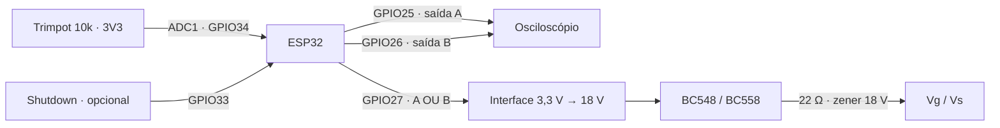

{/* Figuras geradas pelo Kroki. Fontes em diagramas/; depois de editar, rode diagramas/gerar_kroki.py */}

## Checklist — modulador PWM com ESP32 {/* #checklist */}

- [ ] CI 3525 fora do soquete, com RT, CT, RD e os capacitores dos pinos 8 e 9 sem função
- [ ] Trimpot religado entre **3V3 e GND** do ESP32, cursor no **GPIO34**
- [ ] Estágio de interface 3,3 V → 18 V montado entre o **GPIO27** e o par BC548/BC558
- [ ] GND do ESP32 ligado ao GND da fonte de 18 V
- [ ] Firmware gravado e `f_osc` conferida no monitor serial
- [ ] Formas de onda de A (GPIO25), B (GPIO26) e Vg medidas e comparadas com as do SG3525A

Este guia mostra como refazer a experiência **Modulador PWM** com um **ESP32 DevKit** fazendo
o papel do **SG3525A** (UC3525, K3525). O ESP32 gera os mesmos sinais dos pinos 11 e 14 do
CI, com a mesma frequência, a mesma lei de razão cíclica e a mesma partida suave. O estágio de
saída da placa (BC548, BC558, 22 Ω e zener de 18 V) continua o mesmo.



:::danger[Antes de ligar qualquer fio]

- Os pinos do ESP32 suportam **no máximo 3,3 V**. Nunca ligue neles o +18 V, a referência de
  5,1 V do pino 16 ou o cursor do trimpot ainda alimentado pelo pino 16.
- Um GPIO fornece poucos miliampères em 3,3 V. Ele **não** aciona o gate direto: o SG3525A
  entrega até 400 mA de pico em 18 V, e é a interface da [Parte 3](#parte-3) que cobre essa
  diferença.
- Quando o ponto de 220 V da placa for conectado, o GND do circuito deixa de ser isolado da
  rede. A partir daí **não ligue o USB do ESP32 ao computador**: use a interface isolada
  (opção B) com fonte própria para o ESP32, ou um isolador USB.

:::

## Objetivos

- Identificar cada bloco do SG3525A usado na experiência e o recurso do ESP32 que o substitui.
- Gerar duas saídas alternadas e defasadas de 180° com o **LEDC**, usando o `hpoint`.
- Reproduzir em firmware o comparador PWM, a partida suave e o shutdown.
- Adaptar o nível de 3,3 V do ESP32 ao estágio de saída de 18 V.
- Repetir as cinco medidas do roteiro original e comparar os dois moduladores.

## Material

- 1 ESP32 DevKit (o mesmo dos laboratórios) e cabo USB.
- A placa da experiência, com o estágio de saída montado.
- Opção A de interface: 1 BC548, 1 BC558, 3 resistores de 4,7 kΩ e 1 de 10 kΩ.
- Opção B de interface: 1 optoacoplador acionador de gate (TLP250 ou HCPL-3120) e 1 resistor
  de 180 Ω.
- Osciloscópio de dois canais e multímetro.
- VS Code + PlatformIO. Nenhuma biblioteca externa.

---

## Parte 1 — O que o SG3525A faz neste circuito {/* #parte-1 */}

No circuito da experiência o CI trabalha em **malha aberta**: a conexão temporária entre os
pinos 1 e 9 transforma o amplificador de erro em seguidor, e a tensão do trimpot (pino 2) vai
direto ao comparador PWM.

| Bloco do SG3525A                       | No circuito original                             | No ESP32                                                           |
| -------------------------------------- | ------------------------------------------------ | ------------------------------------------------------------------ |
| Referência de 5,1 V (pino 16)          | alimenta o trimpot                               | pino **3V3** alimenta o trimpot                                    |
| Oscilador (pinos 5, 6 e 7)             | RT = 6,8 kΩ, CT = 10 nF, RD = 10 Ω               | timer do **LEDC**, frequência calculada com os mesmos valores      |
| Amplificador de erro (pinos 1, 2 e 9)  | seguidor: a tensão do pino 2 aparece no pino 9   | **ADC** no GPIO34 lê o cursor do trimpot                           |
| Comparador PWM + latch                 | compara o pino 9 com a rampa de 0,9 V a 3,3 V    | função `dutyDe()`: mesma reta, calculada a cada 5 ms               |
| Flip-flop e saídas A/B (pinos 11 e 14) | pulsos alternados, cada saída em metade de f_osc | dois canais do LEDC no mesmo timer, B com `hpoint` de meio período |
| Diodos 1N4148                          | fazem o OU de A e B para um único transistor     | terceiro canal no **GPIO27**, já com o sinal A OU B                |
| Partida suave (pino 8)                 | 10 µF carregado por 50 µA                        | variável `vss` que sobe 5 V/s                                      |
| Shutdown (pino 10)                     | ligado ao GND (sem uso)                          | **GPIO33**, ativo em nível alto (opcional)                         |
| Estágio de saída                       | até 400 mA de pico, alimentado em 18 V           | **não existe**: GPIO de 3,3 V, precisa da interface                |
| Subtensão (UVLO)                       | bloqueia as saídas com VCC abaixo de ~7 V        | não há equivalente para o barramento de 18 V                       |

### Os números do circuito original

O datasheet da onsemi traz o tempo de carga e de descarga em gráficos (figuras 3 e 4). A
fórmula abaixo, usada nos datasheets do 3525 de outros fabricantes, resume os dois:

```text title="Oscilador"
f_osc = 1 / [ CT × (0,7 × RT + 3 × RD) ]
      = 1 / [ 10 nF × (0,7 × 6,8 kΩ + 3 × 10 Ω) ]
      = 1 / 47,9 µs  ≈  20,9 kHz

cada saída (pino 11 ou 14):  f_osc / 2  ≈  10,4 kHz   (período de 95,8 µs)
sinal A OU B (depois dos diodos):  f_osc ≈  20,9 kHz   (período de 47,9 µs)
```

O comparador PWM usa os limiares típicos da tabela _PWM Comparator Section_: razão cíclica zero
em 0,9 V e máxima em 3,3 V. Cada saída chega a 49 % (típico), e 0 % é o mínimo.

```text title="Razão cíclica prevista"
x = (V2 − 0,9) / (3,3 − 0,9)        limitado entre 0 e 1
D de cada saída = x × 50 %          limitado a 49 %
D de A OU B     = 2 × D de cada saída

V2 = 2,0 V  →  x = 0,458  →  22,9 % por saída,  45,8 % em A OU B
V2 = 3,0 V  →  x = 0,875  →  43,8 % por saída,  87,5 % em A OU B
```

:::info[Valores típicos, não garantidos]
Os limiares variam de um CI para outro: o datasheet admite de 0,6 V a 0,9 V para o vale e de
3,3 V a 3,6 V para o pico. Meça o seu SG3525A antes de retirá-lo e, se quiser que o ESP32
reproduza **aquele** CI, ajuste `V_VALE` e `V_PICO` no firmware.
:::

---

## Parte 2 — Preparando a placa {/* #parte-2 */}

Desligue a fonte de 18 V e retire o CI do soquete. O soquete vazio serve de ponto de acesso
aos nós do circuito.

| Componente                                   | Destino                                                   |
| -------------------------------------------- | --------------------------------------------------------- |
| CI 3525                                      | sai do soquete                                            |
| 6,8 kΩ, 10 nF e 10 Ω (pinos 5, 6 e 7)        | ficam sem função: viram constantes no firmware            |
| 10 µF do pino 8                              | fica sem função: a partida suave é feita em firmware      |
| 3,3 nF, 220 kΩ, 10 nF e a conexão temporária | ficam sem função                                          |
| Trimpot de 10 kΩ e o 10 µF do cursor         | **ficam**, com o trimpot religado em 3V3                  |
| 2 diodos 1N4148                              | ficam sem função: o OU já sai pronto no GPIO27            |
| 1 kΩ em série, 1 kΩ para o GND               | **ficam**                                                 |
| BC548, BC558, 22 Ω e zener de 18 V           | **ficam**                                                 |
| 100 µF no +18 V                              | **fica**                                                  |
| 330 kΩ, 5,6 kΩ, 270 Ω, 10 kΩ e 68 nF         | ficam desconectados do ESP32 (veja a [Parte 7](#parte-7)) |

### Ligações do ESP32

| Sinal                  | Pino do ESP32 | Ligar em                                                 |
| ---------------------- | ------------- | -------------------------------------------------------- |
| Alimentação do trimpot | **3V3**       | extremo do trimpot que ia ao pino 16                     |
| Tensão de controle     | **GPIO34**    | cursor do trimpot (nó do pino 2), com o 10 µF para o GND |
| Saída A                | **GPIO25**    | osciloscópio, canal 1 (equivale ao pino 11)              |
| Saída B                | **GPIO26**    | osciloscópio, canal 2 (equivale ao pino 14)              |
| A OU B                 | **GPIO27**    | entrada da interface 3,3 V → 18 V                        |
| Shutdown (opcional)    | **GPIO33**    | chave para o 3V3; solto, o pino fica em nível baixo      |
| Referência             | **GND**       | GND da fonte de 18 V (nó do pino 12)                     |

:::warning[Religue o trimpot antes de conectar o GPIO34]
No circuito original o trimpot recebe 5,1 V do pino 16. Com o CI fora do soquete esse nó fica
solto, mas confirme com o multímetro que o extremo do trimpot está ligado **somente** ao 3V3
do ESP32 antes de conectar o cursor ao GPIO34. O GPIO34 é do **ADC1** e é somente entrada, a
mesma escolha do Lab 07.
:::

Alimente o ESP32 pelo USB. O +18 V da placa alimenta só a interface e o estágio de saída.

---

## Parte 3 — Interface de 3,3 V para 18 V {/* #parte-3 */}

O par BC548/BC558 da placa é um **seguidor de emissor**: ele dá corrente, mas não dá tensão.
Ligado direto a um GPIO, entregaria cerca de 2,6 V em Vg, insuficiente para comandar o
interruptor. É preciso um estágio que leve o nó **X** (onde ficavam os catodos dos dois
1N4148) até perto de 18 V.

### Opção A — dois transistores do kit (sem isolação)

<figure style={{ margin: "1.5rem 0", textAlign: "center" }}>
  
  <figcaption>
    Interface de 3,3 V para 18 V (opção A). O tracejado já existe na placa.
  </figcaption>
</figure>

- GPIO27 em nível alto: Q1 conduz, puxa a base de Q2 e o nó X sobe para perto de 18 V.
- GPIO27 em nível baixo **ou em alta impedância** (ESP32 em reset, gravando ou sem
  alimentação): R2 mantém Q1 cortado, Q2 corta e o 1 kΩ da placa leva o nó X a 0 V. O gate
  fica em nível baixo.

:::warning[Não use um único transistor]
Um só BC548 em emissor comum, com resistor para o +18 V, também eleva a tensão, mas
**inverte** o sinal: com o ESP32 em reset o gate ficaria em nível alto, com o interruptor
conduzindo sem controle. Os dois estágios existem para que a falta de comando signifique
interruptor aberto.
:::

Os dois transistores trabalham saturados, e por isso a borda de descida de Vg atrasa em
relação ao GPIO27. Meça esse atraso com o osciloscópio (GPIO27 num canal, Vg no outro) e
compare com o período de 47,9 µs: ele limita a menor e a maior razão cíclica úteis.

### Opção B — optoacoplador acionador de gate (isolada)

Um TLP250 ou HCPL-3120 substitui a interface **e** o par BC548/BC558, e isola o ESP32 do
circuito de potência.

| Pino do optoacoplador | Ligar em                                                    |
| --------------------- | ----------------------------------------------------------- |
| Anodo do LED          | GPIO27, por um resistor de **180 Ω** (cerca de 9 mA)        |
| Catodo do LED         | GND do **ESP32**                                            |
| VCC                   | +18 V da placa, com 100 nF junto ao CI                      |
| GND de saída          | GND da placa (Vs)                                           |
| Saída                 | resistor de 22 Ω e zener de 18 V, como no circuito original |

Nesta opção o GND do ESP32 **não** é ligado ao GND da placa. O trimpot continua do lado do
ESP32. Confira no datasheet do componente escolhido a corrente de LED recomendada e a faixa de
VCC antes de montar.

:::tip[Qual escolher]
A opção A usa peças iguais às do kit e serve para a bancada em 18 V. A opção B é a indicada
a partir do momento em que a placa for ligada ao retificador.
:::

---

## Parte 4 — Firmware {/* #parte-4 */}

### 4.1 Como o LEDC imita o flip-flop do SG3525A

No SG3525A cada ciclo do oscilador gera um pulso, e um flip-flop entrega os pulsos
alternadamente às saídas A e B. Por isso cada saída comuta em **metade** de f_osc e nunca passa
de 50 %.

No LEDC, cada canal tem dois pontos de comparação: o `hpoint`, onde a saída sobe, e o
`hpoint + duty`, onde ela desce. Dois canais no **mesmo timer**, um com `hpoint = 0` e outro
com `hpoint` de meio período, dão as duas saídas defasadas de 180°:

<figure style={{ margin: "1.5rem 0", textAlign: "center" }}>
  
  <figcaption>
    Saídas A e B no mesmo timer, com B deslocada de meio período pelo hpoint.
  </figcaption>
</figure>

O `ledcWrite()` do Arduino não dá acesso ao `hpoint`. O firmware usa direto o driver da
ESP-IDF (`driver/ledc.h`), que já vem com o core do ESP32 e tem as mesmas funções nos cores
2.x e 3.x.

O sinal **A OU B** sai de um terceiro canal, num segundo timer com o **dobro** da frequência
e **metade** da resolução (11 bits). Os dois timers ficam com o mesmo divisor de relógio:
uma contagem vale o mesmo tempo nos dois, e o mesmo número de `duty` serve aos três canais.

:::info[Frequência contra resolução]
Como no Lab 07, o limite é `80 MHz / 2^bits`. Em 20,9 kHz o máximo é 11 bits (até 39 kHz);
em 10,4 kHz cabem 12 bits (até 19,5 kHz). Cada contagem vale cerca de 23 ns, ou 0,05 % do
período do oscilador.
:::

### 4.2 Código completo

<FileTree
  root="pwm-esp32-3525"
  files={[
    "platformio.ini c",
    "src/main.cpp c",
    "diagram.json c",
    "wokwi.toml c",
  ]}
/>

```ini title="platformio.ini"
[env:esp32dev]
platform = espressif32
board = esp32dev
framework = arduino
monitor_speed = 115200
```

```cpp title="src/main.cpp"
// Guia: ESP32 no lugar do SG3525A - modulador PWM em malha aberta
// GPIO25 = saída A (pino 11) | GPIO26 = saída B (pino 14) | GPIO27 = A OU B
// GPIO34 = trimpot (pino 2)  | GPIO33 = shutdown (pino 10)
#include <Arduino.h>
#include <Ticker.h>
#include "driver/ledc.h"

// ---- Oscilador: os mesmos componentes do circuito original (pinos 5, 6 e 7)
#define RT_OHM 6800.0f                   // pino 6
#define CT_F   10e-9f                    // pino 5
#define RD_OHM 10.0f                     // entre os pinos 5 e 7
#define F_OSC  (1.0f / (CT_F * (0.7f * RT_OHM + 3.0f * RD_OHM)))   // ~20,9 kHz

// ---- Comparador PWM: limiares típicos da rampa (datasheet, "PWM Comparator Section")
#define V_VALE  0.9f                     // abaixo disso: razão cíclica zero
#define V_PICO  3.3f                     // acima disso: razão cíclica máxima
#define D_MAX   0.49f                    // máximo de cada saída (49 % típico)
#define VREF_SG 5.1f                     // referência do SG3525A (pino 16)

// ---- Partida suave: 10 uF no pino 8, carregado por 50 uA
#define CSS_F      10e-6f
#define ISS_A      50e-6f
#define SS_V_POR_S (ISS_A / CSS_F)       // 5 V/s

// ---- Pinos do ESP32
#define POT_PIN  34                      // ADC1_CH6, somente entrada
#define OUTA_PIN 25
#define OUTB_PIN 26
#define OU_PIN   27                      // vai para a interface de 18 V
#define SHUT_PIN 33                      // ativo em nível alto, como o pino 10

// ---- LEDC: timer 0 para A e B, timer 1 (dobro da frequência) para A OU B
#define PWM_MODO LEDC_HIGH_SPEED_MODE    // no ESP32-S3/C3 use LEDC_LOW_SPEED_MODE
#define TIMER_AB LEDC_TIMER_0
#define TIMER_OU LEDC_TIMER_1
#define CANAL_A  LEDC_CHANNEL_0
#define CANAL_B  LEDC_CHANNEL_1
#define CANAL_OU LEDC_CHANNEL_2
#define BITS_AB  12                      // 4096 contagens por período de A ou B
#define BITS_OU  11                      // 2048 contagens por período do oscilador
#define TOPO_AB  (1u << BITS_AB)
#define MEIO     (TOPO_AB / 2)           // meio período de A/B = um período do oscilador

#define ADC_AMOSTRAS 8
#define CONTROLE_MS  5                   // o "comparador" é recalculado a cada 5 ms

Ticker temporizador;
volatile bool controlePendente = false;
volatile bool shutdownPedido = false;
bool desligado = false;
float vss = 0;                           // tensão "no capacitor" de partida suave
uint32_t dutyAtual = 0;                  // contagens em nível alto de cada saída
unsigned long tRelatorio = 0;

void aoEstourarTemporizador() { controlePendente = true; }
void IRAM_ATTR aoShutdown() { shutdownPedido = true; }

// ------------------------------------------------------------------ LEDC
void timerIniciar(ledc_timer_t timer, uint32_t freq, int bits) {
  ledc_timer_config_t t = {};
  t.speed_mode = PWM_MODO;
  t.duty_resolution = (ledc_timer_bit_t)bits;
  t.timer_num = timer;
  t.freq_hz = freq;
  t.clk_cfg = LEDC_AUTO_CLK;
  ESP_ERROR_CHECK(ledc_timer_config(&t));
}

void canalIniciar(int pino, ledc_channel_t canal, ledc_timer_t timer, int hpoint) {
  ledc_channel_config_t c = {};
  c.gpio_num = pino;
  c.speed_mode = PWM_MODO;
  c.channel = canal;
  c.intr_type = LEDC_INTR_DISABLE;
  c.timer_sel = timer;
  c.duty = 0;                            // começa em nível baixo
  c.hpoint = hpoint;                     // contagem em que a saída sobe
  ESP_ERROR_CHECK(ledc_channel_config(&c));
}

void pwmIniciar() {
  uint32_t fSaida = (uint32_t)lroundf(F_OSC / 2.0f);   // A e B comutam em f_osc / 2
  timerIniciar(TIMER_AB, fSaida, BITS_AB);
  timerIniciar(TIMER_OU, 2 * fSaida, BITS_OU);         // mesmo divisor de relógio
  canalIniciar(OUTA_PIN, CANAL_A, TIMER_AB, 0);
  canalIniciar(OUTB_PIN, CANAL_B, TIMER_AB, MEIO);     // 180 graus depois de A
  canalIniciar(OU_PIN, CANAL_OU, TIMER_OU, 0);
  ledc_timer_rst(PWM_MODO, TIMER_AB);                  // zera os dois contadores juntos
  ledc_timer_rst(PWM_MODO, TIMER_OU);
}

void pwmEscrever(uint32_t duty) {
  ledc_set_duty_with_hpoint(PWM_MODO, CANAL_A, duty, 0);
  ledc_set_duty_with_hpoint(PWM_MODO, CANAL_B, duty, MEIO);
  ledc_set_duty_with_hpoint(PWM_MODO, CANAL_OU, duty, 0);
  ledc_update_duty(PWM_MODO, CANAL_A);
  ledc_update_duty(PWM_MODO, CANAL_B);
  ledc_update_duty(PWM_MODO, CANAL_OU);
  dutyAtual = duty;
}

void pwmDesligar() {                     // nível baixo imediato nas três saídas
  ledc_stop(PWM_MODO, CANAL_OU, 0);      // primeiro a que comanda o gate
  ledc_stop(PWM_MODO, CANAL_A, 0);
  ledc_stop(PWM_MODO, CANAL_B, 0);
  dutyAtual = 0;
}

// ------------------------------------------------------- "pino 2" e comparador
// O cursor vai de 0 a 3,3 V; no circuito original ia de 0 a 5,1 V.
// V2 é a tensão que o pino 2 teria com o trimpot na mesma posição.
float lerV2() {
  uint32_t soma = 0;
  for (int i = 0; i < ADC_AMOSTRAS; i++) soma += analogReadMilliVolts(POT_PIN);
  return (soma / (float)ADC_AMOSTRAS) / 1000.0f * (VREF_SG / 3.3f);
}

// Tensão de controle -> contagens em nível alto de cada saída
uint32_t dutyDe(float vc) {
  float x = constrain((vc - V_VALE) / (V_PICO - V_VALE), 0.0f, 1.0f);
  float d = x * 0.5f;                    // fração do período de UMA saída
  if (d > D_MAX) d = D_MAX;
  return (uint32_t)lroundf(d * TOPO_AB);
}

void setup() {
  Serial.begin(115200);
  delay(200);
  Serial.println("\r\n=== ESP32 no lugar do SG3525A ===");

  pinMode(SHUT_PIN, INPUT_PULLDOWN);     // solto = operando (o pino 10 original ia ao GND)
  attachInterrupt(digitalPinToInterrupt(SHUT_PIN), aoShutdown, RISING);

  analogReadResolution(12);
  analogSetPinAttenuation(POT_PIN, ADC_11db);

  pwmIniciar();
  Serial.printf("[OSC] f_osc calculada = %.0f Hz | A e B = %lu Hz | A OU B = %lu Hz\r\n",
                F_OSC, (unsigned long)ledc_get_freq(PWM_MODO, TIMER_AB),
                (unsigned long)ledc_get_freq(PWM_MODO, TIMER_OU));

  temporizador.attach_ms(CONTROLE_MS, aoEstourarTemporizador);
}

void loop() {
  if (shutdownPedido || digitalRead(SHUT_PIN)) {       // "pino 10" em nível alto
    shutdownPedido = false;
    if (!desligado) {
      pwmDesligar();
      desligado = true;
      Serial.println("[SHUT] saidas em nivel baixo");
    }
    vss = 0;                             // descarrega o "capacitor" de partida suave
    return;
  }
  if (desligado) {
    desligado = false;
    Serial.println("[SHUT] liberado: nova partida suave");
  }

  if (!controlePendente) return;
  controlePendente = false;

  vss += SS_V_POR_S * CONTROLE_MS / 1000.0f;           // rampa de 5 V/s
  if (vss > VREF_SG) vss = VREF_SG;
  float v2 = lerV2();
  uint32_t duty = dutyDe(v2 < vss ? v2 : vss);         // vale a menor, como no CI
  if (duty != dutyAtual) pwmEscrever(duty);

  if (millis() - tRelatorio >= 500) {
    tRelatorio = millis();
    Serial.printf("[PWM] V2=%.2f V  Vss=%.2f V  D(A)=D(B)=%.1f %%  D(A ou B)=%.1f %%\r\n",
                  v2, vss, 100.0f * dutyAtual / TOPO_AB, 100.0f * dutyAtual / MEIO);
  }
}
```

### 4.3 O que observar no código

- **`F_OSC`** é calculada com RT, CT e RD. Para mudar a frequência, mude os valores como se
  estivesse trocando os componentes.
- **`lerV2()`** converte a leitura do cursor para a escala do circuito original. Com o trimpot
  agora em 3,3 V, o "pino 2 em 3 V" do roteiro corresponde a **1,94 V** no cursor, e o "pino 2
  em 2 V" a **1,29 V**. O monitor serial já mostra o valor convertido (`V2`).
- **`dutyDe()`** é o comparador PWM: a reta entre `V_VALE` e `V_PICO`, limitada a `D_MAX`.
- **Partida suave.** No CI, a menor entre a tensão do pino 8 e a do pino 9 define a largura
  do pulso. Aqui é a menor entre `vss` e `V2`. Com 5 V/s, os pulsos começam cerca de 0,18 s
  depois da energização (0,9 V) e chegam ao máximo em 0,66 s (3,3 V).
- **Shutdown.** O GPIO33 em nível alto leva as três saídas a zero com `ledc_stop()` e zera
  `vss`. Ao soltar, o modulador refaz a partida suave, como o CI depois de um shutdown longo.

```text title="Monitor serial (trimpot em V2 = 3 V)"
=== ESP32 no lugar do SG3525A ===
[OSC] f_osc calculada = 20877 Hz | A e B = 10438 Hz | A OU B = 20876 Hz
[PWM] V2=3.00 V  Vss=2.50 V  D(A)=D(B)=33.3 %  D(A ou B)=66.7 %
[PWM] V2=3.00 V  Vss=5.10 V  D(A)=D(B)=43.8 %  D(A ou B)=87.5 %
```

As frequências reais dependem do divisor do LEDC e podem diferir em alguns hertz.

---

## Parte 5 — Simulação no Wokwi (opcional) {/* #parte-5 */}

O Wokwi permite conferir a lógica antes de ir para a bancada. Ele não simula o estágio de
18 V: o analisador lógico grava só os três sinais do ESP32.

```json title="diagram.json"
{
  "version": 1,
  "author": "Guia ESP32 x SG3525A",
  "editor": "wokwi",
  "parts": [
    {
      "type": "board-esp32-devkit-c-v4",
      "id": "esp",
      "top": 0,
      "left": 0,
      "attrs": {}
    },
    {
      "type": "wokwi-potentiometer",
      "id": "pot1",
      "top": 30,
      "left": -150,
      "attrs": { "value": "600" }
    },
    {
      "type": "wokwi-pushbutton",
      "id": "btn1",
      "top": 150,
      "left": -150,
      "attrs": { "color": "red", "label": "shutdown" }
    },
    {
      "type": "wokwi-logic-analyzer",
      "id": "logic1",
      "top": 200,
      "left": 150,
      "attrs": { "channelNames": "saidaA,saidaB,AouB", "filename": "pwm3525" }
    }
  ],
  "connections": [
    ["esp:TX", "$serialMonitor:RX", "", []],
    ["esp:RX", "$serialMonitor:TX", "", []],
    ["pot1:VCC", "esp:3V3", "red", []],
    ["pot1:GND", "esp:GND.2", "black", []],
    ["pot1:SIG", "esp:34", "orange", []],
    ["btn1:1.l", "esp:3V3", "red", []],
    ["btn1:2.l", "esp:33", "purple", []],
    ["logic1:D0", "esp:25", "orange", []],
    ["logic1:D1", "esp:26", "blue", []],
    ["logic1:D2", "esp:27", "green", []],
    ["logic1:GND", "esp:GND.2", "black", []]
  ],
  "dependencies": {}
}
```

Rode por um ou dois segundos, pare e abra o arquivo `.vcd` no PulseView ou no Surfer, como na
T3 do Lab 07.

:::note[Limite do simulador]
A defasagem entre A e B depende de o simulador implementar o `hpoint` do LEDC. Se as duas
saídas aparecerem em fase no `.vcd`, a diferença está no simulador: confirme com o
osciloscópio na placa real.
:::

---

## Parte 6 — Roteiro de medidas {/* #parte-6 */}

Faça primeiro as medidas **sem** a fonte de 18 V, só com o osciloscópio nos GPIOs. Depois
ligue a fonte e repita em Vg.

1. **Frequência de comutação.** Meça em GPIO27 (A OU B) e em GPIO25 (saída A). Compare com o
   valor calculado e com a linha `[OSC]` do serial.
2. **Trimpot em V2 = 3 V.** Ajuste até o serial mostrar `V2=3.00 V` (1,94 V no cursor) e meça
   a razão cíclica em GPIO27 e em Vg.
3. **Razão cíclica máxima e mínima da saída A.** Leve o trimpot aos dois extremos.
4. **Diferença entre A e B.** Mostre GPIO25 e GPIO26 **simultaneamente**, com o disparo na
   saída A.
5. **Trimpot em V2 = 2 V** (1,29 V no cursor). Meça a razão cíclica.

| Medida                              | Previsto para o ESP32     | SG3525A (medido) | ESP32 (medido) |
| ----------------------------------- | ------------------------- | ---------------- | -------------- |
| f em A OU B                         | 20,9 kHz                  |                  |                |
| f em A                              | 10,4 kHz                  |                  |                |
| D em A OU B, V2 = 3 V               | 87,5 %                    |                  |                |
| D em A OU B, V2 = 2 V               | 45,8 %                    |                  |                |
| D máximo em A                       | 49 %                      |                  |                |
| D mínimo em A                       | 0 %                       |                  |                |
| Defasagem entre A e B               | 180° (47,9 µs)            |                  |                |
| Tempo da partida suave até D máximo | 0,66 s                    |                  |                |
| Vg em nível alto                    | próximo de 17 V (opção A) |                  |                |

:::tip[Preveja antes de medir]

- **P1:** o SG3525A compara a tensão de controle com a rampa **a cada ciclo** (48 µs). O ESP32
  refaz a conta a cada 5 ms. Em malha aberta isso aparece em alguma das cinco medidas? Em que
  situação passaria a importar?
- **P2:** gire o trimpot bem devagar perto de `V2 = 2 V` e observe a largura do pulso. Ela
  muda de forma contínua ou em degraus? De quanto é o menor degrau de tempo possível com 11
  bits em 20,9 kHz?
- **P3:** aperte o reset do ESP32 com a fonte de 18 V ligada e observe Vg. O que garante o
  nível baixo durante o reset? O que aconteceria com um único transistor inversor na interface?

:::

---

## Parte 7 — Diferenças que continuam existindo {/* #parte-7 */}

| Aspecto                      | SG3525A                              | ESP32 com este firmware                                                                  |
| ---------------------------- | ------------------------------------ | ---------------------------------------------------------------------------------------- |
| Atualização da razão cíclica | a cada ciclo, comparador analógico   | a cada 5 ms, valor quantizado em contagens de 23 ns                                      |
| Resposta ao shutdown         | típica de 0,2 µs (hardware)          | depende do `loop()`: é uma proteção lenta, não serve para limitar corrente pulso a pulso |
| Tempo morto                  | definido por RD e CT                 | fixo pelo limite `D_MAX`                                                                 |
| Saída durante a energização  | UVLO mantém as saídas em nível baixo | GPIOs em alta impedância: a interface é que garante o nível baixo                        |
| Corrente de saída            | até 400 mA de pico                   | precisa de interface ou de acionador de gate                                             |
| Ajustes                      | troca de componentes                 | constantes no código, com leitura pelo serial                                            |

Para proteção rápida, o periférico indicado é o **MCPWM** do ESP32, que tem entrada de falha
tratada em hardware e gerador de tempo morto. A API dele mudou entre os cores 2.x e 3.x do
Arduino, por isso ficou fora deste guia.

### E quando a conexão temporária for desfeita?

No circuito original, desfazer a ligação entre os pinos 1 e 9 fecha a malha: o divisor
330 kΩ / 5,6 kΩ leva uma amostra da tensão de saída ao pino 1, e a rede de 3,3 nF e 220 kΩ
compensa o amplificador de erro. Com o ESP32:

- a amostra da tensão de saída vai a **outro pino do ADC1** (GPIO35, por exemplo);
- o divisor precisa ser **recalculado**: com 5,6 kΩ, a amostra passa de 5 V quando a saída
  chega a 311 V. Com 3,3 kΩ no lugar, fica perto de 3,1 V. Acrescente um grampo de proteção
  no pino;
- o amplificador de erro com a rede de compensação vira um **controlador PI** em firmware, e
  o trimpot passa a ser a referência;
- a malha precisa ser calculada bem mais rápido do que a cada 5 ms.

---

## Se algo não funcionar {/* #problemas */}

| Sintoma                                 | Verifique                                                              |
| --------------------------------------- | ---------------------------------------------------------------------- |
| Sem pulsos, `V2` baixo no serial        | trimpot ligado ao 3V3; cursor no GPIO34; `V2` precisa passar de 0,9 V  |
| Sem pulsos, mensagem `[SHUT]` no serial | GPIO33 em nível alto ou captando ruído: ligue-o ao GND se não for usar |
| Pulsos nos GPIOs, mas Vg em 0 V         | +18 V na interface; GND comum (opção A); pinagem do BC548 e do BC558   |
| Vg com cerca de 2,6 V                   | GPIO ligado direto ao 1 kΩ das bases, sem a interface                  |
| Vg em nível alto com o ESP32 em reset   | interface com um só transistor (inversora): monte os dois estágios     |
| Razão cíclica em Vg maior que no GPIO27 | atraso de desligamento da interface: meça e, se preciso, use a opção B |
| A e B em fase                           | `hpoint` do canal B; os dois canais precisam estar no **mesmo** timer  |
| ESP32 reinicia ao ligar os 18 V         | ruído no GND: encurte os fios e confira o 100 µF no +18 V              |
