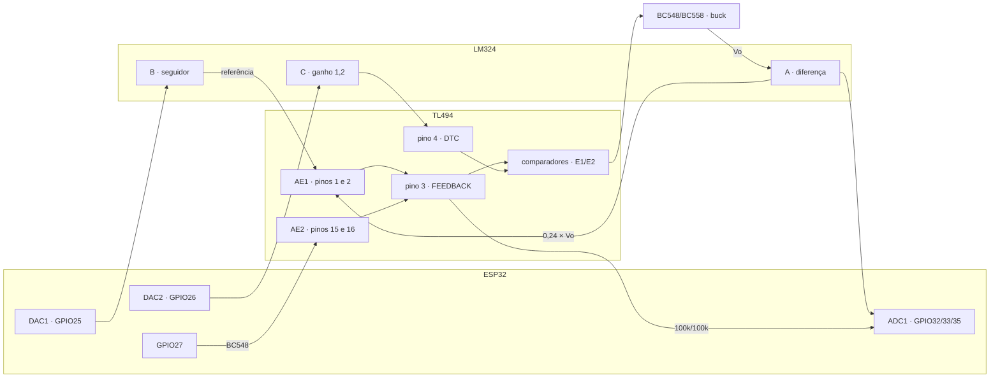
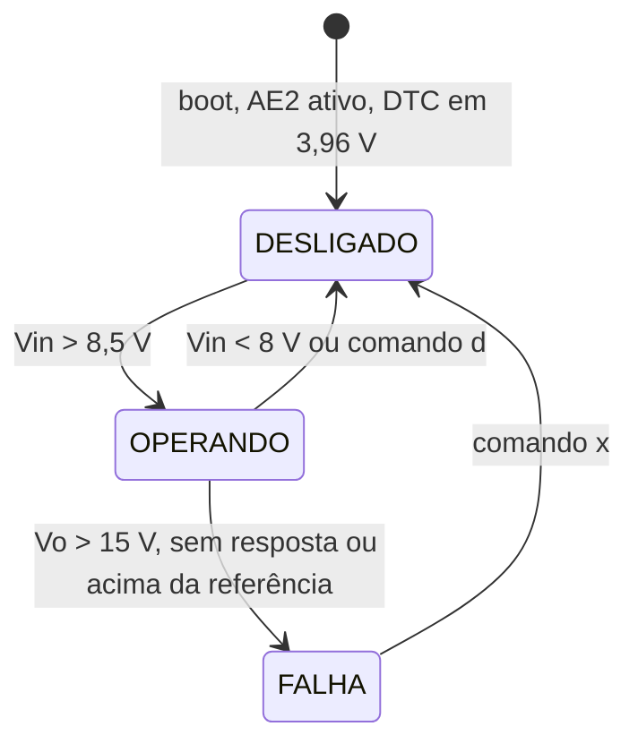

{/* Figuras geradas pelo Kroki. Fontes em diagramas/; depois de editar, rode diagramas/gerar_kroki.py */}

## Checklist — ESP32 nos pinos 1, 2, 3, 4 e 16 do TL494 {/* #checklist */}

- [ ] TL494 montado em saída simples (pino 13 no GND), com RT = 47 kΩ e CT = 1 nF
- [ ] Saídas E1 e E2 no nó X, C1 e C2 no +18 V, estágio BC548/BC558 da placa mantido
- [ ] LM324: A mede Vo, B isola a referência do DAC1, C leva o DAC2 ao pino 4 (DTC)
- [ ] Amplificador de erro 2 ligado como desligamento seguro, comandado pelo GPIO27
- [ ] Rede tipo 3 não inversora no amplificador de erro 1
- [ ] Pino 3, Vin e Vo lidos pelo ADC1 (GPIO33, GPIO32 e GPIO35)
- [ ] Calibração do DTC conferida no osciloscópio
- [ ] Ensaios dos modos 1 e 2 registrados e comparados com a versão do SG3525A

Este guia refaz o [guia de cooperação com o SG3525A](./guia-esp32-sg3525a-cooperacao.mdx)
usando o **TL494**, que é a solução sugerida para projetos novos. O conversor é o mesmo buck de
18 V, e o ESP32 continua com as mesmas tarefas: referência, limite de razão cíclica, proteções e
telemetria. O que muda é **por onde** ele entra no CI. O TL494 tem dois amplificadores de erro
de tensão, uma entrada de tempo morto (DTC) que aceita 0 V a 3,3 V e saídas sem estágio
_totem-pole_. Essas diferenças deixam a interface com o ESP32 mais simples em alguns pontos e
exigem cuidado em outros.



:::danger[Antes de ligar]

- Nenhum pino do ESP32 pode receber mais que 3,3 V. O REF do TL494 (pino 14) tem 5 V e o pino
  3 passa de 3,5 V: os dois só chegam ao ESP32 por divisor ou por transistor, como nos
  esquemas.
- O TL494 **não tem** partida suave nem pino de desligamento internos. Neste guia quem garante
  que não há pulsos na energização é o amplificador de erro 2 e o _pull-up_ do DTC. Monte os dois
  antes de ligar o +18 V.
- Com o conversor ligado ao retificador, o ESP32 não pode ficar no USB do computador sem
  isolação.

:::

## Objetivos

- Comparar o TL494 com o SG3525A e entender o que cada diferença muda na interface com o ESP32.
- Fechar a malha com o amplificador de erro 1 numa rede tipo 3 **não inversora**.
- Usar o DTC como limite de razão cíclica (modo 1) e como entrada do modulador (modo 2).
- Usar o amplificador de erro 2 como desligamento seguro.

## Material

- TL494CN (DIP-16) ou TL494CDR (SOIC-16). Pela tabela de encomenda do datasheet (rev. J), as
  duas versões C estão ativas; a TL494IN (DIP, faixa industrial) está como NRND (não recomendada
  para projetos novos).
- 1 LM324 (quatro amplificadores) e o restante do guia anterior: ESP32 DevKit clássico, buck de
  18 V, estágio BC548/BC558 e 1 BC548 extra.
- Resistores: 2 × 100 kΩ e 2 × 24 kΩ de 1 %, 1 MΩ, 100 kΩ (×4), 47 kΩ, 39 kΩ, 27 kΩ, 22 kΩ,
  20 kΩ, 10 kΩ (×6), 3,3 kΩ, 2 kΩ, 1,1 kΩ, 1 kΩ (×3).
- Capacitores: 1 nF C0G ou filme (CT), 680 pF, 68 nF (×2), 1 µF, 100 nF (×3), 10 nF (×3).
- 1 diodo BAT54 ou 1N5817.

---

## Parte 1 — Por que o TL494 em projetos novos {/* #parte-1 */}

| Característica            | SG3525A (onsemi)                           | TL494 (TI, rev. J)                                     |
| ------------------------- | ------------------------------------------ | ------------------------------------------------------ |
| Amplificador de erro      | 1, de transcondutância (±100 µA no pino 9) | **2**, de tensão: 80 dB, 800 kHz, fornece 2 mA         |
| Faixa de modo comum       | 1,5 V a 5,2 V (teste de CMRR)              | **−0,3 V a VCC − 2 V**                                 |
| Corrente de polarização   | 1 µA típico, 10 µA máximo                  | 0,2 µA típico, 1 µA máximo                             |
| Referência                | 5,1 V ± 1 %                                | 5 V ± 5 %, até 10 mA                                   |
| Sentido do PWM            | COMP sobe → razão cíclica sobe             | **FEEDBACK sobe → razão cíclica desce**                |
| Faixa do pino de controle | 0,9 V (D = 0) a 3,3 V (D máx.)             | 0,5 V (97 %) a 3,5 V (0 %)                             |
| Razão cíclica máxima      | 49 % por saída (98 % em A OU B)            | ~97 % em saída simples; 45 % por saída em _push-pull_  |
| Tempo morto               | RD entre CT e Discharge                    | **entrada DTC**: 0 V (~3 %) a 3,3 V (100 %), I < 10 µA |
| Partida suave             | interna (pino 8)                           | não tem (DTC com RC externo)                           |
| Desligamento              | pino 10                                    | não tem (DTC ou o segundo amplificador)                |
| Saídas                    | _totem-pole_, 400 mA de pico               | transistores abertos, 200 mA                           |
| Oscilador                 | 100 Hz a 400 kHz                           | 1 kHz a 300 kHz, `f = 1 / (RT × CT)`                   |
| Alimentação               | 8 V a 35 V                                 | 7 V a 40 V, 1,6 mA típico em repouso                   |

O que isso significa para o ESP32:

- **O DAC pode começar em 0 V.** A faixa de modo comum vai até −0,3 V, então a referência não
  precisa ficar acima de 1,5 V. A faixa do guia passa de 7 V a 12 V para **2 V a 12 V**.
- **A compensação volta a ser de amp-op.** O amplificador de erro tem saída de tensão, e o zero
  no semiplano direito do SG3525A (que dependia de um `gm` não especificado) desaparece. As
  margens passam a depender só do capacitor de saída.
- **O DTC é o grampo pronto.** Uma entrada de alta impedância, linear de 0 V a 3,3 V: é a faixa
  do DAC do ESP32. O BC558 e a calibração da VEB do guia anterior deixam de existir.
- **O segundo amplificador de erro vira desligamento seguro.** As saídas dos dois são
  combinadas: vale o que pedir **menos** razão cíclica.
- **Cuidados novos:** o sentido do PWM é invertido (a realimentação vai para a entrada não
  inversora), não há partida suave nem desligamento internos, e as saídas de 200 mA continuam
  precisando do estágio BC548/BC558.

:::note[Revisão J do datasheet]
A revisão de setembro de 2026 descreve as saídas como MOSFETs (dreno e fonte), mas mantém os
nomes C1, E1, C2 e E2 na pinagem. Ela também mudou valores típicos que este guia usa: limiar de
razão cíclica zero do DTC de 3 V para **2,5 V** (máximo 3,3 V) e do FEEDBACK de 4 V para
**3,4 V** (máximo 4,5 V). Por isso o roteiro inclui uma calibração.
:::

---

## Parte 2 — Mapa de pinos {/* #parte-2 */}

Os dois CIs não são compatíveis pino a pino: o TL494 precisa de outra placa ou de um adaptador.

| Função                    | SG3525A          | TL494               | Neste guia                                      |
| ------------------------- | ---------------- | ------------------- | ----------------------------------------------- |
| Referência                | 16 (5,1 V)       | 14 REF (5 V)        | divisores do amplificador de erro 2             |
| Alimentação               | 15 VCC, 13 VC    | 12 VCC; 8 C1, 11 C2 | +18 V                                           |
| GND                       | 12               | 7                   | GND comum com o ESP32                           |
| Oscilador                 | 5 CT, 6 RT, 7 RD | 5 CT, 6 RT          | 1 nF e 47 kΩ                                    |
| Amplificador de erro      | 1 ERR−, 2 ERR+   | 2 1IN−, 1 1IN+      | **realimentação no pino 1 (+)**, rede no pino 2 |
| Saída do amplificador     | 9 COMP           | 3 FEEDBACK          | lido pelo GPIO33                                |
| Partida suave             | 8                | —                   | rampa do DTC pelo ESP32                         |
| Desligamento              | 10               | —                   | amplificador de erro 2 (15 e 16)                |
| Tempo morto / limite de D | RD               | 4 DTC               | DAC2 pelo LM324-C                               |
| Saídas                    | 11 A, 14 B       | 9 E1, 10 E2         | em paralelo, no nó X                            |
| Modo das saídas           | —                | 13 OUTPUT CTRL      | GND: saída simples                              |
| Sincronismo               | 3 SYNC, 4 OSC    | —                   | não usado                                       |

<figure style={{ margin: "1.5rem 0", textAlign: "center" }}>
  
  <figcaption>Ligações do TL494 neste guia.</figcaption>
</figure>

---

## Parte 3 — Como o TL494 forma o pulso {/* #parte-3 */}

O oscilador carrega CT com corrente constante até 3 V e descarrega: é uma rampa de 0 V a 3 V. Dois
comparadores olham para ela. A saída conduz enquanto a rampa está **acima** das duas linhas:
`V(pino 3) − 0,7 V` (o diodo interno do comparador PWM) e `V(DTC) + 0,11 V` (o _offset_ do
comparador de tempo morto). Vale a linha mais alta, isto é, a que pedir menos razão cíclica.

<figure style={{ margin: "1.5rem 0", textAlign: "center" }}>
  
  <figcaption>
    A saída conduz no fim de cada período, enquanto a rampa supera as duas
    linhas.
  </figcaption>
</figure>

```text title="Relações usadas no guia (valores típicos)"
oscilador (saída simples):  f = 1 / (RT × CT) = 1 / (47 kΩ × 1 nF) ≈ 21,3 kHz

pelo pino 3:   D = 0,97 × (3,5 − V3) / 3,0        V3 = 1,93 V  →  D = 50,7 %
pelo DTC:      D ≤ 1 − (VDTC + 0,11) / 3,0         VDTC = 0,79 V  →  D ≤ 70 %
```

- Em _push-pull_ (pino 13 no REF) cada saída comutaria na metade de `f`. Aqui o pino 13 vai ao
  GND e as duas saídas trabalham **juntas**, na frequência do oscilador.
- `f = 1 / (RT × CT)` é a fórmula do datasheet. Confira a frequência real no osciloscópio.

---

## Parte 4 — Circuito {/* #parte-4 */}

### 4.1 Oscilador e saídas

<figure style={{ margin: "1.5rem 0", textAlign: "center" }}>
  
  <figcaption>
    Saídas em paralelo como seguidores de fonte. O nó X é o mesmo da placa da
    experiência.
  </figcaption>
</figure>

- RT de 47 kΩ do pino 6 ao GND e CT de 1 nF (C0G ou filme) do pino 5 ao GND.
- C1 e C2 no +18 V; E1 e E2 juntos no nó X. Os dois diodos 1N4148 da placa saem: o TL494 já
  entrega um só sinal.
- O nível alto no nó X fica cerca de 1,7 V abaixo do +18 V (saturação em seguidor de fonte), e o
  estágio BC548/BC558 leva esse sinal ao gate.
- 100 nF cerâmico junto ao pino 12. O datasheet sugere também um capacitor de volume (47 µF) se
  a fonte estiver longe.

### 4.2 Medindo Vo: LM324-A

O mesmo amplificador de diferença do guia anterior, agora numa das quatro seções do LM324.

<figure style={{ margin: "1.5rem 0", textAlign: "center" }}>
  
  <figcaption>Vfb = 0,24 × Vo, referenciado ao GND.</figcaption>
</figure>

A saída vai ao pino 1 do TL494 e ao ESP32, pelo mesmo filtro com grampo do guia anterior:

<figure style={{ margin: "1.5rem 0", textAlign: "center" }}>
  
  <figcaption>Medida de Vo pelo GPIO35.</figcaption>
</figure>

### 4.3 Referência com seguidor: DAC1 e LM324-B

Na rede da [Parte 5](#parte-5), R1 e o ramo R3–C3 ligam o pino 2 ao **nó de referência**. O ramo
R3–C3 puxa corrente alternada; se o nó fosse o próprio filtro do DAC, a referência oscilaria
junto. O seguidor LM324-B mantém o nó firme.

<figure style={{ margin: "1.5rem 0", textAlign: "center" }}>
  
  <figcaption>Referência: DAC1 filtrado e isolado pelo LM324-B.</figcaption>
</figure>

### 4.4 DTC: DAC2 e LM324-C

<figure style={{ margin: "1.5rem 0", textAlign: "center" }}>
  
  <figcaption>
    O DTC recebe 1,2 × DAC2. Com o DAC solto, o pino 4 fica em 3,96 V.
  </figcaption>
</figure>

- O ganho de 1,2 leva o DTC até 3,96 V, acima do limiar **máximo** de razão cíclica zero do
  datasheet (3,3 V). Sem o ganho, 3,3 V no DAC poderia deixar pulsos estreitos em alguns CIs.
- Com o ESP32 em _boot_ ou travado com o DAC2 desligado, o 100 kΩ puxa a entrada para 3,3 V e o
  TL494 fica sem pulsos.
- O datasheet pede que o DTC nunca fique aberto. Aqui ele sempre está ligado à saída do LM324-C.

### 4.5 Desligamento seguro pelo amplificador de erro 2

<figure style={{ margin: "1.5rem 0", textAlign: "center" }}>
  
  <figcaption>O AE2 só fica inativo com o GPIO27 em nível alto.</figcaption>
</figure>

- O pino 15 recebe cerca de 1 V do REF (39 kΩ / 10 kΩ).
- Com o GPIO27 em nível alto, o BC548 leva o pino 16 a ~0,1 V. O AE2 fica com a saída baixa e
  não interfere.
- Com o GPIO27 em nível baixo, solto ou com o ESP32 **sem alimentação**, o pino 16 vai a 5 V. O
  AE2 leva o pino 3 ao alto e o TL494 para de pulsar. É o equivalente ao pino 10 do SG3525A, com
  a mesma lógica de falha segura.
- O preço: o AE2 deixa de estar disponível para limitar corrente, que é o uso que o datasheet
  mostra para ele.

### 4.6 Lendo o pino 3

<figure style={{ margin: "1.5rem 0", textAlign: "center" }}>
  
  <figcaption>
    O pino 3 tem saída de tensão: um divisor de 100 kΩ basta.
  </figcaption>
</figure>

O amplificador de erro fornece 2 mA, então o divisor de 200 kΩ (no máximo ~20 µA) não pesa. No
SG3525A foi preciso usar 940 kΩ para não roubar corrente do OTA.

### 4.7 Resumo das ligações

| ESP32         | Função                | Liga em                                         |
| ------------- | --------------------- | ----------------------------------------------- |
| GPIO25 (DAC1) | referência            | 1 kΩ / 1 µF → LM324-B → nó de referência        |
| GPIO26 (DAC2) | DTC                   | LM324-C (ganho 1,2) → pino 4; 100 kΩ para 3V3   |
| GPIO27        | desligamento          | 10 kΩ → base do BC548, coletor no pino 16       |
| GPIO32        | Vin                   | divisor 27 kΩ / 3,3 kΩ com 10 nF                |
| GPIO33        | pino 3 (FEEDBACK)     | divisor 100 kΩ / 100 kΩ com 10 nF               |
| GPIO34        | trimpot de referência | cursor entre 3V3 e GND                          |
| GPIO35        | Vo                    | LM324-A → 10 kΩ / 20 kΩ → 1 kΩ, 10 nF e BAT54   |
| GND           | referência comum      | pino 7 do TL494, pino 11 do LM324, GND da fonte |

---

## Parte 5 — Modo 1: malha analógica no amplificador de erro 1 {/* #parte-5 */}

### 5.1 Por que não inversora

No TL494, tensão maior no pino 3 significa **menos** razão cíclica. Se Vfb entrasse pelo pino 2
(inversora), uma saída alta produziria pino 3 baixo e mais razão cíclica: realimentação positiva.
Por isso Vfb entra pelo **pino 1** e a rede tipo 3 fica entre o pino 2, o pino 3 e o nó de
referência. É a mesma organização do exemplo de aplicação do datasheet, em que a amostra da
saída vai ao 1IN+ e a referência dividida ao 1IN−.

<figure style={{ margin: "1.5rem 0", textAlign: "center" }}>
  
  <figcaption>
    Rede tipo 3 do modo 1. Em regime, pino 1 = pino 2 = nó de referência.
  </figcaption>
</figure>

| Elemento       | Posição | Valor                                |
| -------------- | ------- | ------------------------------------ |
| R2 · C1        | zero 1  | 1 / (2π × 22 kΩ × 68 nF) = 106 Hz    |
| (R1 + R3) · C3 | zero 2  | 1 / (2π × 11,1 kΩ × 68 nF) = 211 Hz  |
| R3 · C3        | polo 1  | 1 / (2π × 1,1 kΩ × 68 nF) = 2,1 kHz  |
| R2 · C2        | polo 2  | 1 / (2π × 22 kΩ × 680 pF) = 10,6 kHz |

```text title="Ganho de malha no cruzamento (fc ≈ 900 Hz)"
modulador:       0,97 / 3,0 V                     = 0,323 por volt
buck acima de f0: 18 × (232 / 900)²                = 1,20
realimentação:   0,24
compensador:     1 + R2 × 2π × fc × C3 = 1 + 8,46  = 9,46

malha = 0,323 × 1,20 × 0,24 × 9,46 ≈ 0,88
```

Em relação à versão do SG3525A, só R2, C1 e C2 mudaram (18 kΩ, 82 nF, 820 pF → 22 kΩ, 68 nF,
680 pF), para compensar o ganho menor do modulador (0,323 por volt contra 0,408).

### 5.2 O que o modelo prevê

Mesmo modelo médio do buck dos guias anteriores, agora com o amplificador de erro como amp-op
(80 dB, 800 kHz). São resultados de simulação, não de bancada:

| Situação                                          | Resultado previsto                 |
| ------------------------------------------------- | ---------------------------------- |
| Cruzamento e margem de fase (RSE de 0,05 a 0,3 Ω) | 880 Hz a 1,1 kHz, 49° a 86°        |
| Estabilidade condicional abaixo do cruzamento     | não aparece                        |
| Erro em regime                                    | desprezível (ganho de 80 dB)       |
| Carga de 22 Ω para 15 Ω e de volta                | cerca de ±30 mV                    |
| Degrau de referência de 9 V para 6 V              | vale de ~5,6 V, acomoda em ~20 ms  |
| Degrau de referência de 6 V para 9 V              | sem sobressinal, acomoda em ~20 ms |
| Partida com rampa de 20 V/s e grampo adaptativo   | sem sobressinal                    |

A margem não depende mais do `gm` do amplificador, que no SG3525A não era especificado: o pior
caso caiu para 49° (contra 32°).

---

## Parte 6 — Modo 2: malha digital pelo DTC {/* #parte-6 */}

O datasheet descreve o DTC como uma entrada para controlar a saída "a partir de fontes externas
sem perturbar os amplificadores de erro". No modo 2 o ESP32 usa exatamente isso: roda o
controlador integral do guia de malha fechada (`ki = 1,75`) e escreve a razão cíclica no DTC.

```text title="Razão cíclica → tensão no DTC"
VDTC = (1 − D) × 3,0 − 0,11          D = 50 %  →  1,39 V      D = 67 %  →  0,88 V
```

O amplificador de erro 1 continua ligado, mas com a referência em `0,24 × (ref + 1,5 V)`.
Enquanto a saída fica abaixo de `ref + 1,5 V`, ele satura no baixo e não limita nada. Se a saída passar
disso, ele assume e segura a tensão: é um **teto analógico** que não depende do firmware.

- Não há jumper para trocar de modo: só o `#define MODO`.
- Um passo do DAC (12,9 mV × 1,2) muda a razão cíclica em 0,52 %, o mesmo passo do guia do
  SG3525A. A saída oscila da ordem de **±0,2 V** em baixa frequência. O PWM filtrado continua
  sendo a melhora indicada.

---

## Parte 7 — Supervisão {/* #parte-7 */}



Não existe mais o estado de espera da partida suave: o TL494 não tem partida suave interna, e
quem faz a rampa é o próprio ESP32, pela referência e pelo DTC.

### Limite de razão cíclica pelo DTC

```text title="Limite da razão cíclica"
Dmax = 1,3 × ref / Vin + 0,05        (e nunca acima do valor do comando m)
ref = 9 V, Vin = 18 V  →  Dmax = 70 %  →  VDTC = 0,79 V
```

| Situação no modelo                        | Sem limite                    | Com limite                                          |
| ----------------------------------------- | ----------------------------- | --------------------------------------------------- |
| Medida de Vo perdida com a saída em 9 V   | pico de 21,5 V, depois 17,1 V | pico de 14,3 V, depois 12,4 V, até o ESP32 desligar |
| Comando `m 30` liberado de uma vez        | —                             | sobressinal até ~10,1 V                             |
| Comando `m 30` liberado a 0,5 por segundo | —                             | sobressinal até ~9,3 V                              |

O pico sem limite é maior que no SG3525A (21,5 V contra 17,7 V) porque o TL494 chega a 97 % de
razão cíclica. Por isso o firmware nunca deixa o DTC em 0 V com a malha fechada, e o limite do
comando `m` só sobe a 0,5 por segundo.

### Falhas

| Falha               | Como o ESP32 detecta                                             | Reação                              |
| ------------------- | ---------------------------------------------------------------- | ----------------------------------- |
| Subtensão           | Vin < 8 V                                                        | desligamento; volta com Vin > 8,5 V |
| Sobretensão         | Vo > 15 V                                                        | desligamento até o comando `x`      |
| Saída sem resposta  | o pino 3 pede mais que o limite do DTC e Vo < ref / 2, por 50 ms | desligamento até o comando `x`      |
| Acima da referência | Vo mais de 2 V acima da referência por 50 ms                     | desligamento até o comando `x`      |

No modo 1, "pedir mais que o limite" sai direto da leitura do pino 3: `D = 0,97 × (3,5 − V3) / 3`
maior que `Dmax`. No SG3525A era preciso comparar com a tensão do grampo.

---

## Parte 8 — Firmware {/* #parte-8 */}

<FileTree root="esp32-tl494" files={["platformio.ini c", "src/main.cpp c"]} />

O `platformio.ini` é o mesmo dos guias anteriores.

```cpp title="src/main.cpp"
// Guia: ESP32 cooperando com o TL494 pelos pinos 1, 2, 3, 4 e 16
// GPIO25 (DAC1) = referência (buffer LM324-B) | GPIO26 (DAC2) = DTC, pino 4 (LM324-C, ganho 1,2)
// GPIO27 = desligamento pelo amplificador de erro 2 (pino 16)
// GPIO32 = Vin | GPIO33 = FEEDBACK (pino 3) | GPIO34 = trimpot | GPIO35 = Vo
#include <Arduino.h>
#include <Ticker.h>

#define MODO 1                           // 1: malha analógica no TL494 | 2: malha digital pelo DTC

// ---- Pinos do ESP32
#define DAC_REF  25                      // -> 1 kΩ / 1 µF -> LM324-B (seguidor) -> nó de referência
#define DAC_DTC  26                      // -> LM324-C (ganho 1,2) -> pino 4 (DTC)
#define SHUT_PIN 27                      // -> BC548 no pino 16. Nível alto = TL494 liberado
#define VIN_PIN  32
#define FB_PIN   33                      // pino 3 (FEEDBACK) por 100k / 100k
#define POT_PIN  34
#define VO_PIN   35

// ---- Escalas das medidas
#define K_FB    0.24f                    // amplificador de diferença (LM324-A): saída = 0,24 x Vo
#define K_VO    (K_FB * 20.0f / 30.0f)   // GPIO35 vê a saída do amplificador por 10k/20k
#define K_VIN   (3.3f / 30.3f)           // divisor 27k / 3,3k
#define K_PINO3 0.5f                     // divisor 100k / 100k
#define G_DTC   1.2f                     // ganho do LM324-C
#define CAL_VO  1.000f
#define CAL_VIN 1.000f
#define CAL_REF 1.000f

// ---- TL494 (datasheet, valores típicos)
#define V3_ZERO   3.5f                   // pino 3 nesta tensão: razão cíclica zero
#define V3_MAX    0.5f                   // pino 3 nesta tensão: razão cíclica máxima (97 %)
#define V_RAMPA   3.0f                   // amplitude da rampa em CT
#define V_DTC_OFS 0.11f                  // offset interno do comparador de tempo morto
#define D_TOPO    0.97f                  // máximo em saída simples (OUTPUT CTRL no GND)

// ---- DAC do ESP32 (8 bits). Ajuste com o multímetro na calibração
#define DAC_LSB (3.3f / 255.0f)
#define DAC_OFS 0.0f

// ---- Operação
#define TS_MS          2
#define TS             (TS_MS / 1000.0f)
#define REF_MIN        2.0f
#define REF_MAX        12.0f
#define RAMPA_V_POR_S  20.0f
#define DMAX_SOBE_POR_S 0.5f             // o limite só sobe devagar (evita sobressinal)
#define VIN_MIN        8.0f
#define VO_MAX         15.0f
#define GRAMPO_GANHO   1.3f              // Dmax = 1,3 x ref / Vin + 0,05
#define GRAMPO_FOLGA   0.05f
#define TETO_MODO2     1.5f              // modo 2: o AE1 limita Vo a ref + 1,5 V
#define FALHA_AMOSTRAS 25                // 50 ms

enum Estado { DESLIGADO, OPERANDO, FALHA };
const char *NOME_ESTADO[] = {"DESLIGADO", "OPERANDO", "FALHA"};

Ticker temporizador;
volatile bool amostraPendente = false;
Estado estado = DESLIGADO;
const char *motivo = "";
bool modoPot = true;
bool ligadoPeloUsuario = true;
float refAlvo = 9.0f, ref = 0;
float vin = 0, vo = 0, v3 = 0;
float dmaxUsuario = D_TOPO, dmaxUsuarioRampa = 0, dmax = 0;
float ki = 1.75f, integral = 0;          // só no modo 2
float dAplicado = 0;                     // razão cíclica estimada
int contFalha = 0;
uint32_t passo = 0;

void aoEstourarTemporizador() { amostraPendente = true; }

// ---------------------------------------------------------------- conversões
float dDoPino3(float v) { return constrain(D_TOPO * (V3_ZERO - v) / (V3_ZERO - V3_MAX), 0.0f, D_TOPO); }
float dtcDe(float d) { return constrain((1.0f - d) * V_RAMPA - V_DTC_OFS, 0.0f, 3.3f * G_DTC); }

void dacVolts(uint8_t pino, float v) {
  int codigo = (int)lroundf((v - DAC_OFS) / DAC_LSB);
  dacWrite(pino, (uint8_t)constrain(codigo, 0, 255));
}

void dtc(float vPino4) { dacVolts(DAC_DTC, vPino4 / G_DTC); }   // tensão desejada no pino 4

float lerVolts(uint8_t pino, int n = 4) {
  uint32_t soma = 0;
  for (int i = 0; i < n; i++) soma += analogReadMilliVolts(pino);
  return soma / (float)n / 1000.0f;
}

void lerSensores() {
  vin = lerVolts(VIN_PIN) / K_VIN * CAL_VIN;
  vo = lerVolts(VO_PIN) / K_VO * CAL_VO;
  v3 = lerVolts(FB_PIN, 2) / K_PINO3;
}

// ---------------------------------------------------------------- liga e desliga
void desligar(Estado novo, const char *porque) {
  digitalWrite(SHUT_PIN, LOW);           // AE2 no alto: pino 3 no alto, razão cíclica zero
  dtc(3.3f * G_DTC);                     // e o DTC também em 100 % de tempo morto
  dacVolts(DAC_REF, 0);
  integral = 0;
  ref = 0;
  dmax = 0;
  dmaxUsuarioRampa = 0;
  dAplicado = 0;
  contFalha = 0;
  if (estado != novo || motivo != porque)
    Serial.printf("[TL] %s %s\r\n", NOME_ESTADO[novo], porque);
  estado = novo;
  motivo = porque;
}

void partir() {
  dtc(3.3f * G_DTC);                     // começa sem pulsos: a partida suave é a rampa do DTC
  dacVolts(DAC_REF, 0);
  dmaxUsuarioRampa = dmaxUsuario;        // a rampa de 0,5/s vale só para mudanças do comando m
  digitalWrite(SHUT_PIN, HIGH);          // libera o AE2
  estado = OPERANDO;
  motivo = "";
  Serial.println("[TL] OPERANDO");
}

// ---------------------------------------------------------------- controle
void controlar() {
  lerSensores();

  if (estado == FALHA) return;
  if (vin < VIN_MIN) {
    if (estado != DESLIGADO) desligar(DESLIGADO, "SUBTENSAO");
    return;
  }
  if (estado == DESLIGADO) {
    if (ligadoPeloUsuario && vin > VIN_MIN + 0.5f) partir();
    return;
  }
  if (vo > VO_MAX) { desligar(FALHA, "SOBRETENSAO"); return; }

  float degrau = RAMPA_V_POR_S * TS;                    // rampa da referência
  ref += constrain(refAlvo - ref, -degrau, degrau);

  // Limite do usuário (comando m): desce na hora, sobe no máximo 0,5 por segundo
  dmaxUsuarioRampa = min(dmaxUsuario, dmaxUsuarioRampa + DMAX_SOBE_POR_S * TS);
  // Grampo adaptativo pelo DTC: acompanha ref / Vin
  dmax = min(min(dmaxUsuarioRampa, D_TOPO), GRAMPO_GANHO * ref / vin + GRAMPO_FOLGA);

#if MODO == 1
  dacVolts(DAC_REF, K_FB * ref * CAL_REF);              // o TL494 regula
  dtc(dtcDe(dmax));                                     // o ESP32 só limita
  float pedido = dDoPino3(v3);                          // o que o AE1 está pedindo
  dAplicado = min(pedido, dmax);
  bool noLimite = pedido > dmax + 0.005f;
#else
  float erro = ref - vo;
  integral = constrain(integral + ki * erro * TS, 0.0f, dmax);
  dtc(dtcDe(integral));                                 // o DTC é a entrada do modulador
  dacVolts(DAC_REF, min(3.3f, K_FB * (ref + TETO_MODO2) * CAL_REF));   // AE1 vira teto
  dAplicado = min(integral, dDoPino3(v3));
  bool noLimite = integral >= dmax - 0.001f && erro > 0;   // integrador encostado no limite
#endif

  // Saída sem resposta: pedindo mais que o limite e Vo bem abaixo da referência.
  // Acima da referência: o TL494 perdeu a realimentação, mas o ESP32 ainda mede Vo.
  bool semResposta = ref > 3.0f && vo < 0.5f * ref && noLimite;
  bool acima = ref > 3.0f && vo > ref + 2.0f;
  if (semResposta || acima) {
    if (++contFalha >= FALHA_AMOSTRAS) desligar(FALHA, semResposta ? "SEM RESPOSTA" : "ACIMA DA REF");
  } else {
    contFalha = 0;
  }
}

// ---------------------------------------------------------------- comandos
void lerComando() {
  if (!Serial.available()) return;
  String s = Serial.readStringUntil('\n');
  s.trim();
  if (s.length() == 0) return;
  float v = s.substring(1).toFloat();
  switch (tolower(s[0])) {
    case 'r': modoPot = false; refAlvo = constrain(v, REF_MIN, REF_MAX); break;
    case 'p': modoPot = true; break;
    case 'm': dmaxUsuario = constrain(v / 100.0f, 0.0f, D_TOPO); break;
    case 'i': ki = v; break;
    case 'd': ligadoPeloUsuario = false; desligar(DESLIGADO, "COMANDO"); break;
    case 'l': ligadoPeloUsuario = true; break;
    case 'x': if (estado == FALHA) desligar(DESLIGADO, "REARMADO"); break;
    default: Serial.println("[CMD] r <V> | p | m <%> | i <ki> | d | l | x"); return;
  }
  Serial.printf("[CMD] ref=%.1f V (%s)  Dmax usuario=%.0f %%  ki=%.2f\r\n",
                refAlvo, modoPot ? "trimpot" : "serial", 100 * dmaxUsuario, ki);
}

void setup() {
  pinMode(SHUT_PIN, OUTPUT);
  digitalWrite(SHUT_PIN, LOW);           // TL494 bloqueado até tudo estar pronto
  dacWrite(DAC_DTC, 255);                // DTC no máximo: sem pulsos
  dacWrite(DAC_REF, 0);

  Serial.begin(115200);
  Serial.setTimeout(10);
  delay(200);
  Serial.printf("\r\n=== ESP32 + TL494 (modo %d: %s) ===\r\n", MODO,
                MODO == 1 ? "malha analogica no TL494" : "malha digital pelo DTC");

  analogReadResolution(12);
  analogSetPinAttenuation(VIN_PIN, ADC_11db);
  analogSetPinAttenuation(FB_PIN, ADC_11db);
  analogSetPinAttenuation(POT_PIN, ADC_11db);
  analogSetPinAttenuation(VO_PIN, ADC_11db);

  temporizador.attach_ms(TS_MS, aoEstourarTemporizador);
}

void loop() {
  lerComando();
  if (!amostraPendente) return;
  amostraPendente = false;
  passo++;

  if (modoPot && passo % 50 == 0) {      // trimpot a cada 100 ms, em passos de 0,1 V
    float v = REF_MIN + lerVolts(POT_PIN) / 3.3f * (REF_MAX - REF_MIN);
    refAlvo = constrain(roundf(v * 10) / 10, REF_MIN, REF_MAX);
  }
  controlar();

  if (passo % 100 == 0) {                // a cada 200 ms
    const char *situacao = estado != OPERANDO ? NOME_ESTADO[estado]
                         : (dAplicado >= dmax - 0.005f ? "LIMITADO" : "REGULANDO");
    Serial.printf("[TL] Vin=%.1f ref=%.2f Vo=%.2f V3=%.2f D~%.1f%% Dmax=%.1f%% %s %s\r\n",
                  vin, ref, vo, v3, 100 * dAplicado, 100 * dmax, situacao, motivo);
  }
}
```

### Comandos pelo monitor serial

| Comando | Efeito                                                         |
| ------- | -------------------------------------------------------------- |
| `r 9`   | referência de 9 V pelo serial (faixa de 2 V a 12 V)            |
| `p`     | volta a usar o trimpot do GPIO34                               |
| `m 60`  | limita a razão cíclica a 60 % (sobe no máximo 0,5 por segundo) |
| `i 3.5` | muda `ki` (só no modo 2)                                       |
| `d`     | desliga pelo amplificador de erro 2                            |
| `l`     | religa                                                         |
| `x`     | rearma depois de uma falha                                     |

```text title="Monitor serial (modo 1, valores aproximados)"
=== ESP32 + TL494 (modo 1: malha analogica no TL494) ===
[TL] OPERANDO
[TL] Vin=18.0 ref=2.00 Vo=1.98 V3=3.16 D~11.0% Dmax=19.4% REGULANDO
[TL] Vin=18.0 ref=6.00 Vo=5.98 V3=2.46 D~33.6% Dmax=48.3% REGULANDO
[TL] Vin=18.0 ref=9.00 Vo=9.00 V3=1.93 D~50.8% Dmax=70.0% REGULANDO
```

---

## Parte 9 — Roteiro na bancada {/* #parte-9 */}

### 9.1 Antes do +18 V

1. Com o ESP32 **desligado** e o gate do MOSFET desligado do estágio BC548/BC558, ligue o
   +18 V. Confira que o pino 16 está em 5 V, o pino 4 perto de 0 V
   (ESP32 sem alimentação) e o nó X **sem pulsos**: é o AE2 que garante isso.
2. Ligue o ESP32 sem o +18 V: o serial mostra `DESLIGADO SUBTENSAO`. Confira 3,96 V no pino 4.

### 9.2 Calibração

1. Com o +18 V e a carga de 22 Ω, envie `r 9` e `m 50`. A saída deve ficar perto de 9 V, ou
   um pouco abaixo disso, **limitada** pelo DTC (`LIMITADO` no serial). Meça a razão cíclica no
   nó X.
2. Ajuste `V_RAMPA` e `V_DTC_OFS` até a medida bater com 50 %. Repita com `m 30`.
3. Volte com `m 97`. Ajuste `CAL_REF` até Vo medido sobre a carga dar 9,00 V e depois `CAL_VO`
   até o serial concordar. Confira `CAL_VIN` com o multímetro.
4. Compare `D~` do serial com a razão cíclica medida: a diferença mostra o erro de `V3_ZERO` e
   `V3_MAX`, que só afetam a telemetria e a detecção de falhas.

### 9.3 Ensaios

1. **Modo 1:** degrau de carga (47 Ω em paralelo com os 22 Ω), degrau de referência (`r 6` e
   `r 9`) e limite (`m 40`). Registre pico, vale e tempo de acomodação.
2. **Falha:** com a fonte limitada em corrente, tire o Vfb do pino 1 e ligue o pino 1 ao GND: o
   TL494 passa a "ver" saída zero, vai ao limite do DTC e o ESP32 deve desligar com
   `ACIMA DA REF`. Depois solte o fio do +Vin que vai ao
   LM324-A: os dois perdem a medida e o ESP32 deve desligar com `SEM RESPOSTA`.
3. **Modo 2:** grave com `MODO 2` e repita os degraus. Observe Vo com acoplamento AC: a oscilação
   da resolução do DAC deve aparecer.
4. **Teto analógico do modo 2:** com `r 9`, envie `i 0` (congela o integrador) e suba a fonte
   de 18 V para 24 V, se ela permitir. Sem o teto a saída iria a ~12 V; o AE1 deve segurá-la
   perto de 10,5 V, abaixo do limite da falha "acima da referência" (11 V).

| Medida                                 | TL494 modo 1 (previsto) | Medido | SG3525A modo 1 (guia anterior) |
| -------------------------------------- | ----------------------- | ------ | ------------------------------ |
| Vo com referência de 9 V               | 9,0 V                   |        |                                |
| Pico no degrau de carga 22 Ω → 15 Ω    | dezenas de mV           |        |                                |
| Degrau de referência de 9 V para 6 V   | ~20 ms                  |        |                                |
| Vo com `m 40`                          | ~7 V                    |        |                                |
| Margem de fase (se medida com injeção) | 49° a 86°               |        |                                |

:::tip[Preveja antes de medir]

- **P1:** por que a realimentação deste guia entra pelo pino 1 (não inversora), se no SG3525A
  ela entrava pelo pino 1 inversor? O que aconteceria com a saída se você trocasse os fios dos
  pinos 1 e 2?
- **P2:** com o DTC em 0 V e o AE1 saturado no baixo, qual a razão cíclica? Compare com os 98 %
  do SG3525A e com o pico de 21,5 V da Parte 7.
- **P3:** meça a tensão do DTC que zera a razão cíclica no seu CI. Ela fica perto do típico de
  2,5 V ou do máximo de 3,3 V? Por que o LM324-C tem ganho 1,2?
- **P4:** com o +18 V ligado e o ESP32 **sem alimentação**, qual circuito garante que não há
  pulsos? E com o ESP32 travado com o GPIO27 em nível alto?

:::

---

## Se algo não funcionar {/* #problemas */}

| Sintoma                                  | Verifique                                                     |
| ---------------------------------------- | ------------------------------------------------------------- |
| Sem pulsos, pino 16 em 5 V               | GPIO27, BC548 do AE2; estado `DESLIGADO` ou `FALHA` no serial |
| Sem pulsos, pino 4 acima de 2,5 V        | DAC2, LM324-C, ganho; estado do firmware                      |
| Sem pulsos, pino 3 acima de 3,5 V        | pinos 1 e 2 trocados; referência do LM324-B; AE2 ativo        |
| Pulsos com o ESP32 desligado             | pino 15 sem o divisor de 1 V; pino 16 sem o 10 kΩ do REF      |
| Vo vai ao máximo e o ESP32 desliga       | realimentação no pino 2 em vez do pino 1; LM324-A             |
| Oscilação de centenas de hertz no modo 1 | valores da rede tipo 3; nó de referência sem o LM324-B        |
| Frequência longe de 21 kHz               | CT e RT; capacitor de CT de baixa qualidade                   |
| Nível alto do nó X muito abaixo de 16 V  | C1 e C2 sem o +18 V; pino 13 fora do GND                      |
| `D~` do serial diferente do osciloscópio | `V3_ZERO` e `V3_MAX` (calibração 9.2)                         |
