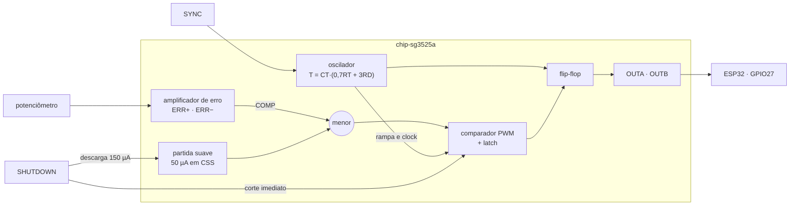

{/* Figuras geradas pelo Kroki. Fontes em diagramas/; depois de editar, rode diagramas/gerar_kroki.py */}

## Checklist — SG3525A no Wokwi {/* #checklist */}

- [ ] Projeto ESP32 criado no wokwi.com e chip personalizado `sg3525a` adicionado em C
- [ ] `sg3525a.chip.json` e `sg3525a.chip.c` substituídos pelos deste guia
- [ ] `diagram.json` e `sketch.ino` da demonstração no projeto
- [ ] Mensagem `SG3525A: chip iniciado` no _Chips Console_
- [ ] Partida suave observada no serial (tensão SS subindo e pulsos começando)
- [ ] Razão cíclica medida pelo ESP32 conferida com a prevista (Parte 6)
- [ ] Shutdown, sincronismo e subtensão observados no analisador lógico
- [ ] (Opcional) chip compilado para WebAssembly e usado no VS Code

Este guia faz para o **SG3525A** o mesmo que o
[guia do chip do TL494](./guia-wokwi-chip-tl494.mdx): um **chip personalizado** do Wokwi, escrito
em C com a [Chips API](https://docs.wokwi.com/chips-api/getting-started), que se comporta como o
CI nos pinos. Com ele dá para testar no simulador o firmware dos guias que usam o SG3525A,
incluindo os recursos que o TL494 não tem: partida suave interna, pino de desligamento, pino de
sincronismo e bloqueio por subtensão.



:::info[O que o Wokwi consegue simular]
O Wokwi é um simulador digital com suporte analógico básico. **Resistores e capacitores
externos não são simulados**: RT, CT, RD e o capacitor da partida suave são atributos da peça, e
uma rede de compensação entre os pinos 1 e 9 não tem efeito. O chip serve para testar a lógica do
firmware e a modulação, não a compensação da malha.
:::

## Objetivos

- Modelar o SG3525A a partir do datasheet: oscilador com tempo morto, comparador PWM com latch,
  flip-flop, partida suave, desligamento, sincronismo e subtensão.
- Montar uma demonstração com ESP32 e conferir a razão cíclica medida contra a prevista.
- Comparar o comportamento com o do chip do TL494.

## Material

- Conta no [wokwi.com](https://wokwi.com) ou o Wokwi for VS Code.
- Os arquivos deste guia (também no pacote `sg3525a-wokwi-chip.zip`).
- Para compilar localmente (opcional): `clang` com alvo `wasm32`, `wasi-libc` e `make`, ou a
  Wokwi CLI.

---

## Parte 1 — O modelo {/* #parte-1 */}

O código roda uma vez por ciclo do oscilador. A cada ciclo ele:

1. desliga as duas saídas e confere `VCC` (em nível baixo: subtensão, sem VREF e sem pulsos);
2. atualiza a partida suave: o capacitor carrega com 50 µA, ou descarrega com 150 µA se o
   `SHUTDOWN` estiver em nível alto;
3. atualiza o amplificador de erro e escreve o resultado no `COMP`;
4. calcula, pela menor tensão entre `COMP` e `SS`, quanto tempo o pulso vai durar;
5. troca a saída do flip-flop e gera o pulso de clock no `OSC` (o tempo morto);
6. no fim do clock, liga a saída da vez e agenda o desligamento.

<figure style={{ margin: "1.5rem 0", textAlign: "center" }}>
  
  <figcaption>
    O pulso começa no fim do clock e termina quando a rampa passa a menor tensão
    entre COMP e SS. As saídas se alternam a cada ciclo.
  </figcaption>
</figure>

```text title="Equações do modelo (valores do circuito da experiência)"
T  = CT × (0,7 RT + 3 RD)           10 nF × (0,7 × 6,8 kΩ + 3 × 10 Ω) = 47,9 µs → 20,9 kHz
td = max(0,5 µs ; 3 RD × CT)        pulso de clock = tempo morto = 0,5 µs

frac = (min(COMP, SS) − 0,9 V) / (3,3 V − 0,9 V)        entre 0 e 1
t_on = frac × (T − td)

cada saída pulsa a cada 2 ciclos:   f(OUTA) = f / 2 = 10,4 kHz
D de cada saída = t_on / (2 T)       no máximo (T − td) / 2T = 49,5 %

partida suave: dV/dt = 50 µA / CSS = 5 V/s com 10 µF
  → pulsos a partir de ~0,18 s (SS = 0,9 V), razão cíclica livre a partir de ~0,66 s (SS = 3,3 V)
SHUTDOWN: dV/dt = −150 µA / CSS = −15 V/s → SS vai de 5 V a 0 em ~0,33 s
```

- **Fórmula do oscilador.** O datasheet da onsemi só traz gráficos. A expressão
  `CT × (0,7 RT + 3 RD)` é a usada nos datasheets da família 3525 de outros fabricantes, a mesma
  do guia do ESP32 no lugar do SG3525A.
- **Latch PWM.** Cada pulso só pode terminar uma vez por ciclo. No modelo isso é natural: a saída
  liga no fim do clock e desliga uma vez, no ponto calculado.
- **Sincronismo.** Uma borda de subida no `SYNC` termina o ciclo e começa outro. A rampa continua
  com a inclinação dada por RT e CT; por isso, sincronizado, o pulso tem a mesma duração e a
  razão cíclica sobe. Como no CI real, a frequência do `SYNC` precisa ser **maior** que a do
  oscilador livre.
- **Amplificador de erro.** Corrige metade do erro (`ERR+ − ERR−`) por ciclo, entre 0,2 V e 5,6 V.
  Com o pino 1 ligado ao pino 9 vira seguidor, como na conexão temporária da experiência.

---

## Parte 2 — Pinos e atributos {/* #parte-2 */}

| Pino | Nome        | No modelo                                                                |
| ---- | ----------- | ------------------------------------------------------------------------ |
| 1    | `ERR-`      | entrada analógica inversora do amplificador de erro                      |
| 2    | `ERR+`      | entrada analógica não inversora                                          |
| 3    | `SYNC`      | digital, com _pull-down_: borda de subida inicia um ciclo                |
| 4    | `OSC`       | digital: alto durante o pulso de clock                                   |
| 5    | `CT`        | rampa de 0,9 V a 3,3 V, só com `rampaNoCT = 1`                           |
| 6    | `RT`        | sem função (RT é atributo)                                               |
| 7    | `DISCHARGE` | sem função (RD é atributo)                                               |
| 8    | `SS`        | analógica: tensão da partida suave                                       |
| 9    | `COMP`      | analógica: saída do amplificador de erro (entrada com `compExterno = 1`) |
| 10   | `SHUTDOWN`  | digital, com _pull-down_: alto corta as saídas na hora                   |
| 11   | `OUTA`      | digital: alto durante o pulso (lógica NOR: baixo quando desligada)       |
| 12   | `GND`       | referência                                                               |
| 13   | `VC`        | digital, com _pull-down_: baixo mantém as saídas em nível baixo          |
| 14   | `OUTB`      | digital: alto durante o pulso da saída B                                 |
| 15   | `VCC`       | digital, com _pull-down_: baixo = subtensão                              |
| 16   | `VREF`      | analógica: 5,1 V com VCC em nível alto                                   |

:::warning[Ligações diferentes do CI real]

- O Wokwi não tem fonte de 18 V: ligue `VCC` e `VC` a GPIOs ou ao 3V3 da placa.
- `SHUTDOWN` e `SYNC` são lidos como níveis digitais. Ligue-os a GPIOs; soltos, ficam em nível
  baixo pelo _pull-down_ do modelo (no CI real, o pino 10 nunca deve ficar solto).

:::

| Atributo      | Padrão | Unidade | Significado                                               |
| ------------- | ------ | ------- | --------------------------------------------------------- |
| `rt`          | 6.8    | kΩ      | resistor do oscilador                                     |
| `ct`          | 10     | nF      | capacitor do oscilador                                    |
| `rd`          | 10     | Ω       | resistor de descarga (tempo morto)                        |
| `css`         | 10     | µF      | capacitor da partida suave                                |
| `vref`        | 5.1    | V       | tensão do VREF                                            |
| `vVale`       | 0.9    | V       | COMP para razão cíclica zero (datasheet: 0,6 V a 0,9 V)   |
| `vPico`       | 3.3    | V       | COMP para razão cíclica máxima (datasheet: até 3,6 V)     |
| `compExterno` | 0      | —       | 1: o pino 9 é entrada (fonte externa comanda a modulação) |
| `rampaNoCT`   | 0      | —       | 1: escreve a rampa no pino CT (8 degraus por ciclo)       |
| `debug`       | 0      | —       | 1: duas linhas por segundo no _Chips Console_             |

`rt`, `ct`, `rd` e `css` também aparecem como controles deslizantes durante a simulação.

---

## Parte 3 — Criando o chip no wokwi.com {/* #parte-3 */}

1. Crie um projeto novo com **ESP32** (Arduino).
2. No editor do diagrama, clique no **+** azul e escolha **Custom Chip**.
3. Dê o nome `sg3525a`, escolha **C** e clique em **Create Chip**. O Wokwi cria
   `sg3525a.chip.json` e `sg3525a.chip.c`.
4. Substitua o conteúdo dos dois arquivos pelos da [Parte 4](#parte-4).
5. Substitua `diagram.json` e `sketch.ino` pelos da [Parte 5](#parte-5).
6. Inicie a simulação. O _Chips Console_ deve mostrar:

```text title="Chips Console"
SG3525A: chip iniciado, f = 20.88 kHz (RT = 6.8 k, CT = 10.0 nF, RD = 10 ohms)
SG3525A: energizado, VREF = 5.10 V, f = 20.88 kHz (saidas em 10.44 kHz)
```

<FileTree
  root="projeto-wokwi"
  files={[
    "sketch.ino c",
    "diagram.json c",
    "sg3525a.chip.json c",
    "sg3525a.chip.c c",
  ]}
/>

---

## Parte 4 — Código do chip {/* #parte-4 */}

### 4.1 Definição: `sg3525a.chip.json`

```json title="sg3525a.chip.json"
{
  "version": 1,
  "name": "SG3525A",
  "author": "Guia ESP32 + SG3525A",
  "license": "MIT",
  "pins": [
    "ERR-",
    "ERR+",
    "SYNC",
    "OSC",
    "CT",
    "RT",
    "DISCHARGE",
    "SS",
    "COMP",
    "SHUTDOWN",
    "OUTA",
    "GND",
    "VC",
    "OUTB",
    "VCC",
    "VREF"
  ],
  "controls": [
    {
      "id": "rt",
      "label": "RT (kΩ)",
      "type": "range",
      "min": 2,
      "max": 150,
      "step": 0.1
    },
    {
      "id": "ct",
      "label": "CT (nF)",
      "type": "range",
      "min": 1,
      "max": 200,
      "step": 0.1
    },
    {
      "id": "rd",
      "label": "RD (Ω)",
      "type": "range",
      "min": 0,
      "max": 500,
      "step": 1
    },
    {
      "id": "css",
      "label": "Partida suave (µF)",
      "type": "range",
      "min": 0.1,
      "max": 100,
      "step": 0.1
    }
  ]
}
```

### 4.2 Modelo: `sg3525a.chip.c`

```c title="sg3525a.chip.c"
// SG3525A — chip personalizado para o simulador Wokwi (Chips API)
//
// Modelo comportamental do SG3525A (onsemi, SG3525A/D rev. 7):
//   - oscilador com RT, CT e RD como atributos: T = CT x (0,7 RT + 3 RD);
//     o pulso de clock (pino 4) dura o tempo de descarga, no mínimo 0,5 µs (tempo morto);
//   - rampa de 0,9 V a 3,3 V (limiares típicos do comparador PWM) durante a carga de CT;
//   - amplificador de erro (pinos 1, 2 e 9) e partida suave interna (50 µA no capacitor do pino 8);
//   - comparador PWM com latch: o pulso começa no fim do clock e termina quando a rampa passa
//     a menor tensão entre COMP e SOFT-START;
//   - flip-flop sempre ativo: OUTA e OUTB se alternam, cada uma em f/2, até 49 % por saída;
//   - SHUTDOWN (pino 10) corta as saídas na hora e descarrega a partida suave (150 µA);
//   - SYNC (pino 3): uma borda de subida inicia um novo ciclo;
//   - VCC e VC digitais: VCC em nível baixo faz o papel do bloqueio por subtensão.
//
// Limites do modelo (o Wokwi é um simulador digital com analógico básico):
//   - resistores e capacitores externos NÃO são simulados: RT, CT, RD e o capacitor de partida
//     suave são atributos;
//   - as entradas analógicas são lidas uma vez por ciclo do oscilador;
//   - o amplificador de erro é um integrador rápido (metade do erro por ciclo).
//
// SPDX-License-Identifier: MIT

#include "wokwi-api.h"
#include <stdio.h>
#include <stdlib.h>
#include <math.h>

#define AE_MIN      0.2f        // VOL típico do amplificador de erro
#define AE_MAX      5.6f        // VOH típico
#define AE_PASSO    0.5f        // fração do erro corrigida por ciclo
#define I_SS_CARGA  50e-6f      // corrente da partida suave (A)
#define I_SS_DESC   150e-6f     // descarga com SHUTDOWN em nível alto (A)
#define V_SS_MAX    5.0f
#define T_CLOCK_MIN 500.0f      // largura mínima do clock (ns), típica do datasheet
#define F_MIN_HZ    100.0f
#define F_MAX_HZ    400000.0f

typedef struct {
  pin_t inv, ninv, sync, osc, ct, rt, dis, ss, comp, shut, outa, vc, outb, vcc, vref;
  uint32_t a_rt, a_ct, a_rd, a_css, a_vref, a_vale, a_pico, a_comp_ext, a_rampa_ct, a_debug;
  timer_t t_ciclo, t_fim_clock, t_desliga, t_rampa;
  uint64_t periodo_ns, clock_ns;
  float ae, vss, vcomp_escrito, vss_escrito, frac, vctrl;
  bool energizado, flip_a, desligado, comp_externo, rampa_ct;
  int passo_rampa;
  uint32_t ciclos, ciclos_relatorio;
} chip_t;

static float limita(float v, float lo, float hi) { return v < lo ? lo : (v > hi ? hi : v); }
static float minf(float a, float b) { return a < b ? a : b; }

static void saidas_off(chip_t *c) {
  pin_write(c->outa, LOW);                          // lógica NOR: nível baixo = desligada
  pin_write(c->outb, LOW);
}

static void calcula_tempos(chip_t *c, uint64_t *periodo, uint64_t *clock) {
  float rt = attr_read_float(c->a_rt) * 1e3f;       // kΩ -> Ω
  float ct = attr_read_float(c->a_ct) * 1e-9f;      // nF -> F
  float rd = attr_read_float(c->a_rd);              // Ω
  float t = ct * (0.7f * rt + 3.0f * rd);           // fórmula usual da família 3525
  float f = 1.0f / t;
  if (f < F_MIN_HZ || f > F_MAX_HZ) {
    static bool avisou = false;
    if (!avisou) printf("SG3525A: f = %.0f Hz fora da faixa do datasheet (100 Hz a 400 kHz)\n", f);
    avisou = true;
  }
  float td = 3.0f * rd * ct * 1e9f;                 // tempo de descarga (ns)
  if (td < T_CLOCK_MIN) td = T_CLOCK_MIN;
  if (td > 0.5f * t * 1e9f) td = 0.5f * t * 1e9f;
  *periodo = (uint64_t)(t * 1e9f);
  *clock = (uint64_t)td;
}

// ------------------------------------------------------------------ eventos do ciclo
static void ao_desligar(void *user_data) {          // rampa passou a tensão de controle
  saidas_off((chip_t *)user_data);
}

static void ao_passo_rampa(void *user_data) {
  chip_t *c = (chip_t *)user_data;
  float vale = attr_read_float(c->a_vale), pico = attr_read_float(c->a_pico);
  if (++c->passo_rampa >= 8) { timer_stop(c->t_rampa); return; }
  pin_dac_write(c->ct, vale + (pico - vale) * c->passo_rampa / 8.0f);
}

static void ao_fim_clock(void *user_data) {         // fim do tempo morto: começa a rampa
  chip_t *c = (chip_t *)user_data;
  pin_write(c->osc, LOW);
  if (c->desligado || !c->energizado || pin_read(c->vc) == LOW || c->frac <= 0.0f) return;

  pin_write(c->flip_a ? c->outa : c->outb, HIGH);   // flip-flop escolhe a saída
  if (c->frac < 1.0f) {
    uint64_t carga = c->periodo_ns - c->clock_ns;
    timer_start_ns(c->t_desliga, (uint64_t)(c->frac * (float)carga), false);
  }
  if (c->rampa_ct) {
    c->passo_rampa = 0;
    pin_dac_write(c->ct, attr_read_float(c->a_vale));
    timer_start_ns(c->t_rampa, (c->periodo_ns - c->clock_ns) / 8, true);
  }
}

static void ciclo(chip_t *c) {                      // início de um ciclo: pulso de clock
  saidas_off(c);
  timer_stop(c->t_desliga);
  timer_stop(c->t_rampa);

  if (pin_read(c->vcc) == LOW) {                    // bloqueio por subtensão
    if (c->energizado) {
      pin_dac_write(c->vref, 0);
      pin_dac_write(c->ss, 0);
      if (!c->comp_externo) pin_dac_write(c->comp, 0);
      c->ae = c->vss = c->vss_escrito = c->vcomp_escrito = 0;
      printf("SG3525A: VCC em nivel baixo (subtensao), saidas desligadas\n");
    }
    c->energizado = false;
    pin_write(c->osc, LOW);
    return;
  }
  if (!c->energizado) {
    pin_dac_write(c->vref, attr_read_float(c->a_vref));
    c->energizado = true;
    printf("SG3525A: energizado, VREF = %.2f V, f = %.2f kHz (saidas em %.2f kHz)\n",
           attr_read_float(c->a_vref), 1e6 / (double)c->periodo_ns, 0.5e6 / (double)c->periodo_ns);
  }

  // RT, CT e RD podem mudar pelos controles
  uint64_t periodo, clock;
  calcula_tempos(c, &periodo, &clock);
  if (periodo != c->periodo_ns || clock != c->clock_ns) {
    c->periodo_ns = periodo;
    c->clock_ns = clock;
    timer_start_ns(c->t_ciclo, c->periodo_ns, true);
    printf("SG3525A: f = %.2f kHz, clock (tempo morto) = %.2f us\n",
           1e6 / (double)c->periodo_ns, c->clock_ns / 1000.0);
  }
  float dt = c->periodo_ns * 1e-9f;

  // Partida suave: 50 µA no capacitor; SHUTDOWN descarrega com 150 µA
  float css = attr_read_float(c->a_css) * 1e-6f;
  c->desligado = pin_read(c->shut) == HIGH;
  c->vss += (c->desligado ? -I_SS_DESC : I_SS_CARGA) * dt / css;
  c->vss = limita(c->vss, 0.0f, V_SS_MAX);
  if (fabsf(c->vss - c->vss_escrito) > 0.001f) {
    pin_dac_write(c->ss, c->vss);
    c->vss_escrito = c->vss;
  }

  // Amplificador de erro (integrador rápido) e pino COMP
  float e = pin_adc_read(c->ninv) - pin_adc_read(c->inv);
  c->ae = limita(c->ae + AE_PASSO * e, AE_MIN, AE_MAX);
  float vcomp = c->ae;
  if (c->comp_externo) {
    vcomp = pin_adc_read(c->comp);
  } else if (fabsf(vcomp - c->vcomp_escrito) > 0.001f) {
    pin_dac_write(c->comp, vcomp);
    c->vcomp_escrito = vcomp;
  }

  // Comparador PWM: vale a menor entre COMP e SOFT-START
  float vale = attr_read_float(c->a_vale), pico = attr_read_float(c->a_pico);
  c->vctrl = minf(vcomp, c->vss);
  c->frac = limita((c->vctrl - vale) / (pico - vale), 0.0f, 1.0f);

  c->flip_a = !c->flip_a;                           // flip-flop: alterna a cada ciclo
  pin_write(c->osc, HIGH);                          // pulso de clock = tempo morto
  timer_start_ns(c->t_fim_clock, c->clock_ns, false);

  if (attr_read(c->a_debug) && ++c->ciclos >= c->ciclos_relatorio) {
    c->ciclos = 0;
    float d = c->frac * (float)(c->periodo_ns - c->clock_ns) / (2.0f * (float)c->periodo_ns);
    printf("SG3525A: COMP=%.2f V SS=%.2f V controle=%.2f V D(A)=D(B)=%.1f%%%s\n",
           vcomp, c->vss, c->vctrl, 100.0f * d, c->desligado ? " SHUTDOWN" : "");
  }
}

static void ao_ciclo(void *user_data) { ciclo((chip_t *)user_data); }

// ------------------------------------------------------------------ pinos digitais
static void ao_mudar_pino(void *user_data, pin_t pin, uint32_t value) {
  chip_t *c = (chip_t *)user_data;
  if (pin == c->shut) {
    c->desligado = value == HIGH;
    if (c->desligado) {                             // latch PWM: corte imediato
      timer_stop(c->t_desliga);
      saidas_off(c);
    }
  } else if (pin == c->sync && value == HIGH) {     // sincronismo: novo ciclo agora
    timer_stop(c->t_fim_clock);
    ciclo(c);
    timer_start_ns(c->t_ciclo, c->periodo_ns, true);
  }
}

// ------------------------------------------------------------------ inicialização
void chip_init(void) {
  chip_t *c = (chip_t *)calloc(1, sizeof(chip_t));

  c->a_rt       = attr_init_float("rt", 6.8f);          // kΩ
  c->a_ct       = attr_init_float("ct", 10.0f);         // nF
  c->a_rd       = attr_init_float("rd", 10.0f);         // Ω
  c->a_css      = attr_init_float("css", 10.0f);        // µF (partida suave)
  c->a_vref     = attr_init_float("vref", 5.1f);        // V
  c->a_vale     = attr_init_float("vVale", 0.9f);       // COMP para razão cíclica zero
  c->a_pico     = attr_init_float("vPico", 3.3f);       // COMP para razão cíclica máxima
  c->a_comp_ext = attr_init("compExterno", 0);          // 1: o pino 9 é entrada
  c->a_rampa_ct = attr_init("rampaNoCT", 0);            // 1: escreve a rampa no pino CT
  c->a_debug    = attr_init("debug", 0);                // 1: relatório no Chips Console

  c->comp_externo = attr_read(c->a_comp_ext) != 0;
  c->rampa_ct = attr_read(c->a_rampa_ct) != 0;

  c->inv   = pin_init("ERR-", ANALOG);
  c->ninv  = pin_init("ERR+", ANALOG);
  c->sync  = pin_init("SYNC", INPUT_PULLDOWN);
  c->osc   = pin_init("OSC", OUTPUT_LOW);
  c->ct    = pin_init("CT", ANALOG);
  c->rt    = pin_init("RT", ANALOG);
  c->dis   = pin_init("DISCHARGE", ANALOG);
  c->ss    = pin_init("SS", ANALOG);
  c->comp  = pin_init("COMP", ANALOG);
  c->shut  = pin_init("SHUTDOWN", INPUT_PULLDOWN);
  c->outa  = pin_init("OUTA", OUTPUT_LOW);
  pin_init("GND", INPUT);
  c->vc    = pin_init("VC", INPUT_PULLDOWN);
  c->outb  = pin_init("OUTB", OUTPUT_LOW);
  c->vcc   = pin_init("VCC", INPUT_PULLDOWN);
  c->vref  = pin_init("VREF", ANALOG);

  pin_dac_write(c->vref, 0);
  pin_dac_write(c->ss, 0);
  if (!c->comp_externo) pin_dac_write(c->comp, 0);

  const pin_watch_config_t cfg_pino = { .edge = BOTH, .pin_change = ao_mudar_pino, .user_data = c };
  pin_watch(c->shut, &cfg_pino);
  pin_watch(c->sync, &cfg_pino);

  const timer_config_t cfg_ciclo = { .callback = ao_ciclo, .user_data = c };
  const timer_config_t cfg_clock = { .callback = ao_fim_clock, .user_data = c };
  const timer_config_t cfg_desl = { .callback = ao_desligar, .user_data = c };
  const timer_config_t cfg_rampa = { .callback = ao_passo_rampa, .user_data = c };
  c->t_ciclo = timer_init(&cfg_ciclo);
  c->t_fim_clock = timer_init(&cfg_clock);
  c->t_desliga = timer_init(&cfg_desl);
  c->t_rampa = timer_init(&cfg_rampa);

  calcula_tempos(c, &c->periodo_ns, &c->clock_ns);
  c->ciclos_relatorio = (uint32_t)(0.5e9 / (double)c->periodo_ns);
  if (c->ciclos_relatorio == 0) c->ciclos_relatorio = 1;
  timer_start_ns(c->t_ciclo, c->periodo_ns, true);

  printf("SG3525A: chip iniciado, f = %.2f kHz (RT = %.1f k, CT = %.1f nF, RD = %.0f ohms)\n",
         1e6 / (double)c->periodo_ns, attr_read_float(c->a_rt), attr_read_float(c->a_ct),
         attr_read_float(c->a_rd));
}
```

### 4.3 O que observar no código

- **Quatro temporizadores**: o ciclo do oscilador (repetitivo), o fim do clock, o desligamento do
  pulso e a rampa opcional no CT. Todos são criados em `chip_init()`, o único lugar em que
  `timer_init()` pode ser chamada.
- **`pin_watch()`** acompanha o `SHUTDOWN` e o `SYNC`. É o que permite cortar o pulso **no meio**
  do ciclo, como o latch do CI real, em vez de esperar o próximo ciclo.
- **A partida suave** é integrada a cada ciclo (`vss += I × dt / CSS`) e escrita no pino 8, para
  que o ESP32 possa medi-la.
- **`ciclo()`** é chamada pelo temporizador e também pelo `SYNC`, que reinicia o temporizador.

---

## Parte 5 — Demonstração com ESP32 {/* #parte-5 */}

| Ligação                              | Função                                                                 |
| ------------------------------------ | ---------------------------------------------------------------------- |
| Potenciômetro → `ERR+` e GPIO34      | tensão de controle                                                     |
| `ERR-` ↔ `COMP`                      | amplificador de erro como seguidor (conexão temporária da experiência) |
| `COMP` → GPIO35                      | o ESP32 lê o pino 9                                                    |
| `SS` → GPIO32                        | o ESP32 lê a partida suave                                             |
| `OUTA` → GPIO27 e analisador (D0)    | o ESP32 mede a razão cíclica com `pulseIn`                             |
| `OUTB` e `OSC` → analisador (D1, D2) | formas de onda                                                         |
| GPIO25 → `SHUTDOWN`                  | comando `s`                                                            |
| GPIO26 → `SYNC`                      | comando `y`: pulsos de 25 kHz pelo LEDC                                |
| GPIO33 → `VCC`; 3V3 → `VC`           | comando `v`: subtensão                                                 |

```json title="diagram.json"
{
  "version": 1,
  "author": "Guia ESP32 + SG3525A",
  "editor": "wokwi",
  "parts": [
    {
      "type": "board-esp32-devkit-c-v4",
      "id": "esp",
      "top": 0,
      "left": 0,
      "attrs": {}
    },
    {
      "type": "chip-sg3525a",
      "id": "sg1",
      "top": 10,
      "left": 260,
      "attrs": { "rt": "6.8", "ct": "10", "rd": "10", "css": "10" }
    },
    {
      "type": "wokwi-potentiometer",
      "id": "pot1",
      "top": -150,
      "left": 180,
      "attrs": {}
    },
    {
      "type": "wokwi-logic-analyzer",
      "id": "logic1",
      "top": 230,
      "left": 280,
      "attrs": {}
    }
  ],
  "connections": [
    ["esp:TX", "$serialMonitor:RX", "", []],
    ["esp:RX", "$serialMonitor:TX", "", []],
    ["pot1:VCC", "esp:3V3", "red", []],
    ["pot1:GND", "esp:GND.2", "black", []],
    ["pot1:SIG", "sg1:ERR+", "orange", []],
    ["pot1:SIG", "esp:34", "orange", []],
    ["sg1:ERR-", "sg1:COMP", "green", []],
    ["sg1:COMP", "esp:35", "green", []],
    ["sg1:SS", "esp:32", "purple", []],
    ["sg1:GND", "esp:GND.1", "black", []],
    ["sg1:VCC", "esp:33", "red", []],
    ["sg1:VC", "esp:3V3", "red", []],
    ["sg1:SHUTDOWN", "esp:25", "blue", []],
    ["sg1:SYNC", "esp:26", "cyan", []],
    ["sg1:OUTA", "esp:27", "yellow", []],
    ["sg1:OUTA", "logic1:D0", "yellow", []],
    ["sg1:OUTB", "logic1:D1", "magenta", []],
    ["sg1:OSC", "logic1:D2", "gray", []],
    ["logic1:GND", "esp:GND.1", "black", []]
  ],
  "dependencies": {}
}
```

```cpp title="sketch.ino"
// Demonstração do chip SG3525A no Wokwi com um ESP32
//   potenciômetro -> ERR+ (e GPIO34); ERR- ligado ao COMP: amplificador de erro como seguidor
//   COMP -> GPIO35 | SS (partida suave) -> GPIO32 | OUTA -> GPIO27 (medida da razão cíclica)
//   GPIO25 -> SHUTDOWN | GPIO26 -> SYNC (LEDC a 25 kHz) | GPIO33 -> VCC
// Comandos no monitor serial: s = shutdown, y = sincronismo a 25 kHz, v = VCC do SG3525A
#include <Arduino.h>

#define POT_PIN  34
#define COMP_PIN 35
#define SS_PIN   32
#define OUTA_PIN 27
#define SHUT_PIN 25
#define SYNC_PIN 26
#define VCC_SG   33

// mesmos valores dos atributos do chip (RT = 6,8 k, CT = 10 nF, RD = 10 ohms)
const float T_LIVRE_US = 10e-3f * (0.7f * 6800 + 3 * 10);   // 47,9 us
const float T_CLOCK_US = 0.5f;                              // tempo morto mínimo
const float T_SYNC_US = 40.0f;                              // 25 kHz

bool desligado = false, sincronizado = false, vccLigado = true;

void syncPwm(uint32_t duty) {
#if ESP_ARDUINO_VERSION_MAJOR >= 3
  ledcWrite(SYNC_PIN, duty);
#else
  ledcWrite(0, duty);
#endif
}

float volts(uint8_t pino) {
  uint32_t soma = 0;
  for (int i = 0; i < 8; i++) soma += analogReadMilliVolts(pino);
  return soma / 8.0f / 1000.0f;
}

float razaoCiclica(uint8_t pino, float *freq) {
  unsigned long alto = pulseIn(pino, HIGH, 20000);
  unsigned long baixo = pulseIn(pino, LOW, 20000);
  *freq = 0;
  if (alto == 0 || baixo == 0) return digitalRead(pino) ? 1.0f : 0.0f;
  *freq = 1e6f / (alto + baixo);
  return (float)alto / (alto + baixo);
}

void setup() {
  Serial.begin(115200);
  pinMode(OUTA_PIN, INPUT);
  pinMode(SHUT_PIN, OUTPUT);
  pinMode(VCC_SG, OUTPUT);
  digitalWrite(SHUT_PIN, LOW);
  digitalWrite(VCC_SG, HIGH);
#if ESP_ARDUINO_VERSION_MAJOR >= 3
  ledcAttach(SYNC_PIN, 25000, 8);
#else
  ledcSetup(0, 25000, 8);
  ledcAttachPin(SYNC_PIN, 0);
#endif
  syncPwm(0);
  analogReadResolution(12);
  Serial.println("\n=== Demo do chip SG3525A no Wokwi ===");
  Serial.println("Comandos: s = shutdown, y = sincronismo 25 kHz, v = VCC");
}

void loop() {
  if (Serial.available()) {
    char c = Serial.read();
    if (c == 's') { desligado = !desligado; digitalWrite(SHUT_PIN, desligado); }
    if (c == 'y') { sincronizado = !sincronizado; syncPwm(sincronizado ? 26 : 0); }  // ~4 us
    if (c == 'v') { vccLigado = !vccLigado; digitalWrite(VCC_SG, vccLigado); }
  }

  float verr = volts(POT_PIN), vcomp = volts(COMP_PIN), vss = volts(SS_PIN);
  float f, d = razaoCiclica(OUTA_PIN, &f);

  // Previsão: o pulso dura frac x (tempo de carga livre), limitado ao ciclo; OUTA pulsa a cada 2 ciclos
  float frac = constrain((min(vcomp, vss) - 0.9f) / (3.3f - 0.9f), 0.0f, 1.0f);
  float ciclo = sincronizado ? T_SYNC_US : T_LIVRE_US;
  float ligado = min(frac * (T_LIVRE_US - T_CLOCK_US), ciclo - T_CLOCK_US);
  float previsto = (desligado || !vccLigado) ? 0.0f : ligado / (2 * ciclo);

  Serial.printf("ERR+=%.2f V COMP=%.2f V SS=%.2f V | OUTA: D=%.1f %% (previsto %.1f %%) f=%.0f Hz%s%s%s\n",
                verr, vcomp, vss, 100 * d, 100 * previsto, f,
                desligado ? " | SHUTDOWN" : "", sincronizado ? " | SYNC 25 kHz" : "",
                vccLigado ? "" : " | VCC desligado");
  delay(500);
}
```

```text title="Monitor serial (valores aproximados, potenciômetro em 2,12 V)"
=== Demo do chip SG3525A no Wokwi ===
Comandos: s = shutdown, y = sincronismo 25 kHz, v = VCC
ERR+=2.12 V COMP=2.12 V SS=0.25 V | OUTA: D=0.0 % (previsto 0.0 %) f=0 Hz
ERR+=2.12 V COMP=2.12 V SS=2.75 V | OUTA: D=25.2 % (previsto 25.2 %) f=10438 Hz
ERR+=2.12 V COMP=2.12 V SS=5.00 V | OUTA: D=25.2 % (previsto 25.2 %) f=10438 Hz
```

A primeira linha mostra a partida suave em andamento. A medida com `pulseIn` tem resolução de
1 µs, cerca de 1 % do período de OUTA; diferenças dessa ordem são esperadas.

---

## Parte 6 — Roteiro de ensaios {/* #parte-6 */}

1. **Partida suave.** Reinicie a simulação com o potenciômetro no meio. Acompanhe `SS` no serial:
   os pulsos devem começar com SS perto de 0,9 V.
2. **Seguidor.** Gire o potenciômetro. `COMP` deve copiar `ERR+`, e a razão cíclica de OUTA deve
   seguir `D = frac × (T − td) / 2T`.
3. **Alternância.** No analisador lógico, OUTA e OUTB nunca conduzem juntas, e entre os pulsos
   aparece o clock do `OSC`.
4. **Shutdown.** Envie `s`. Os pulsos param na hora e `SS` cai para 0 em cerca de 0,33 s. Envie `s`
   de novo: a partida suave recomeça.
5. **Sincronismo.** Envie `y`. A frequência de OUTA passa para 12,5 kHz e a razão cíclica sobe,
   porque o pulso mantém a duração e o ciclo encurta.
6. **Subtensão.** Envie `v`. Saídas e VREF vão a zero; ao religar, a partida suave recomeça.
7. **Tempo morto.** Leve o controle RD a 500 Ω. O clock passa a durar 15 µs, a frequência cai e a
   razão cíclica máxima de cada saída cai para cerca de 38 %.

| Situação                        | D prevista em OUTA | f em OUTA | Medido |
| ------------------------------- | ------------------ | --------- | ------ |
| ERR+ = 2,12 V                   | 25,2 %             | 10,4 kHz  |        |
| ERR+ = 3,3 V (máximo)           | 49,5 %             | 10,4 kHz  |        |
| ERR+ = 1,5 V                    | 12,4 %             | 10,4 kHz  |        |
| ERR+ = 0,5 V                    | 0 %                | —         |        |
| ERR+ = 2,12 V e `SYNC` a 25 kHz | 30,1 %             | 12,5 kHz  |        |
| ERR+ = 3,3 V e RD = 500 Ω       | 38,0 %             | 8,0 kHz   |        |
| `SHUTDOWN` em nível alto        | 0 %                | —         |        |

:::tip[Preveja antes de medir]

- **P1:** por que a razão cíclica de cada saída nunca passa de 50 %, mesmo com COMP no máximo? O
  que limita a soma de OUTA e OUTB?
- **P2:** com o `SYNC` a 25 kHz e ERR+ = 3,3 V, o pulso calculado (`frac × (T − td)`, cerca de
  47 µs) não cabe no ciclo de 40 µs. O que o modelo faz? O que o CI real faria?
- **P3:** troque `css` para 1 µF. Quanto tempo a partida suave passa a levar?
- **P4:** compare com o chip do TL494: qual dos dois precisa de firmware para ter partida suave e
  desligamento? Qual deles permite razão cíclica acima de 50 % numa saída só?

:::

---

## Parte 7 — VS Code e Wokwi CLI {/* #parte-7 */}

<FileTree
  root="exemplo"
  files={[
    "platformio.ini c",
    "wokwi.toml c",
    "diagram.json c",
    "src/main.cpp c",
    "chips/sg3525a.chip.json c",
    "chips/sg3525a.chip.wasm c",
  ]}
/>

```toml title="wokwi.toml"
[wokwi]
version = 1
firmware = '.pio/build/esp32dev/firmware.bin'
elf = '.pio/build/esp32dev/firmware.elf'

[[chip]]
name = 'sg3525a'                    # no diagram.json: "type": "chip-sg3525a"
binary = 'chips/sg3525a.chip.wasm'  # ao lado de chips/sg3525a.chip.json
```

- **Wokwi CLI:** `wokwi-cli chip compile src/sg3525a.c`.
- **clang local:** `make` no pacote (mesmas opções do chip do TL494).
- **Teste nativo:** `make test` roda 17 verificações sem abrir o Wokwi: as razões cíclicas da
  tabela da Parte 6, a partida suave, o shutdown, a subtensão e o sincronismo.

---

## Parte 8 — Comparação com o chip do TL494 {/* #parte-8 */}

| Recurso no modelo      | `chip-sg3525a`                                 | `chip-tl494`                                  |
| ---------------------- | ---------------------------------------------- | --------------------------------------------- |
| Oscilador              | `CT × (0,7 RT + 3 RD)`, controles RT, CT e RD  | `RT × CT`, controles RT e CT                  |
| Tempo morto            | pulso de clock (RD)                            | entrada analógica DTC                         |
| Saídas                 | OUTA e OUTB sempre alternadas, até 49,5 % cada | paralelo (até 96 %) ou push-pull              |
| Sentido do PWM         | COMP sobe → razão cíclica sobe                 | FEEDBACK sobe → razão cíclica desce           |
| Partida suave          | interna (pino 8, atributo `css`)               | não tem                                       |
| Desligamento           | pino 10, corte imediato                        | pelo DTC ou pelo segundo amplificador de erro |
| Sincronismo            | pino 3                                         | não tem                                       |
| Subtensão              | VCC em nível baixo                             | VCC em nível baixo                            |
| Amplificadores de erro | 1                                              | 2, em OU                                      |

---

## Parte 9 — Limites do modelo {/* #parte-9 */}

| Limite                                  | Consequência                                                                   |
| --------------------------------------- | ------------------------------------------------------------------------------ |
| Sem resistores e capacitores analógicos | rede de compensação, divisores e o RC da partida suave externos não têm efeito |
| Leitura uma vez por ciclo               | mudanças em COMP mais rápidas que um ciclo não aparecem                        |
| Amplificador de erro simplificado       | sem `gm` nem limite de ±100 µA: não serve para estudar a compensação           |
| Puxar o pino 9 para baixo               | o modelo não simula a disputa de corrente; use `compExterno = 1`               |
| Sem estágio de potência                 | só o sinal PWM; não há Vo para fechar a malha                                  |
| Carga da simulação                      | três a quatro eventos por ciclo: aumente CT se ficar lento                     |

---

## Se algo não funcionar {/* #problemas */}

| Sintoma                              | Verifique                                                               |
| ------------------------------------ | ----------------------------------------------------------------------- |
| Peça não aparece ou erro ao compilar | nome `sg3525a` nos dois arquivos; tipo `chip-sg3525a` no `diagram.json` |
| Sem pulsos nos primeiros 0,2 s       | é a partida suave: espere ou reduza `css`                               |
| Sem pulsos, SS parado em 0 V         | `SHUTDOWN` em nível alto ou `VCC` em nível baixo                        |
| Sem pulsos, SS em 5 V                | `VC` sem ligação; COMP abaixo de 0,9 V; `ERR-` sem ligação ao `COMP`    |
| OUTB sem pulsos                      | as saídas se alternam: OUTB pulsa nos ciclos ímpares                    |
| `SYNC` não muda a frequência         | frequência do `SYNC` menor que a do oscilador livre                     |
| Simulação lenta                      | aumente `ct` ou desligue `rampaNoCT`                                    |
