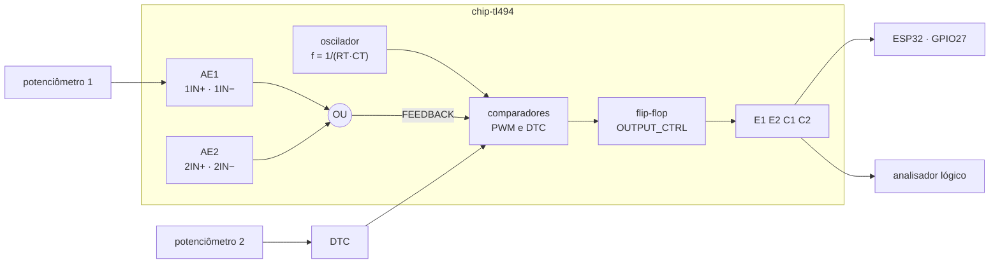

{/* Figuras geradas pelo Kroki. Fontes em diagramas/; depois de editar, rode diagramas/gerar_kroki.py */}

## Checklist — TL494 no Wokwi {/* #checklist */}

- [ ] Projeto ESP32 criado no wokwi.com e chip personalizado `tl494` adicionado em C
- [ ] `tl494.chip.json` e `tl494.chip.c` substituídos pelos deste guia
- [ ] `diagram.json` e `sketch.ino` da demonstração no projeto
- [ ] Mensagem `TL494: chip iniciado` no _Chips Console_
- [ ] Razão cíclica medida pelo ESP32 conferida com a prevista (Parte 6)
- [ ] Push-pull, limite pelo DTC e VCC desligado observados no analisador lógico
- [ ] (Opcional) chip compilado para WebAssembly e usado no VS Code

O Wokwi não tem o TL494 entre as peças. Este guia cria um **chip personalizado** com a
[Chips API](https://docs.wokwi.com/chips-api/getting-started): um modelo em C que se comporta como
o TL494 nos pinos, para testar no simulador o firmware dos guias de cooperação antes de ir para
a bancada. A peça tem os 16 pinos na ordem do CI real, lê as tensões dos pinos analógicos e gera
os pulsos nas saídas, que o ESP32 e o analisador lógico conseguem medir.



:::info[O que o Wokwi consegue simular]
O Wokwi é um simulador digital com suporte analógico básico. As tensões entram no chip pelas
leituras analógicas dos pinos (potenciômetros, outros chips) e saem como tensões ou níveis
lógicos. **Resistores e capacitores externos não são simulados**: por isso RT e CT são
atributos da peça, e uma rede de compensação ou um RC no DTC não têm efeito. O chip serve para
testar a lógica do firmware e a modulação, não a compensação da malha.
:::

## Objetivos

- Entender como um chip personalizado do Wokwi é organizado: definição em JSON e código em C.
- Modelar o TL494 a partir das relações do datasheet (oscilador, comparadores, amplificadores de
  erro, flip-flop).
- Montar uma demonstração com ESP32 e conferir a razão cíclica medida contra a prevista.
- Compilar o chip para WebAssembly e usá-lo no VS Code (opcional).

## Material

- Conta no [wokwi.com](https://wokwi.com) ou o Wokwi for VS Code.
- Os arquivos deste guia (também no pacote `tl494-wokwi-chip.zip`).
- Para compilar localmente (opcional): `clang` com alvo `wasm32`, `wasi-libc` e `make`, ou a
  Wokwi CLI.

---

## Parte 1 — O modelo {/* #parte-1 */}

O código roda uma vez por período do oscilador. A cada período ele:

1. desliga as saídas (o pulso do TL494 termina no fim da rampa);
2. confere o pino `VCC`: em nível baixo, REF vai a 0 V e não há pulsos;
3. lê as entradas dos dois amplificadores de erro e atualiza as saídas deles;
4. escreve no pino `FEEDBACK` a maior das duas saídas (ligação em OU);
5. lê o `DTC` e calcula em que ponto da rampa o pulso começa;
6. no modo _push-pull_, alterna a saída que vai conduzir;
7. agenda o início do pulso com um temporizador.

<figure style={{ margin: "1.5rem 0", textAlign: "center" }}>
  
  <figcaption>
    O modelo reproduz esta comparação: o pulso começa quando a rampa passa a
    linha mais alta.
  </figcaption>
</figure>

```text title="Equações do modelo"
período:  T = RT × CT                     (47 kΩ × 1 nF → 47 µs, 21,3 kHz)

linha = max( V(FEEDBACK) − 0,5 V , V(DTC) + 0,11 V )
o pulso começa em  t = T × linha / 3 V  e termina no fim do período

D = 1 − linha / 3 V       (entre 0 e 1)
FEEDBACK = 0,5 V → D máxima   ·   FEEDBACK = 3,5 V → D = 0   ·   DTC = 0 V → D ≤ 96,3 %
```

- **Amplificadores de erro.** Cada um soma metade do erro (`IN+ − IN−`) à sua saída a cada
  período, entre 0 V e 4,5 V: um integrador rápido. Com o pino 3 ligado ao pino 2, a saída segue
  o pino 1 em poucos períodos (seguidor). Com as entradas em malha aberta, satura como um
  comparador, que é o caso do desligamento pelo amplificador 2.
- **Por que não um amp-op de 80 dB?** O chip lê os pinos uma vez por período. Um ganho muito
  alto com essa amostragem oscilaria no modo seguidor. Corrigir metade do erro por período é o
  maior passo que se mantém estável.
- **Saídas.** E1 e E2 ficam em nível alto durante o pulso, como seguidores. C1 e C2 ficam em
  nível baixo, como fonte comum com _pull-up_. Com `coletorAberto = 1`, C1 e C2 viram dreno
  aberto e precisam de um resistor de _pull-up_ no diagrama.

---

## Parte 2 — Pinos e atributos {/* #parte-2 */}

| Pino | Nome          | No modelo                                                      |
| ---- | ------------- | -------------------------------------------------------------- |
| 1    | `1IN+`        | entrada analógica do amplificador de erro 1                    |
| 2    | `1IN-`        | entrada analógica do amplificador de erro 1                    |
| 3    | `FEEDBACK`    | saída analógica (entrada com `feedbackExterno = 1`)            |
| 4    | `DTC`         | entrada analógica de tempo morto                               |
| 5    | `CT`          | rampa do oscilador, só com `rampaNoCT = 1`                     |
| 6    | `RT`          | sem função (RT é atributo)                                     |
| 7    | `GND`         | referência                                                     |
| 8    | `C1`          | digital: baixo durante o pulso                                 |
| 9    | `E1`          | digital: alto durante o pulso                                  |
| 10   | `E2`          | digital: alto durante o pulso (saída 2)                        |
| 11   | `C2`          | digital: baixo durante o pulso (saída 2)                       |
| 12   | `VCC`         | digital, com _pull-down_: alto = alimentado                    |
| 13   | `OUTPUT_CTRL` | digital, com _pull-down_: baixo = paralelo, alto = _push-pull_ |
| 14   | `REF`         | analógica: 5 V com VCC em nível alto                           |
| 15   | `2IN-`        | entrada analógica do amplificador de erro 2                    |
| 16   | `2IN+`        | entrada analógica do amplificador de erro 2                    |

:::warning[Duas diferenças de ligação em relação ao CI real]

- O Wokwi não tem fonte de 18 V: ligue `VCC` a um GPIO ou ao 3V3 da placa.
- No CI real, `OUTPUT_CTRL` vai ao `REF` para _push-pull_. No modelo ele é lido como nível
  digital: ligue-o a um GPIO ou ao 3V3.

:::

Os atributos ficam em `attrs` da peça no `diagram.json`. `rt` e `ct` também aparecem como
controles deslizantes durante a simulação.

| Atributo          | Padrão | Unidade | Significado                                               |
| ----------------- | ------ | ------- | --------------------------------------------------------- |
| `rt`              | 47     | kΩ      | resistor do oscilador                                     |
| `ct`              | 1      | nF      | capacitor do oscilador                                    |
| `vref`            | 5.0    | V       | tensão do REF                                             |
| `rampa`           | 3.0    | V       | amplitude da rampa                                        |
| `ofsFeedback`     | 0.5    | V       | deslocamento do comparador PWM                            |
| `ofsDtc`          | 0.11   | V       | _offset_ do comparador de tempo morto                     |
| `feedbackExterno` | 0      | —       | 1: o pino 3 é entrada (fonte externa comanda a modulação) |
| `coletorAberto`   | 0      | —       | 1: C1 e C2 em dreno aberto                                |
| `rampaNoCT`       | 0      | —       | 1: escreve a rampa no pino CT (8 degraus por período)     |
| `debug`           | 0      | —       | 1: duas linhas por segundo no _Chips Console_             |

Os padrões reproduzem o texto do datasheet. A revisão J dá limiares típicos um pouco diferentes
(razão cíclica zero com o DTC em 2,5 V e com o FEEDBACK em 3,4 V). Para imitar um CI medido na
bancada, ajuste `rampa`, `ofsFeedback` e `ofsDtc`.

---

## Parte 3 — Criando o chip no wokwi.com {/* #parte-3 */}

1. Crie um projeto novo com **ESP32** (Arduino).
2. No editor do diagrama, clique no **+** azul e escolha **Custom Chip**.
3. Dê o nome `tl494`, escolha a linguagem **C** e clique em **Create Chip**. O Wokwi adiciona a
   peça ao diagrama e cria dois arquivos: `tl494.chip.json` e `tl494.chip.c`.
4. Substitua o conteúdo dos dois arquivos pelos da [Parte 4](#parte-4). O cabeçalho
   `wokwi-api.h` já vem do próprio Wokwi.
5. Substitua `diagram.json` e `sketch.ino` pelos da [Parte 5](#parte-5).
6. Inicie a simulação. A aba **Chips Console**, abaixo do diagrama, deve mostrar:

```text title="Chips Console"
TL494: chip iniciado, f = 21.3 kHz (RT = 47.0 k, CT = 1.00 nF)
TL494: energizado, REF = 5.00 V, f = 21.3 kHz
```

<FileTree
  root="projeto-wokwi"
  files={[
    "sketch.ino c",
    "diagram.json c",
    "tl494.chip.json c",
    "tl494.chip.c c",
  ]}
/>

:::tip[Depuração]
O `printf()` do chip aparece no _Chips Console_, e cada mensagem só é exibida quando termina
com `\n`. Com `"debug": "1"` nos atributos, o chip escreve o estado duas vezes por segundo.
:::

---

## Parte 4 — Código do chip {/* #parte-4 */}

### 4.1 Definição: `tl494.chip.json`

A ordem de `pins` define a numeração da peça. Os `controls` criam os controles deslizantes de
RT e CT; o código lê os valores pelos atributos de mesmo nome.

```json title="tl494.chip.json"
{
  "version": 1,
  "name": "TL494",
  "author": "Guia ESP32 + TL494",
  "license": "MIT",
  "pins": [
    "1IN+",
    "1IN-",
    "FEEDBACK",
    "DTC",
    "CT",
    "RT",
    "GND",
    "C1",
    "E1",
    "E2",
    "C2",
    "VCC",
    "OUTPUT_CTRL",
    "REF",
    "2IN-",
    "2IN+"
  ],
  "controls": [
    {
      "id": "rt",
      "label": "RT (kΩ)",
      "type": "range",
      "min": 1.8,
      "max": 500,
      "step": 0.1
    },
    {
      "id": "ct",
      "label": "CT (nF)",
      "type": "range",
      "min": 0.47,
      "max": 100,
      "step": 0.01
    }
  ]
}
```

### 4.2 Modelo: `tl494.chip.c`

```c title="tl494.chip.c"
// TL494 — chip personalizado para o simulador Wokwi (Chips API)
//
// Modelo comportamental do TL494 (Texas Instruments, SLVS074J):
//   - oscilador dente de serra de 0 V a 3 V, f = 1 / (RT x CT), com RT e CT como atributos;
//   - dois amplificadores de erro com saídas em OU no pino FEEDBACK (vale o que pede menos pulso);
//   - comparador de tempo morto (DTC, offset de 110 mV) e comparador PWM;
//   - OUTPUT CTRL: nível baixo = saídas em paralelo; nível alto = push-pull (flip-flop);
//   - saídas: E1/E2 em nível alto durante o pulso (seguidor) e C1/C2 em nível baixo (fonte comum);
//   - REF de 5 V enquanto o pino VCC estiver em nível alto.
//
// Limites do modelo (o Wokwi é um simulador digital com analógico básico):
//   - resistores e capacitores externos NÃO são simulados: RT e CT são atributos, e uma rede de
//     compensação ligada entre FEEDBACK e 1IN- não tem efeito além da ligação direta;
//   - as entradas analógicas são lidas uma vez por período do oscilador;
//   - cada amplificador de erro é um integrador rápido (metade do erro por período), o que basta
//     para o modo seguidor (FEEDBACK ligado ao 1IN-) e para o uso como comparador.
//
// SPDX-License-Identifier: MIT

#include "wokwi-api.h"
#include <stdio.h>
#include <stdlib.h>
#include <math.h>

#define AE_MAX       4.5f        // saída máxima dos amplificadores de erro (V)
#define AE_PASSO     0.5f        // fração do erro corrigida por período
#define F_MIN_HZ     1000.0f     // faixa recomendada do datasheet
#define F_MAX_HZ     300000.0f

typedef struct {
  // pinos
  pin_t in1p, in1n, fb, dtc, ct, rt, c1, e1, e2, c2, vcc, octrl, ref, in2n, in2p;
  // atributos
  uint32_t a_rt, a_ct, a_vref, a_rampa, a_ofs_fb, a_ofs_dtc, a_fb_ext, a_coletor, a_rampa_ct, a_debug;
  // temporizadores
  timer_t t_periodo, t_liga, t_rampa;
  uint64_t periodo_ns;
  // estado
  float ae1, ae2, vfb_escrito, rampa_v;
  bool energizado, flip, q1, q2, coletor_aberto, fb_externo;
  int passo_rampa;
  uint32_t ciclos, ciclos_relatorio;
  float ultimo_d;
} chip_t;

// ------------------------------------------------------------------ saídas
static void saida(chip_t *c, pin_t pc, pin_t pe, bool liga) {
  pin_write(pe, liga ? HIGH : LOW);                 // E: seguidor, alto durante o pulso
  if (c->coletor_aberto) {
    pin_mode(pc, liga ? OUTPUT_LOW : INPUT);        // C: dreno aberto, precisa de pull-up
  } else {
    pin_write(pc, liga ? LOW : HIGH);               // C: fonte comum com pull-up embutido
  }
}

static void saidas(chip_t *c, bool liga1, bool liga2) {
  saida(c, c->c1, c->e1, liga1);
  saida(c, c->c2, c->e2, liga2);
}

static void ao_ligar(void *user_data) {             // início do pulso dentro do período
  chip_t *c = (chip_t *)user_data;
  saidas(c, c->q1, c->q2);
}

static void ao_passo_rampa(void *user_data) {       // rampa opcional no pino CT
  chip_t *c = (chip_t *)user_data;
  if (++c->passo_rampa >= 8) { timer_stop(c->t_rampa); return; }
  pin_dac_write(c->ct, c->rampa_v * c->passo_rampa / 8.0f);
}

static uint64_t calcula_periodo(chip_t *c) {
  float rt = attr_read_float(c->a_rt) * 1e3f;       // kΩ -> Ω
  float ct = attr_read_float(c->a_ct) * 1e-9f;      // nF -> F
  float f = 1.0f / (rt * ct);
  if (f < F_MIN_HZ || f > F_MAX_HZ) {
    static bool avisou = false;
    if (!avisou) printf("TL494: f = %.0f Hz fora da faixa do datasheet (1 kHz a 300 kHz)\n", f);
    avisou = true;
  }
  if (f > 1e6f) f = 1e6f;
  return (uint64_t)(1e9f / f);
}

static float maxf(float a, float b) { return a > b ? a : b; }
static float limita(float v, float lo, float hi) { return v < lo ? lo : (v > hi ? hi : v); }

// ------------------------------------------------------------------ um período do oscilador
static void ao_periodo(void *user_data) {
  chip_t *c = (chip_t *)user_data;

  saidas(c, false, false);                          // o pulso termina no fim da rampa
  timer_stop(c->t_liga);

  // Alimentação: sem VCC não há referência nem pulsos
  if (pin_read(c->vcc) == LOW) {
    if (c->energizado) {
      pin_dac_write(c->ref, 0);
      if (!c->fb_externo) pin_dac_write(c->fb, 0);
      c->ae1 = c->ae2 = 0;
      c->vfb_escrito = 0;
      printf("TL494: VCC em nivel baixo, saidas desligadas\n");
    }
    c->energizado = false;
    return;
  }
  if (!c->energizado) {
    pin_dac_write(c->ref, attr_read_float(c->a_vref));
    c->energizado = true;
    printf("TL494: energizado, REF = %.2f V, f = %.1f kHz\n",
           attr_read_float(c->a_vref), 1e6 / (double)c->periodo_ns);
  }

  // RT e CT podem mudar pelos controles durante a simulação
  uint64_t novo = calcula_periodo(c);
  if (novo != c->periodo_ns) {
    c->periodo_ns = novo;
    timer_start_ns(c->t_periodo, c->periodo_ns, true);
    printf("TL494: nova frequencia %.2f kHz\n", 1e6 / (double)c->periodo_ns);
  }

  // Amplificadores de erro: saídas ativas só para cima, em OU no FEEDBACK
  float e1 = pin_adc_read(c->in1p) - pin_adc_read(c->in1n);
  float e2 = pin_adc_read(c->in2p) - pin_adc_read(c->in2n);
  c->ae1 = limita(c->ae1 + AE_PASSO * e1, 0.0f, AE_MAX);
  c->ae2 = limita(c->ae2 + AE_PASSO * e2, 0.0f, AE_MAX);

  float vfb = maxf(c->ae1, c->ae2);
  if (c->fb_externo) {
    vfb = maxf(vfb, pin_adc_read(c->fb));          // fonte externa no pino 3
  } else if (fabsf(vfb - c->vfb_escrito) > 0.001f) {
    pin_dac_write(c->fb, vfb);
    c->vfb_escrito = vfb;
  }

  // Comparadores: a saída conduz enquanto a rampa está acima das duas linhas
  float rampa = attr_read_float(c->a_rampa);
  float vdtc = pin_adc_read(c->dtc);
  float limiar = maxf(vfb - attr_read_float(c->a_ofs_fb), vdtc + attr_read_float(c->a_ofs_dtc));
  float fracao = limita(limiar / rampa, 0.0f, 1.0f);   // ponto da rampa em que o pulso começa
  c->ultimo_d = 1.0f - fracao;

  // Flip-flop: em push-pull as saídas se alternam a cada período
  bool push_pull = pin_read(c->octrl) == HIGH;
  c->flip = !c->flip;
  c->q1 = push_pull ? c->flip : true;
  c->q2 = push_pull ? !c->flip : true;

  if (fracao <= 0.0f) {
    ao_ligar(c);
  } else if (fracao < 1.0f) {
    timer_start_ns(c->t_liga, (uint64_t)(fracao * (float)c->periodo_ns), false);
  }

  // Rampa opcional no pino CT (8 degraus por período; pesa na simulação)
  if (c->rampa_v > 0) {
    c->passo_rampa = 0;
    pin_dac_write(c->ct, 0);
    timer_start_ns(c->t_rampa, c->periodo_ns / 8, true);
  }

  if (attr_read(c->a_debug) && ++c->ciclos >= c->ciclos_relatorio) {
    c->ciclos = 0;
    printf("TL494: FEEDBACK=%.2f V DTC=%.2f V AE1=%.2f AE2=%.2f D=%.1f%% %s\n",
           vfb, vdtc, c->ae1, c->ae2, 100.0f * c->ultimo_d, push_pull ? "push-pull" : "paralelo");
  }
}

// ------------------------------------------------------------------ inicialização
void chip_init(void) {
  chip_t *c = (chip_t *)calloc(1, sizeof(chip_t));

  c->a_rt       = attr_init_float("rt", 47.0f);        // kΩ
  c->a_ct       = attr_init_float("ct", 1.0f);         // nF
  c->a_vref     = attr_init_float("vref", 5.0f);       // V
  c->a_rampa    = attr_init_float("rampa", 3.0f);      // amplitude da rampa em CT (V)
  c->a_ofs_fb   = attr_init_float("ofsFeedback", 0.5f);// 0,5 V -> D máx.; 3,5 V -> D = 0
  c->a_ofs_dtc  = attr_init_float("ofsDtc", 0.11f);    // offset do comparador de tempo morto
  c->a_fb_ext   = attr_init("feedbackExterno", 0);     // 1: o pino 3 é entrada
  c->a_coletor  = attr_init("coletorAberto", 0);       // 1: C1/C2 em dreno aberto
  c->a_rampa_ct = attr_init("rampaNoCT", 0);           // 1: escreve a rampa no pino CT
  c->a_debug    = attr_init("debug", 0);               // 1: relatório no Chips Console

  c->fb_externo = attr_read(c->a_fb_ext) != 0;
  c->coletor_aberto = attr_read(c->a_coletor) != 0;
  c->rampa_v = attr_read(c->a_rampa_ct) ? attr_read_float(c->a_rampa) : 0.0f;

  c->in1p  = pin_init("1IN+", ANALOG);
  c->in1n  = pin_init("1IN-", ANALOG);
  c->fb    = pin_init("FEEDBACK", ANALOG);
  c->dtc   = pin_init("DTC", ANALOG);
  c->ct    = pin_init("CT", ANALOG);
  c->rt    = pin_init("RT", ANALOG);
  c->c1    = pin_init("C1", c->coletor_aberto ? INPUT : OUTPUT_HIGH);
  c->e1    = pin_init("E1", OUTPUT_LOW);
  c->e2    = pin_init("E2", OUTPUT_LOW);
  c->c2    = pin_init("C2", c->coletor_aberto ? INPUT : OUTPUT_HIGH);
  c->vcc   = pin_init("VCC", INPUT_PULLDOWN);
  c->octrl = pin_init("OUTPUT_CTRL", INPUT_PULLDOWN);
  c->ref   = pin_init("REF", ANALOG);
  c->in2n  = pin_init("2IN-", ANALOG);
  c->in2p  = pin_init("2IN+", ANALOG);
  pin_init("GND", INPUT);

  pin_dac_write(c->ref, 0);
  if (!c->fb_externo) pin_dac_write(c->fb, 0);

  const timer_config_t cfg_periodo = { .callback = ao_periodo, .user_data = c };
  const timer_config_t cfg_liga = { .callback = ao_ligar, .user_data = c };
  const timer_config_t cfg_rampa = { .callback = ao_passo_rampa, .user_data = c };
  c->t_periodo = timer_init(&cfg_periodo);
  c->t_liga = timer_init(&cfg_liga);
  c->t_rampa = timer_init(&cfg_rampa);

  c->periodo_ns = calcula_periodo(c);
  c->ciclos_relatorio = (uint32_t)(0.5e9 / (double)c->periodo_ns);   // ~2 relatórios por segundo
  if (c->ciclos_relatorio == 0) c->ciclos_relatorio = 1;
  timer_start_ns(c->t_periodo, c->periodo_ns, true);

  printf("TL494: chip iniciado, f = %.1f kHz (RT = %.1f k, CT = %.2f nF)\n",
         1e6 / (double)c->periodo_ns, attr_read_float(c->a_rt), attr_read_float(c->a_ct));
}
```

### 4.3 O que observar no código

- **`chip_init()`** é chamada uma vez para cada TL494 do diagrama. Ela lê os atributos, inicia os
  pinos e cria os três temporizadores. `timer_init()` só pode ser chamada ali.
- **`ao_periodo()`** é o oscilador: um temporizador repetitivo de período `RT × CT`. Se os
  controles mudarem, ele se reprograma.
- **`ao_ligar()`** é um temporizador de disparo único que começa o pulso no ponto calculado da
  rampa. O pulso termina no próximo `ao_periodo()`.
- **`pin_adc_read()`** só funciona com o pino em modo `ANALOG`; por isso todos os pinos de
  tensão são iniciados assim.
- **`pin_dac_write()`** só é chamada no FEEDBACK quando a tensão muda mais de 1 mV, para não
  pesar na simulação.

---

## Parte 5 — Demonstração com ESP32 {/* #parte-5 */}

| Ligação                            | Função                                                     |
| ---------------------------------- | ---------------------------------------------------------- |
| Potenciômetro 1 → `1IN+` e GPIO34  | tensão de controle                                         |
| `1IN-` ↔ `FEEDBACK`                | amplificador de erro 1 como seguidor (como na experiência) |
| Potenciômetro 2 → `DTC` e GPIO32   | limite de razão cíclica                                    |
| `FEEDBACK` → GPIO35                | o ESP32 lê o pino 3                                        |
| `E1` → GPIO27 e analisador (D0)    | o ESP32 mede a razão cíclica com `pulseIn`                 |
| `E2` e `C1` → analisador (D1 e D2) | formas de onda                                             |
| GPIO26 → `OUTPUT_CTRL`             | comando `p`: paralelo ou _push-pull_                       |
| GPIO33 → `VCC`                     | comando `v`: liga ou desliga o TL494                       |

```json title="diagram.json"
{
  "version": 1,
  "author": "Guia ESP32 + TL494",
  "editor": "wokwi",
  "parts": [
    {
      "type": "board-esp32-devkit-c-v4",
      "id": "esp",
      "top": 0,
      "left": 0,
      "attrs": {}
    },
    {
      "type": "chip-tl494",
      "id": "tl1",
      "top": 10,
      "left": 260,
      "attrs": { "rt": "47", "ct": "1", "debug": "0" }
    },
    {
      "type": "wokwi-potentiometer",
      "id": "potfb",
      "top": -150,
      "left": 120,
      "attrs": {}
    },
    {
      "type": "wokwi-potentiometer",
      "id": "potdtc",
      "top": -150,
      "left": 260,
      "attrs": {}
    },
    {
      "type": "wokwi-logic-analyzer",
      "id": "logic1",
      "top": 230,
      "left": 280,
      "attrs": {}
    }
  ],
  "connections": [
    ["esp:TX", "$serialMonitor:RX", "", []],
    ["esp:RX", "$serialMonitor:TX", "", []],
    ["potfb:VCC", "esp:3V3", "red", []],
    ["potfb:GND", "esp:GND.2", "black", []],
    ["potfb:SIG", "tl1:1IN+", "orange", []],
    ["potfb:SIG", "esp:34", "orange", []],
    ["potdtc:VCC", "esp:3V3", "red", []],
    ["potdtc:GND", "esp:GND.2", "black", []],
    ["potdtc:SIG", "tl1:DTC", "purple", []],
    ["potdtc:SIG", "esp:32", "purple", []],
    ["tl1:1IN-", "tl1:FEEDBACK", "green", []],
    ["tl1:FEEDBACK", "esp:35", "green", []],
    ["tl1:GND", "esp:GND.1", "black", []],
    ["tl1:VCC", "esp:33", "red", []],
    ["tl1:OUTPUT_CTRL", "esp:26", "blue", []],
    ["tl1:E1", "esp:27", "yellow", []],
    ["tl1:E1", "logic1:D0", "yellow", []],
    ["tl1:E2", "logic1:D1", "cyan", []],
    ["tl1:C1", "logic1:D2", "gray", []],
    ["logic1:GND", "esp:GND.1", "black", []]
  ],
  "dependencies": {}
}
```

```cpp title="sketch.ino"
// Demonstração do chip TL494 no Wokwi com um ESP32
//   potenciômetro 1 -> 1IN+ (e GPIO34): com 1IN- ligado ao FEEDBACK, o AE1 é seguidor
//   potenciômetro 2 -> DTC  (e GPIO32): limite de razão cíclica
//   FEEDBACK -> GPIO35 | E1 -> GPIO27 (medida da razão cíclica)
//   GPIO26 -> OUTPUT_CTRL (push-pull) | GPIO33 -> VCC do TL494
// Comandos no monitor serial: p = alterna push-pull, v = liga/desliga o VCC do TL494
#include <Arduino.h>

#define POT_FB   34
#define POT_DTC  32
#define FB_PIN   35
#define E1_PIN   27
#define OCTRL    26
#define VCC_TL   33

bool pushPull = false, vccLigado = true;

float volts(uint8_t pino) {
  uint32_t soma = 0;
  for (int i = 0; i < 8; i++) soma += analogReadMilliVolts(pino);
  return soma / 8.0f / 1000.0f;
}

// Razão cíclica pela largura dos pulsos em nível alto e baixo
float razaoCiclica(uint8_t pino, float *freq) {
  unsigned long alto = pulseIn(pino, HIGH, 20000);
  unsigned long baixo = pulseIn(pino, LOW, 20000);
  *freq = 0;
  if (alto == 0 || baixo == 0) return digitalRead(pino) ? 1.0f : 0.0f;   // 100 % ou 0 %
  *freq = 1e6f / (alto + baixo);
  return (float)alto / (alto + baixo);
}

void setup() {
  Serial.begin(115200);
  pinMode(E1_PIN, INPUT);
  pinMode(OCTRL, OUTPUT);
  pinMode(VCC_TL, OUTPUT);
  digitalWrite(OCTRL, LOW);              // saídas em paralelo
  digitalWrite(VCC_TL, HIGH);            // TL494 alimentado
  analogReadResolution(12);
  Serial.println("\n=== Demo do chip TL494 no Wokwi ===");
  Serial.println("Comandos: p = push-pull, v = VCC do TL494");
}

void loop() {
  if (Serial.available()) {
    char c = Serial.read();
    if (c == 'p') { pushPull = !pushPull; digitalWrite(OCTRL, pushPull); }
    if (c == 'v') { vccLigado = !vccLigado; digitalWrite(VCC_TL, vccLigado); }
  }

  float v1 = volts(POT_FB), vdtc = volts(POT_DTC), vfb = volts(FB_PIN);
  float f, d = razaoCiclica(E1_PIN, &f);

  // Previsão pelo datasheet: D = (3,5 - V3) / 3 e D <= 1 - (VDTC + 0,11) / 3
  float dFb = constrain((3.5f - vfb) / 3.0f, 0.0f, 1.0f);
  float dDtc = constrain(1.0f - (vdtc + 0.11f) / 3.0f, 0.0f, 1.0f);
  float previsto = min(dFb, dDtc) * (pushPull ? 0.5f : 1.0f);

  Serial.printf("1IN+=%.2f V  FEEDBACK=%.2f V  DTC=%.2f V | E1: D=%.1f %% (previsto %.1f %%) f=%.0f Hz | %s%s\n",
                v1, vfb, vdtc, 100 * d, vccLigado ? 100 * previsto : 0.0f, f,
                pushPull ? "push-pull" : "paralelo", vccLigado ? "" : " | VCC desligado");
  delay(500);
}
```

```text title="Monitor serial (valores aproximados)"
=== Demo do chip TL494 no Wokwi ===
Comandos: p = push-pull, v = VCC do TL494
1IN+=1.65 V  FEEDBACK=1.65 V  DTC=0.00 V | E1: D=61.7 % (previsto 61.7 %) f=21277 Hz | paralelo
```

A medida com `pulseIn` tem resolução de 1 µs, cerca de 2 % do período em 21 kHz. Diferenças
dessa ordem entre o medido e o previsto são esperadas.

---

## Parte 6 — Roteiro de ensaios {/* #parte-6 */}

1. **Seguidor.** Com o potenciômetro 2 em zero, gire o potenciômetro 1. FEEDBACK deve copiar o
   1IN+ e a razão cíclica deve seguir `D = (3,5 − V3) / 3`.
2. **Limite pelo DTC.** Deixe o potenciômetro 1 em zero (D máxima) e gire o potenciômetro 2. A
   razão cíclica deve seguir `D = 1 − (VDTC + 0,11) / 3` e chegar a zero perto de 2,9 V.
3. **Os dois juntos.** Vale o que pedir menos razão cíclica. Confira com os dois potenciômetros
   no meio.
4. **_Push-pull_.** Envie `p`. No analisador lógico, E1 e E2 se alternam, cada um na metade da
   frequência; no serial, a razão cíclica de E1 cai pela metade.
5. **VCC.** Envie `v`. As saídas param e o _Chips Console_ avisa. Envie `v` de novo.
6. **Frequência.** Mude o controle CT para 10 nF durante a simulação. A frequência deve cair para
   cerca de 2,1 kHz.

| 1IN+ (V) | DTC (V) | Modo        | D prevista em E1 | f em E1  | Medido |
| -------- | ------- | ----------- | ---------------- | -------- | ------ |
| 1,93     | 0       | paralelo    | 52,3 %           | 21,3 kHz |        |
| 0        | 0,79    | paralelo    | 70,0 %           | 21,3 kHz |        |
| 0        | 0       | paralelo    | 96,3 %           | 21,3 kHz |        |
| 3,3      | 0       | paralelo    | 6,7 %            | 21,3 kHz |        |
| 0        | 3,3     | paralelo    | 0 %              | —        |        |
| 1,0      | 0       | _push-pull_ | 41,7 %           | 10,6 kHz |        |

:::tip[Preveja antes de medir]

- **P1:** com o potenciômetro 1 no máximo (3,3 V), por que a razão cíclica não chega a zero? Que
  tensão o FEEDBACK precisaria ter?
- **P2:** com 1IN+ em 1 V e DTC em 1,5 V, qual dos dois comparadores define o pulso?
- **P3:** desfaça a ligação entre `1IN-` e `FEEDBACK`. O que acontece com a saída do amplificador
  de erro 1? Por quê?
- **P4:** ligue `2IN+` ao `REF` e deixe `2IN-` sem ligação. O que o amplificador de erro 2 faz com
  os pulsos? Que circuito do guia de cooperação isso imita?

:::

---

## Parte 7 — VS Code e Wokwi CLI {/* #parte-7 */}

No VS Code o chip entra já compilado em WebAssembly (`.wasm`), ao lado de um `.json` com o mesmo
nome.

<FileTree
  root="exemplo"
  files={[
    "platformio.ini c",
    "wokwi.toml c",
    "diagram.json c",
    "src/main.cpp c",
    "chips/tl494.chip.json c",
    "chips/tl494.chip.wasm c",
  ]}
/>

```toml title="wokwi.toml"
[wokwi]
version = 1
firmware = '.pio/build/esp32dev/firmware.bin'
elf = '.pio/build/esp32dev/firmware.elf'

[[chip]]
name = 'tl494'                      # no diagram.json: "type": "chip-tl494"
binary = 'chips/tl494.chip.wasm'    # ao lado de chips/tl494.chip.json
```

Três formas de compilar o `.wasm`:

- **Wokwi CLI:** `wokwi-cli chip compile src/tl494.c` (baixa o cabeçalho oficial).
- **clang local**, com o `Makefile` do pacote:

```makefile title="Makefile (trecho)"
CFLAGS = --target=wasm32-unknown-wasi -O2 -nostartfiles -Wl,--import-memory -Wl,--export-table \
         -Wl,--no-entry -Wall -Wno-unused-function -Werror

dist/tl494.chip.wasm: src/tl494.c src/wokwi-api.h | dist
	clang $(CFLAGS) -o $@ src/tl494.c
```

- **GitHub Actions ou contêiner**, como no repositório de exemplo
  [wokwi/inverter-chip](https://github.com/wokwi/inverter-chip).

O pacote também traz um teste nativo (`make test`) que imita a Chips API no computador e mede as
saídas em 14 situações, sem abrir o Wokwi.

:::note[Cabeçalho `wokwi-api.h`]
A cópia do pacote veio do exemplo `wokwi/inverter-chip`, com uma correção: `attr_init_float` é
importado como `attrInitFloat`, como no cabeçalho oficial atual
(`https://wokwi.com/api/chips/wokwi-api.h`). Se houver diferença, use o oficial. No wokwi.com o
cabeçalho já vem pronto.
:::

---

## Parte 8 — Limites do modelo {/* #parte-8 */}

| Limite                                  | Consequência                                                        |
| --------------------------------------- | ------------------------------------------------------------------- |
| Sem resistores e capacitores analógicos | redes de compensação, RC no DTC e divisores não têm efeito          |
| Leitura uma vez por período             | mudanças mais rápidas que um período não aparecem                   |
| Amplificador de erro simplificado       | não serve para estudar ganho, banda ou margem de fase               |
| Sem estágio de potência                 | o chip gera só o sinal PWM; não há Vo para fechar a malha           |
| Tensões fora de 0 V a 3,3 V no ESP32    | o Wokwi não danifica o pino; na bancada, use os divisores dos guias |
| Carga da simulação                      | dois eventos por período: aumente CT se a simulação ficar lenta     |
| DAC do ESP32 como entrada do chip       | não verificado neste guia; a demonstração usa potenciômetros        |

---

## Se algo não funcionar {/* #problemas */}

| Sintoma                                     | Verifique                                                           |
| ------------------------------------------- | ------------------------------------------------------------------- |
| Peça não aparece ou erro ao compilar o chip | nome `tl494` nos dois arquivos; tipo `chip-tl494` no `diagram.json` |
| Nada no _Chips Console_                     | mensagens sem `\n` não aparecem; o chip pode não ter sido compilado |
| `VCC em nivel baixo` no console             | pino `VCC` sem ligação ou GPIO33 em nível baixo                     |
| Razão cíclica sempre 0 %                    | `1IN-` sem ligação ao `FEEDBACK` (AE1 satura); DTC acima de 2,9 V   |
| Razão cíclica sempre ~96 %                  | 1IN+ e DTC em 0 V: confira os potenciômetros                        |
| E2 sem pulsos                               | modo paralelo: E2 pulsa junto com E1; em _push-pull_, se alterna    |
| C1 e C2 sempre em nível alto ou indefinidos | `coletorAberto = 1` sem resistor de _pull-up_                       |
| Simulação lenta                             | aumente `ct` (10 nF → 2,1 kHz) ou desligue `rampaNoCT`              |
