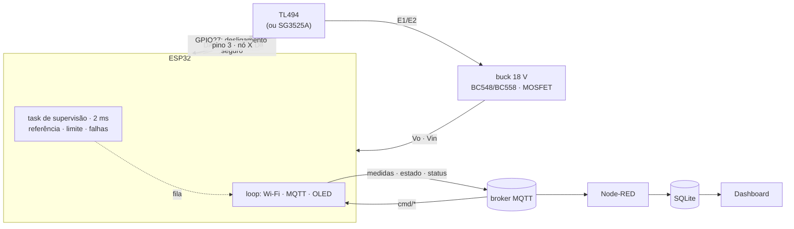
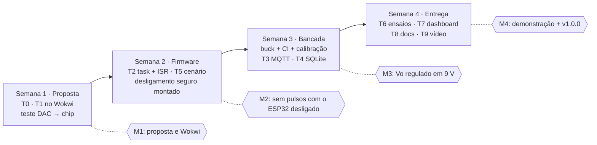

## Checklist — Fonte chaveada supervisionada {/* #checklist */}

- [ ] Proposta aprovada: CI escolhido (TL494 ou SG3525A), modo de malha e roteiro de testes (T0)
- [ ] Trimpot, botão, OLED e LED de estado usados pela aplicação (T1)
- [ ] DAC, ADC1, temporizador de 2 ms e interrupção (botão e medida da razão cíclica) (T2)
- [ ] Telemetria, eventos, LWT e comandos validados pelo MQTT, com o Node-RED (T3)
- [ ] SQLite com medidas, eventos e as consultas de regulação, falhas e disponibilidade (T4)
- [ ] Simulação no Wokwi com o chip personalizado do TL494 (ou do SG3525A) e o modelo do buck (T5)
- [ ] **Buck de 18 V regulando em bancada**, com supervisão, falhas ensaiadas e telemetria (T6)
- [ ] Dashboard de operação no Node-RED (T7)
- [ ] Documentação no GitHub com o esquema, a calibração e a tabela previsto × medido (T8)
- [ ] Vídeo de apresentação de 3 a 5 minutos (T9)
- [ ] Nenhum token ou senha no repositório; nenhum `push --force`; cada tarefa num commit `Tn:`
- [ ] Logout do Git e do `gh` no computador do laboratório

:::info[Pontuação]
Os mesmos critérios e pesos do [projeto final](/projects/2026.2/projeto-final) e do
[Moodle](https://moodle.utfpr.edu.br/mod/assign/view.php?id=1800525): T1 10 · T2 10 · T3 10 ·
T4 10 · T5 10 · **T6 30** · T7 5 · T8 5 · T9 10. Esta página é uma **alternativa de tema**: o
grupo escolhe entre ela e um tema livre na proposta (T0).
:::

<LabSetup />

### Configuração do ambiente de desenvolvimento {/* #setup */}

<DevTools />

---

Nesta alternativa o produto é uma **fonte chaveada de bancada supervisionada**: o buck de 18 V
dos guias, regulado pelo **TL494** (ou pelo **SG3525A**), com o **ESP32** fazendo o que o CI não
faz sozinho. O ESP32 gera a referência, limita a razão cíclica, detecta falhas, desliga com
segurança e põe a fonte na rede: telemetria por MQTT, histórico no SQLite e comando pelo
dashboard.

O projeto junta duas trilhas da disciplina. O hardware e o firmware de controle vêm dos guias de
eletrônica de potência; o MQTT, o banco, o dashboard, o Wokwi e o CI vêm dos Labs 01–10.

| Guia                                                                                                | O que entra no projeto                                  |
| --------------------------------------------------------------------------------------------------- | ------------------------------------------------------- |
| [Buck em malha fechada](./guia-esp32-buck-malha-fechada.mdx)                                        | estágio de potência, divisores, modelo médio do buck    |
| [ESP32 e TL494 trabalhando juntos](./guia-esp32-tl494-cooperacao.mdx)                               | interface com o LM324, modos 1 e 2, supervisão e falhas |
| [ESP32 e SG3525A trabalhando juntos](./guia-esp32-sg3525a-cooperacao.mdx)                           | a mesma coisa para quem escolher o SG3525A              |
| [Chip do TL494 no Wokwi](./guia-wokwi-chip-tl494.mdx) e [do SG3525A](./guia-wokwi-chip-sg3525a.mdx) | o CI no simulador                                       |
| [Comparação TL494 × SG3525A](./comparacao-tl494-sg3525a.mdx)                                        | a escolha do CI, justificada na proposta                |



:::danger[Segurança]

- **Só 18 V.** O projeto usa a fonte de bancada de 18 V **limitada em corrente** (1 A). Ligar o
  conversor ao retificador da rede está **fora** deste projeto.
- Nenhum pino do ESP32 recebe mais que 3,3 V. O REF do TL494 (5 V), o pino 3, o nó X e o pino 9
  do SG3525A só chegam ao ESP32 por divisor ou transistor, como nos guias.
- O **desligamento seguro** (amplificador de erro 2 no TL494, pino 10 no SG3525A) é montado e
  testado **antes** do primeiro +18 V: com o ESP32 desligado, não pode haver pulsos.
- Resistores de carga de 10 W esquentam. Não encoste neles com a fonte ligada.

:::

## Objetivos

- Integrar o ESP32 a um controlador PWM analógico, dividindo o trabalho: o CI regula, o ESP32
  supervisiona.
- Garantir que a rede (Wi-Fi e MQTT) **nunca** atrasa a supervisão: tempo real e IoT no mesmo
  chip.
- Medir a qualidade da regulação com números tirados do banco, e comparar com o que os guias
  preveem.
- Testar o firmware no Wokwi com o CI simulado antes de energizar a placa.

## Material

| Qtd. | Componente                                                     | Observação                                  |
| ---- | -------------------------------------------------------------- | ------------------------------------------- |
| 1    | ESP32 DevKit **clássico**                                      | só ele tem os dois DACs                     |
| 1    | TL494CN **ou** SG3525ANG                                       | justifique a escolha na proposta            |
| 1    | LM324 (TL494) **ou** LM358 (SG3525A)                           | medida de Vo e buffers                      |
| —    | Buck e estágio BC548/BC558 do guia de malha fechada            | IRF540, 1N5822, 1 mH, 2 × 470 µF            |
| —    | Resistores e capacitores da lista do guia de cooperação do CI  | rede tipo 3, divisores, desligamento seguro |
| 1    | OLED SSD1306 I2C                                               | estado local da fonte                       |
| 1    | Botão e 1 LED com 220 Ω                                        | rearme local e estado                       |
| 2    | Resistores de 47 kΩ e 10 kΩ                                    | divisor do nó X para medir a razão cíclica  |
| 2    | Cargas de 22 Ω e 47 Ω, 10 W                                    | degraus de carga                            |
| —    | Fonte de 18 V com limite de corrente, osciloscópio, multímetro |                                             |

## Clonar o repositório do grupo {/* #clonar */}

<LabTeamMembers labName="projeto" />

## Envie o link do repositório do seu grupo no Moodle: {/* #moodle-link */}

<LabSubmit labName="projeto" />

## Suba os containers {/* #docker */}

<LabIotAlunoSimples
  labName="projeto"
  completo="/infra/setup/gen_iot_aluno#projeto"
/>

---

<details>
<summary><strong>Mapa de tarefas</strong> — 10 tarefas · 100 pts</summary>

- [T0 — Proposta do projeto](#t0) · 0 pts (obrigatória)
- [T1 — Dispositivos de entrada e saida](#t1) · 10 pts
- [T2 — Perifericos dedicados e interrupcao](#t2) · 10 pts
- [T3 — MQTT via Node-RED](#t3) · 10 pts
- [T4 — SQL via Node-RED](#t4) · 10 pts
- [T5 — Simulacao no Wokwi](#t5) · 10 pts
- [T6 — Prototipo em bancada](#t6) · 30 pts
- [T7 — Dashboard no Node-RED](#t7) · 5 pts
- [T8 — Documentacao no GitHub](#t8) · 5 pts
- [T9 — Video de apresentacao](#t9) · 10 pts

</details>

<FileTree
  details={true}
  defaultOpen={false}
  title="Estrutura de Arquivos do Projeto (no fim)"
  root="projeto-grupo-x"
  files={[
    "platformio.ini c",
    "wokwi.toml c",
    "diagram.json c",
    "chips/tl494.chip.json c",
    "chips/tl494.chip.wasm c",
    "src/main.cpp c",
    "src/supervisao.cpp c",
    "src/rede.cpp c",
    "src/secrets.h.example c",
    "test/cenario.yaml c",
    "nodered/flows-projeto.json c",
    "docs/proposta.md c",
    "docs/contrato-mqtt.md c",
    "docs/esquema.png c",
    "docs/pinagem.md c",
    "docs/calibracao.md c",
    "docs/roteiro-bancada.md c",
    ".github/workflows/ci.yml c",
    "evidencias/t1-wokwi.png c",
    "evidencias/t2-medicao.png c",
    "evidencias/t2-serial.txt c",
    "evidencias/t3-mqtt.txt c",
    "evidencias/t4-consultas.txt c",
    "evidencias/t5-wokwi.txt c",
    "evidencias/t6-bancada.md c",
    "evidencias/t6-bancada.jpg c",
    "evidencias/t6-osciloscopio.png c",
    "evidencias/t7-dashboard.png c",
    "evidencias/t9-video.md c",
    "README.md u",
  ]}
/>

## Critérios de avaliação {/* #criterios */}

| Tarefa | Critério do Moodle                    | Peso     | Nesta alternativa                                                                   |
| ------ | ------------------------------------- | -------- | ----------------------------------------------------------------------------------- |
| T1     | 1) Dispositivo de entrada e saída     | 10 %     | trimpot da referência e botão; OLED e LED de estado                                 |
| T2     | 2) Periférico dedicado ou interrupção | 10 %     | DAC1 e DAC2, ADC1, temporizador de 2 ms, ISR do botão e medida de D por interrupção |
| T3     | 3) MQTT via Node-RED                  | 10 %     | medidas a cada 1 s, eventos de estado e falha, LWT, comandos com limites            |
| T4     | 4) SQL via Node-RED (SQLite)          | 10 %     | regulação de linha e de carga, tempo em cada estado, falhas, disponibilidade        |
| T5     | 5) Simulação via Wokwi                | 10 %     | chip personalizado do CI + modelo médio do buck no firmware                         |
| T6     | 6) Bancada, protótipo operacional     | **30 %** | o buck regulando, as falhas ensaiadas e a telemetria funcionando ao mesmo tempo     |
| T7     | 7) Dashboard via Node-RED             | 5 %      | Vo × referência, D, estado, comandos confirmados, falhas                            |
| T8     | 8) Documentação no GitHub             | 5 %      | esquema completo, calibração, tabela previsto × medido                              |
| T9     | 9) Vídeo de apresentação              | 10 %     | a fonte regulando, um degrau de carga e uma falha tratada                           |

---

## Parte 0 — Proposta {/* #parte-0 */}

A proposta segue o modelo do [projeto final](/projects/2026.2/projeto-final#parte-0), com três decisões a
mais:

1. **O CI.** TL494 ou SG3525A, justificado com a [comparação](./comparacao-tl494-sg3525a.mdx). O
   TL494 é a sugestão para projeto novo; o SG3525A faz sentido se a placa da experiência já estiver
   montada para ele.
2. **O modo de malha na bancada.** Modo 1 (malha analógica no CI, ESP32 supervisiona) é o
   obrigatório. O modo 2 (malha digital) pode entrar como comparação.
3. **Os limites de operação**, que viram constantes no firmware e regras no contrato MQTT:

| Grandeza             | TL494      | SG3525A       |
| -------------------- | ---------- | ------------- |
| Faixa da referência  | 2 V a 12 V | 7 V a 12 V    |
| Razão cíclica máxima | 97 %       | 98 % (A OU B) |
| Subtensão (Vin)      | 8 V        | 8 V           |
| Sobretensão (Vo)     | 15 V       | 15 V          |

<CommitPoint
  id="t0"
  task="Proposta do projeto"
  pontos={0}
  files="docs/proposta.md"
/>

---

## Parte 1 — Dispositivos de entrada e saída {/* #parte-1 */}

Além das ligações do guia de cooperação, a fonte ganha uma interface local:

| Dispositivo   | Tipo    | Pino(s) ESP32          | Para quê                                                             |
| ------------- | ------- | ---------------------- | -------------------------------------------------------------------- |
| Trimpot       | entrada | GPIO34 (ADC1)          | referência local, de 2 V a 12 V                                      |
| Botão         | entrada | GPIO4 (interrupção)    | toque: liga/desliga; 2 s pressionado: **rearme** depois de uma falha |
| OLED SSD1306  | saída   | GPIO21 SDA, GPIO22 SCL | Vin, Vo, referência, D, estado, ícones de Wi-Fi e MQTT               |
| LED de estado | saída   | GPIO2                  | apagado: desligada · aceso: operando · piscando: falha               |

```text title="SSD1306 (128 x 64)"
FONTE TL494 grp a     [W] [M]
-------------------------------
Vo  9.00 V        ref  9.0
Vin 18.0 V        D   50.8%
OPERANDO          Dmax 70%
```

:::warning[Rearme só no local]
O rearme depois de uma falha **não** existe pelo MQTT: só pelo botão. Quem rearma precisa estar
olhando a bancada. É uma decisão de projeto, e o README explica por quê (P3).
:::

**Evidências:** `docs/pinagem.md` (todos os pinos, os do guia e estes), `docs/esquema.png` (o
esquema completo) e `evidencias/t1-wokwi.png`.

<CommitPoint
  id="t1"
  task="Dispositivos de entrada e saida"
  pontos={10}
  files="diagram.json docs/pinagem.md docs/esquema.png evidencias/t1-wokwi.png"
/>

---

## Parte 2 — Periféricos dedicados e interrupção {/* #parte-2 */}

| Recurso           | Uso                                                          | Origem             |
| ----------------- | ------------------------------------------------------------ | ------------------ |
| **DAC1** (GPIO25) | referência do amplificador de erro 1 (pelo LM324-B)          | guia de cooperação |
| **DAC2** (GPIO26) | DTC: limite de razão cíclica (pelo LM324-C)                  | guia de cooperação |
| **ADC1**          | Vin (GPIO32), pino 3 (GPIO33), trimpot (GPIO34), Vo (GPIO35) | guias e Lab 07     |
| **Temporizador**  | supervisão a cada 2 ms                                       | guias e Lab 05     |
| **GPIO ISR**      | botão (GPIO4) e bordas do nó X (GPIO18) para **medir D e f** | novo               |
| **I2C**           | OLED                                                         | Lab 06             |

### 2.1 A supervisão não espera pela rede

O firmware dos guias roda a supervisão no `loop()`. Com Wi-Fi e MQTT, isso não serve mais: a
reconexão do Lab 05 bloqueia o `loop()` por segundos, e a falha "sem resposta" precisa ser vista
em 50 ms. A supervisão vai para uma **task própria**, de prioridade maior, acordada a cada 2 ms.
A rede só lê o que ela publica numa fila.

```cpp title="src/main.cpp (estrutura)"
QueueHandle_t filaMedidas;               // supervisão -> rede (último valor, tamanho 1)
QueueHandle_t filaComandos;              // rede -> supervisão (ref, dmax, liga)

void taskSupervisao(void *) {
  TickType_t proximo = xTaskGetTickCount();
  for (;;) {
    vTaskDelayUntil(&proximo, pdMS_TO_TICKS(2));
    aplicarComandos();                   // lê filaComandos sem esperar (timeout 0)
    controlar();                         // o controlar() do guia, sem nenhum Serial nem rede
    if (++n % 50 == 0) xQueueOverwrite(filaMedidas, &medidas);   // 10 Hz para a rede
  }
}

void setup() {
  // ... desligamento seguro primeiro, como no guia
  filaMedidas = xQueueCreate(1, sizeof(Medidas));
  filaComandos = xQueueCreate(8, sizeof(Comando));
  xTaskCreatePinnedToCore(taskSupervisao, "sup", 4096, NULL, 5, NULL, 1);
  // Wi-Fi, MQTT e OLED ficam no loop(), prioridade 1
}
```

:::note[ESP-IDF]
Quem migrou para o ESP-IDF no Lab 09 faz igual: a task `app` vira a task da rede, e a supervisão
é uma segunda task, de prioridade maior, acordada por um `esp_timer` ou por `vTaskDelayUntil`.
:::

### 2.2 Medindo a razão cíclica por interrupção

O `D~` dos guias é **estimado** pela tensão do pino 3. Para conferir, o ESP32 mede o pulso de
verdade no nó X, por um divisor de 47 kΩ / 10 kΩ (16 V viram 2,8 V) até o GPIO18. Uma interrupção
por borda a 21 kHz pesaria na CPU, então a medida é feita em **janelas**: a cada 200 ms a ISR é
ligada, registra 16 períodos e se desliga.

```cpp title="src/supervisao.cpp (trechos)"
#define NOX_PIN 18
volatile int64_t tSubida = 0, somaAlto = 0, somaPeriodo = 0;
volatile int bordas = 0;

void IRAM_ATTR isrNoX() {
  int64_t t = esp_timer_get_time();
  if (digitalRead(NOX_PIN)) {
    if (tSubida) somaPeriodo += t - tSubida;
    tSubida = t;
  } else if (tSubida) {
    somaAlto += t - tSubida;
  }
  if (++bordas >= 33) detachInterrupt(NOX_PIN);   // 16 períodos e para
}

// a cada 200 ms, na task de rede:
//   D = somaAlto / somaPeriodo  ·  f = 16e6 / somaPeriodo   (zere as somas e religue a ISR)
```

A resolução é de 1 µs num período de 47 µs, cerca de 2 %. Compare com o `D~` estimado e com o
osciloscópio: as três medidas vão para a tabela da T6.

**Evidências:** `evidencias/t2-medicao.png` (analisador lógico do Wokwi ou osciloscópio, com f e
D anotados) e `evidencias/t2-serial.txt` com o botão, o rearme e as duas medidas de D.

<CommitPoint
  id="t2"
  task="Perifericos dedicados e interrupcao"
  pontos={10}
  files="src/ evidencias/t2-medicao.png evidencias/t2-serial.txt"
/>

---

## Parte 3 — MQTT via Node-RED {/* #parte-3 */}

Tudo sob `elt73a/projeto/grupo-x/`. O contrato vai para `docs/contrato-mqtt.md`.

| Tópico         | Sentido        | Quando                     | Payload (exemplo)                                                                                                          |
| -------------- | -------------- | -------------------------- | -------------------------------------------------------------------------------------------------------------------------- |
| `.../medidas`  | ESP32 → broker | a cada 1 s                 | `{"seq":42,"vin":18.0,"vo":9.00,"ref":9.0,"v3":1.93,"d_est":50.8,"d_med":51.2,"f_khz":21.3,"dmax":70.0,"uptime_ms":42013}` |
| `.../estado`   | ESP32 → broker | a cada mudança, **retido** | `{"estado":"FALHA","motivo":"ACIMA DA REF","ci":"TL494","modo":1}`                                                         |
| `.../status`   | ESP32 → broker | LWT, **retido**            | `online` / `offline`                                                                                                       |
| `.../cmd/ref`  | broker → ESP32 | comando                    | `2` a `12` (V); fora da faixa é recusado                                                                                   |
| `.../cmd/dmax` | broker → ESP32 | comando                    | `0` a `97` (%); sobe no máximo 0,5 por segundo, como no guia                                                               |
| `.../cmd/liga` | broker → ESP32 | comando                    | `0` desliga sempre; `1` liga só se não houver falha                                                                        |

- A telemetria sai da **fila**: a task de rede publica o último valor, nunca espera a supervisão.
- Um comando aceito muda `.../medidas` (a referência ou o limite novo aparece); um recusado não
  muda nada. O dashboard mostra o valor confirmado.
- **Não existe `cmd/rearme`** (Parte 1).

**Evidência:** `evidencias/t3-mqtt.txt` com medidas, uma troca de referência pelo MQTT, uma
referência fora da faixa recusada, uma falha em `.../estado` e o `offline` do LWT.

<CommitPoint
  id="t3"
  task="MQTT via Node-RED"
  pontos={10}
  files="docs/contrato-mqtt.md src/ evidencias/t3-mqtt.txt"
/>

---

## Parte 4 — SQL via Node-RED (SQLite) {/* #parte-4 */}

```sql title="Esquema (modo Batch)"
CREATE TABLE IF NOT EXISTS medidas (
    id          INTEGER PRIMARY KEY AUTOINCREMENT,
    recebido_em TEXT NOT NULL DEFAULT (strftime('%Y-%m-%d %H:%M:%f', 'now', 'localtime')),
    seq         INTEGER,
    vin         REAL NOT NULL CHECK (vin BETWEEN 0 AND 40),
    vo          REAL NOT NULL CHECK (vo BETWEEN 0 AND 40),
    ref         REAL CHECK (ref BETWEEN 0 AND 12),
    d_est       REAL CHECK (d_est BETWEEN 0 AND 100),
    d_med       REAL CHECK (d_med BETWEEN 0 AND 100),
    dmax        REAL CHECK (dmax BETWEEN 0 AND 100),
    estado      TEXT
);

CREATE TABLE IF NOT EXISTS eventos (
    id          INTEGER PRIMARY KEY AUTOINCREMENT,
    recebido_em TEXT NOT NULL DEFAULT (strftime('%Y-%m-%d %H:%M:%f', 'now', 'localtime')),
    estado      TEXT NOT NULL CHECK (estado IN ('DESLIGADO', 'PARTIDA', 'OPERANDO', 'FALHA')),
    motivo      TEXT
);

CREATE TABLE IF NOT EXISTS status (
    id          INTEGER PRIMARY KEY AUTOINCREMENT,
    recebido_em TEXT NOT NULL DEFAULT (strftime('%Y-%m-%d %H:%M:%f', 'now', 'localtime')),
    valor       TEXT NOT NULL CHECK (valor IN ('online', 'offline'))
);
```

Indicadores, cada um num inject (o `estado` de `medidas` copia o último `.../estado`, gravado pela
function):

```sql title="Regulação de linha: erro por faixa de Vin (GROUP BY)"
SELECT ROUND(vin) AS vin_v, COUNT(*) AS n,
       ROUND(AVG(vo - ref), 3) AS erro_medio_v, ROUND(MAX(ABS(vo - ref)), 3) AS erro_max_v
FROM medidas WHERE estado = 'OPERANDO' AND ref > 0
GROUP BY vin_v ORDER BY vin_v;
```

```sql title="Tempo em cada estado (LEAD)"
SELECT estado, COUNT(*) AS vezes, ROUND(SUM(dt_s), 1) AS segundos
FROM (SELECT estado, (julianday(LEAD(recebido_em, 1, strftime('%Y-%m-%d %H:%M:%f', 'now', 'localtime'))
             OVER (ORDER BY id)) - julianday(recebido_em)) * 86400 AS dt_s FROM eventos)
GROUP BY estado ORDER BY segundos DESC;
```

```sql title="Falhas e tempo até o rearme (LEAD)"
SELECT recebido_em AS falha, motivo,
       ROUND((julianday(proximo) - julianday(recebido_em)) * 86400, 1) AS s_ate_rearme
FROM (SELECT *, LEAD(recebido_em) OVER (ORDER BY id) AS proximo FROM eventos)
WHERE estado = 'FALHA';
```

```sql title="Quanto se perde no caminho: Vo / (D × Vin)"
SELECT ROUND(ref) AS ref_v, COUNT(*) AS n,
       ROUND(AVG(vo / (d_med / 100.0 * vin)), 3) AS vo_sobre_d_vin,
       ROUND(AVG(d_med - d_est), 2) AS d_med_menos_d_est
FROM medidas WHERE estado = 'OPERANDO' AND d_med > 10
GROUP BY ref_v;
```

A última consulta compara o buck real com o ideal (`Vo = D × Vin`): um valor abaixo de 1 mede as
perdas, e a diferença entre `d_med` e `d_est` mostra o erro da calibração de `V3_ZERO` e `V3_MAX`
do guia. A disponibilidade sai da consulta do [projeto final](/projects/2026.2/projeto-final#parte-4). Mais a
manutenção do Lab 08: índice em `recebido_em` e retenção numa transação.

**Evidência:** `evidencias/t4-consultas.txt` com as cinco consultas depois dos ensaios da T6.

<CommitPoint
  id="t4"
  task="SQL via Node-RED"
  pontos={10}
  files="nodered/flows-projeto.json evidencias/t4-consultas.txt"
/>

---

## Parte 5 — Simulação no Wokwi {/* #parte-5 */}

O Wokwi não simula o estágio de potência nem a rede tipo 3. A simulação junta as duas peças que
os guias já têm:

- o **chip personalizado** do CI ([TL494](./guia-wokwi-chip-tl494.mdx) ou
  [SG3525A](./guia-wokwi-chip-sg3525a.mdx)), que gera os pulsos de verdade;
- o **modelo médio do buck** do [guia de malha fechada](./guia-esp32-buck-malha-fechada.mdx#parte-5),
  dentro do firmware, alimentado pela razão cíclica **medida** pela interrupção da Parte 2.

Como não há Vo no Wokwi, a malha simulada é a do **modo 2** (malha digital pelo DTC). Um segundo
potenciômetro faz o papel de **Vin**, para testar a subtensão.

```ini title="platformio.ini"
[env]
platform = espressif32@6.9.0
board = esp32dev
framework = arduino
monitor_speed = 115200

[env:esp32dev]                     ; Wokwi
build_flags = -DALVO_WOKWI -DMODO=2 -DSIMULAR_PLANTA=1

[env:bancada]                      ; ESP32 real
build_flags = -DALVO_BANCADA -DMODO=1 -DSIMULAR_PLANTA=0
```

```json title="diagram.json (TL494)"
{
  "version": 1,
  "author": "elt73a - Projeto final (fonte)",
  "editor": "wokwi",
  "parts": [
    {
      "type": "board-esp32-devkit-c-v4",
      "id": "esp",
      "top": 0,
      "left": 0,
      "attrs": {}
    },
    {
      "type": "chip-tl494",
      "id": "tl1",
      "top": 10,
      "left": 260,
      "attrs": { "rt": "47", "ct": "10" }
    },
    {
      "type": "wokwi-potentiometer",
      "id": "potref",
      "top": -150,
      "left": -150,
      "attrs": {}
    },
    {
      "type": "wokwi-potentiometer",
      "id": "potvin",
      "top": -150,
      "left": 0,
      "attrs": {}
    },
    {
      "type": "board-ssd1306",
      "id": "oled1",
      "top": 160,
      "left": -170,
      "attrs": { "i2cAddress": "0x3c" }
    },
    {
      "type": "wokwi-pushbutton",
      "id": "btn1",
      "top": 260,
      "left": -150,
      "attrs": { "color": "red", "label": "REARME" }
    },
    {
      "type": "wokwi-led",
      "id": "led1",
      "top": 250,
      "left": 60,
      "attrs": { "color": "green" }
    },
    {
      "type": "wokwi-resistor",
      "id": "r1",
      "top": 290,
      "left": 20,
      "attrs": { "value": "220" }
    },
    {
      "type": "wokwi-logic-analyzer",
      "id": "logic1",
      "top": 230,
      "left": 280,
      "attrs": {}
    }
  ],
  "connections": [
    ["esp:TX", "$serialMonitor:RX", "", []],
    ["esp:RX", "$serialMonitor:TX", "", []],
    ["potref:VCC", "esp:3V3", "red", []],
    ["potref:GND", "esp:GND.2", "black", []],
    ["potref:SIG", "esp:34", "orange", []],
    ["potvin:VCC", "esp:3V3", "red", []],
    ["potvin:GND", "esp:GND.2", "black", []],
    ["potvin:SIG", "esp:32", "brown", []],
    ["tl1:VCC", "esp:14", "red", []],
    ["tl1:GND", "esp:GND.1", "black", []],
    ["tl1:1IN+", "esp:GND.1", "black", []],
    ["tl1:1IN-", "tl1:FEEDBACK", "green", []],
    ["tl1:FEEDBACK", "esp:33", "green", []],
    ["tl1:DTC", "esp:26", "purple", []],
    ["tl1:2IN+", "esp:GND.1", "black", []],
    ["tl1:2IN-", "esp:GND.1", "black", []],
    ["tl1:E1", "esp:18", "yellow", []],
    ["tl1:E1", "logic1:D0", "yellow", []],
    ["tl1:E2", "logic1:D1", "cyan", []],
    ["oled1:VCC", "esp:3V3", "red", []],
    ["oled1:GND", "esp:GND.2", "black", []],
    ["oled1:SDA", "esp:21", "blue", []],
    ["oled1:SCL", "esp:22", "purple", []],
    ["btn1:1.l", "esp:4", "gold", []],
    ["btn1:2.l", "esp:GND.1", "black", []],
    ["esp:2", "r1:1", "green", []],
    ["r1:2", "led1:A", "green", []],
    ["led1:C", "esp:GND.2", "black", []],
    ["logic1:GND", "esp:GND.1", "black", []]
  ],
  "dependencies": {}
}
```

O chip fica com `ct = 10` nF (2,1 kHz) para a simulação não ficar lenta; o modelo do buck é
médio, então a frequência não muda o resultado. No Wokwi o desligamento seguro é o pino `VCC` do
chip (GPIO14), porque o modelo do TL494 não tem o BC548 do amplificador de erro 2.

:::warning[Confira na semana 1: o DAC do ESP32 aciona o chip?]
O [guia do chip](./guia-wokwi-chip-tl494.mdx#parte-8) não verificou se o DAC do ESP32 chega ao
pino analógico de um chip personalizado. Teste primeiro: `dacWrite(26, ...)` em degraus e o
`D` medido no GPIO18. Se o DAC não chegar, troque o fio do `DTC` por um terceiro potenciômetro e
deixe a malha do Wokwi em **malha aberta** (o ESP32 mede D, calcula Vo pelo modelo e supervisiona).
Registre o que aconteceu no README: é uma descoberta, não um defeito do grupo.
:::

Um cenário do `wokwi-cli` fecha a T5, com o chip compilado em `chips/tl494.chip.wasm` e o
`[[chip]]` no `wokwi.toml` (Parte 7 do guia do chip):

```yaml title="test/cenario.yaml"
name: Fonte parte, regula e desliga por subtensao
version: 1
author: grupo-x

steps:
  - set-control:
      part-id: potvin
      control: position
      value: 0.6
  - wait-serial: "OPERANDO"
  - wait-serial: "REGULANDO"
  - set-control:
      part-id: potvin
      control: position
      value: 0.1
  - wait-serial: "SUBTENSAO"
```

**Evidência:** `evidencias/t5-wokwi.txt` com o cenário passando, e o CI verde.

<CommitPoint
  id="t5"
  task="Simulacao no Wokwi"
  pontos={10}
  files="diagram.json wokwi.toml chips/ test/cenario.yaml .github/workflows/ci.yml evidencias/t5-wokwi.txt"
/>

---

## Parte 6 — Protótipo em bancada {/* #parte-6 */}

O protótipo é a fonte **regulando de verdade**, no modo 1, com a supervisão e a rede funcionando
ao mesmo tempo. A montagem e a calibração seguem o guia de cooperação do CI escolhido; o firmware
é o da Parte 2 com `-DALVO_BANCADA`, gravado com `pio run -e bancada -t upload`. A rede é a do
laboratório e o broker é o Mosquitto local.

### 6.1 Ordem de montagem

1. Desligamento seguro e DTC (ou grampo, no SG3525A) **primeiro**. Teste sem o ESP32: +18 V
   ligado, nó X **sem pulsos**.
2. LM324 (ou LM358) e os divisores. Confira cada tensão com o multímetro antes de ligar ao ESP32.
3. ESP32, OLED, botão e LED. Firmware gravado, ainda sem o +18 V: o serial mostra
   `DESLIGADO SUBTENSAO`.
4. Calibração do guia, registrada em `docs/calibracao.md` (as constantes `CAL_*`, `V_RAMPA`,
   `V_DTC_OFS` ou a VEB do grampo, com os valores medidos).
5. Rede tipo 3 e o modo 1.

### 6.2 Roteiro de testes

| #   | Teste                                                 | Resultado esperado                                                 |
| --- | ----------------------------------------------------- | ------------------------------------------------------------------ |
| 1   | +18 V com o ESP32 **desligado**                       | nenhum pulso no nó X                                               |
| 2   | ESP32 ligado, rede do laboratório                     | `online` no broker; OLED com Vin e o ícone `[M]` cheio             |
| 3   | Referência de 9 V pelo trimpot                        | Vo de 9,0 V sobre a carga; `REGULANDO`                             |
| 4   | Referência de 6 V pelo **dashboard**                  | Vo vai a 6 V; o dashboard mostra 6 V confirmado                    |
| 5   | Referência de 15 V pelo MQTT                          | recusada; nada muda                                                |
| 6   | Degrau de carga: 47 Ω em paralelo com 22 Ω            | pico de dezenas de mV (modo 1); registrado no osciloscópio         |
| 7   | Fonte de 18 V para 15 V                               | Vo continua em 9 V; a consulta de regulação de linha mostra o erro |
| 8   | `cmd/dmax` 40                                         | Vo cai para perto de 7 V; `LIMITADO`                               |
| 9   | Fio do pino 1 solto (fonte limitada em corrente)      | `FALHA` `ACIMA DA REF` em até 50 ms; LED piscando; evento no banco |
| 10  | Rearme pelo **botão** (2 s)                           | volta a `DESLIGADO` e depois `OPERANDO`                            |
| 11  | Mosquitto parado (`docker stop`) com a fonte operando | a fonte **continua regulando**; o teste 9 repetido ainda desliga   |
| 12  | Reset do ESP32 com o +18 V ligado                     | Vo vai a zero e volta pela rampa, sem sobressinal                  |
| 13  | D medido pela ISR × `D~` estimado × osciloscópio      | diferença anotada na tabela abaixo                                 |

| Medida                                   | Previsto (guia)       | Medido | Fonte do número          |
| ---------------------------------------- | --------------------- | ------ | ------------------------ |
| Vo com referência de 9 V                 | 9,0 V                 |        | multímetro sobre a carga |
| f do oscilador                           | ≈ 21,3 kHz (TL494)    |        | osciloscópio e ISR       |
| Pico no degrau de carga                  | dezenas de mV         |        | osciloscópio             |
| Vo com `dmax` 40                         | ~7 V                  |        | multímetro               |
| Tempo até `FALHA` com o pino 1 solto     | ≤ 50 ms               |        | serial e banco           |
| Erro de regulação de linha (15 V a 18 V) | desprezível           |        | consulta da T4           |
| D medido − D estimado                    | depende da calibração |        | consulta da T4           |

**Evidências:** `evidencias/t6-bancada.md` (o roteiro preenchido), `evidencias/t6-bancada.jpg`
(foto da montagem), `evidencias/t6-osciloscopio.png` (o degrau de carga) e
`docs/calibracao.md`. A nota sai da **demonstração na bancada**, com o professor escolhendo
testes do roteiro.

<CommitPoint
  id="t6"
  task="Prototipo em bancada"
  pontos={30}
  files="platformio.ini docs/calibracao.md docs/roteiro-bancada.md evidencias/t6-bancada.md evidencias/t6-bancada.jpg evidencias/t6-osciloscopio.png"
/>

---

## Parte 7 — Dashboard via Node-RED {/* #parte-7 */}

Página **Fonte** (caminho `/fonte`) do `My Dashboard`:

| Grupo       | Conteúdo                                                                                     |
| ----------- | -------------------------------------------------------------------------------------------- |
| Fonte       | `online`/`offline`, estado e motivo, Vin, Vo, D medido e estimado                            |
| Comando     | slider da referência, slider do limite de D, botão liga/desliga (sem rearme)                 |
| Histórico   | Vo e referência num gráfico; D e Dmax em outro (interpolação _step_); período por _dropdown_ |
| Indicadores | as consultas da T4 em `ui-table` e a lista de falhas                                         |

**Evidência:** `evidencias/t7-dashboard.png` com o degrau de referência do teste 4 no gráfico.

<CommitPoint
  id="t7"
  task="Dashboard no Node-RED"
  pontos={5}
  files="nodered/flows-projeto.json evidencias/t7-dashboard.png"
/>

---

## Parte 8 — Documentação no GitHub {/* #parte-8 */}

O README segue o [projeto final](/projects/2026.2/projeto-final#parte-8) e acrescenta:

1. O esquema completo (`docs/esquema.png`), com o desligamento seguro destacado.
2. A divisão de trabalho entre o CI e o ESP32, numa tabela, e o diagrama de estados da supervisão.
3. As contas do projeto (oscilador, rede tipo 3, ganho de malha) e a tabela **previsto × medido**
   da T6, com um parágrafo sobre as diferenças.
4. A justificativa da escolha do CI.

<CommitPoint
  id="t8"
  task="Documentacao no GitHub"
  pontos={5}
  files="README.md docs/"
/>

---

## Parte 9 — Vídeo de apresentação {/* #parte-9 */}

**3 a 5 minutos**, todos os integrantes aparecem e falam:

1. **(30 s)** A fonte e a divisão de trabalho entre o CI e o ESP32.
2. **(60 s)** A bancada: Vo seguindo a referência pelo trimpot e pelo dashboard.
3. **(45 s)** Um degrau de carga no osciloscópio.
4. **(45 s)** Uma falha: o ESP32 desliga, o banco registra, o rearme é feito no botão.
5. **(30 s)** O broker parado e a fonte continuando a regular.
6. **(30 s)** O Wokwi com o chip do CI e o CI verde.

<CommitPoint
  id="t9"
  task="Video de apresentacao"
  pontos={10}
  files="evidencias/t9-video.md README.md"
/>

---

## Com o SG3525A {/* #sg3525a */}

Tudo o que está acima vale, trocando as peças do [guia de cooperação do SG3525A](./guia-esp32-sg3525a-cooperacao.mdx):

| Item                    | TL494                                 | SG3525A                                               |
| ----------------------- | ------------------------------------- | ----------------------------------------------------- |
| Referência              | DAC1 → LM324-B → 1IN−, de 2 V a 12 V  | DAC1 → pino 2, de **7 V** a 12 V                      |
| Limite de razão cíclica | DAC2 → LM324-C → DTC                  | DAC2 → BC558 no pino 9 (VEB medida no boot)           |
| Desligamento seguro     | AE2 pelo BC548 (GPIO27)               | pino 10 pelo BC548 (GPIO27)                           |
| Partida                 | rampa do ESP32                        | partida suave interna + espera de 0,7 s               |
| Leitura do controle     | pino 3 por 100 k / 100 k (GPIO33)     | pino 9 por 470 k / 470 k (GPIO33)                     |
| Medida de D pela ISR    | nó X (saída simples, ~21 kHz)         | nó X (sinal A OU B, ~20,9 kHz)                        |
| Modo 2 na bancada       | pelo DTC, sem jumper                  | jumper J1 entre os pinos 1 e 9                        |
| Wokwi                   | `chip-tl494`, `VCC` como desligamento | `chip-sg3525a`, `SHUTDOWN` no GPIO14 e `ERR+` no DAC1 |

---

## Cronograma sugerido {/* #cronograma */}



:::warning[A bancada é mais longa aqui]
Uma fonte chaveada leva mais tempo para montar e calibrar que um tema de sensores. Comece o
estágio de potência na **semana 2**, em paralelo com o firmware, e use a montagem da experiência
se ela já existir.
:::

---

## Preveja antes de rodar {/* #previsoes */}

- **P1:** por que a supervisão precisa de uma task própria e a telemetria não? Calcule quanto
  tempo a reconexão Wi-Fi do Lab 05 pode bloquear o `loop()` e compare com os 50 ms da falha
  "sem resposta".
- **P2:** no modo 1, se o ESP32 travar com o GPIO27 em nível alto, o que continua protegendo a
  fonte? E se ele travar em nível baixo?
- **P3:** por que o rearme não existe pelo MQTT? Dê um cenário em que um rearme remoto causaria
  dano.
- **P4:** a consulta `Vo / (D × Vin)` deu um valor abaixo de 1. De onde vem a diferença? Ela muda
  com a carga?
- **P5:** o que o Wokwi não conseguiu mostrar e só apareceu na bancada? Cite um exemplo medido.

---

## Logout do seu ambiente dev, git e gh {/* #logout */}

<LabLogout />
