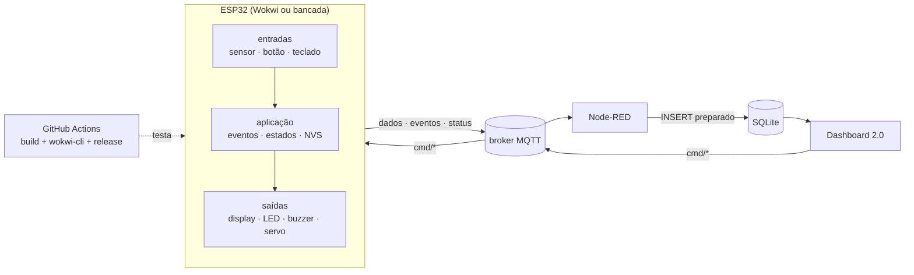
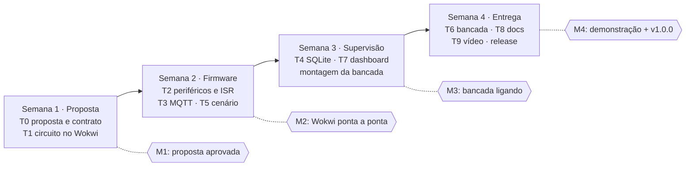

## Checklist — Projeto final {/* #checklist */}

- [ ] Proposta do projeto aprovada pelo professor, com o contrato MQTT e o roteiro de testes da bancada (T0)
- [ ] Pelo menos um dispositivo de entrada e um de saída, usados de verdade pela aplicação (T1)
- [ ] Pelo menos um periférico dedicado (ADC, PWM, timer…) **e** uma rotina de interrupção (T2)
- [ ] MQTT nos dois sentidos com o Node-RED, com LWT, seguindo o contrato (T3)
- [ ] SQLite no Node-RED com `CHECK`, INSERT preparado e consultas que respondem perguntas do projeto (T4)
- [ ] Simulação completa no Wokwi e um teste automático com o `wokwi-cli` no CI (T5)
- [ ] **Protótipo em bancada** com o mesmo firmware, passando no roteiro de testes (T6)
- [ ] Dashboard de operação no Node-RED (T7)
- [ ] Documentação no GitHub: README, contrato MQTT, pinagem, badge do CI e release (T8)
- [ ] Vídeo de apresentação de 3 a 5 minutos, com o link no README e no Moodle (T9)
- [ ] Nenhum token ou senha no repositório; nenhum `push --force`; cada tarefa num commit `Tn:`
- [ ] Logout do Git e do `gh` no computador do laboratório

:::info[Pontuação]
**T1…T9 = 100 pts**, um para um com os critérios do
[Projeto final no Moodle](https://moodle.utfpr.edu.br/mod/assign/view.php?id=1800525):
T1 10 · T2 10 · T3 10 · T4 10 · T5 10 · **T6 30** · T7 5 · T8 5 · T9 10. A T0 (proposta) não vale
pontos, mas é obrigatória: sem ela aprovada, o grupo não começa. Vale o commit `Tn:` mais recente de
cada tarefa. O autograder confere o que dá para conferir no repositório; a bancada (T6) e o vídeo
(T9) são avaliados pelo professor.
:::

<LabSetup />

### Configuração do ambiente de desenvolvimento {/* #setup */}

<DevTools />

---

No projeto final o **grupo escolhe o que construir**. Pode ser um dos temas sugeridos abaixo ou uma
ideia própria. O que é fixo é a forma: um nó IoT com ESP32 que **lê** o mundo, **age** sobre ele,
conversa por **MQTT** com o **Node-RED**, guarda o que acontece num **SQLite**, aparece num
**dashboard** e roda **duas vezes**: no **Wokwi** e numa **bancada**, com um ESP32 de verdade.

Quase nada é novo. Cada requisito é um padrão que você já praticou de um lab ao outro:

| Lab | O que entra no projeto                                                                               |
| --- | ---------------------------------------------------------------------------------------------------- |
| 01  | _issue_ → _branch_ → PR → revisão → _merge_; README com badges e Mermaid; um commit `Tn:` por tarefa |
| 02  | versões fixas, `wokwi.toml` + `diagram.json`, Docker, `wokwi-cli`, token fora do Git                 |
| 03  | logs por nível, CI compilando a cada `push`                                                          |
| 04  | Wi-Fi e MQTT robustos, broker com usuário e senha, broker local na placa física                      |
| 05  | temporizador + flag, JSON, `seq` para detectar perdas, LWT `online`/`offline`                        |
| 06  | OLED, `telaSuja`, MQTT nos dois sentidos, dashboard                                                  |
| 07  | ADC1, LEDC, modos de operação, comandos validados e confirmados                                      |
| 08  | SQLite com `CHECK`, INSERT preparado, `LAG`/`LEAD`, histórico no dashboard, retenção                 |
| 09  | ESP-IDF: task + fila de eventos, drivers com _handles_, NVS                                          |
| 10  | CI com teste no simulador, _secrets_, _release_ e badge dinâmico                                     |



:::tip[A regra de ouro do projeto]
A **decisão** mora no ESP32. Com o broker ou o Node-RED fora do ar, o dispositivo continua fazendo
o seu trabalho e se protegendo. O Node-RED registra, mostra e repassa comandos, que o ESP32 valida e
confirma.
:::

## Objetivos

- Propor um produto IoT pequeno, com escopo que caiba em quatro semanas.
- Integrar num só firmware os periféricos do semestre: entradas, saídas, **periféricos dedicados**
  e **interrupção**.
- Definir e documentar um **contrato MQTT** e respeitá-lo dos dois lados.
- Guardar, consultar e manter os dados num **SQLite** pelo Node-RED, e mostrá-los num **dashboard**.
- Levar o mesmo firmware do **simulador** para a **bancada**, trocando só a configuração de rede.
- Comunicar o projeto: **README**, **release** e um **vídeo** curto.

## Material

<Tabs groupId="alvo">
<TabItem value="wokwi" label="Wokwi" default>

- VS Code + PlatformIO + extensão **Wokwi**, como nos labs.
- Stack Docker do curso: **Node-RED** (com `node-red-node-sqlite` e o **Dashboard 2.0**) e o
  `mosquitto_sub`/`mosquitto_pub` via Docker.
- Broker alcançável pela internet: o **privado** da disciplina, com usuário e senha (Lab 04, T5).

</TabItem>
<TabItem value="bancada" label="Bancada">

- ESP32 DevKit v1 e um cabo USB **de dados** (o que só carrega não grava, Lab 02).
- Os componentes do **seu** projeto, listados na proposta (T0), com protoboard e _jumpers_.
- Rede Wi-Fi do laboratório e o **Mosquitto local** do stack Docker, no IP da sua máquina (Lab 04).

Confira **antes** da proposta se os componentes existem no laboratório ou se o grupo vai
providenciá-los.

</TabItem>
</Tabs>

:::note[Arduino ou ESP-IDF?]
Os dois são aceitos: os critérios não dependem do framework. A base recomendada é o firmware do
**Lab 09 (ESP-IDF)** ou do **Lab 08 (Arduino)**. Os trechos desta página têm as duas versões quando a
API muda.
:::

## Clonar o repositório do grupo {/* #clonar */}

<LabTeamMembers labName="projeto" />

## Envie o link do repositório do seu grupo no Moodle: {/* #moodle-link */}

<LabSubmit labName="projeto" />

## Suba os containers {/* #docker */}

<LabIotAlunoSimples
  labName="projeto"
  completo="/infra/setup/gen_iot_aluno#projeto"
/>

---

<details>
<summary><strong>Mapa de tarefas</strong> — 10 tarefas · 100 pts</summary>

- [T0 — Proposta do projeto](#t0) · 0 pts (obrigatória)
- [T1 — Dispositivos de entrada e saida](#t1) · 10 pts
- [T2 — Perifericos dedicados e interrupcao](#t2) · 10 pts
- [T3 — MQTT via Node-RED](#t3) · 10 pts
- [T4 — SQL via Node-RED](#t4) · 10 pts
- [T5 — Simulacao no Wokwi](#t5) · 10 pts
- [T6 — Prototipo em bancada](#t6) · 30 pts
- [T7 — Dashboard no Node-RED](#t7) · 5 pts
- [T8 — Documentacao no GitHub](#t8) · 5 pts
- [T9 — Video de apresentacao](#t9) · 10 pts

</details>

<FileTree
  details={true}
  defaultOpen={false}
  title="Estrutura de Arquivos do Projeto (no fim)"
  root="projeto-grupo-x"
  files={[
    "platformio.ini c",
    "wokwi.toml c",
    "diagram.json c",
    "src/main.c c",
    "src/secrets.h.example c",
    "test/cenario.yaml c",
    "nodered/flows-projeto.json c",
    "docs/proposta.md c",
    "docs/contrato-mqtt.md c",
    "docs/pinagem.md c",
    "docs/roteiro-bancada.md c",
    ".github/workflows/ci.yml c",
    "evidencias/t1-wokwi.png c",
    "evidencias/t2-medicao.png c",
    "evidencias/t2-serial.txt c",
    "evidencias/t3-mqtt.txt c",
    "evidencias/t4-consultas.txt c",
    "evidencias/t5-wokwi.txt c",
    "evidencias/t6-bancada.md c",
    "evidencias/t6-bancada.jpg c",
    "evidencias/t6-serial-bancada.txt c",
    "evidencias/t7-dashboard.png c",
    "evidencias/t9-video.md c",
    "README.md u",
  ]}
/>

## Critérios de avaliação {/* #criterios */}

Cada critério do Moodle é **uma tarefa** e **um commit** `Tn:`. As tarefas seguem a numeração dos
critérios, não a ordem de trabalho: a ordem sugerida está no [cronograma](#cronograma).

| Tarefa | Critério do Moodle                                                      | Peso     | Requisito mínimo neste projeto                                                       |
| ------ | ----------------------------------------------------------------------- | -------- | ------------------------------------------------------------------------------------ |
| T1     | 1) Dispositivo de entrada e saída (teclado, botão, sensor, LCD, OLED…)  | 10 %     | ≥ 1 entrada e ≥ 1 saída **usadas pela lógica**, não só ligadas                       |
| T2     | 2) Periférico dedicado ou rotina de interrupção (ADC, PWM, DMA, timer…) | 10 %     | ≥ 1 periférico dedicado **e** ≥ 1 interrupção (GPIO ou timer), com medição           |
| T3     | 3) MQTT via Node-RED                                                    | 10 %     | contrato escrito; dados, eventos, `status` (LWT) e ≥ 1 comando validado e confirmado |
| T4     | 4) SQL via Node-RED (SQLite)                                            | 10 %     | ≥ 2 tabelas com `CHECK`, INSERT preparado, ≥ 3 consultas úteis, retenção             |
| T5     | 5) Simulação via Wokwi                                                  | 10 %     | `diagram.json` completo, simulação ponta a ponta, cenário do `wokwi-cli` no CI       |
| T6     | 6) Bancada, protótipo operacional                                       | **30 %** | mesmo firmware num ESP32 real, roteiro de testes da proposta cumprido                |
| T7     | 7) Dashboard via Node-RED                                               | 5 %      | estado ao vivo, comandos confirmados, histórico vindo do banco                       |
| T8     | 8) Documentação no GitHub                                               | 5 %      | README, contrato, pinagem, badge do CI, release, _issues_ e PRs                      |
| T9     | 9) Vídeo de apresentação                                                | 10 %     | 3 a 5 min, com a bancada funcionando e todos os integrantes                          |

---

## Parte 0 — Proposta do projeto {/* #parte-0 */}

O grupo escolhe um tema da lista ou propõe outro, e escreve `docs/proposta.md`. A proposta é
entregue por PR, e o professor aprova (ou pede ajustes) no próprio PR.

### 0.1 Temas sugeridos

Todos usam peças que o Wokwi simula e que existem em kits comuns de ESP32.

| Tema                              | Entradas                              | Saídas                          | Periférico / interrupção             | O que o banco responde                    |
| --------------------------------- | ------------------------------------- | ------------------------------- | ------------------------------------ | ----------------------------------------- |
| Câmara climática (exemplo abaixo) | DHT22, potenciômetro, botão           | OLED, LEDs, buzzer              | ADC, LEDC, timers, ISR do botão      | tempo em cada estado, energia, alarmes    |
| Irrigação de estufa               | umidade do solo (pot), DHT22          | LED/relé da bomba, OLED         | ADC, timer, ISR de botão manual      | litros por dia, regas por turno           |
| Controle de acesso                | teclado matricial, botão              | servo da trava, LCD I2C, buzzer | PWM do servo, ISR, timer de bloqueio | acessos por usuário, tentativas inválidas |
| Estacionamento inteligente        | HC-SR04, botão                        | LEDs de vaga, OLED              | medição de pulso por timer/ISR       | ocupação por hora, tempo médio por vaga   |
| Nível de reservatório             | HC-SR04 ou pot, boia (botão)          | LED/relé da bomba, OLED         | timer, ISR da boia                   | consumo por dia, partidas da bomba        |
| Alarme residencial                | PIR, sensor de porta (botão), teclado | sirene (buzzer), LCD, LEDs      | ISR do PIR, timer de entrada         | disparos por zona, armado × desarmado     |
| Iluminação automática             | LDR, PIR                              | LED com _dimmer_, OLED          | ADC, LEDC, ISR do PIR                | horas acesas, energia economizada         |
| Contador de produção (esteira)    | sensor de barreira (botão/IR), pot    | motor de passo ou servo, OLED   | ISR de contagem, timer de cadência   | peças por minuto, paradas e duração       |

### 0.2 Modelo da proposta

```markdown title="docs/proposta.md"
# Proposta — Grupo X: <nome do projeto>

## Problema

Duas ou três frases: quem usa, o que o dispositivo resolve.

## Funcionamento

O que o ESP32 decide sozinho, em que estados ele pode estar e o que provoca cada troca
(um diagrama de estados em Mermaid ajuda).

## Hardware

| Componente | Entrada/saída | Pino | Tem no Wokwi? | Tem na bancada? |

## Periféricos e interrupção

Quais periféricos dedicados e qual interrupção, e para quê.

## Contrato MQTT (rascunho)

| Tópico | Sentido | Quando | Payload |

## Banco

Tabelas e as três perguntas que as consultas vão responder.

## Roteiro de testes da bancada

| # | Teste | Resultado esperado | (pelo menos 8 testes; veja a Parte 6)

## Divisão do trabalho

Quem é o responsável por cada tarefa (T1–T9).
```

:::warning[Escopo]
Um projeto bom é **pequeno e completo**. Prefira um dispositivo com três estados bem tratados a um
com dez estados pela metade. O professor pode pedir para cortar escopo na aprovação.
:::

<CommitPoint
  id="t0"
  task="Proposta do projeto"
  pontos={0}
  files="docs/proposta.md"
/>

---

## Parte 1 — Dispositivos de entrada e saída {/* #parte-1 */}

Monte o circuito no `diagram.json` e documente a pinagem em `docs/pinagem.md`:

| Dispositivo | Tipo (entrada/saída) | Pino(s) ESP32 | Para quê na aplicação |
| ----------- | -------------------- | ------------- | --------------------- |
| …           | …                    | …             | …                     |

Cuidados que valem para qualquer projeto:

- **ADC2 não funciona com o Wi-Fi ligado.** Sinal analógico vai num pino do **ADC1**
  (GPIOs 32–39, Lab 07).
- GPIOs 34–39 são **somente entrada**, sem _pull-up_ interno.
- Sensores e displays em **3V3**: o GPIO do ESP32 não tolera 5 V. Módulos de 5 V (HC-SR04, alguns
  relés) precisam de divisor ou de um nível lógico adequado no sinal que volta para o ESP32.
- Servo, relé e motor **não** se alimentam do pino do ESP32: use a fonte certa e GND comum.

Valide o diagrama com o `wokwi-cli lint .` na imagem Docker do Lab 02 (como no Lab 04, 1.3).

**Evidências:** `diagram.json`, `docs/pinagem.md` e `evidencias/t1-wokwi.png`, uma captura do Wokwi
com todas as entradas e saídas à vista.

<CommitPoint
  id="t1"
  task="Dispositivos de entrada e saida"
  pontos={10}
  files="diagram.json docs/pinagem.md evidencias/t1-wokwi.png"
/>

---

## Parte 2 — Periféricos dedicados e interrupção {/* #parte-2 */}

O critério pede um periférico dedicado **ou** uma interrupção; o projeto pede os **dois**, porque um
produto IoT sempre tem os dois. Exemplos do semestre:

| Periférico / recurso       | Exemplo de uso                                  | Lab de origem |
| -------------------------- | ----------------------------------------------- | ------------- |
| **ADC1** (oneshot)         | potenciômetro, LDR, umidade do solo             | 07, 09        |
| **LEDC** (PWM)             | brilho de LED, ventoinha, buzzer, servo (50 Hz) | 07, 09        |
| **`esp_timer`** / `Ticker` | leituras periódicas, _timeouts_, cadência       | 05, 09        |
| **GPIO ISR**               | botão, PIR, barreira, contagem de pulsos        | novo          |
| **I2C master**             | OLED, LCD, sensores I2C                         | 06, 09        |
| **NVS**                    | configuração que sobrevive ao _reset_           | 09            |

:::warning[Um timer LEDC por frequência]
Dois canais LEDC no mesmo timer têm a **mesma** frequência. Um buzzer a 2 kHz e um servo a 50 Hz
precisam de timers diferentes (Lab 07, nota "Canal e timer").
:::

### 2.1 Interrupção de GPIO

A ISR só avisa e volta: põe um evento na fila (ESP-IDF) ou levanta uma flag (Arduino). O _debounce_
e todo o resto acontecem fora dela.

<Tabs groupId="framework">
<TabItem value="idf" label="ESP-IDF" default>

```c title="src/main.c (trechos)"
#include "driver/gpio.h"
#define BOTAO_PIN GPIO_NUM_4

static void IRAM_ATTR isr_botao(void *arg) {
    evento_t ev = { .tipo = EV_BOTAO };
    BaseType_t acordou = pdFALSE;
    xQueueSendFromISR(fila, &ev, &acordou);   // nada de log, printf ou MQTT aqui
    portYIELD_FROM_ISR(acordou);
}

static void botao_iniciar(void) {
    gpio_config_t cfg = {
        .pin_bit_mask = 1ULL << BOTAO_PIN,
        .mode = GPIO_MODE_INPUT,
        .pull_up_en = GPIO_PULLUP_ENABLE,
        .intr_type = GPIO_INTR_NEGEDGE,         // apertar = 3,3 V -> 0 V
    };
    gpio_config(&cfg);
    gpio_install_isr_service(0);
    gpio_isr_handler_add(BOTAO_PIN, isr_botao, NULL);
}

// na task app, no case EV_BOTAO:
//   int64_t agora = esp_timer_get_time();
//   if (agora - ultimo_botao < 50000) break;   // debounce de 50 ms
//   ultimo_botao = agora;
//   ... a ação do botão
```

</TabItem>
<TabItem value="arduino" label="Arduino">

```cpp title="src/main.cpp (trechos)"
#define BOTAO_PIN 4
volatile bool botaoPendente = false;

void IRAM_ATTR isrBotao() { botaoPendente = true; }   // só a flag

// em setup():
//   pinMode(BOTAO_PIN, INPUT_PULLUP);
//   attachInterrupt(digitalPinToInterrupt(BOTAO_PIN), isrBotao, FALLING);
//
// no loop():
//   static unsigned long ultimo = 0;
//   if (botaoPendente) {
//     botaoPendente = false;
//     if (millis() - ultimo >= 50) { ultimo = millis(); /* a ação do botão */ }
//   }
```

</TabItem>
</Tabs>

### 2.2 Medindo

Mostre que o periférico faz o que você diz: o **analisador lógico** do Wokwi (`wokwi.vcd` no Surfer
ou no PulseView, Lab 07) para PWM e pulsos, ou o serial com os valores do ADC de ponta a ponta.

**Evidências:** `evidencias/t2-medicao.png` (analisador lógico ou gráfico, com a medição anotada) e
`evidencias/t2-serial.txt` com a interrupção agindo.

<CommitPoint
  id="t2"
  task="Perifericos dedicados e interrupcao"
  pontos={10}
  files="src/ evidencias/t2-medicao.png evidencias/t2-serial.txt"
/>

---

## Parte 3 — MQTT via Node-RED {/* #parte-3 */}

Tudo fica sob `elt73a/projeto/grupo-x/`. Troque o `x` (e o `#define GRUPO`) pela letra do seu
grupo. O contrato vai para `docs/contrato-mqtt.md` e só muda por PR revisado. Ele precisa ter, no
mínimo, estas **categorias** de tópico:

| Categoria | Tópico (exemplo) | Sentido        | Regra                                                                     |
| --------- | ---------------- | -------------- | ------------------------------------------------------------------------- |
| Dados     | `.../dados`      | ESP32 → broker | periódico, JSON com `seq` e `uptime_ms` (Lab 05)                          |
| Eventos   | `.../estado`     | ESP32 → broker | **só quando muda**: modo, estado, atuadores (Lab 07)                      |
| Status    | `.../status`     | ESP32 → broker | LWT `offline` e `online`, ambos **retidos** (Lab 05)                      |
| Comandos  | `.../cmd/<nome>` | broker → ESP32 | faixa válida documentada; inválido é recusado e **não** gera `.../estado` |

1. **Firmware:** assina `cmd/#` a cada conexão (sessão limpa), publica `online` retido, deixa o LWT.
2. **Node-RED:** um `mqtt in` por tópico (_a parsed JSON object_, `status` como _a String_) e um
   `mqtt out` de tópico vazio para os comandos, que usam o `msg.topic` de cada widget.
3. **Confirmação, não eco:** o que o dashboard mostra vem do ESP32, nunca do último clique.

<GroupCommands
  commands={[
    {
      title: "1. Assinar todos os tópicos do grupo",
      codeTitle: "Terminal 1 — assinar via Docker",
      command: `docker run --rm --init -v "%cd%\\evidencias:/ev" eclipse-mosquitto:2 sh -c "mosquitto_sub -h broker.hivemq.com -t '{course}/projeto/grupo-{group}/#' -v | tee /ev/t3-mqtt.txt"`,
    },
    {
      title: "2. Mandar um comando",
      codeTitle: "Terminal 2 — comandar via Docker",
      command: `docker run --rm eclipse-mosquitto:2 mosquitto_pub -h broker.hivemq.com -t {course}/projeto/grupo-{group}/cmd/modo -m auto`,
    },
  ]}
/>

:::note[Broker com senha e broker local]
Os comandos acima usam o broker público para caber na linha. Com o broker privado, acrescente
`-u <usuario> -P <senha>` digitados na hora, nunca num arquivo do repositório. Na bancada, troque o
`-h` pelo IP da máquina do Mosquitto local.
:::

**Evidência:** `evidencias/t3-mqtt.txt` com dados chegando, um comando válido confirmado, um comando
inválido recusado e o `offline` do LWT ao parar a simulação.

<CommitPoint
  id="t3"
  task="MQTT via Node-RED"
  pontos={10}
  files="docs/contrato-mqtt.md src/ evidencias/t3-mqtt.txt"
/>

---

## Parte 4 — SQL via Node-RED (SQLite) {/* #parte-4 */}

O banco `/data/sqlite/projeto.sqlite` segue o Lab 08: modo _Batch_ para o esquema, _Prepared
Statement_ para tudo o que vem de fora, `catch` nos erros.

Requisitos:

1. **≥ 2 tabelas** do seu domínio, com `NOT NULL` e `CHECK` nas faixas e nos valores válidos, e
   `recebido_em` preenchido pelo banco. Uma delas guarda **dados periódicos** e a outra **eventos**.
2. A tabela **`status`** abaixo, igual para todos os grupos.
3. **≥ 3 consultas** que respondem perguntas **do projeto** (as da proposta), e pelo menos uma usa
   `GROUP BY` e uma usa `LAG()` ou `LEAD()`.
4. **Manutenção:** índice em `recebido_em` e retenção do detalhe numa transação (Lab 08, T6).

```sql title="Tabela comum a todos os grupos"
CREATE TABLE IF NOT EXISTS status (
    id          INTEGER PRIMARY KEY AUTOINCREMENT,
    recebido_em TEXT NOT NULL DEFAULT (strftime('%Y-%m-%d %H:%M:%f', 'now', 'localtime')),
    valor       TEXT NOT NULL CHECK (valor IN ('online', 'offline'))
);
```

```sql title="Disponibilidade do nó (LEAD)"
SELECT ROUND(100.0 * SUM(CASE WHEN valor = 'online' THEN dt_s ELSE 0 END) / SUM(dt_s), 1) AS disponibilidade_pct
FROM (SELECT valor, (julianday(LEAD(recebido_em, 1, strftime('%Y-%m-%d %H:%M:%f', 'now', 'localtime'))
             OVER (ORDER BY id)) - julianday(recebido_em)) * 86400 AS dt_s FROM status);
```

:::tip[Perguntas que valem uma consulta]
"Quanto tempo ficou em cada estado?" (`LEAD`, Lab 08) · "Alguma leitura se perdeu?" (`LAG` no `seq`)
· "Quantos eventos por hora?" (`GROUP BY substr(recebido_em, 1, 13)`) · "Quanto tempo entre o alarme
e o reconhecimento?" (`LEAD` na tabela de eventos). Uma consulta que só lista as últimas linhas não
conta como uma das três.
:::

**Evidência:** `evidencias/t4-consultas.txt` com a saída de "Ver esquema" e de cada consulta,
precedida da pergunta que ela responde, e o fluxo em `nodered/flows-projeto.json`.

<CommitPoint
  id="t4"
  task="SQL via Node-RED"
  pontos={10}
  files="nodered/flows-projeto.json evidencias/t4-consultas.txt"
/>

---

## Parte 5 — Simulação no Wokwi {/* #parte-5 */}

A simulação precisa rodar **ponta a ponta**: Wokwi → broker → Node-RED → SQLite → dashboard, e os
comandos de volta. E precisa de um **teste automático**: um cenário do `wokwi-cli` (Labs 02 e 10)
que mexe numa entrada e espera a reação certa no serial.

```yaml title="test/cenario.yaml (exemplo: ajuste ao seu projeto)"
name: Botao muda o estado
version: 1
author: grupo-x

steps:
  - wait-serial: "conectado"
  - set-control:
      part-id: btn1
      control: pressed
      value: 1
  - delay: 100ms
  - set-control:
      part-id: btn1
      control: pressed
      value: 0
  - wait-serial: '"estado":"ATIVO"'
```

```yaml title=".github/workflows/ci.yml (job novo)"
simula:
  runs-on: ubuntu-latest
  steps:
    - uses: actions/checkout@v7
    - uses: actions/setup-python@v7
      with:
        python-version: "3.12"
    - name: Gera o secrets.h a partir dos secrets do GitHub
      run: cp src/secrets.h.example src/secrets.h # ajuste: preencha com ${{ secrets.MQTT_USER }} etc.
    - name: Compila o firmware do Wokwi
      run: |
        pip install "platformio==${PLATFORMIO_VERSAO}"
        pio run -e esp32dev
    - name: Wokwi
      uses: wokwi/wokwi-ci-action@v1
      with:
        token: ${{ secrets.WOKWI_CLI_TOKEN }}
        timeout: 60000
        scenario: test/cenario.yaml
```

:::warning[Segredos no CI]
O token do Wokwi e as credenciais do broker vão para **Settings → Secrets and variables → Actions**.
O `src/secrets.h` é **gerado** no job a partir deles e nunca entra num commit (Lab 02, T5).
:::

**Evidência:** `evidencias/t5-wokwi.txt` com a saída do cenário terminando em sucesso, e a execução
verde na aba **Actions**.

<CommitPoint
  id="t5"
  task="Simulacao no Wokwi"
  pontos={10}
  files="test/cenario.yaml .github/workflows/ci.yml evidencias/t5-wokwi.txt"
/>

---

## Parte 6 — Protótipo em bancada {/* #parte-6 */}

Este é o critério de maior peso (**30 %**). O protótipo precisa ser **operacional**: o mesmo
firmware da T5, montado num ESP32 real, cumprindo o roteiro de testes da proposta na frente do
professor e no vídeo.

### 6.1 Dois ambientes, um código

<FileTree
  root="projeto-grupo-x"
  files={["platformio.ini u", "src/secrets.h.example c"]}
/>

```ini title="platformio.ini"
[env]
platform = espressif32@6.9.0
board = esp32dev
framework = espidf                 ; ou arduino
monitor_speed = 115200

[env:esp32dev]                     ; Wokwi (o wokwi.toml aponta para .pio/build/esp32dev/)
build_flags = -DALVO_WOKWI

[env:bancada]                      ; ESP32 real
build_flags = -DALVO_BANCADA
```

```c title="src/secrets.h.example (copie para src/secrets.h e preencha)"
#pragma once
#if defined(ALVO_BANCADA)
  #define WIFI_SSID   "IoT-Broker"
  #define WIFI_SENHA  "********"
  #define MQTT_HOST   "192.168.0.10"            // IP da máquina do Mosquitto local
  #define MQTT_USER   ""
  #define MQTT_PASS   ""
#else
  #define WIFI_SSID   "Wokwi-GUEST"
  #define WIFI_SENHA  ""
  #define MQTT_HOST   "mqtt.adrianoruseler.com"
  #define MQTT_USER   "seu_usuario"
  #define MQTT_PASS   "sua_senha"
#endif
#define MQTT_PORTA  1883
```

```shell title="Terminal do VS Code (cmd)"
pio run -e bancada -t upload
pio device monitor
```

No Node-RED, os nós MQTT passam a usar o Mosquitto local. O fluxo é o mesmo.

### 6.2 Montagem

- Ligue **primeiro** sem o ESP32 no USB e confira cada fio contra o `docs/pinagem.md`.
- Tire uma foto da montagem **funcionando**: ela vai para a evidência e para o vídeo.
- Display I2C não aparece? Rode um _scanner_ I2C e confira o endereço (`0x3C`/`0x3D` nos OLED,
  `0x27`/`0x3F` nos LCD com PCF8574).
- Nada de carga ligada à rede elétrica (127/220 V) na bancada: relés acionam LEDs ou cargas de
  baixa tensão.

### 6.3 Roteiro de testes

O roteiro é do **grupo**, escrito na proposta em `docs/roteiro-bancada.md`. Ele precisa de
**pelo menos 8 testes** e cobrir, no mínimo:

| Deve testar                                     | Exemplo (na câmara climática)                                     |
| ----------------------------------------------- | ----------------------------------------------------------------- |
| Boot, Wi-Fi do laboratório e `online` no broker | IP no serial; `online` retido no Mosquitto local                  |
| Cada entrada mudando o comportamento            | o potenciômetro muda o setpoint de 20 a 55 °C no OLED             |
| Cada saída comandada                            | o LED do aquecedor pisca a 5 Hz com o _duty_ pedido               |
| A interrupção                                   | o botão reconhece o alarme e o buzzer para                        |
| Um comando pelo dashboard, confirmado           | o modo muda e o dashboard mostra o modo **confirmado**            |
| Falha de rede: broker parado (`docker stop`)    | o ESP32 continua funcionando sozinho e reconecta quando ele volta |
| _Reset_ pelo botão **EN**                       | volta na configuração salva na NVS                                |
| Os dados da bancada no banco                    | as linhas aparecem no SQLite e no histórico do dashboard          |

**Evidências:** `evidencias/t6-bancada.md` (o roteiro preenchido, com o que foi visto em cada teste),
`evidencias/t6-bancada.jpg` (uma foto em que dê para seguir os fios) e
`evidencias/t6-serial-bancada.txt`. A nota da T6 sai da **demonstração na bancada**, com o professor
escolhendo testes do roteiro.

<CommitPoint
  id="t6"
  task="Prototipo em bancada"
  pontos={30}
  files="platformio.ini src/secrets.h.example docs/roteiro-bancada.md evidencias/t6-bancada.md evidencias/t6-bancada.jpg evidencias/t6-serial-bancada.txt"
/>

---

## Parte 7 — Dashboard via Node-RED {/* #parte-7 */}

Página **Projeto** (caminho `/projeto`) do `My Dashboard`, com pelo menos:

| Grupo       | Conteúdo                                                                             |
| ----------- | ------------------------------------------------------------------------------------ |
| Dispositivo | `online`/`offline`, o estado atual e os últimos dados                                |
| Comando     | os comandos do contrato, mostrando o valor **confirmado** (_pass-through_ desligado) |
| Histórico   | um gráfico vindo do **banco**, com o período escolhido por _dropdown_ (Lab 08)       |
| Indicadores | as consultas da T4 em `ui-table`                                                     |

**Evidência:** `evidencias/t7-dashboard.png`.

<CommitPoint
  id="t7"
  task="Dashboard no Node-RED"
  pontos={5}
  files="nodered/flows-projeto.json evidencias/t7-dashboard.png"
/>

---

## Parte 8 — Documentação no GitHub {/* #parte-8 */}

O repositório é a documentação. Quem nunca viu o projeto precisa conseguir montá-lo e rodá-lo só
com ele.

1. **README** com: badges (CI **dinâmico**, Lab 10), integrantes, o problema, a arquitetura e o
   diagrama de estados em Mermaid, como rodar no Wokwi e na bancada, os resultados das consultas
   com a conclusão do grupo, e as respostas P1–P5.
2. `docs/proposta.md`, `docs/contrato-mqtt.md`, `docs/pinagem.md` e `docs/roteiro-bancada.md`.
3. Uma **_issue_ por tarefa**, cada uma fechada por um PR revisado por outro integrante (Lab 01).
4. **Release** `v1.0.0` gerada por _tag_, com `firmware.bin`, `firmware.elf` e o fluxo do Node-RED.
5. O link do vídeo (T9).

<CommitPoint
  id="t8"
  task="Documentacao no GitHub"
  pontos={5}
  files="README.md docs/"
/>

---

## Parte 9 — Vídeo de apresentação {/* #parte-9 */}

**3 a 5 minutos**, com link no README e enviado no Moodle. Todos os integrantes aparecem e falam.
Um roteiro que cabe no tempo:

1. **(30 s)** O problema e a arquitetura.
2. **(90 s)** A **bancada** funcionando: as entradas mudando o comportamento, as saídas respondendo.
3. **(45 s)** Um comando pelo dashboard e a falha de rede sendo tratada.
4. **(45 s)** O banco: o histórico e o que as consultas revelaram.
5. **(30 s)** O Wokwi e o CI verde.
6. **(15 s)** O que o grupo faria diferente.

:::tip[Vídeo]
Grave a tela e a bancada (celular serve). O vídeo pode ficar não listado no YouTube ou numa pasta
compartilhada; confira se o link abre numa janela anônima antes de entregar.
:::

**Evidência:** `evidencias/t9-video.md` com o link e a lista de quem fez o quê.

<CommitPoint
  id="t9"
  task="Video de apresentacao"
  pontos={10}
  files="evidencias/t9-video.md README.md"
/>

---

## Cronograma sugerido {/* #cronograma */}

Quatro semanas, com um marco conferido em aula no fim de cada uma:



:::warning[Não deixe a bancada para o fim]
A T6 vale 30 %. Monte a bancada **na semana 3**, em paralelo com o Node-RED: um fio solto, um cabo
USB que só carrega ou um display num endereço I2C diferente custam uma aula inteira.
:::

---

## Exemplo de referência: câmara climática {/* #exemplo */}

<details>
<summary><strong>Como a câmara climática dos Labs 05–09 cumpre cada critério</strong> (clique para abrir)</summary>

A câmara é o projeto que o semestre foi construindo. Serve de exemplo do **tamanho** esperado e de
como os critérios se encaixam. O grupo pode seguir este exemplo, mas precisa acrescentar o que falta
nele (planta, alarme com botão e buzzer).

**O problema que falta resolver:** no Wokwi o LED "aquecedor" não esquenta o DHT22. A solução é uma
**planta térmica simulada** no firmware: o DHT22 mede a temperatura **ambiente**, e um modelo de
1ª ordem, integrado a cada 1 s por um `esp_timer`, calcula a temperatura **interna**:

```text title="Modelo da câmara (Euler, Δt = 1 s)"
T[k+1] = T[k] + Δt/C · ( P·aq/100 − (G0 + Gv·ve/100) · (T[k] − T_amb) )
C = 120 J/°C · P = 25 W · G0 = 0,5 W/°C · Gv = 2 W/°C   →   constante de tempo C/G0 = 240 s
```

| Critério | Na câmara climática                                                                           |
| -------- | --------------------------------------------------------------------------------------------- |
| T1       | DHT22, potenciômetro (setpoint) e botão; OLED, LEDs aquecedor/ventilador e buzzer             |
| T2       | ADC1, LEDC em três timers (5 Hz, 25 kHz, 2 kHz), `esp_timer` e ISR do botão de reconhecimento |
| T3       | `.../dht`, `.../pwm`, `.../alarme` (retido), `.../status` (LWT); `cmd/modo`, `cmd/ack`…       |
| T4       | `leituras`, `atuacao`, `alarmes`, `status`; energia por modo, trocas do aquecedor, erro × SP  |
| T5       | cenário que gira o pot e espera `AQUECENDO` e depois `ESTAVEL`                                |
| T6       | o mesmo firmware na bancada; a planta continua simulada, o DHT22 lê o ar do laboratório       |
| T7       | OLED pixel a pixel, modos, histórico T × SP, indicadores                                      |

Modos: `pot`, `remoto`, `auto` (ON/OFF com histerese de ±0,5 °C) e `pi` (Kp = 25 %/°C,
Ki = 0,25 %/(°C·s), com anti-windup). Alarme `SOBRETEMP` acima de SP + 8 °C: aquecedor a 0 %,
buzzer, e só se apaga com o botão (ou `cmd/ack`) e a temperatura de volta.

Com o mesmo modelo, 10 minutos com SP = 37,5 °C dão, como ordem de grandeza:

| Modo   | Chega a SP − 0,5 °C | Trocas do aquecedor | Erro RMS | Energia  |
| ------ | ------------------- | ------------------- | -------- | -------- |
| `auto` | ~68 s               | ~39                 | ~0,3 °C  | ~1,45 Wh |
| `pi`   | ~98 s               | 0 (~26 % contínuo)  | ~0,01 °C | ~1,45 Wh |

A energia é praticamente a mesma; o que muda é o desgaste do atuador e a qualidade da regulação.
É o tipo de conclusão que o banco deve sustentar com números.

</details>

---

## Preveja antes de rodar {/* #previsoes */}

Responda no `README.md` (T8), com exemplos do **seu** projeto:

- **P1:** que decisão o seu ESP32 toma sozinho, e o que aconteceria se ela ficasse numa _function_ do
  Node-RED e o broker caísse?
- **P2:** qual interrupção o projeto usa, e por que a ISR não pode publicar no MQTT nem escrever no
  display? O que o _debounce_ evitou na bancada?
- **P3:** quais tópicos são **retidos** e por quê? O que vê quem abre o dashboard 10 minutos depois
  de um evento?
- **P4:** qual consulta do banco revelou algo que o dashboard ao vivo não mostrava?
- **P5:** o que mudou entre o Wokwi e a bancada além da configuração de rede? Cite um problema que só
  apareceu na bancada e como o grupo o encontrou.

---

## Logout do seu ambiente dev, git e gh {/* #logout */}

<LabLogout />
